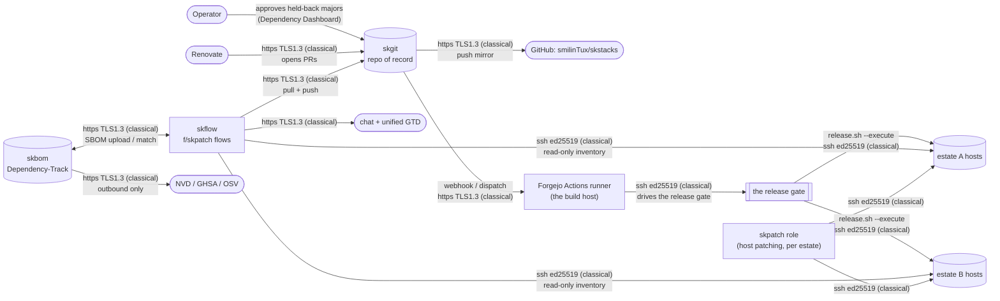
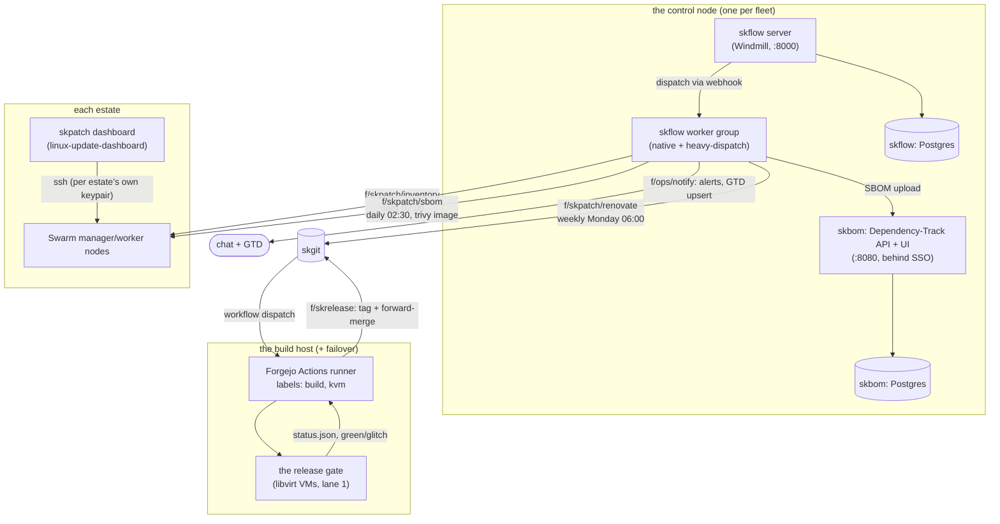
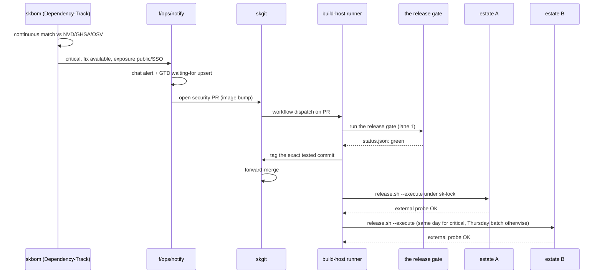

# The skpatch program: patching hosts and images across the fleet

**Status:** Active, partially shipped (see "What is live today" below). **Maturity tier:** T0 (N/A, no key material issued to other systems; see "Honest claims"). **Version phase:** framework `v1` tree (per this repo's own [Versions table](../README.md#versions): "Published, one service at a time", not frozen; do not read this as the generic `VERSION_LIFECYCLE` "Legacy" phase, which does not apply to how this repo names its trees).

`skpatch` is the name for the whole patching program, not just the one
Ansible role. It has two halves that both answer the same question,
"is everything we run current and free of a known fix-available CVE,
and if not, how fast does that get closed", for two different kinds of
thing: **hosts** (Linux packages, via the `skpatch` role, already
deployed) and **container images** (via a scan-and-automate pipeline that
is partly built: `renovate.json` exists, the rest is landing in phases).

## Start here

- **What this is, in two sentences.** A fixed-cadence pipeline that
  inventories every container image an estate runs, scans it for known
  vulnerabilities, opens the dependency bumps that close them, and gates
  every bump through the same release process as a hand-written change.
  It sits alongside the existing `skpatch` role, which does the
  equivalent job for host-level Linux packages over SSH.
- **Key entry points:**
  - [`v1/ansible/optional/skpatch/README.md`](../v1/ansible/optional/skpatch/README.md):
    the host-patching role, deploy, provisioning, the sudoers allowlist.
  - [`v1/ansible/optional/skpatch/SOP.md`](../v1/ansible/optional/skpatch/SOP.md):
    that role's own operating procedures (build, test, deploy, troubleshoot).
  - [`renovate.json`](../renovate.json): the dependency-bump automation
    for both v1 and v2 image references; see
    [`docs/dependency-updates.md`](./dependency-updates.md) for what it
    watches and how a bump ships today.
  - `.github/workflows/skred-scan.yml`: the existing nightly source
    scanner (gitleaks, trivy, semgrep against the repo's own source) and
    the estate denylist gate. This program adds **image** scanning on
    top of it, not a replacement for it.
  - `f/skpatch`: the planned Windmill (`skflow`) folder that will hold
    the inventory, SBOM-upload and Renovate-trigger flows. Not yet
    deployed; see "What is live today".
- **The data it owns.** A per-estate image inventory (service, image,
  tag, digest, exposure class), kept in that estate's own **instance**
  repo (never this framework repo; this repo has no estate data). The
  CVE register itself lives in Dependency-Track (`skbom`), not as a
  hand-kept file in any repo, once phase 4 below ships.
- **External dependencies & integration points.** Upstream registries
  (Docker Hub, GHCR, lscr.io, quay.io, read-only, anonymous pulls where
  possible), the estate's own `skgit` instance (repo of record for
  automation, pull-mirrored to the public GitHub repo), Dependency-Track's
  own NVD/GHSA/OSV feeds, and the estate's own notification channels
  (chat plus the unified GTD) via `f/ops/notify`.
- **Maturity tier.** `T0, N/A (no key material)`. This program does not
  generate, exchange, sign or store cryptographic key material of its
  own; it moves operational data (image refs, scan results, SSH sessions)
  over standard transports. See the data-flow diagram below for the
  honest per-hop posture of those transports: none of them is claimed
  as post-quantum anywhere in this document.

## 1. What problem this solves

Every container image a fleet runs is a moving target: a pin that was
correct the day it was written drifts out from under it as upstream
ships new releases and CVEs land against the base OS packages inside the
image. Before this program, there was no running scanner anywhere in the
fleet, `renovate.json` existed but had never executed, and the only CVE
tracking was a hand-maintained register (see "What this replaces" below)
that could only ever be as current as the last person who updated it by
hand.

The goal: every image is pinned, inventoried, scanned on a fixed
schedule, and the fix lands on a cadence set by how exposed and how
severe the finding is (critical and reachable gets same day, everything
else gets a weekly or monthly batch), with nothing skipping the normal
release gate except the one documented same-day lane.

## 2. Components

| Component | Role | Status |
|---|---|---|
| `skpatch` (Ansible role) | Host-level Linux package updates over SSH, report-only by default (see its own [README](../v1/ansible/optional/skpatch/README.md)). | **Live:** deployed per-estate already. |
| `renovate.json` (this repo) | Detects outdated/vulnerable image pins across `v1/**/*.j2` and `v2/**/*.yaml`, opens grouped PRs. | **Live config, not yet running:** no scheduler has executed it (see [`docs/dependency-updates.md`](./dependency-updates.md) "Turning it on"). |
| `skred-scan` (`.github/workflows/skred-scan.yml`) | Nightly source-code scan (gitleaks, trivy, semgrep) plus the estate denylist gate. Scans repo **source**, not running images. | **Live.** |
| `skbom` | Dependency-Track (vulnerability register, matched continuously against NVD/GHSA/OSV) plus a daily Trivy SBOM job that feeds it. Lives behind SSO with a portal tile. | **Planned.** Not yet a role in this framework; stood up per-estate as its own service. |
| `skflow` `f/skpatch` folder | Windmill flows: `inventory` (daily per-estate image inventory over SSH, read-only), `sbom` (Trivy scan plus Dependency-Track upload), `renovate` (weekly Renovate run against the estate's `skgit`). | **Planned.** `skflow` itself is an existing optional role in this catalog; the `skpatch`-specific flows inside it are new. |
| `skflow` `f/skrelease` folder | Tag the exact tested commit, forward-merge, bump the instance repo's pin, deploy estate A then estate B. | **Planned.** |
| `skflow` `f/ops` folder | Fan out alerts (chat, unified GTD) for anything the policy table below raises. | **Planned.** |
| Forgejo Actions runner (the build host) | Runs the release gate and CI dispatch close to where the heavy work (image builds, the gate's own VMs) actually happens, instead of over a slower path. | **Planned**, spike in progress. |

## 3. Architecture

### 3.1 System context: who talks to this

### 3.2 Component view: the moving parts

### 3.3 Data-flow: what moves, transformed how, protected by what

```mermaid
flowchart LR
    A["Image ref + digest<br/>(public, on each estate's hosts)"]
      -->|"docker service ls/inspect<br/>ssh ed25519 (classical), read-only"| B["skflow inventory flow<br/>(in-memory row)"]
    B -->|"commit<br/>https TLS1.3 (classical)"| C[("instance repo:<br/>inventory/&lt;estate&gt;.yaml")]
    B -->|"webdav PUT<br/>https TLS1.3 (classical)"| D[("skhub:<br/>Security/Inventory/&lt;estate&gt;.md")]
    A -->|"trivy image --format cyclonedx<br/>https TLS1.3 (classical), registry pull"| E["SBOM<br/>(CycloneDX JSON, internal)"]
    E -->|"upload<br/>internal overlay (plaintext)"| F[("skbom: Dependency-Track project<br/>&lt;estate&gt;/&lt;service&gt;@&lt;digest&gt;")]
    F -->|"continuous match<br/>https TLS1.3 (classical), outbound"| G([NVD / GHSA / OSV])
    G -->|"finding<br/>internal overlay (plaintext)"| H["policy evaluation<br/>(critical/high/exposure lanes)"]
    H -->|"alert<br/>https TLS1.3 (classical)"| I([chat: Telegram / Talk])
    H -->|"upsert<br/>internal overlay (plaintext)"| J[("unified GTD")]
    H -->|"security PR<br/>https TLS1.3 (classical)"| K[("skgit: PR against main")]
    K -->|"webhook dispatch<br/>https TLS1.3 (classical)"| L["the build host:<br/>Forgejo Actions runner"]
    L -->|"ssh ed25519 (classical)"| M[["the release gate"]]
    M -->|"ssh ed25519 (classical)<br/>release.sh --execute"| N[("estate A, then estate B")]
```

> Legend: no hop in this program is hybrid-pq or even classical-asymmetric
> beyond standard TLS 1.3 and SSH ed25519; this is an operational
> pipeline, not a crypto component. "internal overlay (plaintext)" marks
> traffic that stays inside a cluster's own Docker overlay network, which
> this program does not itself encrypt (the network's own encryption
> setting, if any, is out of this program's scope to change). Nothing
> here is described as quantum-resistant or post-quantum; everything is
> classical, and that is an accurate, not aspirational, label.

### 3.4 Sequence: the same-day critical lane

## 4. Cadence and policy

| Finding | Lane |
|---|---|
| Critical, fix available, service public or SSO-gated | Same day: security PR, gate, estate A deploy, estate B deploy. An image-only tactical update is allowed with the gate trailing, when the alternative is staying exposed. |
| Critical, no fix available | Alert, GTD waiting-for, re-checked daily; mitigation is a human decision. |
| High, fix available | Weekly batch (Monday PRs, mid-week estate A, end-of-week estate B). |
| Upstream rebuild on the same tag (new digest, no CVE fix implied) | Weekly batch, digest bumps grouped per service. |
| Everything else | Monthly review from the `skbom` dashboard. |
| Host packages | The `skpatch` role (report-only by default) plus unattended security upgrades on every node. |

Honest limit: the release gate takes on the order of hours on today's
gate host, so "same day" means same day, not same hour. Shortening that
is the point of moving the gate to a dedicated build host; until that
lands, "same day" is bounded by however long the gate actually takes to
run.

## 5. Release path

1. A change (a Renovate PR, a security PR, or a hand-written change) opens
   against `main` on the repo of record (`skgit`, pull-mirrored to the
   public GitHub repo so the public copy stays current).
2. The build host's Forgejo Actions runner picks up the gate dispatch.
   The existing glitch rule applies: a stage that fails may be resumed
   only if it then passes with no code change; otherwise it reruns in
   full. `status.json` is the gate's own report.
3. On green, the **exact tested commit** is tagged, never a later commit
   on the same branch, and forward-merged.
4. The instance repo (per estate) bumps its pinned `framework/` submodule
   to the new tag.
5. Deploy estate A first (fresh dump, snapshot, image-pinned update,
   `UpdateStatus.State == completed`, external probe, auto-rollback on
   failure), then estate B in its own deploy window; same day only for
   the critical lane above, otherwise the next scheduled window.

## 6. What this replaces

Before this program, the only running CVE tracking was a hand-rolled,
unmerged monitor (source-controlled as a single large PR, never merged):
a live inventory script, upstream-version/rebuild detection, a hand-kept
CVE register file, and a notify path. Its core problem was structural,
not a bug: a hand-kept register can only ever be as current as the last
person who updated it, and it duplicates exactly what a real
vulnerability-matching engine (Dependency-Track, continuously reconciled
against NVD/GHSA/OSV) already does better.

What is kept, refactored into the `skflow` `f/skpatch` flows: the
inventory logic, the Traefik-label exposure classifier, the notify path,
the PHP-runtime version probe, and the in-image runtime floor table
(these do not require a human to keep current the way a CVE register
does; they describe this framework's own services, not the outside
world's vulnerability feed).

What is retired outright: the hand-kept vulnerability register itself,
the upstream-version/rebuild detector (Renovate already does this,
correctly, as its whole job), and the register-rendering script. None of
these functions disappear; they move to tools built to do them
continuously instead of by hand.

## 7. What is live today vs planned (checked 2026-11-06)

So this document does not overstate anything it links to:

- **Live:** the `skpatch` role (host patching), `renovate.json` (config
  only, see below), the `skred-scan` nightly source scan and estate
  denylist gate.
- **Configured but not yet executing:** `renovate.json` is correct and
  committed, but no scheduler has run it yet; it has opened zero PRs.
  See [`docs/dependency-updates.md`](./dependency-updates.md) "Turning it
  on" for the two ways to activate it.
- **Not yet built:** `skbom` (Dependency-Track plus the Trivy SBOM flow), the
  `skflow` `f/skpatch`/`f/skrelease`/`f/ops` flows, and the dedicated
  Forgejo Actions runner on a build host. These ship in phases, each
  behind its own release-gated PR; this document describes the target
  shape so each phase lands against an agreed design rather than an ad
  hoc one.

## Related projects / See also

- ⬆️ **Depends on:** [skgit](https://github.com/smilinTux/skstacks/blob/main/docs/v1-service-catalog.md#skgit), the repo-of-record and CI dispatch target for every bump this program opens.
- ⬆️ **Depends on:** [skflow](https://github.com/smilinTux/skstacks/blob/main/docs/v1-service-catalog.md#skflow), the Windmill engine the `f/skpatch`/`f/skrelease`/`f/ops` flows run on.
- ↔️ **Sibling:** the `skpatch` role itself: [README](../v1/ansible/optional/skpatch/README.md) · [SOP](../v1/ansible/optional/skpatch/SOP.md).
- 📐 **Standards:** [sk-standards](https://github.com/smilinTux/sk-standards), the doc/SOP, architecture & data-flow, and cryptography standards this document follows.
