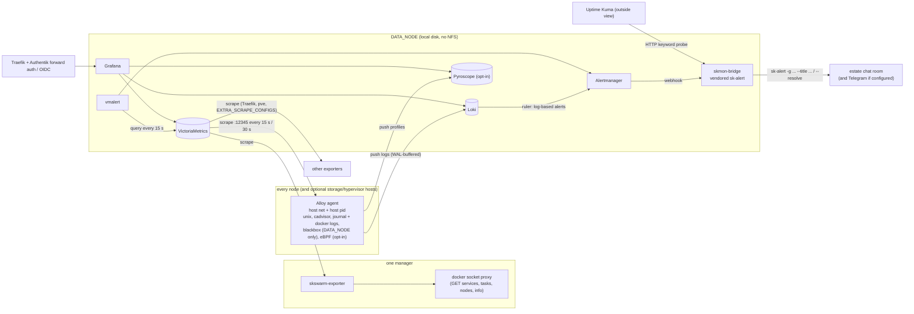

# skmon v2: observability that works out of the box and alerts in under a minute

- Status: design only. Nothing in this document is built yet.
- Date: 2026-11-11
- Role: `v1/ansible/optional/skmon`
- Supersedes: the component list in PR #368 (see section 15). It keeps #368's direction.
- Estate-specific placement and sizing are deliberately **not** in this file. Each instance
  keeps its own note next to its own vault.

Who decided what is marked like this, everywhere in the document:

- **[Chef]**: decided by Chef, the project owner. Not open to change by the builder.
- **[orchestrator]**: the orchestrating agent's call. Open to change, but change it in this
  document first, with the reason.
- **[design]**: settled while writing this design. Open to change on the same terms.
- **[builder]**: deliberately left to whoever builds it.

## 1. Intent and why

Chef asked for four things: metrics out of the box, an `sk-alert` when a service, a swarm
node or a server is down, a way to look inside a single Docker container (its resource use
and where its CPU goes), and best-practice Grafana dashboards. All of it without bogging the
cluster down.

Today's skmon does not deliver that. It ships Prometheus, Grafana, Loki, node-exporter,
cAdvisor, Alertmanager and (before #368) Jaeger and Promtail, but:

- **Alertmanager has no receiver.** `alertmanager-config.yml.j2` routes everything to a
  placeholder with no channel, and there are no alert rules at all. skmon can never tell
  anyone anything.
- **Everything lives on shared storage.** TSDB, Loki chunks, Grafana's database and every
  config file are bind mounts under `/var/data`, which on a typical swarm is one NFS export.
  When that export stalls, the monitoring stalls with it, so the failure that most needs an
  alert is the one that silences the alerter.
- **node-exporter runs on the overlay network**, so its network counters describe the
  container, not the host.
- cAdvisor runs with its defaults, which include per-container disk usage walks. That is one
  of the most expensive things a monitoring agent can do on an overlay2 host.
- The bundled dashboards do not include Node Exporter Full, a per-container view, ZFS or
  Proxmox.

The incident that sets the bar: on 2026-11-11 a single USB SSD behind one estate's NFS
export dropped. ZFS suspended the pool, every NFS client went into hard-mount retry, tasks
piled up in `Preparing`, processes sat in uninterruptible sleep (D state), and the whole
swarm hung for 1 hour 40 minutes. Nobody was alerted. **skmon v2 must alert on that class
of failure within 60 seconds, on any estate, and must keep working while it is happening.**

## 2. Goals

1. **Out of the box.** Deploying skmon with an empty `EXTRA_*` config gives host, container,
   swarm, storage, edge (Traefik) and certificate metrics, the curated alert set, routing to
   `sk-alert`, and the dashboards, with no hand edits.
2. **Storage failure alerted in 60 s or less** (ZFS pool not online, NFS mount unresponsive,
   NFS major timeouts, D-state pile-up, IO pressure, tasks stuck in `Preparing`), and the
   alert path keeps working while shared storage is stalled.
3. **Node and server down alerted in 90 s or less**, service-below-replicas in about 2.5
   minutes (it needs a longer window to ride out normal rolling updates).
4. **Look inside a container**: per-container CPU, throttling, memory working set against
   its limit, OOM kills, restarts, network and block IO, with its logs one click away and,
   on hosts that opt in, a continuous CPU flame graph of the processes inside it.
5. **One agent per node** (Grafana Alloy) instead of node-exporter, cAdvisor and Promtail.
6. **Light**: a budget per component (section 13), enforced by a gate stage.
7. **Self-contained per estate**: one deployment monitors one estate, stores its data inside
   that estate, and alerts into that estate's own `sk-alert` routing.
8. **One message per incident**, not fifty: an NFS stall that takes down twenty services must
   reach a human as one storage alert, not twenty-one.

## 3. Non-goals

- Distributed tracing. Jaeger is retired and nothing replaces it here.
- Monitoring more than one estate from one deployment, or any federation between estates.
- High availability of the monitoring stack itself (single-node VictoriaMetrics and Loki).
  The dead-man's switch in section 9.5 covers "the monitor is down".
- Application-level business metrics. Roles that export metrics can be scraped through
  `EXTRA_SCRAPE_CONFIGS`; writing exporters for applications is not part of this work.
- Replacing `skhealth`. It stays as the independent, swarm-free backstop (section 9.6).
- A v2 (k8s) implementation. `v2/compute/skmon` is out of scope; this is the v1 Ansible role.

## 4. Anti-goals (things this must never become)

- **An alerter that dies with the thing it watches.** Nothing on the alert path (agent,
  metric store, rule evaluator, Alertmanager, bridge) may read its config from, or write its
  data to, shared storage.
- **A cross-estate data path.** No estate's metrics, logs, profiles or alerts may be stored on,
  or routed through, another estate. Remote write, federation and shared Grafana instances
  between estates are out.
- **A resource hog.** No "collect everything" defaults: every collector that is not on the
  list in section 7.1 is off, and high-cardinality labels are dropped at the agent.
- **An alert firehose.** No rule ships without a `for:` window, a severity, a runbook line and
  a place in the inhibition tree.
- **A second auth system.** No Grafana local users for people, no basic-auth prompts. Access
  is Authentik.
- **Floating images**, or images newer than two weeks.

## 5. Constraints

- Docker Swarm, deployed by the v1 Ansible role. Traefik labels use `traefik.swarm.*` only
  (adding `traefik.docker.*` makes Traefik skip the service). No cross-cluster routing.
- Every web UI gets an Authentik portal tile with an icon, through
  `shared/tasks/authentik_portal_tile.yml`. Access mode is `admin-only` (group `skadmin`) per
  `docs/design/sso-app-access-provisioning.md` and the SSO standard it implements.
- Images pinned to an exact version that was released at least 14 days before the build.
  The framework's no-floating-tags test already enforces the "exact" half.
- The parking knob keeps working: `skmon.replicas: 0` stops every skmon workload on every
  node, including the per-node agents, and a later non-zero value brings them back with data
  intact.
- No secrets in argv (framework test). Secrets go in Docker secrets or env files.
- A change bound for a client estate gets a full tier-2 lab run first (section 16).
- The public framework carries no hostnames, IPs or estate names.
- **Estates are completely separate (owner, 2026-11-12).** Each estate's skmon stores, routes and
  shows only its own data. No metrics, logs, profiles or alert payloads cross to another estate's
  storage, Grafana or chat room, and no estate's data is stored on another estate. The one
  allowed crossing is a liveness probe of the bridge's `/healthz` from outside the failure domain
  (9.5): it carries a status code, stores nothing about the monitored estate, and sends no data in.

## 6. Decisions

| # | Decision | Who |
|---|---|---|
| D1 | Loki is the strategic log store. | [Chef] |
| D2 | The first deployment is on the client estate, and it monitors that estate only. | [Chef] |
| D3 | No data from one estate is ever stored on another. Each estate gets its own self-contained deployment; the second estate comes later. | [Chef] |
| D4 | The first estate may need a worker resized or added; assess it with real numbers (done in that estate's note). | [Chef] |
| D5 | Grafana Alloy is the one per-node agent. It replaces node-exporter, cAdvisor and Promtail: built-in unix exporter, cadvisor, Docker log shipping to Loki, blackbox probes, and the eBPF profiler. | [orchestrator] |
| D6 | VictoriaMetrics single-node is the metric store instead of Prometheus, for footprint and retention. PromQL-compatible, so community dashboards work. | [orchestrator] |
| D7 | vmalert evaluates rules, Alertmanager routes, groups and silences, and a small webhook receiver (the bridge) calls the estate's `sk-alert`. | [orchestrator] |
| D8 | Grafana Pyroscope for continuous profiling, optional per host. | [orchestrator] |
| D9 | Grafana with provisioned dashboards (section 11). | [orchestrator] |
| D10 | Retire Prometheus, node-exporter, cAdvisor, Promtail and Jaeger. | [orchestrator] |
| D11 | Uptime Kuma (skpulse) stays as the outside view. | [orchestrator] |
| D12 | The curated alert set in section 8. | [orchestrator] |
| D13 | The alert path has zero shared-storage dependency: configs as Swarm configs or node-local files, data on node-local disk of one pinned node (`DATA_NODE`). | [design] |
| D14 | The Alloy agent runs as an Ansible-managed host container on every node (host network, host PID), not as a Swarm global service. Section 7.2 has the reasons. | [design] |
| D15 | Metrics are pulled: VictoriaMetrics scrapes each node's agent, so `up` gives node-down for free. Logs are pushed by the agent to Loki. | [design] |
| D16 | Swarm desired-vs-running state comes from a tiny purpose-built exporter, `skswarm-exporter` (section 7.4). | [design] |
| D17 | Default retention: metrics 90 days, logs 30 days, profiles 14 days. | [design] |
| D18 | Scrape and evaluation interval: 15 s for host and swarm signals, 30 s for container and app metrics. | [design] |
| D19 | `skhealth` stays deployed as the independent backstop. skmon does not replace it. | [design] |
| D20 | PR #368 is folded into this work, not merged on its own (section 15). | [design] |

## 7. Architecture

### 7.1 Components

| Component | Runs as | Where | Replaces |
|---|---|---|---|
| Grafana Alloy (agent) | Host container, one per node, managed by Ansible | Every swarm node, plus optional non-swarm hosts (storage server, hypervisor) | node-exporter, cAdvisor, Promtail |
| VictoriaMetrics single-node | Swarm service, replicas 1 | `DATA_NODE` | Prometheus |
| vmalert | Swarm service, replicas 1 | `DATA_NODE` | Prometheus rule evaluation (there were no rules) |
| Alertmanager | Swarm service, replicas 1 | `DATA_NODE` | the same, now with a receiver |
| skmon-bridge | Swarm service, replicas 1 | `DATA_NODE` | nothing (new) |
| skswarm-exporter | Swarm service, replicas 1 | any manager | nothing (new) |
| Loki | Swarm service, replicas 1 | `DATA_NODE` | the same, moved to local disk |
| Grafana | Swarm service, replicas 1 | `DATA_NODE` | the same, moved to local disk |
| Pyroscope | Swarm service, replicas 0 or 1 (`PROFILING.enabled`) | `DATA_NODE` | nothing (new, optional) |
| pve exporter | Swarm service, replicas 0 or 1 (`PVE.enabled`) | any node | nothing (new, optional) |
| Jaeger | removed | | |

Collectors enabled in the agent's unix exporter: `cpu`, `diskstats`, `filesystem`,
`loadavg`, `meminfo`, `netdev`, `netstat` (filtered), `pressure`, `processes`, `stat`,
`time`, `uname`, `vmstat` (with `oom_kill`), `mountstats`, `nfs`, `zfs`, `systemd` (failed
units only), `hwmon`, `textfile`. Everything else is off.

cadvisor component settings: docker only, `housekeeping_interval` 15 s, and these metric
groups disabled: `disk` (the per-container `du` walk), `percpu`, `process`, `tcp`, `udp`,
`advtcp`, `sched`, `hugetlb`, `referenced_memory`, `cpu_topology`, `resctrl`, `memory_numa`.
Container labels are dropped except the Swarm ones, which are relabelled to `stack`,
`service`, `task_slot` and `node`.

### 7.2 Why the agent is a host container, not a Swarm global service (D14)

A Swarm service cannot use the host PID namespace and cannot run privileged. Without host
networking, the unix exporter reads the container's own network namespace, which is the
current node-exporter bug. The eBPF profiler needs host PID and either privileged mode or
`CAP_BPF`, `CAP_PERFMON` and `CAP_SYS_ADMIN`. And the agent must also run on hosts that are
not swarm members, because the storage server is often not one (in the incident above it was
not).

So the role adds one play, `agent.yml`, that runs on `skmon_agent_hosts` (default:
`swarm_managers:swarm_workers`, plus an optional `skmon_extra_hosts` group) and keeps one
container named `skmon-<env>-alloy` running with:

- `--network host --pid host --restart unless-stopped`, image pinned.
- Read-only mounts: `/proc`, `/sys`, `/` (as `/rootfs`), `/var/lib/docker/containers`,
  `/var/log`, `/run/log/journal` and `/var/log/journal`, `/var/run/docker.sock` (the cadvisor
  component needs it; the old cAdvisor mounted all of `/var/run`, so this is no new exposure).
- Config at `/etc/skmon-<env>/alloy/` and state at `/var/lib/skmon-<env>/alloy/`, both on the
  node's local disk, never under `/var/data`.
- Unprivileged by default. On hosts listed in `PROFILING.hosts`, the same container runs with
  the capabilities the profiler needs and its config gains the `pyroscope.ebpf` block. It is
  still one agent per node.
- Listens on the node's private address only (`AGENT_LISTEN_ADDR`, default the inventory
  address), port `AGENT_PORT` (default 12345). It is never published through Traefik.

**Two install modes, one config** [design, from the builder check]. Hosts that already run
Docker (every swarm node) get the container. Hosts where installing Docker is wrong (a
hypervisor, where Docker's iptables rules fight the host's own, or a storage appliance) get the
same pinned Alloy release as a binary under a systemd unit, with the same config, mounts
replaced by native paths, and the same parking behaviour. `skmon_extra_hosts` entries choose
with `agent_mode: container|systemd` (default `systemd` for extra hosts, `container` for swarm
nodes). F5 covers both pins. An extra host must be an Ansible-managed inventory host the play can
`become` on; read-only SSH in the skhealth style is not enough to install an agent.

The cost: a node added to the swarm later gets an agent on the next skmon deploy, not
automatically. The `AgentMissing` alert (section 8) catches the gap, because the scrape list
comes from the inventory and the swarm-exporter knows every node the swarm knows.

### 7.3 Data flow



Reachability: VictoriaMetrics sits on the `skmon-<env>` overlay and reaches each agent at
`<node private address>:12345` through normal container egress. Loki's push endpoint and
Pyroscope's ingest endpoint are published in `mode: host` on `DATA_NODE` only, and agents
push to `<DATA_NODE address>:<port>`. Those endpoints and the agent port must be reachable
only from the estate's own node addresses (section 17, item B4).

### 7.4 skswarm-exporter (D16)

Neither Alloy nor cAdvisor sees Swarm's desired state: they only see containers that exist on
their own node. A service whose tasks cannot start has no container to see. Two options were
weighed:

- **An existing small exporter.** Several community Swarm exporters exist, but none is in use
  in this framework, their maintenance and image cadence would become a new pinned dependency,
  and the metrics this design needs most (time a task has spent in `Preparing`, `Starting` or
  `Pending`, and Swarm API latency) are not something they are known to expose.
- **A tiny purpose-built exporter.** About 200 lines of Python standard library, delivered as a
  Swarm config on a pinned Python base image (no image build pipeline needed), polling the
  Docker API every 15 s through a read-only socket proxy restricted to `GET` on services,
  tasks, nodes and info.

**Chosen: purpose-built.** The metrics are the contract, so a builder may still swap in an
off-the-shelf exporter later if it emits the same series. The contract:

| Series | Labels | Meaning |
|---|---|---|
| `skswarm_service_replicas_desired` | `stack`, `service`, `mode` | Replicated: `Spec.Mode.Replicated.Replicas`. Global: number of eligible nodes. |
| `skswarm_service_replicas_running` | `stack`, `service` | Tasks with desired state `running` and current state `running`. |
| `skswarm_task_state_age_seconds` | `stack`, `service`, `state` | For each non-terminal state other than `running` (`new`, `pending`, `assigned`, `accepted`, `preparing`, `starting`): age of the oldest such task. Absent when there is none. |
| `skswarm_service_task_failures_total` | `stack`, `service` | Counter of tasks observed reaching `failed` or `rejected`. |
| `skswarm_node_info` | `node`, `role`, `availability`, `state`, `addr` | One per node, value 1. |
| `skswarm_api_duration_seconds` | `endpoint` | How long the last Docker API call took. |
| `skswarm_up` | | 1 when the last poll fully succeeded. |

Parked services (desired 0) produce `desired 0, running 0` and alert on nothing.

### 7.5 Storage layout

`DATA_NODE` (required when skmon is enabled, like skaegis and skhub's local-disk modes) is the
node that holds every stateful skmon service. `DATA_PATH` defaults to
`/srv/local/skmon-<env>` and must not be under `/var/data`; the deploy fails if it is, or if
`DATA_NODE` is unset. The play creates the directories on `DATA_NODE` with `delegate_to`.

| Path under `DATA_PATH` | Owner | Contents |
|---|---|---|
| `vm/` | 0:0 | VictoriaMetrics data |
| `loki/` | 10001 | Loki chunks, TSDB index, compactor, ruler |
| `grafana/` | 472 | Grafana database (sessions, user prefs, annotations) |
| `alertmanager/` | 65534 | silences and notification log |
| `bridge/` | per image | `sk-alert` de-dup state and thread table |
| `pyroscope/` | 10001 | profiles |

Configs for every Swarm service are Swarm `configs:` (stored in Raft, available while NFS is
stalled), named with a content hash so a change rolls the service. Dashboards are many and
large, so Grafana's provisioning directory is rendered into `DATA_PATH/grafana-provisioning`
instead. Grafana is not on the alert path, so a slower route is acceptable for it.

**The backing store of `DATA_NODE`'s local disk matters.** When the swarm nodes are VMs, their
"local" disks may sit on the same hypervisor pool that backs the shared export. A pool
suspension then freezes the monitor's disk too. Put `DATA_PATH` on a disk backed by a different
pool where one exists. Where none exists (a single-host estate), the outside view in 9.5 is the
only guaranteed signal for a whole-host failure, and the estate's runbook must say so.

Backups: Alertmanager silences and the Grafana database are small and worth keeping.
VictoriaMetrics and Loki data can be lost without breaking anything. Whether skbackup covers
`DATA_PATH` is left to the builder (B7).

## 8. Alert set (D12)

Every rule carries labels `severity` (`critical` or `warning`), `class` (`node`, `storage`,
`swarm`, `http`, `capacity`, `container`, `cert`, `meta`) and `estate` (from the vault), plus a
`runbook` annotation that is one plain sentence on what to check first.

| Alert | Signal (sketch) | for | Severity |
|---|---|---|---|
| `NodeDown` | `up{job="alloy-unix"} == 0` (the unix exporter job only; the cadvisor job is separate, so a wedged Docker daemon shows as `CadvisorScrapeFailing`, a warning, not as a node down that would mute the storage alerts through inhibition rule 1) | 30s | critical |
| `StorageHostStalled` | on hosts labelled `role=storage`: `node_processes_state{state="D"} > D_STATE_THRESHOLD`, or nfsd threads all busy (`nfsd` collector) | 30s | critical |
| `AuthentikDown` | probe of Authentik's own health endpoint fails | 1m | critical |
| `SwarmNodeNotReady` | `skswarm_node_info{state!="ready"}` or `availability="drain"` unexpectedly | 30s | critical |
| `AgentMissing` | a swarm node in `skswarm_node_info` with no `up{job="alloy-unix"}` series | 5m | warning |
| `ZfsPoolNotOnline` | `node_zfs_zpool_state{state!="online"} == 1` | 15s | critical |
| `NfsMountUnresponsive` | `node_filesystem_device_error{fstype=~"nfs4?"} == 1` (stat timed out after `mount_timeout` 5 s) | 15s | critical |
| `NfsMajorTimeouts` | `increase(node_mountstats_nfs_operations_major_timeouts_total[1m]) > 0` | 0s | critical |
| `DStatePileUp` | `node_processes_state{state="D"} > D_STATE_THRESHOLD` (default 10) | 30s | critical |
| `IoPressureHigh` | `rate(node_pressure_io_stalled_seconds_total[1m]) > 0.5` | 30s | warning |
| `TasksStuckPreparing` | `skswarm_task_state_age_seconds{state=~"preparing|starting|pending"} > 120` | 0s | critical |
| `SwarmApiUnresponsive` | `skswarm_up == 0` or `skswarm_api_duration_seconds > 5` | 30s | critical |
| `ServiceBelowReplicas` | `desired - running > 0` (critical when `running == 0`) | 2m | warning / critical |
| `ContainerCrashloop` | `increase(skswarm_service_task_failures_total[10m]) >= 3` | 0s | warning |
| `HttpEndpointDown` | `probe_success == 0` | 1m | critical (or the target's own label) |
| `CertExpiringSoon` | `probe_ssl_earliest_cert_expiry - time()` below 14 d (warning) or 3 d (critical) | 10m | warning / critical |
| `DiskFilling` | filesystem above 90 % (warning) or 95 % (critical), or `predict_linear` full within 24 h; inodes the same | 5m | warning / critical |
| `MemoryPressure` | `rate(node_pressure_memory_waiting_seconds_total[2m]) > 0.2` or MemAvailable below 5 % | 2m | warning |
| `OomKill` | `increase(node_vmstat_oom_kill[5m]) > 0`, labelled by container from `container_oom_events_total` where present | 0s | warning |
| `Watchdog` | `vector(1)` | | none (dead-man's switch, section 9.5) |
| `AlertDeliveryFailing` | bridge `skmon_bridge_delivery_failures_total` increasing | 5m | critical (delivered by Kuma, see 9.5) |
| `MonitorDiskFilling` | `DATA_PATH` filesystem above 85 % | 10m | warning |

**Pool state alone is not enough.** In one real incident on an estate in scope, `zpool status`
stayed healthy while nfsd was blocked inside the ZFS intent log for days, and the kernel's
hung-task warnings had been rate-limited into silence. So the client-side signals
(`NfsMountUnresponsive`, `NfsMajorTimeouts`, `DStatePileUp`) and `StorageHostStalled` are the
primary storage alerts, and `ZfsPoolNotOnline` is one more. The storage host's agent enables the
`nfsd` collector in addition to the list in 7.1.

**What `HttpEndpointDown` proves** [design, from the builder check]. Probes hit the public URL
and accept 2xx or 3xx, so for a router behind forward auth the probe proves DNS, TLS, Traefik and
the route, and stops at Authentik's redirect. Backend health is covered by Docker healthchecks
(an unhealthy task is replaced and counted by `ContainerCrashloop`) and by `ServiceBelowReplicas`.
Probes never carry credentials. A route listed in `PROBES` with `expect: 200` and a public health
path is the way to probe a backend directly.

Two log-based rules run in Loki's ruler as a second, independent signal for the same class:
kernel lines matching `nfs: server .* not responding` and ZFS lines matching
`pool .* (suspended|has encountered an uncorrectable I/O failure)`, both from the journal.

### 8.1 Timing budget for the storage class (goal 2)

Scrape 15 s + one evaluation 15 s + `for: 15s` (two consecutive evaluations) + Alertmanager
`group_wait` 5 s for `severity=critical, class=storage` + bridge and chat delivery about 2 s
gives **about 52 s worst case and about 30 s typical** for `ZfsPoolNotOnline` and
`NfsMountUnresponsive`. `NfsMajorTimeouts` has no `for:` and is faster. The node-down budget
is 15 + 15 + 30 + 5 + 2 = 67 s worst case. These are asserted by the gate (section 16, S5).

### 8.2 Inhibition (goal 8)

Ordered from widest to narrowest:

1. `NodeDown` or `SwarmNodeNotReady` on a node mutes every other alert with the same `node`.
2. Any firing `class=storage` alert (`ZfsPoolNotOnline`, `NfsMountUnresponsive`,
   `NfsMajorTimeouts`, `DStatePileUp`) mutes `ServiceBelowReplicas`, `TasksStuckPreparing`,
   `ContainerCrashloop`, `HttpEndpointDown` and `IoPressureHigh` estate-wide, because those are
   the consequences, not the cause. In the incident above this turns the storm into one thread.
3. `AuthentikDown` mutes `HttpEndpointDown` for every target behind forward auth.
4. `critical` mutes `warning` for the same `alertname` and target.

## 9. Routing to sk-alert

### 9.1 Alertmanager

- Group by `alertname`, `estate`, `class`. `group_wait` 5 s for critical storage and node
  alerts, 30 s otherwise. `group_interval` 2 m. `repeat_interval` 4 h for critical, 24 h for
  warning.
- One receiver for people (`bridge`), one for the dead-man's switch (`watchdog`, also the
  bridge, on a separate path).
- Silences are made in Alertmanager's UI behind Authentik. A silence is the only supported way
  to mute an alert, so it is auditable.

### 9.2 The bridge (skmon-bridge)

A small HTTP service (Python standard library) that accepts Alertmanager's webhook payload and
runs a vendored copy of `sk-alert` once per notification:

| Alertmanager | sk-alert call |
|---|---|
| `status=firing` | `sk-alert -l <crit|warn> -g skmon/<estate>/<groupKey hash> --title "<alertname> on <target>" "<summary, runbook, Grafana link>"` |
| `status=resolved` | the same `-g` key with `--resolve "<alertname> resolved after <duration>"` |
| severity `critical` | `-l crit`; `warning` is `-l warn`; anything else is `-l info` |

- `-g` (thread, no de-dup) is used, not `-k`: Alertmanager already does de-dup and repeat
  timing, and `-g` makes every repeat and the resolve land in one chat thread per incident.
- The bridge always passes `--talk` when a Talk room is configured, so skmon alerts do not depend
  on the estate's `SKALERT_TALK_DEFAULT` [design, from the builder check]. Telegram is used when
  configured, as `sk-alert` does by default.
- **At least one channel outside the monitored failure domain is required.** If the estate's
  chat server (skhub) runs on the same swarm and shared storage that skmon watches, a storage
  stall takes the chat server down with it, and the critical alert is delivered nowhere. The
  play fails unless the vault declares at least one channel that does not depend on that swarm
  (`ALERT_OUT_OF_DOMAIN_CHANNEL: telegram`, or a Talk server hosted elsewhere inside the same
  estate), or sets `ALERT_ACCEPT_IN_DOMAIN_ONLY: true` with a reason. S7 proves delivery to that
  channel while NFS is blocked.
- **`sk-alert` is not vendored into the public framework** [design, from the builder check]. The
  upstream script names estates and hosts in its comments. The role instead takes
  `SKALERT_SCRIPT_SRC`, a path on the Ansible controller to the estate's own pinned copy (its
  skcapstone checkout), plus `SKALERT_SCRIPT_SHA256` in the vault. It delivers the script as a
  Swarm config and fails the deploy when the hash does not match, so an upstream change still
  cannot change alert behaviour without a deliberate vault change. The lab uses a stub with the
  same command-line interface, checked by F6.
- Routing and credentials are rendered from the skmon vault into the bridge as Docker secrets
  mounted where `sk-alert` looks for `config/alert.env` (routing only) and `config/alert.secret`
  (chat credentials). The vault is per estate, so routing is per estate by construction.
- The bridge keeps `sk-alert`'s state directory on `DATA_PATH/bridge`, so threads survive a
  restart.
- It exposes `/healthz` (section 9.5) and `/metrics` with
  `skmon_bridge_deliveries_total`, `skmon_bridge_delivery_failures_total` and
  `skmon_bridge_last_watchdog_timestamp_seconds`.
- If `sk-alert` exits non-zero the bridge returns 500, so Alertmanager retries.
- The bridge never logs message bodies at info level and never logs the secret files.

### 9.3 What a message looks like

```
[crit] NfsMountUnresponsive on worker-2: /var/data
Shared storage is not answering (stat timed out after 5 s). 14 dependent alerts muted.
First check: the storage server and its pool state.
Grafana: https://skmon.<cluster>.<domain>/d/estate-overview
```

### 9.4 Who receives it

Whatever room and recipients the estate's own `sk-alert` routing names. This design adds no
recipient of its own. Which people should be in that room on each estate is an owner decision
(section 18).

### 9.5 Dead-man's switch

`Watchdog` always fires, is routed only to the bridge's `/watchdog` path with
`repeat_interval` 1 m, and never reaches a person. The bridge's `/healthz` returns 200 only if
the last Watchdog arrived less than 3 minutes ago and the last delivery did not fail. Uptime
Kuma (skpulse) probes `/healthz` with a keyword monitor, so if VictoriaMetrics, vmalert,
Alertmanager or the bridge dies, or `DATA_NODE` goes down, Kuma raises it through its own
notification channel. For this to mean anything, the Kuma instance doing the probing must not
share the monitored swarm's failure domain (shared storage, network, hypervisor). Where it runs
is a per-estate placement choice recorded in the estate note.

How the probe reaches `/healthz` [design, from the builder check]: the bridge publishes one port
in `mode: host` on `DATA_NODE`, serving only `/healthz`, restricted to the probing host's address
by the same mechanism as B4. No Traefik router, so the edge is not on the dead-man path. The
monitor itself is created by hand per estate (a runbook step in 15.2), because the probing Kuma
is by definition not one this deployment manages. An estate does not count as done until that
outside probe is green.

### 9.6 skhealth stays

`skhealth` runs from a systemd timer on every node with no container, no swarm and no shared
storage dependency, and already checks NFS mounts, ZFS pools and swarm state every 5 minutes.
It stays deployed as the second, independent path (D19). skmon is the fast path; skhealth is the
one that still works if Docker itself is wedged on the node.

## 10. Access

- Grafana uses Authentik OIDC (`generic_oauth`), with role mapping `skadmin` to Grafana Admin
  and nothing else admitted (`admin-only` mode). The local `admin` account stays for break-glass
  only, password from the vault.
- Alertmanager, VictoriaMetrics' UI (vmui) and Pyroscope have no OIDC of their own. They sit
  behind the Authentik forward-auth middleware with an explicit `skadmin` policy binding, not
  the domain catch-all and not `traefikAuth` basic auth.
- Portal tiles with icons: Grafana, VictoriaMetrics (vmui), Alertmanager, and Pyroscope when
  enabled. The Prometheus tile is replaced by the vmui one. The Jaeger tile is removed by the
  play (the shared tile task only creates, so the role needs one delete call for the retired
  slugs `jaeger` and `prometheus`).
- Loki has no UI and no router. The agent and the bridge have no router.
- **Who creates the Authentik objects** [design, from the builder check]. The shared SSO
  provisioning in `docs/design/sso-app-access-provisioning.md` is not built yet, and skmon does
  not wait for it. skmon ships its own idempotent provisioning task, following the pattern of the
  roles that already create their own providers (skrac): one OAuth2/OIDC provider and application
  for Grafana, one proxy (forward-auth) provider and application per other UI, each bound to
  `skadmin` only, using the group and mode names of the SSO standard so the shared code can take
  them over later without renaming. Client secrets are generated into the vault, never printed.

## 11. Dashboards

Vendored as JSON in the role (never downloaded at deploy time), with datasource references
rewritten to provisioned datasource UIDs (`skmon-vm`, `skmon-loki`, `skmon-pyroscope`), and
each file's header recording its upstream source and revision.

| Dashboard | Source |
|---|---|
| **Estate overview** (new, home dashboard) | built here: node up/down grid, storage health (pools, NFS, D-state, IO pressure), services below replicas, firing alerts, cert expiry soonest five, top five containers by CPU and memory |
| Node Exporter Full | grafana.com 1860, vendored, `job` variable defaulted to `alloy` |
| Container (per-container deep view) | built here on cadvisor series: CPU and throttling, memory working set vs limit, OOM events, restarts, network, block IO; links to the container's Loki logs and, when enabled, its Pyroscope flame graph for the same time range |
| Swarm services | built here on `skswarm_*`: desired vs running, stuck tasks by state and age, failures |
| Traefik | the official Traefik dashboard from grafana.com, vendored (replaces today's `traefik.json`) |
| ZFS | built or vendored on `node_zfs_*`: pool state, ARC, IO |
| Proxmox | grafana.com "Proxmox via Prometheus", only when `PVE.enabled` |
| Loki logs | a logs-explore board per stack and service |
| Pyroscope | Grafana's profiles drilldown, plus a link from the container board |
| VictoriaMetrics, Alloy, Loki self-monitoring | the upstream official boards, in a "skmon internals" folder |

Kept from today: `crowdsec.json`, `forgejo.json`, `qdrant.json` (moved to an "apps" folder;
they only render if those exporters are scraped). Dropped: `prometheus.json`,
`docker-swarm.json` (replaced), `grafana.json` (replaced by the internals folder).

The Grafana plugin default becomes `[]`. The current default installs Angular plugins that
current Grafana refuses.

## 12. Configuration surface (vault keys, new or changed)

`DATA_NODE`, `DATA_PATH`, `METRICS_RETENTION` (90d), `LOGS_RETENTION` (30d),
`PROFILES_RETENTION` (14d), `SCRAPE_INTERVAL_FAST` (15s), `SCRAPE_INTERVAL` (30s),
`AGENT_PORT`, `AGENT_LISTEN_ADDR`, `PROFILING: {enabled, hosts: []}`,
`PVE: {enabled, targets: [], token in vault}`, `PROBES: [{name, url, severity}]` (the blackbox
targets; the default is every Traefik router's host on the estate, read at deploy time),
`ALERT_ROUTING` (rendered into the bridge's `alert.env`), `ALERT_SECRETS` (rendered into
`alert.secret`), `D_STATE_THRESHOLD`, `ESTATE` (the `estate` label), per-component `*_CPU_*` and
`*_MEMORY_*` knobs, `skmon_extra_hosts` (inventory group for non-swarm hosts).

Removed: every `PROMETHEUS_*`, `NODE_EXPORTER_*`, `CADVISOR_*`, `PROMTAIL_*`, `JAEGER_*` key.
The play fails with a clear message if an old key is still set, rather than silently ignoring it.

## 13. Sizing

Formula, so any estate can size itself: active series is roughly
`nodes x 1,500 (host) + containers x 60 (cadvisor after the drops above) + services x 8 (swarm)
+ probes x 15 + Traefik routers x 60 + about 8,000 (self-monitoring)`. At a 15 to 30 s interval
VictoriaMetrics stores well under 1 byte per sample on disk; budget 1 byte.

Reference: a five-node swarm with about 90 running tasks, 80 services and 40 probed endpoints
comes to about 25,000 to 35,000 active series, about 1,000 to 1,500 samples per second.

| Component | Memory reservation / limit | CPU limit | Disk at 30 d | Disk at 90 d |
|---|---|---|---|---|
| Alloy agent, per node | 128M / 384M (640M with profiling) | 0.5 | under 1 GB WAL and positions | same |
| VictoriaMetrics | 256M / 1G | 1.0 | 2 to 4 GB | 6 to 11 GB |
| vmalert | 32M / 128M | 0.25 | none | none |
| Alertmanager | 32M / 128M | 0.25 | under 100 MB | same |
| skmon-bridge | 16M / 64M | 0.1 | under 100 MB | same |
| skswarm-exporter + socket proxy | 32M / 128M | 0.1 | none | none |
| Loki | 384M / 1G | 1.0 | 2 to 6 GB (depends on log volume, at 30 d retention) | 6 to 18 GB if raised to 90 d |
| Grafana | 128M / 512M | 0.5 | under 1 GB | same |
| Pyroscope (optional) | 256M / 1G | 0.5 | 1 to 3 GB at 14 d | not recommended |
| **Total on DATA_NODE** | about 1.2 GB reserved, 4 GB limit | under 0.3 cores average | **plan 15 GB** | **plan 40 GB** |

This is less than today's skmon per node (node-exporter 128M + cAdvisor 256M + Alloy 256M
limits, three containers) and moves the heavy disk walk out entirely. Loki volume is the one
number that has to be measured on each estate: the builder measures it on the lab and each
estate note measures it live.

## 14. Parking (replicas 0)

- Every Swarm service renders `replicas: 0`, as today.
- The agent play stops and removes `skmon-<env>-alloy` on every agent host. The host-container
  design makes this an explicit task, not a constraint trick.
- `DATA_PATH` is never deleted by parking. Unparking brings back history.
- The deploy script must not run `docker service update --force --detach=false` on parked
  services (the harness measured about 300 s wasted per global service doing exactly that).

## 15. Migration

### 15.1 PR #368

#368 drops Jaeger and swaps Promtail for Alloy as a Swarm global service, keeping Prometheus,
node-exporter and cAdvisor. Its Jaeger removal, docs and v2 descriptor edits, and CHANGELOG notes
are all still right. Its Alloy-as-global-service shape is not: v2 runs Alloy as a host container
with a different config. **Recommendation: do not merge #368 on its own.** Close it as
superseded, and carry its Jaeger removal, the `icons/jaeger.png` and NOTICE edits and the v2 doc
lines as the first commit of the v2 build branch, credited to #368. Merging it first would ship
one more intermediate skmon shape that the lab gate and every estate would have to roll through
for no lasting benefit, and its gate stage still expects Promtail and Jaeger anyway (S1 below).

### 15.2 From current skmon to v2 on a live estate

1. Render with the instance vault and diff against what is running (testing.md layer 3).
2. Set `DATA_NODE` and `DATA_PATH`; the play creates the local directories.
3. Deploy. `docker stack deploy --prune` removes `prometheus`, `node-exporter`, `cadvisor`,
   `promtail`, `jaeger`. Old data stays on `/var/data` untouched.
4. Grafana: copy the old database to the new local path once, if anyone cares about saved
   prefs and annotations. Dashboards are provisioned, so nothing is lost without it.
5. Old Prometheus history is not migrated (VictoriaMetrics can import it with `vmctl`, but on
   the estates in scope skmon is parked or absent, so there is no history worth the work).
6. Remove the retired tiles (section 10) and, after a week, the old `/var/data` directories.
7. Check: every node `up`, a test alert end to end (`amtool alert add` of a `severity=warning`
   test alert, seen in the room, then resolved), Kuma monitor green.

## 16. Gate stages

The release follows tier 2 (full lab run) for any client-estate-bound change, on the tagged
commit, with the knob-on variants below added to a lab profile, because the default lab vault
leaves opt-in knobs unset and would otherwise prove only the default render.

Framework (fast, every push):

- **F1** Render tests: parked and unparked renders; no service on the alert path has a bind
  mount under `/var/data`; `DATA_NODE` missing or `DATA_PATH` under `/var/data` fails the play;
  no `traefik.docker.*` label; every router has a tile entry with an icon; no secret in argv.
- **F2** Config validators run in pinned containers: `alloy validate`, `vmalert -dryRun` over
  every rule file, `amtool check-config`, Loki `-verify-config`.
- **F3** Rule unit tests (`vmalert-tool unittest`): each curated alert fires on a synthetic series
  and stays quiet on a healthy one; the inhibition tree mutes the consequence alerts under a
  storage alert.
- **F4** Dashboards: every JSON parses, every datasource UID exists in the provisioned set, every
  PromQL expression parses.
- **F5** Image pins: exact tags, and a pin table with release dates that a test checks against
  the 14-day rule at build time.
- **F6** Bridge unit tests: payload-to-`sk-alert` argument mapping, resolve, non-zero exit
  returns 500, `/healthz` logic, no secret in logs.

Lab harness (extend the existing `skmon` stage and its v2.22 checks, which today still list
`promtail` and `jaeger`):

- **S1** Converge: the new service list reaches 1/1 (or 0/0 for optional ones off), and an agent
  container runs on every node (count equals node count).
- **S2** Data present: `up{job="alloy-unix"} == 1` for every node; host, container, swarm, Traefik and
  probe series present; a log line written by a test container is found in Loki within 30 s.
- **S3** Auth: `sktest-admin` reaches Grafana as Admin through Authentik; `sktest-user` is refused
  on Grafana, vmui and Alertmanager; tiles exist with icons, verified through the Authentik API
  (a 302 proves nothing).
- **S4** Alert path end to end against a mock chat server that records posts: one injected
  failure per class, each asserting one firing message and one resolve in the same thread:
  agent stopped on a worker (`NodeDown`), a dummy service with an impossible constraint
  (`ServiceBelowReplicas`), a dummy service that exits 1 (`ContainerCrashloop`), a dummy with a
  32M limit that allocates more (`OomKill`), a probe target scaled to 0 (`HttpEndpointDown`), a
  self-signed short-lived certificate (`CertExpiringSoon`).
- **S5** Storage class with timing: on one worker only, drop its NFS traffic to the lab's NFS
  server and assert `NfsMountUnresponsive` within 60 s, the consequence alerts muted, then restore
  and assert resolve. A file-backed lab zpool with one vdev taken offline asserts
  `ZfsPoolNotOnline` within 60 s. Runs late in the gate, because it stalls a node.
- **S6** Dead-man: stop Alertmanager; the bridge's `/healthz` goes non-200 within 3 minutes and a
  lab Kuma monitor (or the harness standing in for one) sees it.
- **S7** NFS independence: with the worker's NFS still blocked, restart vmalert and Alertmanager;
  both come back (they hold no `/var/data` mount), and the storage alert reaches the mock
  out-of-domain channel, proving the alert path survives and delivers during the failure it reports.
- **S8** Park and unpark: `replicas: 0` gives 0/0 everywhere, no agent container on any node, no
  task desired running, and the deploy finishes without the force-update stall; unpark brings
  back the same VictoriaMetrics history (a sample written before parking is still queryable).
- **S9** Footprint: after 10 minutes of steady state, agent RSS and CPU per node and the
  `DATA_NODE` stack's RSS are within section 13's limits.
- **S10** Upgrade path: deploy the previous release's skmon first, then v2 over it; old services
  are pruned, retired tiles removed, no orphan tasks.
- **S11** Knob-on variants in a lab profile: `PROFILING.enabled` on one lab host (a flame graph
  for a known busy container appears in Pyroscope) and `PVE.enabled` against a stub exporter
  target.

## 17. Left to the builder

- **B1** Exact image versions, chosen at build time under the 14-day rule. At design time the
  candidates were VictoriaMetrics and vmalert v1.155.0, Alloy v1.21.2 or v1.21.3, Loki 3.7.9,
  Pyroscope 2.4.2, pve exporter 3.10.2, Alertmanager v0.34.2 once it is 14 days old, and the
  Grafana 13.3 line.
- **B2** The bridge's base image: a framework-built image in the estate registry, or a pinned
  upstream image that already has `bash`, `curl` and `python3`. No package installs at container
  start.
- **B3** Language and packaging details of `skswarm-exporter` and the bridge, within the metric
  and mapping contracts above.
- **B4** How the agent port and the published Loki and Pyroscope ports are restricted to the
  estate's own node addresses (host firewall rule, or listen-address binding where possible).
  The requirement is fixed; the mechanism is the builder's.
- **B5** The ZFS dashboard (vendor one or build one).
- **B6** Whether the Swarm configs are hash-named by the play or by a helper task shared with
  other roles.
- **B7** Whether skbackup covers the Grafana database and Alertmanager silences.
- **B8** The lab mechanics for S5 (how to block NFS for one worker, how to build the file-backed
  pool on the lab image).
- **B9** Which existing roles' exporters to scrape by default beyond Traefik (CrowdSec, Forgejo,
  Qdrant boards exist today).

## 18. Owner answers (2026-11-12)

The framework-level answers. Each estate's note records its own room name, recipients and disks.

- **Q1 Recipients and the out-of-domain channel.** Each estate gets its own dedicated status
  room in its own chat, named for that estate, holding the operators who run it (on a client
  estate, the client's operator and ours). Critical alerts also go to Telegram, which sits
  outside every estate's failure domain. No estate's alerts go to another estate's room.
- **Q2 Agent on the storage or hypervisor host.** Yes, in a light mode: systemd, host, ZFS,
  SMART and NFS metrics only (no log shipping, no profiling), a 60 s scrape interval, and a
  systemd cap of `MemoryMax=256M` and `CPUQuota=5%`. The estate note records a one-day
  measurement of its cost after install. It comes off with `state=absent` if that cost shows up
  on the host.
- **Q3 Disk for `DATA_NODE`.** A dedicated virtual disk per stack (skmon and skaegis each get
  their own), mounted on `DATA_NODE`. Never on the estate's shared storage, so a shared-storage stall
  cannot take the alert path down. Prefer a hypervisor pool apart from the swarm VMs' root
  disks. Sharing the root-disk pool is acceptable when that pool is redundant and has I/O
  headroom: at this sizing skmon writes a few MB/s. Do not add these disks to a pool that is
  mid-migration; wait for its end state. A single-device pool is acceptable for skmon alone:
  monitoring data can be rebuilt, and configuration and secrets stay in the stack's backups. Size it from section 13 (skmon 64 GB covers 30 d of metrics and 14 d of logs
  with headroom).

## 19. Builder check

A fresh builder read the design and raised six questions (2026-11-11). How each was handled:

| # | Question | Handling |
|---|---|---|
| 1 | Where alerts land while shared storage is stalled; Talk is opt-in in `sk-alert` | Answered in 9.2: `--talk` forced, an out-of-domain channel is required by the play and proved by S7. Who receives it is Q1. |
| 2 | Docker on non-swarm storage or hypervisor hosts | Answered in 7.2: a systemd install mode. Permission to install it on a client-owned host is Q2. |
| 3 | Who builds the Authentik objects before the SSO provisioning work lands | Settled in 10 [design]: skmon ships its own provisioning, named to the SSO standard. |
| 4 | Vendoring `sk-alert` would put estate names in the public repo | Settled in 9.2 [design]: not vendored; estate-supplied path plus pinned hash. |
| 5 | How the outside Kuma reaches `/healthz`, and who makes the monitor | Settled in 9.5 [design]: host-mode port on `DATA_NODE`, allowlisted, monitor made by hand, required for done. |
| 6 | What `HttpEndpointDown` proves behind forward auth; Authentik outage storm | Settled in 8 [design]: edge-level probe, backend via healthchecks, `AuthentikDown` with an inhibition rule. |

The builder also flagged that a cadvisor scrape that hangs on a wedged Docker daemon must not read
as `NodeDown` (which would mute storage alerts). Settled in 8: separate unix and cadvisor jobs,
and `NodeDown` uses the unix one only.
