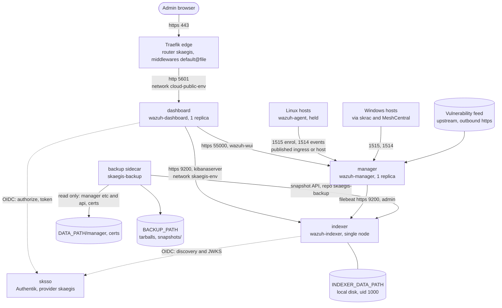
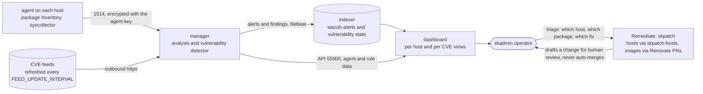
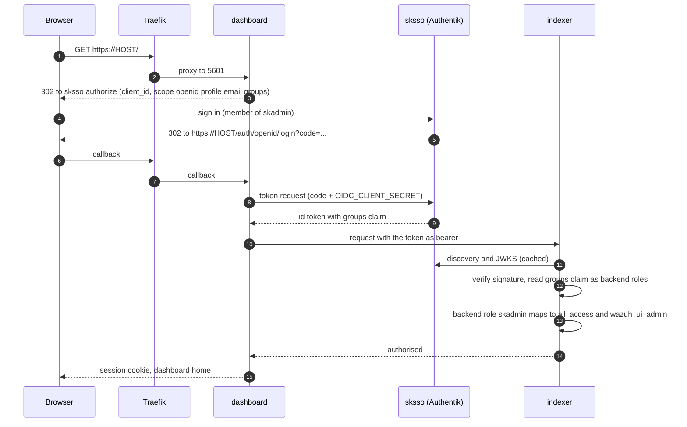
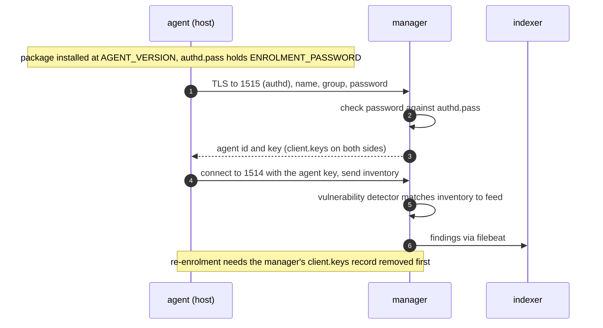

# skaegis: Standard Operating Procedures

Deploys and operates continuous CVE detection on the swarm: unmodified upstream
[Wazuh](https://github.com/wazuh/wazuh-docker) 4.14.10 (GPL-2.0), as an indexer, a manager, a dashboard and a
backup sidecar, every image pinned by digest. skaegis is the Detect step of the suite (Defend sksec, Detect
skaegis, Remediate skpatch). Called by: the operator (ad hoc deploys and enrolment today); the Remediate half
consumes its findings ([`docs/skpatch-program.md`](../../../../docs/skpatch-program.md)).

## 1. Overview

**Purpose.** Give an estate one place to see which of its hosts run software with **known, published CVEs**,
continuously, from an agent on each host reporting its package inventory to a manager that matches it against
the vulnerability feed.

**Scope, what it owns.** The four services (`indexer`, `manager`, `dashboard`, `backup`), the one-time
internal certificate issue, the indexer security configuration (users, OIDC domain, role mapping) applied at every
indexer start, the Traefik router and portal tile for the dashboard, the Linux agent playbook and the Windows
agent script.

**What it explicitly does NOT do.**
- It does not patch. It detects. Fixing is the Remediate half: [skpatch-hosts](../skpatch-hosts/README.md) for
  Linux packages, the skpatch program's image pipeline for containers. The loop drafts a fix for a human to
  review; nothing is auto-merged.
- It does not find unknown vulnerabilities, and a host without an agent is invisible to it.
- It does not hold a credential for any enrolled host. Agents call in; the manager never connects out to them.
- It does not modify upstream Wazuh. It pins it, configures it and wires it to the framework's edge and SSO.
- It does not serve non-admins. Access mode is `admin-only`: the group `skadmin` is both the gate and the
  in-app admin role.

**Why this app gets scrutiny.** It holds an inventory of every enrolled host's weaknesses, and the
enrolment password lets a host join. Both facts shape the design: admin-only access, the password never on a
command line, the manager's enrolment port published only as far as the agents need.

## 2. Architecture



Networks: `skaegis-<env>` (overlay, internal to the stack; indexer, manager, dashboard and backup) and
`cloud-public-<env>` (shared with the edge; **only the dashboard joins it**). Only the dashboard carries
Traefik labels (`traefik.swarm.network=cloud-public-<env>`); the other three have `traefik.enable=false`.
The manager's 1514 and 1515 are published directly on the swarm (not through Traefik).

**Front-end / Exposure.** Tier 2 (SKStacks/Traefik). Public `:443` route: `Host(<HOSTNAME>)` to the dashboard
on 5601 (TLS terminated at the edge, internal hop is HTTP on the overlay). Published TCP ports on the swarm:
`AGENT_PORT` (1514) and `ENROLMENT_PORT` (1515) in `ingress` or `host` mode. Never expose them to the internet:
firewall them to the agents' source networks. Indexer 9200 and manager API 55000 are never published.

### Data flow



The manager matches each agent's inventory against the feed on its own schedule; the indexer is the system of
record for findings; the dashboard is a read view. Nothing flows from skaegis to a host except the agent's
own channel.

### Sign-in (OIDC)



A login whose groups claim has no `skadmin` maps to no role and gets nothing. The indexer holds no secret for
this: it only validates tokens against the issuer's keys.

### Agent enrolment



## 3. Build

No image is built here. Every service runs an unmodified upstream image pinned by manifest-list digest, written
as literals in the compose template (`src/config/skaegis/skaegis.yml.j2`) and as defaults in the three deploy
plays; `v1/scripts/list_images.py` reads the template and a test keeps the two equal. The backup sidecar is the
manager image with the `skaegis-backup` script as its entrypoint. The indexer runs `src/skaegis/indexer-entrypoint`
(a wrapper that stages the security config, applies it and then `exec`s the upstream entrypoint).

## 4. Test

```bash
python -m pytest -q -p no:cacheprovider \
  v1/tests/test_skaegis_render.py \
  v1/tests/test_readme_references_exist.py \
  v1/tests/test_portal_tile_lint.py

# Real-Ansible render gate (also checks every vault key the deploy reads is documented
# in the README's "Vault contract" section)
python v1/tests/render/render_playbooks.py --service skaegis
```

The green-bar gate that blocks a release is the framework's own release gate; nothing in this role bypasses it.

## 5. Release / Deploy

### First deploy

1. **sksso first** (OIDC mode, the default). Set `sksso.SKAEGIS_OIDC_CLIENT_SECRET` (`openssl rand -hex 32`),
   deploy sksso. It creates the `skaegis` OAuth2 provider, the application and the `skadmin` binding. Make sure
   the people who need access are in the group `skadmin` in Authentik.
2. **Write the vault block** (README "Vault contract"): the five secrets, `OIDC_ISSUER` and `OIDC_CLIENT_SECRET`
   (equal to the sksso value), `DATA_NODE` and local paths if the indexer goes on local disk,
   `AGENT_MANAGER_ADDRESS` for the agent playbook.
3. **Place it.** `docker node update --label-add skaegis=true <node>` (a worker, unless you override
   `PLACEMENT_CONSTRAINTS`). On the indexer node, if not using `DATA_NODE`: `sysctl -w vm.max_map_count=262144`
   and persist it.
4. **Deploy.**
   ```bash
   ansible-playbook -i envs/prod/inventory.ini \
     framework/v1/ansible/optional/skaegis/deploy_skaegis-prod.yml \
     -e target_manager_group=swarm_managers \
     --vault-password-file ~/.vault_pass_env/.<instance>_prod_vault_pass
   ```
   The play validates the vault (fails before changing anything), creates the directories, sets
   `vm.max_map_count` when `DATA_NODE` is set, issues the internal certificates, writes the configuration,
   deploys the stack and waits for each service to reach `1/1`. The first start is slow: the manager has
   a 300 s start period and the indexer 180 s.
5. **Verify.** `docker service ls | grep skaegis-prod`, then sign in at `https://<HOSTNAME>/` as a `skadmin`
   member. The dashboard may show a short "not ready" while the indexer finishes its first security apply.
6. **Store the break-glass password** (`INDEXER_PASSWORD`, the internal `admin` user) off-cluster in the estate
   secret store.
7. **Enrol hosts** (below).

### Redeploy, and what restarts what

Config files, env files and scripts are bind mounts or read at start, so a changed file alone does not change
the service spec. The deploy script restarts exactly the services that read what the play changed (and never
force-restarts a service on its very first install):

| Changed by this run | Restarts |
|---|---|
| indexer env (`INDEXER_PASSWORD`, `DASHBOARD_PASSWORD`, `INDEXER_HEAP`, `APPLY_SECURITY_CONFIG`), `opensearch.yml`, `config.yml`, `roles_mapping.yml`, `indexer-entrypoint`, `EXTRA_CA_CERT`, a new certificate set | `indexer` |
| `ossec.conf` (`FEED_UPDATE_INTERVAL`, `CLUSTER_KEY`), `authd.pass` (`ENROLMENT_PASSWORD`), manager env (`INDEXER_PASSWORD`, `API_PASSWORD`), a new certificate set | `manager` |
| dashboard env (`DASHBOARD_PASSWORD`, `API_PASSWORD`, `OIDC_CLIENT_SECRET`), `opensearch_dashboards.yml` (host, OIDC settings, `SESSION_TTL_MS`), `EXTRA_CA_CERT`, a new certificate set | `dashboard` |
| the `skaegis-backup` script | `backup` |
| images, resources, ports, placement, Traefik labels | whatever `docker stack deploy` updates in the spec |

The indexer re-applies its security configuration on every start, so `config.yml` and `roles_mapping.yml`
in the repo are the truth, not anything edited in the dashboard. A failed apply is retried three times and logged
to `/tmp/skaegis-securityadmin.log` inside the indexer container.

### Windows agents

Windows hosts are enrolled through the skrac (MeshCentral) agent they already run, so no new inbound path or
stored credential is needed. The script is `src/skaegis/windows/install-wazuh-agent.ps1`. It is idempotent: a host
already on the pinned version, pointed at the manager and enrolled is left alone. Otherwise it downloads the
pinned MSI from `packages.wazuh.com` (the host needs outbound https), **refuses it unless its SHA-256 matches**,
installs it silently, writes the manager address and the enrolment password, and starts the `WazuhSvc` service.

The enrolment password **never appears on a command line** (not the script's, not msiexec's, so not in
MeshCentral's event log): it is read from a one-line file uploaded next to the script, written to the agent's
`authd.pass` with an ACL of SYSTEM and Administrators only, and the uploaded file is deleted.

With `meshctrl` (add your usual `--url` and login options to each command), per Windows node:

```bash
# 0. Local one-line password file (the real ENROLMENT_PASSWORD from the vault), kept private.
umask 077
printf '%s\n' "$ENROLMENT_PASSWORD" > enrolment.pass

# 1. Create the working directory on the host (skip if it exists).
meshctrl runcommand --id <nodeid> --powershell \
  --run "New-Item -ItemType Directory -Force C:\ProgramData\skaegis | Out-Null"

# 2. Upload the script and the password file.
meshctrl upload --id <nodeid> --file install-wazuh-agent.ps1 --target C:\ProgramData\skaegis
meshctrl upload --id <nodeid> --file enrolment.pass          --target C:\ProgramData\skaegis

# 3. Run it. The manager address is a swarm node the host reaches on 1514 and 1515.
meshctrl runcommand --id <nodeid> --powershell \
  --run "& C:\ProgramData\skaegis\install-wazuh-agent.ps1 -ManagerAddress <node address>"

# 4. Remove the local password file.
shred -u enrolment.pass
```

Optional parameters: `-AgentGroup <name>` (default `default`), `-AgentName <name>` (default the computer name),
`-AgentPort` and `-EnrolmentPort` (defaults 1514 and 1515), `-EnrolmentPasswordFile <path>` (default
`C:\ProgramData\skaegis\enrolment.pass`), `-Version` and `-Sha256` (the pinned MSI version and hash).

The same works from the MeshCentral web UI: open the device, use **Files** to upload the two files into
`C:\ProgramData\skaegis`, then **Terminal** (PowerShell) to run the same command. **Remove** an agent with
`-Remove` (stops the service, uninstalls, deletes the agent and working directories):

```bash
meshctrl runcommand --id <nodeid> --powershell \
  --run "& C:\ProgramData\skaegis\install-wazuh-agent.ps1 -Remove"
```

Then delete the record on the manager ("Remove an agent").

### Linux agents

`provision_skaegis_agents.yml` (Debian and Ubuntu only; it refuses anything else). Always limit it with `-l`:

```bash
ansible-playbook -i envs/prod/inventory.ini \
  framework/v1/ansible/optional/skaegis/provision_skaegis_agents.yml \
  -l <host-or-group> -e skaegis_agents_provision_env=prod \
  --vault-password-file ~/.vault_pass_env/.<instance>_prod_vault_pass
```

It checks the Wazuh signing key's fingerprint before trusting the apt source, installs `wazuh-agent` at
`AGENT_VERSION`, points it at `AGENT_MANAGER_ADDRESS`, writes `authd.pass` (root and group `wazuh`, 0640),
enables and (re)starts the service, waits up to two minutes for `client.keys`, and **fails if the host did not
enrol**. It then `apt-mark hold`s `wazuh-agent` so a host-patching run (skpatch-hosts) never moves it. Opt a
host out with `skaegis_agent_enabled: false`; group it with `skaegis_agent_group`.

### Remove an agent

1. **Host side.** Linux: rerun the playbook with `-e skaegis_agents_provision_state=absent -l <host>` (stops the
   service, releases the hold, purges the package, deletes `/var/ossec` and the apt source and key). Windows: the
   script with `-Remove`.
2. **Manager side.** The record stays (shown as disconnected) until removed. Either use the dashboard's agent
   management, or on the node running the manager:
   ```bash
   docker exec $(docker ps -q -f name=skaegis-prod_manager) /var/ossec/bin/manage_agents -l      # find the id
   docker exec $(docker ps -q -f name=skaegis-prod_manager) /var/ossec/bin/manage_agents -r <id>
   ```
3. A host you remove and later re-enrol must have its manager record removed first, or the enrolment is refused as
   a duplicate name.

### Rotate the internal certificates

The internal TLS set (root CA, admin, indexer, manager and dashboard certificates) is issued once, on the first
deploy. The generator runs only when `<DATA_PATH>/certs/root-ca.pem` is absent. To rotate:

1. Take a backup first (`docker exec <backup container> /usr/local/bin/skaegis-backup once`).
2. On the node holding the data, move the directory aside (do not delete it yet):
   ```bash
   mv <DATA_PATH>/certs <DATA_PATH>/certs.old-$(date +%F)
   ```
3. Redeploy with the same command as above. The play recreates the directory, the generator issues a complete new
   set, ownership is set to uid 1000 (mode 0400 per file), and **the indexer, manager and dashboard are all
   restarted**. Expect a few minutes of downtime.
4. Check `docker service ls`, sign in, confirm the manager shows as connected to the indexer, then remove
   `certs.old-*`.

Agents do not use these certificates for their events channel (they use their own keys) and the manager does not
verify agent host names, so enrolled agents keep working. An incomplete set (the generator failed half way) fails
the play with the missing file names: move the directory aside and rerun.

### Backup and restore

The `backup` sidecar runs every `BACKUP_FREQUENCY` seconds (default daily, first run after `BACKUP_START_DELAY`):

- **Manager tarball** `<BACKUP_PATH>/skaegis-manager-<UTC stamp>.tar.gz`: the manager's `etc` (including
  `ossec.conf`, `authd.pass`, `client.keys`), its API configuration, and the certificate directory. It is written
  to a `.partial` file, verified (`gzip -t`, contains `ossec.conf`) and then renamed, so a failed run never replaces
  a good archive. **The tarball holds private keys and the agent keys: treat the backup directory as a secret**
  (the directory is root-only and files are written with umask 077).
- **Indexer snapshot** `skaegis-<stamp>` into the repository `skaegis-backup` (type `fs`, location
  `/var/lib/wazuh-indexer-snapshots`, which is `<BACKUP_PATH>/snapshots` on the host). Global state is not included.
- Both are pruned after `BACKUP_KEEP_DAYS` (default 7). A failed step keeps the previous copies.

Run one now: `docker exec $(docker ps -q -f name=skaegis-prod_backup) /usr/local/bin/skaegis-backup once`.

**Restore the manager state** (lost data directory, new node):

1. Redeploy skaegis so the directories, certificates and services exist (or extract the certs from the tarball first
   so the new set is not generated). Scale the manager down: `docker service scale skaegis-prod_manager=0`.
2. Extract the tarball over the data directory, as root:
   ```bash
   tar -xzf skaegis-manager-<stamp>.tar.gz -C /tmp/skaegis-restore
   cp -a /tmp/skaegis-restore/manager-etc/.   <DATA_PATH>/manager/etc/
   cp -a /tmp/skaegis-restore/manager-api/.   <DATA_PATH>/manager/api-configuration/
   cp -a /tmp/skaegis-restore/certs/.         <DATA_PATH>/certs/     # only if restoring the old certificate set
   ```
   Keep the certs consistent with the indexer: either the whole old set or the whole new set, never a mix.
3. Scale the manager back to 1. Agents keep their keys because `client.keys` is restored.

**Restore the indexer** from a snapshot (the data directory is lost or the indexes are damaged):

1. Make sure the indexer is up and the snapshot files are under `<BACKUP_PATH>/snapshots`.
2. From inside the indexer container, with the admin client certificate:
   ```bash
   docker exec -it $(docker ps -q -f name=skaegis-prod_indexer) bash
   C="--cacert /usr/share/wazuh-indexer/config/certs/root-ca.pem \
      --cert /usr/share/wazuh-indexer/config/certs/admin.pem \
      --key /usr/share/wazuh-indexer/config/certs/admin-key.pem"
   curl -s $C -X PUT https://127.0.0.1:9200/_snapshot/skaegis-backup \
     -H 'Content-Type: application/json' \
     -d '{"type":"fs","settings":{"location":"/var/lib/wazuh-indexer-snapshots"}}'
   curl -s $C https://127.0.0.1:9200/_snapshot/skaegis-backup/_all | head -c 2000   # pick a snapshot
   curl -s $C -X DELETE 'https://127.0.0.1:9200/wazuh-*'                            # only the indexes being replaced
   curl -s $C -X POST https://127.0.0.1:9200/_snapshot/skaegis-backup/<snapshot>/_restore \
     -H 'Content-Type: application/json' \
     -d '{"indices":"wazuh-*","include_global_state":false}'
   ```
3. Watch `GET /_cat/recovery`. The security index is not part of the snapshot: it is rebuilt from the repo's
   config at every indexer start. Agents refill current inventory on their own; the snapshot only restores history.

### Upgrades

Bump everything that moves together, in one change:

1. The three image digests (indexer, manager, dashboard) in **all three** `deploy_skaegis-<env>.yml` defaults and in
   the literals in `src/config/skaegis/skaegis.yml.j2` (the test keeps them equal). Take the manifest-list digest
   with `docker buildx imagetools inspect wazuh/wazuh-<service>:<version>`. Check the generator image only if the
   upstream release changed it.
2. `AGENT_VERSION` (default in `provision_skaegis_agents.yml`) to the same Wazuh version, and, for Windows, the
   `-Version` and `-Sha256` defaults in `install-wazuh-agent.ps1` (the hash of the published MSI).
3. Take a backup, redeploy (the stack updates stop-first), confirm the services, then roll the Linux agents with
   the provisioning playbook (it releases the hold, installs the new version, holds again) and rerun the Windows
   script. A manager must never be older than its agents.

Roll back by redeploying the previous digests and restoring the snapshot if an index migration ran.

## 6. Configuration / Usage

All configuration is the vault block `skaegis:`. The full table, with defaults, is in the README section
"Vault contract". Operational notes:

- **Secrets are in the vault only.** They reach the services through root-only env files
  (`/var/data/config/skaegis-<env>/{indexer,manager,dashboard}.env`, 0600), `manager/authd.pass` and
  `manager/ossec.conf` (0600), never through the image or the compose file. The OIDC secret is expanded by the
  dashboard from its environment, not written into `opensearch_dashboards.yml`.
- **Internal accounts.** `admin` (indexer, password `INDEXER_PASSWORD`; the manager's filebeat and the break-glass
  login), `kibanaserver` (the dashboard's server account, `DASHBOARD_PASSWORD`), `wazuh-wui` (the manager API user
  the dashboard uses, `API_PASSWORD`). No demo accounts exist.
- **Who gets in.** Only members of the group `skadmin` through OIDC, plus the internal `admin` user through basic
  login. To grant or revoke access, change `skadmin` membership in Authentik; the next login picks it up.
- **Change a password.** Edit the vault, redeploy. The indexer entrypoint rehashes `INDEXER_PASSWORD` and
  `DASHBOARD_PASSWORD` and re-applies the security config on restart; the manager and dashboard restart for their own env.
- **Agent groups.** Enrol into a Wazuh agent group with `AGENT_GROUP` or per host `skaegis_agent_group`; manage
  group membership afterwards in the dashboard.
- **Vulnerability feed.** `FEED_UPDATE_INTERVAL` (default `60m`) sets how often the manager refreshes it; the manager
  needs outbound https for that.
- **Logs.** `docker service logs skaegis-<env>_<service>`; agent side `/var/ossec/logs/ossec.log` (Linux) and
  `C:\Program Files (x86)\ossec-agent\ossec.log` (Windows).

## 7. API / Reference

| Playbook | What it does | Inputs |
|---|---|---|
| `deploy_skaegis-<env>.yml` | Deploy or update the stack (env: `dev`, `staging`, `prod`) | `target_manager_group` |
| `provision_skaegis_agents.yml` | Install and enrol, or remove, the Linux agent | `-l <hosts>`, `skaegis_agents_provision_env`, `skaegis_agents_provision_state` (`present` or `absent`), `skaegis_agents_provision_hosts`; per host `skaegis_agent_enabled`, `skaegis_agent_group` |

| Port | Where | Exposure |
|---|---|---|
| 443 | Traefik, router `skaegis[-<env>]` to dashboard 5601 | public edge |
| 1514 | manager, agent events | published (`AGENT_PORT`, `AGENT_PUBLISH_MODE`) |
| 1515 | manager, enrolment | published (`ENROLMENT_PORT`) |
| 9200 | indexer | `skaegis-<env>` only |
| 55000 | manager API | `skaegis-<env>` only |

| Path (on the data node) | Mode | Content |
|---|---|---|
| `<DATA_PATH>/manager/` | 0700 root | manager state (`etc`, `queue`, `logs`, API configuration) |
| `<DATA_PATH>/certs/` | 0500, files 0400, uid 1000 | internal TLS set |
| `<INDEXER_DATA_PATH>/` | 0700 uid 1000 | indexer data |
| `<BACKUP_PATH>/` | 0711 root | manager tarballs; `snapshots/` (0700 uid 1000) the snapshot repository |
| `/var/data/config/skaegis-<env>/` | 0644 (env files and `manager/` 0600, 0700) | compose file, rendered configuration |
| `/var/data/skaegis-<env>/deploy`, `/var/data/deploy_skaegis-<env>` | 0755 | control script and its link |

## 8. Troubleshooting

| Symptom | Check |
|---|---|
| Deploy fails on the vault assert | A secret is too short, has a forbidden character, or `API_PASSWORD` misses the Wazuh policy (12 to 64 characters with upper, lower, digit, symbol). `CLUSTER_KEY` must be exactly 32 letters or digits. `AUTH_MODE: oidc` needs `OIDC_ISSUER` (https) and a 32+ character `OIDC_CLIENT_SECRET`. |
| Deploy fails on data paths | A path outside `/var/data` is set but `DATA_NODE` is empty. Set `DATA_NODE` to the node holding the data. |
| Deploy fails: image without `@sha256:` | An image override lost its digest. Every image must be pinned. |
| Indexer restarts or never becomes healthy | `vm.max_map_count` below 262144 on its node; the JVM heap (`INDEXER_HEAP`) too large for `INDEXER_MEMORY_LIMIT` (keep it at or below half); data directory not owned by uid 1000 (the play sets it, a manual copy may not); data on NFS. Look at `docker service ps --no-trunc skaegis-<env>_indexer` and its logs. |
| Dashboard shows "not ready" or the sign-in page loops | The security config is not applied yet or failed. Read `/tmp/skaegis-securityadmin.log` in the indexer container; the entrypoint retries three times. Restart the indexer once the cluster is healthy. |
| OIDC: redirect or `invalid_redirect_uri` | The provider's redirect must be exactly `https://<HOSTNAME>/auth/openid/login`. Rerun sksso with the right `SKAEGIS_HOST`, and check `OIDC_CLIENT_ID` equals the provider client id. |
| OIDC: `invalid_client` | `skaegis.OIDC_CLIENT_SECRET` differs from `sksso.SKAEGIS_OIDC_CLIENT_SECRET`. Make them equal, redeploy both. |
| OIDC: the dashboard or indexer cannot reach the issuer | The issuer host does not resolve from the swarm: set `SSO_HOST_IP` (maps it inside the indexer and dashboard). A private CA signs the issuer certificate: set `EXTRA_CA_CERT` (PEM). Redeploy; both services restart. |
| Signed in through SSO but sees nothing or "forbidden" | The user is not in `skadmin` (the groups claim lacks it), or the provider does not emit the `groups` scope. Check `OIDC_SCOPE` and `OIDC_GROUPS_CLAIM`. "authentik Admins" is deliberately not mapped. |
| Cannot sign in at all | Use the break-glass: the basic login with user `admin` and `INDEXER_PASSWORD`. |
| Agent does not enrol | From the host: is `<AGENT_MANAGER_ADDRESS>:1515` reachable (firewall, published mode)? Does `ENROLMENT_PASSWORD` match the manager's `authd.pass`? Is the name already registered (remove the old record first)? Read `/var/ossec/logs/ossec.log` on the host and `docker service logs skaegis-<env>_manager`. |
| Agent enrolled but shows disconnected | 1514 blocked, or `client.keys` on the host and on the manager disagree (a removed and re-added record). Remove the manager record and re-enrol. |
| A host patched by skpatch-hosts changed its agent version | It should not: the package is held. Check `apt-mark showhold`. |
| No CVE findings appear | Wait for the first feed download and the first inventory scan; confirm the manager has outbound https and `vulnerability-detection` is enabled in `ossec.conf`. |
| Backup run reports an error | `docker service logs skaegis-<env>_backup`. A failed archive or snapshot keeps the previous ones. "cannot register the snapshot repository" means the indexer was down at that time. |

## 9. Maturity-tier + Version reference

- **Maturity tier:** `T0, Classical`. TLS 1.2 on the internal links and at the edge, bcrypt-hashed internal users,
  and the upstream security plugin; no hybrid-KEM or post-quantum claim.
- **Crypto component status:** not a crypto component under `SK_REPO_DOC_STANDARD`'s definition. It operates
  standard TLS, OIDC and the upstream product's own mechanisms and implements no protocol of its own.
  CRYPTOGRAPHY_STANDARD compliance: N/A.
- **Upstream:** Wazuh 4.14.10 (indexer, manager, dashboard), certificate tool `wazuh-certs-generator` 0.0.5,
  all digest-pinned.
- **Version phase:** framework `v1` tree (this repo's [Versions table](../../../../README.md#versions)).

<!-- docs-evidence
     Executed by the docs-check gate (DOCS_FRESHNESS_STANDARD §1.3).
     Hermetic: repo-local, no network, no live host.
verified: 2026-11-11
checks:
  - name: deploy playbook exists
    run: test -f v1/ansible/optional/skaegis/deploy_skaegis-prod.yml
  - name: agent playbook exists
    run: test -f v1/ansible/optional/skaegis/provision_skaegis_agents.yml
  - name: Windows agent script exists
    run: test -f v1/ansible/optional/skaegis/src/skaegis/windows/install-wazuh-agent.ps1
  - name: documented manager image pin matches the playbook
    run: grep -q 'wazuh/wazuh-manager:4.14.10@sha256:dcda4869e2f792e92f03bce93f85b4bdf103756ea61cfca8ba9f3eabeb05365b' v1/ansible/optional/skaegis/deploy_skaegis-prod.yml
  - name: README documents the vault contract
    run: grep -q '^## Vault contract' v1/ansible/optional/skaegis/README.md
-->
