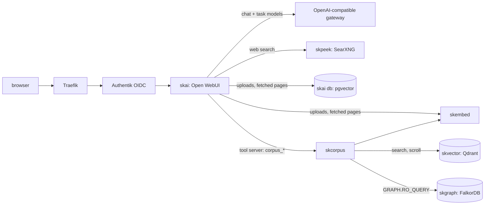

# skai

SKAI is the estate's answer engine: fast chat with any model behind an
OpenAI-compatible gateway, answers that search the web and cite their
sources, and a knowledge base that searches our own corpora (vectors and an
entity graph) and cites the file and chunk it used. It is
[Open WebUI](https://github.com/open-webui/open-webui) at a pinned release,
configured purely through environment variables, plus two companion roles:

- [`skembed`](../skembed/README.md): query and document embeddings on CPU (`/v1/embeddings`).
- [`skcorpus`](../skcorpus/README.md): the read-only corpus search tool server.



No Ollama and no local model runtime: model routing is the gateway's job.

## What is in the stack

| Service | Image (default, pinned by index digest) | Notes |
|---|---|---|
| `skai` | `ghcr.io/open-webui/open-webui:v0.13.4@sha256:d5168bfb...` | One replica, port 8080, data in `DATA_PATH` (uploads, the local reranker model) |
| `db` | `pgvector/pgvector:0.8.7-pg17-bookworm@sha256:b513c485...` | App data AND upload/web vectors (`VECTOR_DB=pgvector`), stop-first |
| `db-backup` | the same image | `pg_dumpall` loop: unique names, temp file renamed on success, prune after a good dump only |
| `voice` (with `VOICE: true`) | `ghcr.io/speaches-ai/speaches:0.8.3-cpu@sha256:21e3df06...` | faster-whisper STT and Piper TTS, OpenAI-compatible, API key |

## How it is configured

Everything is in `/var/data/config/skai-<env>/skai.env` (0600), rendered from
the vault on every deploy, with `ENABLE_PERSISTENT_CONFIG=false`: Open WebUI
takes its settings from the environment on every start and no setup wizard
state exists. A setting changed in the admin UI lasts until the next restart;
make it a vault key instead. Env names were checked against the pinned
release's `backend/open_webui/config.py` and `env.py` (v0.13.4).

| Area | Open WebUI env (what the role sets) |
|---|---|
| Models | `ENABLE_OLLAMA_API=false`, `OPENAI_API_BASE_URL` / `OPENAI_API_KEY` (gateway), `DEFAULT_MODELS` (`DEFAULT_MODEL`), `TASK_MODEL_EXTERNAL` and `TASK_MODEL` (`TASK_MODEL`: titles, tags, follow-ups, search query generation) |
| Web search | `ENABLE_WEB_SEARCH`, `WEB_SEARCH_ENGINE=searxng`, `SEARXNG_QUERY_URL`, `ENABLE_SEARCH_QUERY_GENERATION=true`, `WEB_SEARCH_RESULT_COUNT` (6), `WEB_SEARCH_CONCURRENT_REQUESTS` (4), `WEB_LOADER_CONCURRENT_REQUESTS` (6), `BYPASS_WEB_SEARCH_EMBEDDING_AND_RETRIEVAL=false` (fetched pages are chunked, embedded and reranked, not pasted whole) |
| Retrieval | `RAG_EMBEDDING_ENGINE=openai`, `RAG_OPENAI_API_BASE_URL` / `RAG_OPENAI_API_KEY` / `RAG_EMBEDDING_MODEL` (skembed), `VECTOR_DB=pgvector`, `PGVECTOR_DB_URL`, `ENABLE_RAG_HYBRID_SEARCH=true`, `RAG_RERANKING_MODEL`, optional `RAG_RERANKING_ENGINE=external` + `RAG_EXTERNAL_RERANKER_URL`, `RAG_TOP_K`, `RAG_TOP_K_RERANKER`, `ENABLE_RETRIEVAL_QUERY_GENERATION=true` |
| Tool server | `ENABLE_TOOL_SERVERS=true`, `TOOL_SERVER_CONNECTIONS` (below) |
| Sign-in | `ENABLE_OAUTH_SIGNUP`, `OAUTH_CLIENT_ID` / `OAUTH_CLIENT_SECRET`, `OPENID_PROVIDER_URL`, `OPENID_REDIRECT_URI`, `OAUTH_PROVIDER_NAME`, `OAUTH_SCOPES`, `ENABLE_OAUTH_ROLE_MANAGEMENT=true`, `OAUTH_ROLES_CLAIM=groups`, `OAUTH_ADMIN_ROLES`, `OAUTH_ALLOWED_ROLES`, `OAUTH_MERGE_ACCOUNTS_BY_EMAIL=false`, `ENABLE_LOGIN_FORM=false`, `ENABLE_SIGNUP=false` |
| Bootstrap | `WEBUI_ADMIN_EMAIL` / `WEBUI_ADMIN_PASSWORD` (the provisioner admin, created on the first start only), `WEBUI_SECRET_KEY`, `DATABASE_URL`, `WEBUI_URL` |
| Voice | `AUDIO_STT_ENGINE=openai`, `AUDIO_STT_OPENAI_API_BASE_URL` / `_KEY`, `AUDIO_STT_MODEL`, `AUDIO_TTS_ENGINE=openai`, `AUDIO_TTS_OPENAI_API_BASE_URL` / `_KEY`, `AUDIO_TTS_MODEL`, `AUDIO_TTS_VOICE` |

### Corpus tool servers (`TOOL_SERVER_CONNECTIONS`), one per corpus

With `CORPUS_TOKEN` set, the env carries one OpenAPI tool server per entry in
`CORPORA` (the v0.13 `ToolServerConnection` shape,
`backend/open_webui/routers/configs.py`), each on that corpus's own skcorpus
prefix, whose operations take no corpus argument:

```json
[{"url": "http://skcorpus-<env>_skcorpus:8000/c/example-legal", "path": "openapi.json", "type": "openapi",
  "auth_type": "bearer", "key": "<CORPUS_TOKEN>",
  "config": {"enable": true, "access_grants": []},
  "info": {"id": "skcorpus-example-legal", "name": "Example Legal search", "description": "..."}}]
```

Tool id `server:skcorpus-<name>`. A model given one corpus's tools cannot
reach another corpus. The env carries **no access grants**, so on its own a
connection is admin-only (fail closed); see "Who may use which corpus".

### Corpus presets

For each entry in `CORPORA` one Open WebUI model preset, id `corpus-<name>`:
the base model (`base_model`, default `DEFAULT_MODEL`), that corpus's tool
(`server:skcorpus-<name>`), native function calling, and a system prompt
that answers from the corpus in layers: the graph (`graph_entity`,
`graph_neighbors`) for who or what connects to what, vectors
(`corpus_search`) for substance, `corpus_get` for context, chunk text quoted
word for word only when asked, every source cited as title, file_path and
chunk_index, and a coherence `warning` on a result passed on to the user.
`system_prompt` replaces the default per corpus (`{corpus}` and `{title}` are
filled in). Separate corpora are separate presets: one entry per corpus, never
one bucket.

### Who may use which corpus (`allowed_groups`)

Each corpus entry has `allowed_groups` (default `[USERS_GROUP]`, that is
`[skai-users]`): Authentik group names, or `"*"` for every signed-in user.
Open WebUI's access grants name group **ids**, which exist only at runtime,
so the stack runs a small **provision service** (`app/provision_presets.py
--loop`, standard library Python on the same Open WebUI image, credentials in
its own 0600 `provision.env`). Every `PROVISION_INTERVAL` seconds (default
300) it signs in as the provisioner admin and, through the app's own API:

1. creates any missing Open WebUI group named in `allowed_groups` (empty; with
   `ENABLE_OAUTH_GROUP_MANAGEMENT=true` Open WebUI fills it from the `groups`
   claim at every login, so membership stays in Authentik);
2. sets each corpus tool server's read grants to its groups (the env value
   comes back on every restart because `ENABLE_PERSISTENT_CONFIG=false`; the
   loop restores the grants within one interval, and until then only admins
   can use the tools);
3. creates or updates each preset with the same grants.

It prints `GROUP_CREATED`, `TOOLS_UPDATED`/`TOOLS_UNCHANGED`,
`PRESET_CREATED`/`UPDATED`/`UNCHANGED` and `RECONCILED` (or
`RECONCILE_ERROR <reason>`, retried). It never deletes a group, a connection
or a model, and never touches one that is not in its file; remove a retired
preset in the admin UI. The deploy waits for a `RECONCILED` line after it
(`FIRST_START_WAIT_SECONDS`, default 900) and fails if none comes.

Open WebUI admins bypass these grants (they see every corpus).

## Sign-in (Authentik OIDC)

`AUTH_MODE: oidc` (the default) needs the provider on the Authentik side:
`sksso.SKAI_OIDC_ENABLED: true` and the same secret in both vaults (see
`../sksso/README.md` "skai (Open WebUI) OIDC login"). Deploy sksso first.

- **One Application, members only.** The portal tile slug equals the OIDC
  client id (`skai`), so the tile and the provider are one Authentik
  Application. Access mode `app-groups` (APPLICATION_ACCESS_SSO_STANDARD): the
  Application is bound to the global admin group, `ADMIN_GROUP` and
  `USERS_GROUP` (default `skai-users`), so only their members can sign in at
  all. sksso's
  skai blueprint creates that group and binding as code and holds its
  members (`sksso.SKAI_USERS`, instance vars, never framework defaults); the
  portal tile task finds the same group and binding. The standard always
  binds the global admin group too, so keep that group as small as the
  estate needs.
- **Admins by group.** `ADMIN_GROUP` (default `skadmin`) members are made
  Open WebUI admins on every login (the `groups` claim of the profile scope);
  everyone else allowed in is a user. `USER_GROUPS` (default
  `[USERS_GROUP]`) is checked again inside Open WebUI (`OAUTH_ALLOWED_ROLES`,
  plus `ADMIN_GROUP`); `["*"]` leaves the gate to Authentik alone.
- **Password sign-in.** The login form is hidden and sign-up is off. Password
  sign-in stays on in the app only for the provisioner, and Traefik answers
  403 to `/api/v1/auths/signin` and `/signup` from outside (an `ipAllowList`
  of `127.0.0.1/32` on a priority-1000 router).
- **The provisioner account** is the first user (created from env on the
  first start). Because it exists, the first OIDC user is NOT made admin
  automatically: admin rights come only from `ADMIN_GROUP`. A database that
  already has users (an import) gets no provisioner account: create the
  account by hand with that email and password, as admin, or the provision
  service fails.

`AUTH_MODE: local` shows the password form and needs no sksso change (labs).

## Deployment

```bash
ansible-playbook -i envs/prod/inventory.ini \
  framework/v1/ansible/optional/skai/deploy_skai-prod.yml \
  -e target_manager_group=swarm_managers \
  --vault-password-file ~/.vault_pass_env/.<instance>_prod_vault_pass
```

Order on an estate: skpeek, skembed (only without `EMBED_URL`), skcorpus, sksso (with
`SKAI_OIDC_ENABLED` and `SKAI_USERS`), skai.

What the play does: validates pins, secrets and knobs (fails closed); renders
`skai.env`, `postgres.env`, `postgres-backup.env`, `provision.env` and
`voice.env` (all 0600), `presets.json` and the compose file; ensures the
overlays (`skai-<env>`, `cloud-public-<env>`, `skpeek-<env>`, `skcorpus-<env>`,
and `skembed-<env>` unless `EMBED_URL` is set); deploys stack `skai-<env>` (a
changed env restarts the app service, a changed `provision.env` the provision
service); with corpora configured, waits for the provision service's
`RECONCILED`; creates or updates the portal tile (access mode app-groups).

## Configuration (vault)

```yaml
skai:
  CLUSTERNAME: skstack01            # default: inventory cluster_name
  DOMAIN: example.com               # default: inventory domain
  CLOUDFLARED: false                # true: default host is under DOMAIN, not CLUSTERNAME.DOMAIN
  HOSTNAME: ""                      # default skai[-dev|-staging].<base domain>
  # secrets (required)
  SECRET_KEY: "..."                 # 32+ chars, WEBUI_SECRET_KEY (sessions, encrypted fields)
  DB_PASSWORD: "..."                # 16+ chars of [A-Za-z0-9._~-]
  PROVISIONER_PASSWORD: "..."       # 32+ chars, the env-created admin the deploy uses for presets
  GATEWAY_API_KEY: "..."            # the gateway key
  OIDC_CLIENT_SECRET: "..."         # 32+ chars with AUTH_MODE oidc; same value as sksso.SKAI_OIDC_CLIENT_SECRET
  # models
  GATEWAY_URL: "https://gateway.example.com/v1"   # required, OpenAI-compatible base URL
  DEFAULT_MODEL: ""                 # the default chat model id (required with CORPORA without base_model)
  TASK_MODEL: ""                    # a fast model for titles and search queries; default DEFAULT_MODEL
  # web search
  WEB_SEARCH: true
  SEARXNG_URL: ""                   # default http://skpeek-<env>_skpeek:8080/search?q=<query>
  WEB_SEARCH_RESULT_COUNT: 6
  WEB_SEARCH_CONCURRENT_REQUESTS: 4
  WEB_LOADER_CONCURRENT_REQUESTS: 6
  # retrieval
  EMBED_URL: ""                     # default http://skembed-<env>_skembed:8080/v1; set = an existing endpoint, no skembed
  EMBED_MODEL: ""                   # required: skembed.MODEL_NAME
  EMBED_API_KEY: ""                 # skembed.API_KEY, if set
  RERANK_MODEL: ""                  # default BAAI/bge-reranker-v2-m3 (local, downloaded into DATA_PATH)
  RERANK_URL: ""                    # optional external reranker endpoint instead of the local model
  RERANK_API_KEY: ""
  RAG_TOP_K: 8
  RAG_TOP_K_RERANKER: 5
  # corpus tool server and presets
  CORPUS_URL: ""                    # default http://skcorpus-<env>_skcorpus:8000
  CORPUS_TOKEN: ""                  # 32+ chars, same value as skcorpus.API_TOKEN; empty = no tool server
  CORPORA: []                       # one preset and one tool server each: [{name, title, description,
                                    #   base_model, system_prompt, allowed_groups}]
  PROVISION_INTERVAL: 300           # seconds between provision service passes (30 or more)
  # sign-in
  AUTH_MODE: oidc                   # oidc (default) or local
  ADMIN_GROUP: skadmin              # Authentik group whose members are Open WebUI admins
  USERS_GROUP: skai-users           # Authentik group that may sign in; default allowed_groups of every corpus
  USER_GROUPS: []                   # default [USERS_GROUP]; groups Open WebUI lets in ("*": leave it to Authentik)
  OIDC_CLIENT_ID: ""                # default AUTHENTIK_TILE_SLUG, else skai
  OIDC_SSO_HOST: ""                 # default sso[-<env>].<cluster>.<domain>
  OIDC_DISCOVERY_URL: ""            # full override
  OIDC_PROVIDER_NAME: ""            # login button label, default "SKStack SSO"
  PROVISIONER_EMAIL: ""             # default skai-provisioner@<DOMAIN>
  DEFAULT_USER_ROLE: user           # role of a new user that no group maps (user or pending)
  WEBUI_NAME: SKAI
  # voice (optional)
  VOICE: false
  VOICE_API_KEY: ""                 # 16+ chars with VOICE
  VOICE_STT_MODEL: ""               # default Systran/faster-whisper-small
  VOICE_TTS_MODEL: ""               # default speaches-ai/piper-en_US-amy-medium
  VOICE_TTS_VOICE: ""               # default amy
  # images, storage, placement, routing
  IMAGE: ""                         # each must carry @sha256:
  DB_IMAGE: ""
  VOICE_IMAGE: ""
  DATA_PATH: ""                     # default /var/data/skai-<env>/data
  DB_PATH: ""                       # default /var/data/skai-<env>/postgres
  DUMP_PATH: ""                     # default /var/data/skai-<env>/dump
  VOICE_PATH: ""                    # default /var/data/skai-<env>/voice
  BACKUP_KEEP_DAYS: 7
  BACKUP_FREQUENCY: 86400
  PLACEMENT_CONSTRAINTS: []         # app and voice; default ["node.role == worker"]
  DB_PLACEMENT_CONSTRAINTS: []      # db and db-backup; default ["node.role == worker"]
  CONNECT_NETWORKS: []              # default [skpeek-<env>, skembed-<env> (unless EMBED_URL), skcorpus-<env>]
  CPUS: "2.0"
  MEMORY_LIMIT: 4G
  MEMORY_RESERVATION: 1G
  POSTGRES_CPUS: "1.00"
  POSTGRES_MEMORY_LIMIT: 2048M
  POSTGRES_MEMORY_RESERVATION: 256M
  POSTGRES_HEALTH_START_PERIOD: 300s
  VOICE_CPUS: "2.0"
  VOICE_MEMORY_LIMIT: 3G
  VOICE_MEMORY_RESERVATION: 512M
  HEALTH_START_PERIOD: 600s
  FIRST_START_WAIT_SECONDS: 900
  MIDDLEWARES: ""                   # default skai-chain@file (microphone/camera allowed, SAMEORIGIN)
  API_MIDDLEWARES: ""               # /api/, /oauth/, /ws/ router; default derived (no error pages)
  TLS_OPTIONS: ""                   # default none (Traefik's default TLS options)
  AUTHENTIK_TILE: true
  AUTHENTIK_TILE_SLUG: ""           # default skai (= the OIDC client id)
  AUTHENTIK_TILE_NAME: ""           # default SKAI
  AUTHENTIK_TILE_GROUP: ""          # default skadmin: who may sign in
  AUTHENTIK_TILE_ICON: ""           # default fa://fa-robot
  AUTHENTIK_TILE_OPEN_IN_NEW_TAB: true
  AUTHENTIK_TILE_DESCRIPTION: ""
  networks: []                      # override the overlays to create (subnet registry)
```

Secrets: `SECRET_KEY`, `DB_PASSWORD`, `PROVISIONER_PASSWORD`, `GATEWAY_API_KEY`,
`OIDC_CLIENT_SECRET`, `CORPUS_TOKEN`, `EMBED_API_KEY`, `RERANK_API_KEY`,
`VOICE_API_KEY`. They are only written to the 0600 env files; `env_file`
values are copied into the swarm service spec, so never print a service
spec's env.

## Networks

| Network | Subnet |
|---|---|
| `skai-prod` / `-staging` / `-dev` | `172.16.120.0/24` / `172.16.121.0/24` / `172.16.122.0/24` |
| joins | `cloud-public-<env>`, `skpeek-<env>`, `skcorpus-<env>`, and `skembed-<env>` unless `EMBED_URL` is set |

## Instance actions

1. Generate `SECRET_KEY`, `DB_PASSWORD`, `PROVISIONER_PASSWORD` and `OIDC_CLIENT_SECRET`
   (`openssl rand -hex 32`); put the OIDC secret in the sksso vault too
   (`SKAI_OIDC_ENABLED: true`, `SKAI_OIDC_CLIENT_SECRET`) and redeploy sksso.
2. Set `GATEWAY_URL`, `GATEWAY_API_KEY`, `DEFAULT_MODEL` and `TASK_MODEL`.
3. Embeddings: either deploy skembed and set `EMBED_MODEL` to its `MODEL_NAME`, or point
   `EMBED_URL` (and `skcorpus.EMBED_URL` or a corpus's `embed_url`) at an existing
   OpenAI-compatible endpoint and leave skembed out.
4. For the knowledge base: deploy skcorpus, set `CORPUS_TOKEN` (= `skcorpus.API_TOKEN`) and
   `CORPORA`: one entry per skcorpus corpus, same `name`, with its `title` and
   `allowed_groups` (default `[skai-users]`).
5. Who may sign in: list the members in `sksso.SKAI_USERS` (Authentik usernames) and
   redeploy sksso; `ADMIN_GROUP` says who administers.
6. Voice: `VOICE: true`, `VOICE_API_KEY`, then download the models once inside the voice
   container (`curl -X POST -H "Authorization: Bearer $KEY" localhost:8000/v1/models/<id>`
   for the STT and TTS model ids), and check the TTS voice name the model lists.

## Verification

```bash
docker service ls --filter name=skai
curl -sI https://<HOSTNAME>/ | head -1                       # 200 (or the SSO redirect)
curl -s -o /dev/null -w '%{http_code}\n' -X POST https://<HOSTNAME>/api/v1/auths/signin   # 403 in oidc mode
```

Tests: `v1/tests/test_skai_render.py` (the deploy through real Ansible:
pins, fail-closed secrets and knobs, the env names, the tool server JSON, the
presets and their groups, the provision service, the routers),
`v1/tests/test_skai_provision.py` (the provisioner against a fake Open WebUI
API: groups, per-corpus tool grants, presets, the loop) and
`v1/tests/test_skai_oidc_sksso.py` (the sksso blueprint and its byte-identity
when off).

## docs: full-gate stage plan (release harness)

What a lab stage in the full release gate should check for these three roles.
The lab has no real corpus, so the stage seeds its own tiny fixture. Nothing
here is in the harness yet; this is the plan for it.

1. **skembed answers.** Deploy skembed with a small public model (`MODEL_ID`
   of a MiniLM-sized sentence-transformers model, `MODEL_NAME: lab-embed`).
   Wait for the task to be healthy, then from a container on `skembed-<env>`:
   `POST /v1/embeddings {"model":"lab-embed","input":["hello"]}` returns 200
   with one vector of the model's dimension; a second call with two inputs
   returns two vectors.
2. **skcorpus searches a fixture it seeds itself.** Deploy skvector (and
   skgraph) if the lab does not already run them. The stage creates a Qdrant
   collection `lab-fixture-v1` (cosine, the model's dimension) with three
   points whose payload carries `text`, `title`, `file_path`, `chunk_index`
   (two chunks of one file, one of another), embedding each text through
   skembed; and a FalkorDB graph `lab-fixture` with two nodes joined by one
   relation (`CREATE` through the admin connection, never through skcorpus).
   Deploy skcorpus with one corpus `{name: lab-fixture, collections:
   [lab-fixture-v1], graph: lab-fixture, embed_model: lab-embed}`. Check:
   `/health` 200; `/corpora` without a token 401, with it lists `lab-fixture`;
   `corpus_search` for the text of chunk 0 returns that chunk first with
   title, file_path and chunk_index; `corpus_get` with `window: 1` returns
   chunks 0 and 1 in order; `graph_neighbors` of the first node returns the
   second; a `graph_entity` name containing `") DETACH DELETE n //` returns
   200 with no rows and the graph still has both nodes afterwards.
3. **skai serves its login page and has the tool server.** Deploy sksso with
   `SKAI_OIDC_ENABLED`, then skai with `CORPUS_TOKEN` and `CORPORA:
   [{name: lab-fixture}]`, the lab gateway (or any OpenAI-compatible stub) as
   `GATEWAY_URL`. Check: `GET https://<skai host>/health` 200 through
   skfenceha; the root page serves the Open WebUI app and
   `/api/config` shows the OIDC provider (`oauth.providers.oidc`); `POST
   /api/v1/auths/signin` from outside answers 403; inside the container, the
   provisioner admin's token reads `GET /api/v1/configs/tool_servers` with
   one connection whose `info.id` is `skcorpus-lab-fixture` and whose read
   grant names the Open WebUI group `skai-users`, `GET /api/v1/models/model?id=corpus-lab-fixture`
   returns the preset with `server:skcorpus-lab-fixture` in `meta.toolIds`
   and the same group grant, and the provision service logs
   `PRESET_UNCHANGED corpus-lab-fixture` and `RECONCILED` on its next pass.
   After `docker service update --force skai-<env>_skai` the grant is back
   within one `PROVISION_INTERVAL`. The Authentik API shows the `skai`
   Application with the OAuth2 provider, bindings to the admin group and
   `skai-users`, the members from `SKAI_USERS`, and the icon. skcorpus's
   `/health` reports `lab-fixture` healthy (its fixture was embedded by the
   same model); a second fixture collection with one point stored under a
   random vector reports degraded with a `warning` on its hits.
4. **Teardown** removes the fixture collection and graph.
