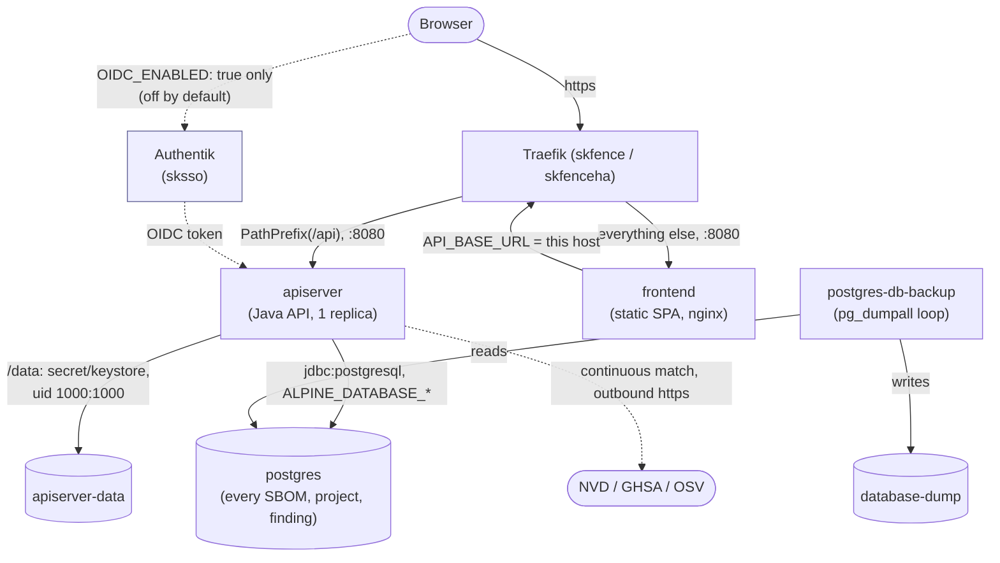

# skbom: Standard Operating Procedures

Deploys and operates [OWASP Dependency-Track](https://github.com/DependencyTrack/dependency-track)
(Apache-2.0) on the swarm: an SBOM store that matches every uploaded SBOM
continuously against NVD/GHSA/OSV. Called by: the operator (ad hoc
deploys today; the planned `skflow` `f/skpatch/sbom` flow will upload
SBOMs to it on a schedule, see
[`docs/skpatch-program.md`](../../../../docs/skpatch-program.md)).

## 1. Overview

**Purpose.** Give the skpatch program's image-patching half a real CVE
register, continuously reconciled against NVD/GHSA/OSV, instead of a
hand-kept register file that can only ever be as current as the last
person who updated it.

**Scope, what it owns.** The `apiserver` and `frontend` services, their
shared Postgres (every project, SBOM and finding lives there), and the
`postgres-db-backup` dump sidecar.

**What it explicitly does NOT do.**
- It does not scan images or generate SBOMs itself. That is Trivy, run
  as a separate `skflow` `f/skpatch/sbom` flow (planned), which uploads a
  CycloneDX SBOM to a project here; this role only stores and matches
  what it is given.
- It does not open a bump PR or run the release gate. That is Renovate
  and the build host's Forgejo Actions runner, the other pieces of the
  same program.
- It does not patch host packages. That is the separate `skpatch` role.

**Why two services behind one host.** `apiserver` holds the data and does
the CVE matching; `frontend` is a static SPA that calls the API from the
browser. They scale and fail independently (a frontend redeploy never
restarts the database-backed API mid-scan), so they are two Swarm
services, routed by Traefik directly (`PathPrefix(`/api`)` to apiserver,
everything else to frontend), not one service proxying to the other.

## 2. Architecture



**Start here:**
- [`deploy_skbom-<env>.yml`](./): deploys all four services; the vault's
  fail-closed guards (missing/weak `DB_PASSWORD`, unpinned image, a local
  data path with no `DATA_NODE`, `OIDC_ENABLED` without both OIDC values)
  live in its `pre_tasks`.
- [`src/config/skbom/skbom.yml.j2`](./src/config/skbom/skbom.yml.j2): the
  compose template, including the Traefik label split between the two
  routers.
- [`src/config/skbom/apiserver.env.j2`](./src/config/skbom/apiserver.env.j2)
  / [`frontend.env.j2`](./src/config/skbom/frontend.env.j2): the two
  app env files; `postgres.env.j2` / `postgres-backup.env.j2` are the
  database side, copied from skflow's own templates.

## 3. Build

Nothing is built; this role deploys two upstream images by digest (no
local build step, no Dockerfile). "Build" here means rendering the
compose template and env files from the vault:

```bash
ansible-playbook -i envs/<env>/inventory.ini \
  framework/v1/ansible/optional/skbom/deploy_skbom-<env>.yml \
  -e target_manager_group=swarm_managers \
  --vault-password-file ~/.vault_pass_env/.<instance>_<env>_vault_pass \
  --check --diff
```

## 4. Test

```bash
# Render tests (template renders correctly for every documented config shape)
python -m pytest v1/tests/test_skbom_render.py -v

# Repo-wide gates this role must also keep passing
python -m pytest v1/tests/test_compose_templates_render.py -k skbom -v   # traefik.docker.* / traefik.swarm.* lint, PR #235
python -m pytest v1/tests/test_no_latest_images.py -v                    # every remote image pinned by digest
python -m pytest v1/tests/test_unique_subnets.py -v                      # skbom-<env> subnets don't collide
python -m pytest v1/tests/test_portal_tile_lint.py -v
```

The green-bar gate that blocks a release is the framework's own release
gate (`framework-tests.yml` plus the end-to-end harness run); nothing in
this role bypasses it.

## 5. Release / Deploy

```bash
ansible-playbook -i envs/prod/inventory.ini \
  framework/v1/ansible/optional/skbom/deploy_skbom-prod.yml \
  -e target_manager_group=swarm_managers \
  --vault-password-file ~/.vault_pass_env/.<instance>_prod_vault_pass
```

Label the intended node before the first deploy
(`docker node update --label-add skbom=true <node>`); the default
placement constraint matches nothing otherwise and the stack never
schedules.

**Rollback.** Redeploy with the previous `APISERVER_IMAGE`/`FRONTEND_IMAGE`
digest pinned in the vault. Dependency-Track runs its own schema
migrations on `apiserver` start; a downgrade across a migration boundary
is an upstream Dependency-Track question, not something this role
handles, so check upstream's release notes before rolling an `apiserver`
version backward against data a newer version has already migrated.

**Backups.** `postgres-db-backup` covers the database (every SBOM,
project and finding) automatically; see README.md "Backups" for the
`apiserver-data` keystore, which is not in that loop.

**Front-end / Exposure** (per `UNIFIED_INGRESS_STANDARD.md`):
- **Tier:** `2 SKStacks/Traefik` (routed by skfence or skfenceha).
- **Public routes:** `GET /` (the SPA, `frontend`) and `PathPrefix(`/api`)`
  (the API, `apiserver`), both unauthenticated at the Traefik layer
  unless `OIDC_ENABLED` is set (Dependency-Track's own login then gates
  the UI and the API both check their own session/token regardless).
- **Bind address:** published only through the Traefik ingress network;
  neither container has a host-published port.

## 6. Configuration / Usage

`skbom:` in `optional/group_vars/<env>/skbom-<env>-<domain dashed>-<cluster>_vault.yml`.

```yaml
skbom:
  # REQUIRED (no default)
  DB_PASSWORD: ""                           # 16+ chars; Postgres password. Secret.

  # optional
  CLUSTERNAME: cluster1                     # default: inventory cluster_name
  DOMAIN: example.com                       # default: inventory domain
  CLOUDFLARED: false                        # true: default host is under DOMAIN, not CLUSTERNAME.DOMAIN
  HOSTNAME: ""                              # public host; default skbom[-dev|-staging].<base domain>
  APISERVER_IMAGE: ""                       # default dependencytrack/apiserver:4.14.6@sha256:...; must carry @sha256:
  FRONTEND_IMAGE: ""                        # default dependencytrack/frontend:4.14.6@sha256:...; must carry @sha256:
  POSTGRES_IMAGE: ""                        # default postgres:17.7-alpine@sha256:...; must carry @sha256: (same literal as skflow's default)
  POSTGRES_BACKUP_IMAGE: ""                 # dump sidecar, default postgres:17.7@sha256:...; must carry @sha256:
  DB_USERNAME: dtrack                       # Postgres role name AND ALPINE_DATABASE_USERNAME
  DB_NAME: dtrack                           # Postgres database name
  EXTRA_JAVA_OPTIONS: "-Xmx3g"               # apiserver JVM heap; the target node has 8GB
  LOGGING_LEVEL: INFO                       # apiserver LOGGING_LEVEL
  TZ: UTC
  # OIDC login (Dependency-Track's own, not a forward-auth proxy) - OFF by
  # default. All-or-nothing: OIDC_ENABLED: true needs OIDC_ISSUER and
  # OIDC_CLIENT_ID both set, or the deploy refuses.
  OIDC_ENABLED: false
  OIDC_ISSUER: ""                           # e.g. https://sso.example.com/application/o/skbom/
  OIDC_CLIENT_ID: ""                        # one Authentik OIDC app (public/SPA client), used by apiserver AND frontend
  OIDC_USERNAME_CLAIM: preferred_username    # apiserver ALPINE_OIDC_USERNAME_CLAIM
  OIDC_TEAMS_CLAIM: groups                  # apiserver ALPINE_OIDC_TEAMS_CLAIM
  OIDC_USER_PROVISIONING: true              # apiserver ALPINE_OIDC_USER_PROVISIONING
  OIDC_TEAM_SYNCHRONIZATION: false          # apiserver ALPINE_OIDC_TEAM_SYNCHRONIZATION
  OIDC_LOGIN_BUTTON_TEXT: "Login with SSO"  # frontend's login button label
  EXTRA_ENV: {}                             # extra apiserver env vars (map), written to apiserver.env
  PLACEMENT_CONSTRAINTS: ["node.labels.skbom == true"]   # NOT node.role == worker; label a node first
  DATA_NODE: ""                             # required when APISERVER_DATA_PATH/POSTGRES_PATH/DUMP_PATH are outside /var/data
  APISERVER_DATA_PATH: ""                   # default /var/data/skbom-<env>/apiserver-data
  POSTGRES_PATH: ""                         # default /var/data/runtime/skbom-<env>/postgres
  DUMP_PATH: ""                             # default /var/data/skbom-<env>/database-dump
  TRAEFIK_MIDDLEWARES: ""                   # default default-no-error-pages@file (both routers)
  TLS_OPTIONS: ""                           # default intermediate@file; "none" = no tls.options label
  APISERVER_CPUS: "2.00"
  APISERVER_MEMORY_LIMIT: 4096M
  APISERVER_MEMORY_RESERVATION: 1024M
  FRONTEND_REPLICAS: 1
  FRONTEND_CPUS: "0.50"
  FRONTEND_MEMORY_LIMIT: 256M
  FRONTEND_MEMORY_RESERVATION: 64M
  POSTGRES_CPUS: "1.00"
  POSTGRES_MEMORY_LIMIT: 1024M
  POSTGRES_MEMORY_RESERVATION: 256M
  HEALTH_CHECK_INTERVAL: 30s
  HEALTH_CHECK_TIMEOUT: 10s
  HEALTH_CHECK_RETRIES: 3
  HEALTH_CHECK_START_PERIOD: 90s            # apiserver's first boot runs schema migrations
  BACKUP_FREQUENCY: 86400                   # seconds between dumps
  BACKUP_KEEP_DAYS: 7                       # BACKUP_NUM_KEEP is accepted as a fallback
  LOG_MAX_SIZE: 10m
  LOG_MAX_FILES: 3
  AUTHENTIK_TILE: true                      # false opts out of the portal tile
  AUTHENTIK_TILE_SLUG: ""                   # default skbom[-env]
  AUTHENTIK_TILE_NAME: "SKBom (Dependency-Track)"
  AUTHENTIK_TILE_GROUP: "authentik Admins"
  AUTHENTIK_TILE_ICON: "fa://fa-shield-halved"
  AUTHENTIK_TILE_ICON_FILE: "icon.png"
  AUTHENTIK_TILE_ICON_NAME: "skbom"
  AUTHENTIK_TILE_OPEN_IN_NEW_TAB: true
  AUTHENTIK_TILE_DESCRIPTION: ""
```

## 7. API / Reference

This role configures the upstream Dependency-Track REST API and its SPA;
it exposes no API of its own. Health-checked endpoints:

| Endpoint | Auth | Purpose |
|---|---|---|
| `GET /health` (apiserver, :8080) | none | Container healthcheck and Traefik's loadbalancer probe. |
| `GET /api/version` (apiserver, :8080) | none | A second unauthenticated probe; used in "Verification" below. |
| `GET /` (frontend, :8080) | none at the Traefik layer | The SPA shell; Dependency-Track's own login (local or OIDC) gates everything past it. |

Dependency-Track's own API documentation (Swagger UI, `/api-docs`) is
served by `apiserver` once it is up; this role does not reproduce it.

## 8. Troubleshooting

| Symptom | Check |
|---|---|
| Deploy fails: "skbom needs DB_PASSWORD" | Vault is missing `DB_PASSWORD` or it is under 16 characters. |
| Deploy fails: image without `@sha256:` | One of `APISERVER_IMAGE`/`FRONTEND_IMAGE`/`POSTGRES_IMAGE`/`POSTGRES_BACKUP_IMAGE` (if overridden) carries a floating tag; the role refuses it. |
| Deploy fails: "OIDC_ENABLED is true but OIDC_ISSUER and/or OIDC_CLIENT_ID is empty" | Set both together, or leave `OIDC_ENABLED` false. |
| Stack never schedules (services stuck pending) | No node carries the `skbom=true` label the default `PLACEMENT_CONSTRAINTS` requires. `docker node update --label-add skbom=true <node>`. |
| `apiserver` healthcheck fails for several minutes after a fresh deploy | Expected on first boot: schema migrations run before `/health` answers `UP`. `HEALTH_CHECK_START_PERIOD` (default `90s`) and the deploy script's own `HEALTH_WAIT_SECONDS` (default 600) both account for this; a slow start is a warning, not a failed deploy. |
| Frontend loads but every API call 404s/CORS-errors | `frontend.FRONTEND_IMAGE`'s `API_BASE_URL` must equal this same host (the role sets it to `https://<skbom host>` by default; check for a `HOSTNAME` override that does not match what the browser is actually loading the SPA from). |
| A node still can't be reached after `DATA_NODE` is set | Check the three data paths actually point under that node's local disk, and that the vault's `DATA_NODE` spelling matches the inventory hostname exactly (case-sensitive). |

## 9. Maturity-tier + Version reference

- **Maturity tier:** `T0, Classical`. This role generates no key material
  of its own; apiserver's `/data` keystore (AES, upstream Dependency-Track's
  own implementation, not this role's) encrypts any integration
  credentials an operator later stores in the app, the same shape as
  skpatch's `LUDASH_ENCRYPTION_KEY` but generated by the upstream app
  itself rather than supplied by the vault.
- **Crypto component status:** not a crypto component under
  `SK_REPO_DOC_STANDARD`'s operative definition: it operates standard
  TLS and relies on the upstream app's own at-rest encryption for
  anything it stores; it does not implement, negotiate, or expose a
  cryptographic protocol to other systems. No separate
  `docs/CRYPTO_SPEC.md` is carried for that reason.
- **Version phase:** framework `v1` tree (this repo's own
  [Versions table](../../../../README.md#versions), "Published, one
  service at a time").
- **CRYPTOGRAPHY_STANDARD compliance:** N/A, for the same reason stated
  above.

<!-- docs-evidence
     Executed by the docs-check gate (DOCS_FRESHNESS_STANDARD §1.3).
     Hermetic: repo-local, no network, no live host.
verified: 2026-11-06
checks:
  - name: deploy playbook exists
    run: test -f v1/ansible/optional/skbom/deploy_skbom-prod.yml
  - name: compose template exists
    run: test -f v1/ansible/optional/skbom/src/config/skbom/skbom.yml.j2
  - name: documented apiserver default image matches the playbook's pin
    run: grep -q 'dependencytrack/apiserver:4.14.6@sha256:3110dd66ee9d1b4b9a4dc6c51c68c23f14ba006b6e5a74d0b5204e169a1da09a' v1/ansible/optional/skbom/deploy_skbom-prod.yml
  - name: documented frontend default image matches the playbook's pin
    run: grep -q 'dependencytrack/frontend:4.14.6@sha256:f298c3e6061096bf76575a1bbe994528089141856ec7b2ec63469cf3f2abeedf' v1/ansible/optional/skbom/deploy_skbom-prod.yml
  - name: default placement constraint documented here matches the template's default
    run: grep -q "node.labels.skbom == true" v1/ansible/optional/skbom/src/config/skbom/skbom.yml.j2
-->
