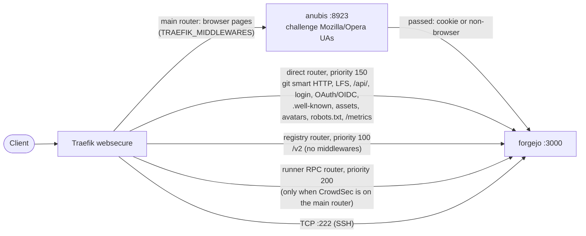

# skgit

Forgejo (git hosting, issues, packages, container registry, Actions) on the
swarm, with its Postgres, a dump sidecar, an Anubis crawler gate in front of
the web UI, and opt-in Actions runners (Docker-in-Docker, deployed with
`docker compose` on one node). Operating procedures: [SOP.md](SOP.md).

## Services

| Service | Image | Role |
|---|---|---|
| `forgejo` | `codeberg.org/forgejo/forgejo` (`FORGEJO_VERSION`) | web, git over HTTPS and SSH (`:222`), API, registry |
| `anubis` | `ghcr.io/techarohq/anubis` (`ANUBIS_IMAGE`, pinned by digest) | proof-of-work gate for browser page views |
| `postgres` | `postgres:16` | Forgejo database |
| `db-backup` | `postgres:16` | `pg_dumpall` loop into `skgit-<env>/database-dump` |
| runners (compose) | `forgejo/runner` + `docker:dind` | Actions, only when `DIND_NODE` is set |

## Routing



The main router keeps the instance's middleware chain (for example
`crowdsec-bouncer@file`), so CrowdSec still sees every browser request
before Anubis does. The direct router uses the same chain. With
`ANUBIS_ENABLED: false` the anubis service and the direct router are not
rendered and the main router points at Forgejo again (`--prune` removes the
service on the next deploy).

## Crawler gate

Crawlers that rotate Chrome user agents over many IPs ignore robots.txt and
walk Forgejo's history views: blame, commit lists, single commits, raw files,
archives, compares. Each of those runs git over the repository history, and
enough of them at once starve a slow node and push Forgejo past its memory
limit during repacks. Forgejo has no "sign in for expensive pages only"
setting (`REQUIRE_SIGNIN_VIEW` is all or nothing), and a cookie test in
Traefik does not work because the sticky-session cookie is set for everyone.

[Anubis](https://github.com/TecharoHQ/anubis) runs with its built-in default
policy:

- a user agent claiming Mozilla or Opera gets a short proof-of-work challenge
  (a second or less in a real browser), then a signed cookie valid for a week
  and bound to the client IP;
- known good crawlers (search engines, verified by IP range) are allowed,
  known AI scrapers and pathological clients are denied;
- anything else (git, curl, wget, Go, Docker, CI, Prometheus) passes without
  a challenge.

On top of that, the direct router keeps every non-browser path away from
Anubis entirely, so git, the API, the registry, runners, LFS and the sksso
OAuth/OIDC flow keep working even if Anubis is down. A browser that signs in
through sksso is challenged once on its first page after the callback.

The key Anubis signs its cookies with is generated at start, so a restart
of the anubis service asks browsers to solve one more challenge. Nothing
else is stored.

## Forgejo configuration: app.ini only

The forgejo service runs `forgejo web` directly instead of the image's s6
setup, so `FORGEJO__*` environment variables are never applied to app.ini.
`src/config/skgit/app.ini.j2`, rendered by every deploy, is the whole
Forgejo configuration. To change a setting, use a vault knob below (or add
one to the template); do not add `FORGEJO__*` variables, and do not add
`environment-to-ini`: `skgit.env` still carries legacy keys (admin
credentials, `install` keys) that do not belong in app.ini.

Settings the template owns besides the basics:

- `[security] REVERSE_PROXY_LIMIT = 1` and `REVERSE_PROXY_TRUSTED_PROXIES`:
  Forgejo's peer is Traefik or Anubis on an overlay network, so it takes the
  client IP from `X-Forwarded-For` and logs real client addresses instead of
  `172.16.x.x`. Anubis strips private hops from `X-Forwarded-For`.
- `[session] PROVIDER = file` on the bind-mounted sessions dir, so a deploy
  does not log everyone out.
- `[git.config]`: global git config for every git process Forgejo spawns.
  Defaults `pack.threads = 1`, `pack.windowMemory = 256m`,
  `pack.deltaCacheSize = 64m`, `gc.auto = 0` bound the memory of concurrent
  repacks; Forgejo's own cron runs housekeeping.

## robots.txt

The role installs `src/config/skgit/robots.txt` as
`skgit-<env>/data/gitea/public/robots.txt` (Forgejo's custom dir), served at
`/robots.txt`. It disallows the history views and the API for polite
crawlers and sets `Crawl-delay: 10`; code browsing stays indexable.

## Vault knobs

Required: `POSTGRES_PASSWORD`, `SHARED_SECRET`, `SECRET_KEY`,
`INTERNAL_TOKEN`, `RUNNER_REGISTRATION_TOKEN`, `CLUSTERNAME`, `DOMAIN`
(see the minimal snippet in `docs/v1-service-catalog.md`).

| Knob | Default | Effect |
|---|---|---|
| `ANUBIS_ENABLED` | `true` | crawler gate on the web UI; `false` routes it straight to Forgejo |
| `ANUBIS_IMAGE` | pinned `anubis:v1.28.2@sha256:...` | Anubis image (Renovate maintains the default) |
| `ANUBIS_LOG_LEVEL` | `INFO` | Anubis `SLOG_LEVEL` |
| `TRAEFIK_MIDDLEWARES` | `default-no-crowdsec@file` | middleware chain of the main and direct routers |
| `RUNNER_RPC_MIDDLEWARES` | `default-no-crowdsec@file` | runner RPC router chain (rendered only with CrowdSec on the main router) |
| `REVERSE_PROXY_TRUSTED_PROXIES` | `10.0.0.0/8,172.16.0.0/12,192.168.0.0/16` | networks Forgejo trusts for `X-Forwarded-For` |
| `GIT_CONFIG` | pack limits above | dict of git config keys; a key here replaces the default |
| `ROBOTS_TXT` | `true` | install the role's robots.txt; `false` leaves the file alone |
| `HEALTH_START_PERIOD` | `60m` | Forgejo healthcheck start period (major upgrades migrate before answering) |
| `ACTIONS_ENABLED`, `PACKAGES_ENABLED`, `LFS_ENABLED` | `true` | `[actions]`, `[packages]`, `[lfs] ENABLED` |
| `ENABLE_PUSH_CREATE_USER`, `ENABLE_PUSH_CREATE_ORG` | `true` | push-to-create |
| `FORGEJO_VERSION` | see template | Forgejo image tag |
| `METRICS_TOKEN`, `METRICS_ENABLED` | unset | `/metrics`, fail closed without a token |
| `LFS_JWT_SECRET`, `OAUTH2_JWT_SECRET` | unset | set them, or Forgejo generates new ones |
| `DIND_NODE` | unset | node for the Actions runners; unset skips them |
| `placement_constraints` | `[]` | swarm constraints for every service |
| `first_install_wait_seconds` | `1800` | deploy wait for the Forgejo task and API |
| `AUTHENTIK_TILE*` | on | Authentik portal tile |
| `ADMIN_EMAIL`, `ADMIN_PASSWORD`, `ADMIN_USERNAME` | unset, `skadmin` | local admin account, created only with `admin_enabled: true` |

## Verify

```sh
H=https://skgit.<cluster>.<domain>
# browser UA on a history page: Anubis challenge (200 with the challenge page)
curl -s -A 'Mozilla/5.0' "$H/<owner>/<repo>/blame/branch/main/README.md" | grep -ci anubis
# non-browser UA on the same page: Forgejo answers directly
curl -s -o /dev/null -w '%{http_code}\n' "$H/<owner>/<repo>/blame/branch/main/README.md"
# git smart HTTP and the API never see Anubis
git ls-remote "$H/<owner>/<repo>.git" | head -1
curl -s "$H/api/v1/version"
curl -s "$H/robots.txt" | head -3
```
