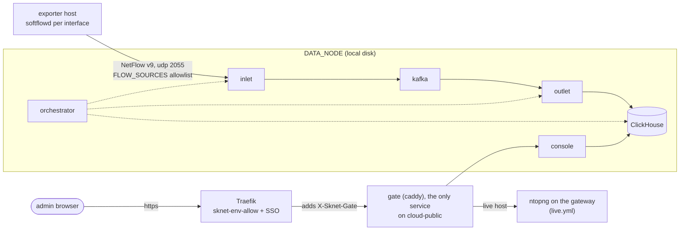

# sknet

**Network flow visibility for a self-hosted estate: an Akvorado flow collector and console on one swarm node, softflowd exporters on the hosts you want to watch, and an optional ntopng live view on the gateway.** Mesh-only web access, SSO by default, local-disk data with a disk budget.

Built on [Akvorado](https://github.com/akvorado/akvorado) (AGPL-3.0) and [ntopng Community](https://github.com/ntop/ntopng) (GPLv3). Both are used unchanged, from their upstream images; "sknet" only names the role, the stack, the routers and the portal tile. Their web UIs keep their own look. Product site: [sknet.skworld.io](https://sknet.skworld.io).

- **Status:** Active, opt-in. Nothing renders or changes for an instance that never runs one of the three plays below.
- **Maturity-tier:** T0, Classical. The role implements no cryptography and makes no post-quantum or hybrid claim; it deploys upstream tools and serves them over the instance's existing TLS.
- **Version:** framework `v1` tree (this repo's [Versions table](../../../../README.md#versions)). Release notes are in the repo [CHANGELOG.md](../../../../CHANGELOG.md).
- **Canonical-home:** `v1/ansible/optional/sknet/` in [smilinTux/skstacks](https://github.com/smilinTux/skstacks).
- **Operating procedures:** [SOP.md](./SOP.md). Product docs (also rendered on the product site): [docs/overview.md](./docs/overview.md), [docs/architecture.md](./docs/architecture.md), [docs/multi-hop-pattern.md](./docs/multi-hop-pattern.md), [docs/operations.md](./docs/operations.md).
- **Generic pattern:** [sknet-flow-visibility](../../../../v2/docs/patterns/sknet-flow-visibility.md) (collector placement, one exporter per hop, the telemetry exception for one-way sites).

## What it is

| Part | Play | Runs as |
|---|---|---|
| Collector and console: Akvorado `orchestrator`, `inlet`, `outlet`, `console`, plus single-node KRaft Kafka and ClickHouse | `deploy_sknet-<env>.yml` | swarm stack `sknet-<env>`, all stateful services pinned to `DATA_NODE`, data on local disk |
| Flow exporters: softflowd, one instance per interface, NetFlow v9, unsampled | `exporters.yml` | `sknet-softflowd@<interface>.service` on each host of group `sknet_exporter_hosts` |
| Live view: ntopng Community 7.0, packet capture on the gateway's own interfaces | `live.yml` | `sknet-live.service` (pinned container, host network, memory-capped) on each host of group `sknet_live_hosts`; fronted by the stack's `gate` (Caddy) service |

The inlet's UDP ports (`NETFLOW_PORT` 2055, `IPFIX_PORT` 4739) are published in host mode so the exporter's source address survives, and an iptables allowlist (`sknet-<env>-fw.service`) drops every source not in `FLOW_SOURCES`. The web UIs are routed through Traefik with an address allowlist (`ALLOW_CIDRS`) and, by default, Authentik forward auth.



## Quickstart

Inventory (instance-private, not in this repo) with one group per host play, and per-host variables in `host_vars/`:

```ini
[sknet_exporter_hosts]
gateway-1  ansible_host=192.0.2.10
site-a     ansible_host=198.51.100.7

[sknet_exporter_hosts:vars]
sknet_collector=192.0.2.20

[sknet_live_hosts]
gateway-1
```

```yaml
# host_vars/gateway-1.yml
sknet_export_address: "192.0.2.10"        # the source address the collector sees
sknet_interfaces:
  - { name: lan0,  index: 101, class: lan }
  - { name: mesh0, index: 102, class: mesh }
sknet_live_interfaces: [lan0, mesh0]
sknet_live_bind: "192.0.2.10"
sknet_live_allow_sources: ["192.0.2.0/24"]
```

Minimal vault:

```yaml
sknet:
  CLUSTERNAME: "<cluster>"
  DOMAIN: "example.com"
  DATA_NODE: "<swarm node hostname>"
  FLOW_SOURCES: ["192.0.2.10", "198.51.100.7"]
```

Deploy, in this order:

```bash
# 1. The collector stack (builds the exporter metadata from the inventory group)
ansible-playbook -i envs/prod/inventory.ini -i shared/sknet_exporters.ini \
  framework/v1/ansible/optional/sknet/deploy_sknet-prod.yml \
  -e target_manager_group=swarm_managers \
  --vault-password-file ~/.vault_pass_env/.<instance>_prod_vault_pass

# 2. The exporters (softflowd on each host and interface)
ansible-playbook -i shared/sknet_exporters.ini \
  framework/v1/ansible/optional/sknet/exporters.yml [-l gateway-1]

# 3. The live view (optional; set LIVE_UPSTREAM in the vault and redeploy step 1 to route it)
ansible-playbook -i shared/sknet_exporters.ini \
  framework/v1/ansible/optional/sknet/live.yml [-l gateway-1]
```

The host plays read the same environment's vault (`prod`, or `-e env=<env>`); an empty `sknet: {}` block is enough for them. Full procedure, verification and troubleshooting: [docs/operations.md](./docs/operations.md) and [SOP.md](./SOP.md).

## Prerequisites

- A swarm node with **AVX2** (ClickHouse 26.6 and later) and local disk for `DATA_DIR`. ClickHouse and Kafka never go on NFS or `/var/data`.
- Traefik (skfence or skfenceha); Authentik (sksso) for the default sign-in and the portal tile.
- Exporter hosts on `apt` (softflowd is installed when missing and `allow_package_install` is true, the default).
- Docker Engine on the live host (the live play does not install it).

## Configuration (vault)

The vault holds one `sknet:` block, merged over `vars/defaults.yml`; set only what you change. Required: `DATA_NODE` and `FLOW_SOURCES`, and at least one exporter (inventory group or `STATIC_EXPORTERS`).

| Key | Default | Meaning |
|---|---|---|
| `CLUSTERNAME`, `DOMAIN` | cluster and domain of the play | Host names are `<HOSTNAME>[-env].<CLUSTERNAME>.<DOMAIN>` (`DOMAIN` alone when `CLOUDFLARED`) |
| `HOSTNAME` / `LIVE_HOSTNAME` | `sknet` / `sknet-live` | Console and live labels; a value with a dot is a full host name |
| `DATA_NODE` | required | Swarm node hostname that holds Kafka, ClickHouse and the flow ports. It must also be a host name in the deploy's inventory (the data directories and the flow firewall are created on it with `delegate_to`) |
| `GATE_SECRET` | required | Random string of at least 32 characters (letters, digits, dash, underscore; `openssl rand -hex 32`). Traefik adds it as the `X-Sknet-Gate` header and the `gate` service refuses any request without it |
| `DATA_DIR` | `/var/lib/sknet-<env>` | Local disk path on `DATA_NODE`; refused under `/var/data` |
| `AKVORADO_IMAGE` | `quay.io/akvorado/akvorado:2026.10.1` | Pinned by tag or digest; floating tags refused |
| `CLICKHOUSE_IMAGE` / `KAFKA_IMAGE` / `PROXY_IMAGE` | `clickhouse/clickhouse-server:26.8`, `apache/kafka:4.3.1`, `caddy:2.11.9-alpine` | Pinned |
| `NTOPNG_IMAGE` | digest of the pinned ntopng build | Used by `live.yml`; Docker Hub publishes only a floating tag, so it is a digest |
| `ALLOW_CIDRS` | RFC 1918 + `100.64.0.0/10` | The `sknet-<env>-allow` ipAllowList on every router; narrow it |
| `AUTH_MODE` | `authentik` | `authentik` (allowlist plus SSO) or `allowlist` (refused with `CLOUDFLARED`) |
| `SSO_MIDDLEWARE` | `authentik@file` | Only valid with `AUTH_MODE: authentik` |
| `TRAEFIK_MIDDLEWARES`, `TLS_OPTIONS`, `CLOUDFLARED` | `default-no-error-pages@file`, `none`, `false` | Router settings |
| `NETFLOW_PORT` / `IPFIX_PORT` | `2055` / `4739` | Inlet UDP ports, host mode on `DATA_NODE`; must differ |
| `FLOW_SOURCES` | required | IPv4 literals allowed to send flows; must contain every exporter address; empty refuses the deploy |
| `STATIC_EXPORTERS` | `{}` | Fallback exporter metadata: name to `{sknet_export_address, sknet_interfaces}` |
| `NETWORKS` | `{}` | CIDR to name map for Akvorado network naming |
| `GEOIP_ENABLED` | `false` | Adds a `geoip` directory under `DATA_DIR`; you supply the database files |
| `FLOW_TTL_DAYS` | `30` | Raw and 1 minute tables (1 to 3650); decide before first start |
| `FLOW_AGG_TTL_DAYS` | `90` | 5 minute table; the hourly table keeps 4 times as long (at most 365) |
| `DISK_BUDGET_GB` | `20` | Planning figure (at least 5); deploy refuses a disk where `DATA_DIR` used plus free is below it |
| `MIN_FREE_GB` | `5` | ClickHouse stops writing below this much free space |
| `CLICKHOUSE_MEMORY_LIMIT`, `KAFKA_MEMORY_LIMIT`, `AKVORADO_MEMORY_LIMIT` | `1536M`, `704M`, `512M` | `AKVORADO_MEMORY_LIMIT` is the outlet |
| `ORCHESTRATOR_MEMORY_LIMIT`, `INLET_MEMORY_LIMIT`, `CONSOLE_MEMORY_LIMIT`, `PROXY_MEMORY_LIMIT` | `192M`, `160M`, `256M`, `64M` | `PROXY_MEMORY_LIMIT` is the gate. Whole stack 3424M, under 3.5 GB |
| `LIVE_UPSTREAM` | unset | `http://<IPv4>:<port>` of the ntopng host; unset renders no live host on the gate (the console still goes through it) |
| `PROXY_PLACEMENT_CONSTRAINTS` | `[]` | Swarm placement for the `gate`. Empty means: keep it off every host of `sknet_live_hosts` in the inventory (`node.hostname != <name>`); a list replaces that default |
| `LOG_MAX_SIZE`, `LOG_MAX_FILES` | `10m`, `3` | Container log rotation |
| `AUTHENTIK_TILE`, `AUTHENTIK_TILE_SLUG`, `AUTHENTIK_TILE_NAME`, `AUTHENTIK_TILE_GROUP`, `AUTHENTIK_TILE_ICON`, `AUTHENTIK_TILE_DESCRIPTION`, `AUTHENTIK_TILE_OPEN_IN_NEW_TAB` | tile on | Portal tile (a bookmark; the sign-in gate is `AUTH_MODE` and `ALLOW_CIDRS`) |

### Host variables (instance inventory)

| Variable | Play | Meaning |
|---|---|---|
| `sknet_interfaces` | exporters, deploy | List of `{name, index, class, speed_mbps, description}`; name 1 to 15 characters of `A-Za-z0-9_.-`; index integer 100 to 65535 unique per host; class `lan`, `mesh`, `estate-link` or `internet` |
| `sknet_collector` | exporters | IPv4 literal of the collector; names refused; public addresses refused unless `sknet_allow_public_collector: true` |
| `sknet_export_address` | exporters, deploy | The address the collector sees as source; feeds `FLOW_SOURCES` checks and static metadata |
| `sknet_state` | exporters, live | `present` (default) or `absent` |
| `sknet_netflow_port` | exporters | Refused unless it equals the vault's `NETFLOW_PORT` |
| `sknet_softflowd_max_flows`, `_maxlife`, `_memory_max`, `_cpu_quota` | exporters | `32768`, `60` s, `128M`, `10%` |
| `sknet_live_interfaces` | live | 1 to 8 distinct interface names to capture |
| `sknet_live_bind` | live | IPv4 literal for the ntopng UI (port 3000); `0.0.0.0` refused; public refused unless `sknet_live_allow_public_bind: true` |
| `sknet_live_allow_sources` | live | Non-empty list of IPv4 or CIDR (prefix /8 or longer) allowed to reach tcp 3000; include the address of every swarm node that can run the `gate` (a gate on the live host itself needs its `docker_gwbridge` subnet instead, see Security notes) |
| `sknet_live_memory_max` | live | `512M`; applied to the container (swap included) and the unit |
| `sknet_live_max_hosts`, `sknet_live_max_flows` | live | `16384` each (ntopng `-x`, `-X`) |
| `sknet_live_purge_data` | live | With `sknet_state: absent`, also delete the data directory |
| `allow_package_install` | exporters | Play variable, default `true`; softflowd is installed with apt only |

## Sizing and the disk

Raw flow rows are about 100 to 150 bytes compressed: `GB per day = flows per second x 86400 x ~125 / 1e9`. At 100 flows/s that is roughly 1 to 1.5 GB a day, so the default 20 GB holds about 15 to 20 days of raw flows (the default 30-day TTL fits only up to about 50 flows/s; measure and adjust). The deploy refuses a data disk where what `DATA_DIR` already uses plus what is free is below `DISK_BUDGET_GB` (a redeploy of a growing install still passes), and ClickHouse stops writing when free space drops below `MIN_FREE_GB`, so a TTL that is too generous costs history, not the disk.

## Security notes

- **Allowlist first.** `ALLOW_CIDRS` is applied on every router before SSO. It judges the address Traefik sees; behind NAT or a tunnel that is not the client, which is why `AUTH_MODE: allowlist` is refused with `CLOUDFLARED`.
- **Header trust and the gate.** The console and Akvorado trust the login header Authentik's forward auth sets, and ntopng has no login. The shared `cloud-public-<env>` network is the boundary: every routed service of every stack is on it, so any container there could forge that header or reach ntopng. Only the `gate` service (Caddy) sits on it. Traefik adds the `X-Sknet-Gate` header (vault `GATE_SECRET`, required, 32 or more characters) to both routers, and the gate answers 403 to any request without it, strips it, and then proxies the console host to the console over the private `sknet-<env>` network and the live host to ntopng. `/debug` is blocked on the console host. The secret is a Docker secret for the gate and a Traefik label, so a Swarm manager can read it; rotate it by changing the vault key and redeploying. Keep `sknet-<env>` private too: nothing else should be attached to it.
- **Live view.** ntopng runs with its own login off (`-l 1`); the bind address, the `SKNET-LIVE` iptables chain and the gate are the access control. The gate reaches ntopng from the address of the swarm node running it, so list those nodes in `sknet_live_allow_sources`. A gate on the live host itself (when it is also a swarm node) arrives from the `docker_gwbridge` subnet instead and is dropped, so the deploy keeps the gate off hosts of `sknet_live_hosts` by default (`PROXY_PLACEMENT_CONSTRAINTS` overrides). The alternative is adding that host's `docker_gwbridge` subnet to `sknet_live_allow_sources`, which admits every container on the host. `live.yml` warns when the host is an active swarm node. The `SKNET-LIVE` hook matches only `sknet_live_bind` on tcp 3000; rerun `systemctl restart sknet-live-fw` after a host firewall reload (ufw, firewalld). ntopng bundles a Redis on the host's loopback port 6379: a host Redis there would clash and silently receive ntopng's preferences.
- **Reboot window.** `sknet-<env>-fw.service` starts after `docker.service`, so for a few seconds after a reboot the flow ports accept datagrams from any address. The inlet only accepts NetFlow into Kafka, so the exposure is small.
- **Double counting.** softflowd reports one interface index as both input and output, so traffic forwarded between two monitored interfaces shows under both. Group by exporter and interface and do not sum across interfaces.
- **One-way sites.** A site that may not open connections into the core can still export flows with one narrow exception: one UDP port to one collector. See [docs/multi-hop-pattern.md](./docs/multi-hop-pattern.md).

## Files

| Open this | It is |
|---|---|
| [`deploy_sknet-<env>.yml`](./) | Swarm deploy for dev, staging and prod: validation, data directories, disk gate, stack, port allowlist, portal tile |
| [`exporters.yml`](./exporters.yml) | softflowd host play; `sknet_state: absent` removes everything it added |
| [`live.yml`](./live.yml) | ntopng host play; same `absent` semantics |
| [`vars/defaults.yml`](./vars/defaults.yml) | Every default and the validation patterns |
| [`tasks/`](./tasks) | `validate.yml`, `data_dirs.yml`, `render.yml`, `deploy.yml`, `port_allowlist.yml`, `exporter_check.yml`, `exporter_guards.yml`, `live_guards.yml` |
| [`src/config/sknet/`](./src/config/sknet) | Stack file, Akvorado and ClickHouse config, Caddyfile, softflowd and ntopng units, firewall scripts |

## See also

- [SOP.md](./SOP.md): build, test, deploy, configuration, reference and troubleshooting.
- [docs/v1-service-catalog.md](../../../../docs/v1-service-catalog.md#sknet): the catalog entry.
- [skmesh site isolation](../../../../v2/docs/patterns/skmesh-site-isolation.md): the trusted-core, one-way-site model the telemetry exception fits into.
- [Akvorado documentation](https://github.com/akvorado/akvorado/tree/main/console/data/docs) and [ntopng documentation](https://www.ntop.org/guides/ntopng/).
