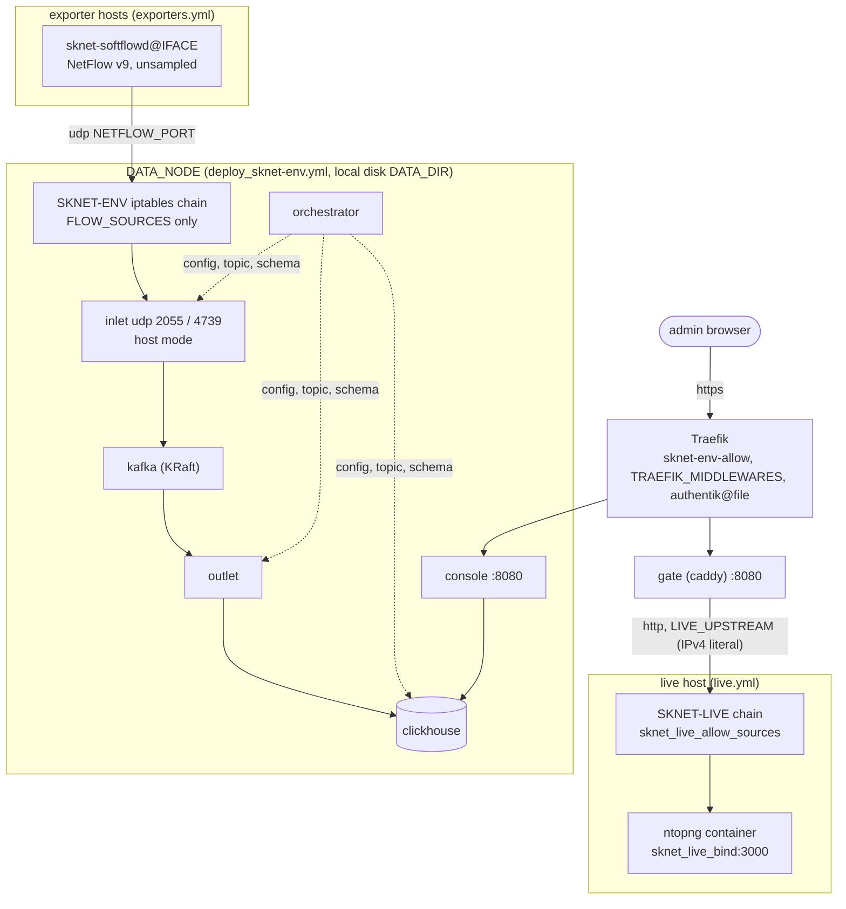
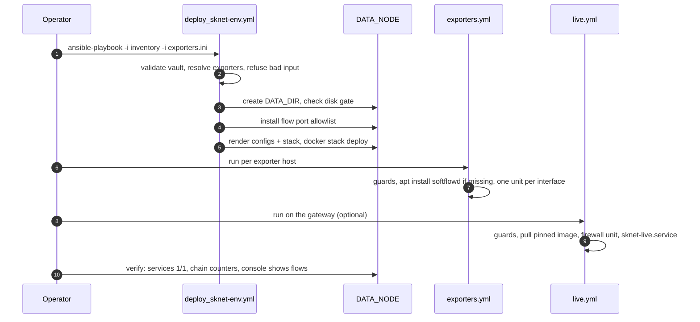

# sknet: Standard Operating Procedures

Deploys and operates network flow visibility: [Akvorado](https://github.com/akvorado/akvorado) (AGPL-3.0) as the flow collector and console, softflowd as the flow exporter, and [ntopng Community](https://github.com/ntop/ntopng) (GPLv3) as an optional live view. Called by the operator. Companion: [README.md](./README.md) (what it is, quickstart, the knob table). Product docs, also rendered on [sknet.skworld.io](https://sknet.skworld.io): [docs/](./docs).

Conventions in this file: placeholders are `<env>` (dev, staging, prod), `<instance>`, `<cluster>`, `<interface>`; example addresses are from 192.0.2.0/24 and 198.51.100.0/24, the example domain is `example.com`. Real names live in the instance repo.

## 1. Overview

**Purpose.** Show who talks to whom, over which interface, how much, and since when, across a LAN, a mesh, links to other estates and the internet edge, with history (Akvorado) and a live per-host view on the gateway (ntopng).

**Scope, what it owns.**

- The swarm stack `sknet-<env>`: `orchestrator`, `inlet`, `outlet`, `console`, single-node KRaft `kafka`, `clickhouse`, and the `gate` (Caddy), which fronts the console and, when `LIVE_UPSTREAM` is set, the live view.
- The flow port allowlist on `DATA_NODE`: `sknet-<env>-fw.service` and the iptables chain `SKNET-<ENV>`.
- The exporter host play: `sknet-softflowd@<interface>.service` per interface, env files under `/etc/sknet`.
- The live host play: `sknet-live.service` (ntopng container) and `sknet-live-fw.service` (chain `SKNET-LIVE`, tcp 3000).
- The Traefik routers `sknet[-env]` and `sknet-live[-env]`, the middleware `sknet-<env>-allow` and the Authentik portal tile.

**What it explicitly does NOT do.**

- It does not publish anything to the internet: no public router, no public flow port.
- It does not capture packets on the collector, inspect payloads, or run intrusion detection.
- It does not install Docker, and installs softflowd only with apt.
- It does not use SNMP; interface metadata is static, built from the exporter inventory.
- It does not put ClickHouse or Kafka on NFS or `/var/data`; the deploy refuses that.
- It does not weaken a one-way site: the only mesh exception it documents is one UDP port to one collector.

## 2. Architecture

System view (what runs where):



Deploy and verification path:



Where the code lives: `deploy_sknet-<env>.yml` (three env plays), `exporters.yml`, `live.yml`, `vars/defaults.yml`, `tasks/*.yml`, `src/config/sknet/*.j2`, `src/sknet/deploy.j2`. Overlay networks `sknet-<env>` (subnets reserved per environment in the deploy plays) and `cloud-public-<env>`.

### Components and ports

| Piece | Where | Notes |
|---|---|---|
| inlet | `DATA_NODE` | udp `NETFLOW_PORT` (2055) and `IPFIX_PORT` (4739), published `mode: host` so the source address survives |
| kafka, clickhouse, outlet, orchestrator, console | `DATA_NODE` | `sknet-<env>` overlay only; data in `DATA_DIR/{kafka,clickhouse,outlet,console}` |
| gate | any node except the live host (default from the inventory, or `PROXY_PLACEMENT_CONSTRAINTS`) | always; the only service on `cloud-public-<env>`; needs `X-Sknet-Gate`; reaches ntopng from the node's own address |
| softflowd | exporter hosts | one systemd instance per interface; unit `sknet-softflowd@.service`; env `/etc/sknet/softflowd-<interface>.env` |
| ntopng | live host | `sknet-live.service`, host network, `--memory` and `MemoryMax` from `sknet_live_memory_max` (512M) |

### Access model

1. The router chain is `sknet-<env>-allow`, then `TRAEFIK_MIDDLEWARES`, then (authentik mode) `authentik@file`. The allowlist is first.
2. `ALLOW_CIDRS` is judged on the address Traefik sees (ipStrategy depth 0). Behind NAT or a tunnel that is not the client.
3. `AUTH_MODE: authentik` maps the `X-authentik-username`, `-name` and `-email` headers to the console login; no header, no access. `AUTH_MODE: allowlist` admits everyone the allowlist admits as one fixed user, and is refused with `CLOUDFLARED`.
4. **Header trust and the gate.** The console and Akvorado trust the login header, and ntopng has no login. The shared `cloud-public-<env>` network is the boundary, and only `gate` sits on it. Traefik adds `X-Sknet-Gate` (vault `GATE_SECRET`, required, 32 or more characters, `openssl rand -hex 32`) on both routers; the gate answers 403 without it, strips it and proxies on over `sknet-<env>`. `/debug` is blocked on the console host. Keep `sknet-<env>` private too.

## 3. Build

Nothing is built; the role deploys upstream images, pinned by tag (Akvorado, ClickHouse, Kafka, Caddy) or digest (ntopng, whose Docker Hub repository publishes only a floating tag). "Build" means rendering the stack and configs from the vault. Render and check without changing the live stack:

```bash
ansible-playbook -i envs/<env>/inventory.ini -i shared/sknet_exporters.ini \
  framework/v1/ansible/optional/sknet/deploy_sknet-<env>.yml \
  -e target_manager_group=swarm_managers \
  --vault-password-file ~/.vault_pass_env/.<instance>_<env>_vault_pass \
  --check --diff
```

`vars/defaults.yml` carries the same image literals as the stack template so `v1/scripts/list_images.py` sees the pins; `test_sknet_render.py` keeps the two equal.

## 4. Test

```bash
# Render tests: the stack, Akvorado config, ClickHouse profile and proxy render for the
# documented vault shapes, and the deploy's guards refuse bad input
python -m pytest v1/tests/test_sknet_render.py -v

# Exporter host play: guards, units and state absent
python -m pytest v1/tests/test_sknet_exporters.py -v

# Live host play: guards, units, firewall chain and state absent
python -m pytest v1/tests/test_sknet_live.py -v

# Repo-wide gates this role must keep passing
python -m pytest v1/tests/test_no_latest_images.py v1/tests/test_unique_subnets.py v1/tests/test_render_gate.py -v
python -m pytest v1/tests/test_readme_references_exist.py -v
```

The real-Ansible render gate (`v1/tests/render/render_playbooks.py`) renders the deploy against `v1/tests/render/vars/sknet.{example,set,with.sksso}.yml` and requires every vault key the example reads to appear under the README's "Configuration (vault)" section. Privacy: `scripts/scrub-check.sh` and the framework's skred scan must stay clean (no real hostnames, addresses or domains).

## 5. Release / Deploy

### 5.1 Order

1. **Preflight.** `DATA_NODE` has AVX2 (`grep -w avx2 /proc/cpuinfo`), local disk for `DATA_DIR` with at least `DISK_BUDGET_GB` available to sknet, and Traefik sees real client addresses. Decide `FLOW_TTL_DAYS` now: ClickHouse sizes partitions from it on first start.
2. **Vault and inventory.** Write the `sknet:` vault block and the instance-private exporter inventory (groups `sknet_exporter_hosts`, `sknet_live_hosts`; hostvars in the README).
3. **Stack.** `deploy_sknet-<env>.yml` with `-i <exporters ini>` (see §3 for the command without `--check --diff`).
4. **Exporters.** `exporters.yml`, one host at a time with `-l <host>`.
5. **Live view** (optional). `live.yml -l <host>`, then set `LIVE_UPSTREAM` in the vault and redeploy the stack (with the live hosts in the inventory) to add the live host to the gate.
6. **Verify** (§5.2).

The stack deploy script waits up to `HEALTH_WAIT_SECONDS` (300) for the orchestrator to converge, then prints the console URL, the live URL when enabled, and the inlet ports.

### 5.2 Verify

```bash
docker service ls --filter name=sknet-<env>              # every replica 1/1
sudo iptables -L SKNET-<ENV> -n -v                       # RETURN per FLOW_SOURCES address, then DROP, per port
systemctl status 'sknet-softflowd@*'                     # on an exporter: one active unit per interface
sudo tcpdump -ni any -c 5 udp port 2055                  # on DATA_NODE: flows arriving
docker exec $(docker ps -q -f name=sknet-<env>_clickhouse) \
  clickhouse-client -q "SELECT count(), max(TimeReceived) FROM flows"
```

Then open `https://sknet.<cluster>.example.com/`: the home page shows the last flow, and grouping by exporter and interface shows the interface names from the inventory. From a client outside `ALLOW_CIDRS` the same URL must return 403.

### 5.3 Disk gate and retention

- **Gate.** Before the stack is touched the deploy measures `DATA_DIR` on `DATA_NODE` and refuses to continue when (what `DATA_DIR` already uses + free space) is below `DISK_BUDGET_GB`. A redeploy of a growing install passes; a fresh, too small disk fails with the numbers. It is a planning figure, not a quota.
- **Floor.** `MIN_FREE_GB` (5) is a ClickHouse `keep_free_space_bytes`: writes stop before the disk fills.
- **Sizing.** `GB/day = flows/s x 86400 x ~125 B / 1e9`. 100 flows/s is roughly 1 to 1.5 GB a day, so 20 GB holds about 15 to 20 days of raw flows. The default `FLOW_TTL_DAYS` of 30 fits 20 GB only up to about 50 flows/s. Measure: `SELECT formatReadableSize(sum(bytes_on_disk)) FROM system.parts WHERE database = 'default' AND active`.
- **TTLs.** `FLOW_TTL_DAYS`: raw and 1 minute tables. `FLOW_AGG_TTL_DAYS`: 5 minute table; hourly table 4 times that. Kafka keeps 12 hours with a size cap of one twentieth of `DISK_BUDGET_GB` per partition.

### 5.4 Upgrade and rollback

Bump the pinned image in the vault, read the upstream notes, update the Akvorado orchestrator first if the release says so (`docker service update --image <new> sknet-<env>_orchestrator`), then rerun the deploy. Swarm configs are named after their content, so only services whose configuration changed roll. For ntopng rerun `live.yml`. Akvorado does not support downgrade: keep a copy of `DATA_DIR/clickhouse` before a major bump.

### 5.5 Removal

Exporters and live: `sknet_state: absent`, run the play (softflowd package and ntopng image stay; the live data directory stays unless `sknet_live_purge_data: true`). Stack: `docker stack rm sknet-<env>`; data stays in `DATA_DIR`. Flow port allowlist: include `tasks/port_allowlist.yml` with `sknet_fw_state: absent`, or remove the unit, script and chain by hand (README, operations doc).

## 6. Configuration / Usage

The vault and hostvar reference is in the [README](./README.md#configuration-vault). Rules the plays enforce, with the failure you will see:

| Guard | Refused when |
|---|---|
| vault block | no `sknet:` block |
| `DATA_NODE`, `DATA_DIR` | node not a hostname; dir not an absolute local path, or under `/var/data` |
| images | any of the five images not pinned by version tag or digest (no `latest`, `stable`, major-only) |
| numbers | `FLOW_TTL_DAYS` outside 1 to 3650, `FLOW_AGG_TTL_DAYS` outside 1 to 365, `DISK_BUDGET_GB` under 5, `MIN_FREE_GB` under 1, equal or invalid ports, a `*_MEMORY_LIMIT` not like `512M` |
| `AUTH_MODE` | not `authentik` or `allowlist`; `SSO_MIDDLEWARE` with `allowlist`; `allowlist` with `CLOUDFLARED` true |
| `ALLOW_CIDRS` | empty, not a list, or any entry not an IPv4 CIDR |
| `LIVE_UPSTREAM` | not empty and not `http://<IPv4>:<port>` |
| `FLOW_SOURCES` | empty, not IPv4 literals, or missing an exporter's `sknet_export_address` |
| exporters | none present (`No flow exporter ...`), a bad address, index (not 100 to 65535 and unique), class or interface name |
| `sknet_collector` | not an IPv4 literal, or public without `sknet_allow_public_collector: true` |
| `sknet_netflow_port` | differs from the vault's `NETFLOW_PORT` |
| live host | no docker; bind not an IPv4 literal, `0.0.0.0`, or public without `sknet_live_allow_public_bind`; empty or malformed `sknet_live_allow_sources`; 0 or more than 8 interfaces |

**Exporter metadata source.** The inventory group `sknet_exporter_hosts` wins when it has members (deploy run with `-i <exporters ini>`); otherwise vault `STATIC_EXPORTERS`. Interface class drives the Akvorado boundary: `internet` is external, the others internal.

**Double counting.** softflowd reports one index as input and output. Traffic forwarded between two monitored interfaces shows on both; group by exporter and interface and never sum across interfaces.

**One-way sites.** A site that may not open connections into the core exports flows with one exception: UDP `NETFLOW_PORT` to the one collector. Two matching changes are required (mesh policy, host egress guard); see [docs/multi-hop-pattern.md](./docs/multi-hop-pattern.md) and the [pattern](../../../../v2/docs/patterns/sknet-flow-visibility.md).

## 7. API / Reference

There is no network API. Reference points:

- **Playbooks.** `deploy_sknet-{dev,staging,prod}.yml` (tags: `config`, `compose`, `deploy-script`, `firewall`, `networks`, `deploy`, `authentik`, `authmode`), `exporters.yml`, `live.yml`.
- **Units.** `sknet-<env>-fw.service` (DATA_NODE), `sknet-softflowd@<interface>.service` (exporters), `sknet-live.service` and `sknet-live-fw.service` (live host).
- **iptables chains.** `SKNET-<ENV>` (hooked into `INPUT` and `DOCKER-USER`), `SKNET-LIVE` (hooked into `INPUT` for tcp 3000).
- **Paths.** `/var/data/config/sknet-<env>/` (stack and configs on the manager), `DATA_DIR` (data on `DATA_NODE`), `/etc/sknet/` (exporter env files), `/var/lib/sknet-live/ntopng` (live data).
- **Ports.** udp 2055 (NetFlow v9), udp 4739 (IPFIX), tcp 3000 (ntopng, bound to `sknet_live_bind`), tcp 8080 (the gate and the console, overlay only).
- **Upstream docs.** [Akvorado](https://github.com/akvorado/akvorado/tree/main/console/data/docs), [softflowd](https://github.com/irino/softflowd), [ntopng](https://www.ntop.org/guides/ntopng/).

## 8. Troubleshooting

| Symptom | Likely cause and fix |
|---|---|
| Deploy fails: `No flow exporter ...` | No exporters resolved. Run with `-i <exporters ini>` or set `STATIC_EXPORTERS`. |
| Deploy fails on the disk gate | `DATA_DIR` used plus free is under `DISK_BUDGET_GB`. Free space, use a bigger local disk, or lower `DISK_BUDGET_GB` and `FLOW_TTL_DAYS` together. |
| Deploy fails: `FLOW_SOURCES ... Missing: [...]` | An exporter's `sknet_export_address` is not in `FLOW_SOURCES`. Add it. |
| `AUTH_MODE allowlist cannot be used with CLOUDFLARED` | Behind a tunnel the allowlist cannot see clients. Use `authentik`, or serve the host with real client addresses and set `CLOUDFLARED: false`. |
| No flows in the console | Work from the exporter to the console: unit active, packets leave (`tcpdump` on the exporter), packets arrive (`tcpdump` on `DATA_NODE`), source in `FLOW_SOURCES` (chain DROP counter), exporter in the metadata (redeploy with `-i`), disk above `MIN_FREE_GB`. |
| Flows arrive but the exporter is wrong or unnamed | NAT changed the source address. Set `sknet_export_address` and `FLOW_SOURCES` to the address the collector sees (confirm with `tcpdump`), redeploy, rerun `exporters.yml`. |
| Interface shows as a number | The index is not in that exporter's `sknet_interfaces`, or the metadata is stale (redeploy). |
| 403 on the console | Client address not in `ALLOW_CIDRS` (judged on what Traefik sees), or an off-mesh resolver returned the public address. This is the allowlist working. |
| Console loads but you are anonymous or looped to sign-in | Authentik headers missing; check `SSO_MIDDLEWARE` on the router. |
| Live view 502 or timeout | Where does the gate run? On another node, that node's address must be in `sknet_live_allow_sources`. On the live host itself (also a swarm node) the traffic comes from the `docker_gwbridge` subnet and is dropped: keep the gate off it (`PROXY_PLACEMENT_CONSTRAINTS`, or the inventory default) or add that subnet (admits every container there). Check `LIVE_UPSTREAM` equals `http://<sknet_live_bind>:3000`, `systemctl status sknet-live`, and after a host firewall reload `systemctl restart sknet-live-fw`. |
| Plain `forbidden` (403) from the gate | The `X-Sknet-Gate` header is missing or wrong: both routers must end with `sknet-<env>-gate`; after changing `GATE_SECRET` redeploy. |
| ntopng restarts under load | The memory cap is working. Lower `sknet_live_max_hosts` and `sknet_live_max_flows`, capture fewer interfaces, or raise `sknet_live_memory_max` if the host can spare it. |
| Flows stop, disk nearly full | `MIN_FREE_GB` tripped. Lower the TTLs, free space, then flows resume. |
| Traffic looks doubled | Forwarded traffic is seen on two interfaces. Filter by exporter and interface. |
| `softflowd` missing and the play refuses | The host is not on apt or `allow_package_install` is false. Install softflowd 1.0.0 or later by hand. |

## 9. Maturity-tier + Version reference

- **Maturity tier:** `T0, Classical`. The role implements no cryptography, makes no post-quantum or hybrid claim and is not a crypto component; TLS is the instance's existing Traefik, and sign-in is Authentik.
- **Version phase:** framework `v1` tree (this repo's [Versions table](../../../../README.md#versions)). The role has no version of its own; it ships with the framework release, see [CHANGELOG.md](../../../../CHANGELOG.md).
- **Pinned upstream versions:** Akvorado `2026.10.1` (Akvorado moved to calendar versioning at 2026.8.0; do not run anything older than 2026.10.0, which fixed two memory-exhaustion bugs in the NetFlow and IPFIX decoders), ClickHouse `26.8` (AVX2 required), Kafka `4.3.1`, Caddy `2.11.9`, ntopng Community 7.0 by digest, softflowd 1.0.0 or later from the distribution (forced interface index syntax exists in 1.0.0, 1.1.0 and 1.1.1).
- **Licences:** Akvorado AGPL-3.0, ntopng GPLv3, ClickHouse and Kafka Apache-2.0, softflowd BSD. Upstream images are deployed unmodified. This role's files are AGPL-3.0-or-later.
- **Related docs:** [README.md](./README.md), [docs/](./docs), the catalog entry [`docs/v1-service-catalog.md`](../../../../docs/v1-service-catalog.md#sknet), the pattern [`v2/docs/patterns/sknet-flow-visibility.md`](../../../../v2/docs/patterns/sknet-flow-visibility.md), and [skmesh site isolation](../../../../v2/docs/patterns/skmesh-site-isolation.md).
