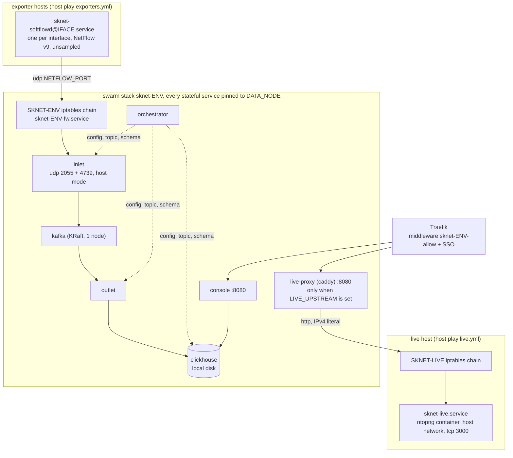
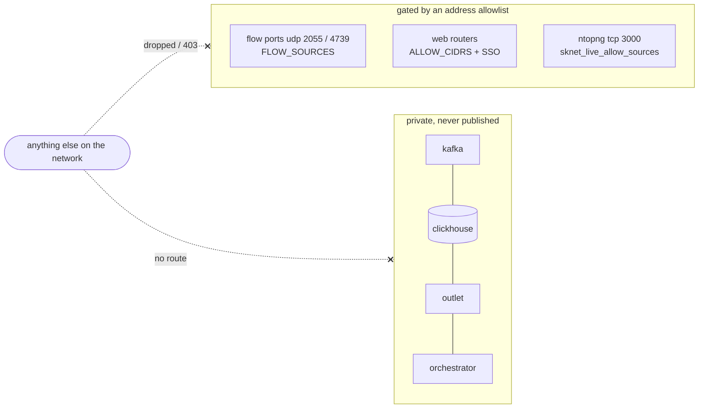

# sknet architecture

This page describes what runs where, which ports are open to whom, and which parts you must keep private. Names are placeholders: `site-a`, `gateway-1`, `collector-1`, addresses from 192.0.2.0/24 and 198.51.100.0/24, domain `example.com`.

## Components

| Piece | Where it runs | Role |
|---|---|---|
| `inlet` | swarm, on `DATA_NODE` | Listens for NetFlow v9 and IPFIX, wraps datagrams and writes them to Kafka. Parses nothing. |
| `kafka` | swarm, on `DATA_NODE` | Single-node KRaft broker used only as a buffer. Retention is 12 hours and a size cap taken from `DISK_BUDGET_GB`. |
| `outlet` | swarm, on `DATA_NODE` | Reads Kafka, decodes, adds interface names and classes, inserts into ClickHouse. |
| `clickhouse` | swarm, on `DATA_NODE` | Flow storage. Low-memory profile, system logs trimmed, stops writing when free space drops below `MIN_FREE_GB`. |
| `orchestrator` | swarm, on `DATA_NODE` | Creates the Kafka topic, builds the ClickHouse schema and TTLs, serves configuration to the others. |
| `console` | swarm, on `DATA_NODE` | The Akvorado web UI. Routed by Traefik at `sknet[-env].<cluster>.<domain>`. |
| `live-proxy` | swarm, any node (or `PROXY_PLACEMENT_CONSTRAINTS`) | Optional Caddy that forwards to the ntopng host so the live view gets the same router, allowlist and sign-in. |
| `softflowd` | exporter hosts | One systemd instance per interface: `sknet-softflowd@<interface>.service`. |
| `ntopng` | live host | One container, host networking, memory-capped, web UI on one private address, port 3000. |

Upstream services that sknet leaves out: Akvorado's bundled Traefik, Valkey, GeoIP updater, Kafka UI, Grafana, Prometheus and demo exporters. The upstream compose file cannot be deployed to swarm as it is (it uses `extends`), so sknet ships one flattened stack file.

## Ports

| Port | Proto | Where | Open to |
|---|---|---|---|
| `NETFLOW_PORT` (2055) | udp | `DATA_NODE`, host mode | only addresses in `FLOW_SOURCES` |
| `IPFIX_PORT` (4739) | udp | `DATA_NODE`, host mode | only addresses in `FLOW_SOURCES` |
| 8080 | tcp | console and live-proxy containers | the swarm overlay only, through Traefik |
| 3000 | tcp | live host, on `sknet_live_bind` only | only `sknet_live_allow_sources` |
| 9092, 9000, 8123 | tcp | Kafka, ClickHouse | the `sknet-<env>` overlay only, never published |

The inlet's UDP ports are published in host mode so the exporter's source address reaches the inlet unchanged. That address is the exporter's identity in Akvorado. The swarm routing mesh would rewrite it, which is why it is not used.

### The flow port allowlist

Published ports bypass most host firewall rules, so the deploy installs its own. A oneshot systemd unit `sknet-<env>-fw.service` runs `/usr/local/sbin/sknet-<env>-fw`, which fills an iptables chain `SKNET-<ENV>` and hooks it into `INPUT` and `DOCKER-USER`. For each flow port it returns for every address in `FLOW_SOURCES` and drops everything else. The match uses the original destination port, so it also holds after Docker's address translation. The unit is re-applied after a reboot or a Docker restart. `FLOW_SOURCES` takes IPv4 literals only (not names, not CIDRs, not IPv6), and an empty list refuses the deploy.

## Web access

Every sknet router carries the middleware chain `sknet-<env>-allow`, then `TRAEFIK_MIDDLEWARES`, then (in `authentik` mode) `authentik@file`. The allowlist comes first, so an address outside `ALLOW_CIDRS` is refused before it ever reaches the sign-in provider, and gets a plain 403.

`ALLOW_CIDRS` defaults to the three RFC 1918 private ranges plus the carrier-grade NAT range (100.64.0.0/10) commonly used by overlay meshes. Narrow it to your LAN and mesh ranges.

### `AUTH_MODE`

| Mode | Gate | Console user |
|---|---|---|
| `authentik` (default) | `ALLOW_CIDRS` then Authentik forward auth | the login from the `X-authentik-username`, `X-authentik-name` and `X-authentik-email` headers; no header means no access |
| `allowlist` | `ALLOW_CIDRS` only | one fixed user (`sknet-allowlist`) for everyone the allowlist admits |

Rules the deploy enforces:

- Any other `AUTH_MODE` is refused.
- `SSO_MIDDLEWARE` is valid only with `AUTH_MODE: authentik`.
- **`allowlist` is refused when `CLOUDFLARED` is true.** Behind a tunnel every request arrives from the tunnel, the allowlist cannot tell clients apart, and with no SSO everyone would be admitted as the fixed user.

### Which address the allowlist judges

The allowlist uses the direct remote address Traefik sees (`ipStrategy` depth 0), and trusts no `X-Forwarded-For`. That is the real client only when Traefik's entrypoints see client addresses: host-mode ports with no NAT, proxy or tunnel in front. Behind routing-mesh NAT every client looks private and passes `ALLOW_CIDRS`. If you cannot give Traefik real client addresses, use `authentik` mode and treat SSO as the real gate.

### Header trust warning

The console and Akvorado trust the login header the proxy sets. Anything that can reach the console container directly, bypassing Traefik, can send that header and be anyone. So:

- keep the `sknet-<env>` overlay network private (publish nothing on it but the router);
- do not attach other services to it;
- do not publish any port other than the router.

The deploy does not and cannot check this for you. It is the one place where a shared network turns a convenience header into an authentication bypass.

## The live view

ntopng runs as `sknet-live.service`: `docker run` with host networking, `--memory` and `--memory-swap` set to `sknet_live_memory_max` (default 512M, also `MemoryMax` on the unit), all capabilities dropped except the few capture needs, and `no-new-privileges`. It captures only the interfaces in `sknet_live_interfaces` (1 to 8) and listens on `sknet_live_bind:3000`.

ntopng's own login is disabled (`-l 1`, everyone is admin) because the proxy provides sign-in. That is why the host play refuses a wildcard bind (`0.0.0.0`), refuses a public bind address unless `sknet_live_allow_public_bind: true`, and refuses an empty `sknet_live_allow_sources`. The chain `SKNET-LIVE` (hooked into `INPUT` for tcp 3000) accepts only that list and drops the rest.

**Live-proxy source address.** The `live-proxy` service reaches the ntopng host from the node address of whichever swarm node runs it. So `sknet_live_allow_sources` must include every swarm node address that can run the proxy, or pin the proxy with `PROXY_PLACEMENT_CONSTRAINTS` and list only those nodes. A proxy that moves to an unlisted node shows up as a 502 or timeout on the live hostname.

`LIVE_UPSTREAM` is `http://<IPv4 literal>:<port>`. Names are refused so the target cannot change under the proxy.

## Data and retention

| Setting | Effect |
|---|---|
| `DATA_NODE` | Required. The swarm node that holds Kafka and ClickHouse. The deploy refuses to run without it. |
| `DATA_DIR` | Local disk on that node, default `/var/lib/sknet-<env>`. Never under `/var/data` (shared storage) and never NFS. |
| `FLOW_TTL_DAYS` (30) | Raw table and the 1 minute table. |
| `FLOW_AGG_TTL_DAYS` (90) | The 5 minute table; the hourly table keeps 4 times as long (360 days). At most 365. |
| `DISK_BUDGET_GB` (20) | Planning figure. The deploy refuses a disk where what `DATA_DIR` already uses plus what is free is below it. Also sets Kafka's size cap (one twentieth of the budget per partition). |
| `MIN_FREE_GB` (5) | Hard stop. ClickHouse stops writing when the disk has less free than this. |

Decide `FLOW_TTL_DAYS` before the first start: ClickHouse sizes partitions from the TTL when it creates the tables, and changing it by a large factor later does not repartition them.

## Exporter identity and metadata

Akvorado has no SNMP here. The outlet takes interface names, speeds and classes from static metadata keyed by the exporter's source address. The deploy builds it from the hostvars of the inventory group `sknet_exporter_hosts` (run the deploy with `-i <exporters ini>`), or, if that group is absent, from the vault map `STATIC_EXPORTERS`. With neither it refuses to deploy rather than render a collector that discards every flow.

Each interface has a name, a forced interface index of 100 or more (unique per host) and a class:

| Class | Meaning | Boundary in Akvorado |
|---|---|---|
| `lan` | a local network | internal |
| `mesh` | an overlay mesh interface | internal |
| `estate-link` | a tunnel to another estate | internal |
| `internet` | a public-facing interface | external |

softflowd reports the same interface index as both input and output and gives no direction, so group by exporter and interface, not by direction. See the [multi-hop pattern](multi-hop-pattern.md) for what that means for traffic that crosses two monitored interfaces.

## Trust boundaries

Nothing in sknet is meant to face the internet. There is no public router and no public flow port.
