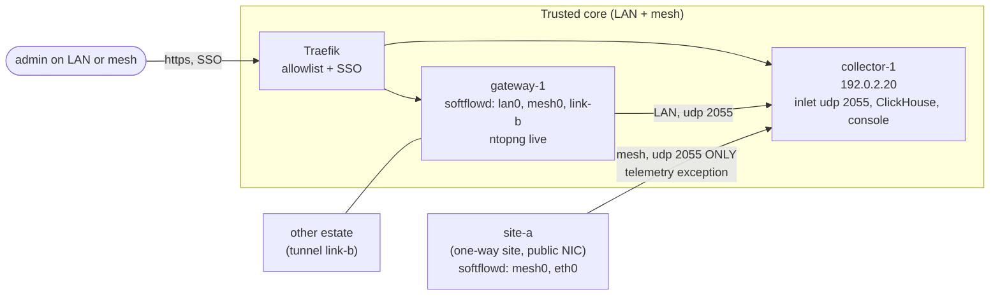

# Multi-hop pattern: seeing flows across a gateway, a mesh and one-way sites

This page shows how to place the collector and the exporters so that traffic across several network hops is visible, including a remote site that is deliberately not allowed to reach back into your network. Names are placeholders: `site-a` (a remote site), `gateway-1`, `collector-1`, addresses from 192.0.2.0/24 and 198.51.100.0/24.

## The picture



## Rules

### 1. Put the collector inside the trusted core

The collector stores a record of every conversation it is told about. It belongs on a node in the trusted part of the network, on local disk, with web access only through the allowlist and SSO. Exporters come to it; it never reaches out.

### 2. One exporter per hop that matters

Run softflowd on the host that carries the traffic you want to see, one instance per interface:

- the gateway's LAN interface, its mesh interface and each tunnel to another estate;
- a remote site's mesh interface and its public interface.

Each exporter has a stable source address that the collector sees, listed in `FLOW_SOURCES`. Each interface has a forced index (100 or more) so the console shows names and not numbers.

### 3. Classify interfaces

Give every interface a class so the console can tell inside from outside: `lan`, `mesh`, `estate-link`, `internet`. The `internet` class is the external boundary; the others are internal. Top-talker widgets on the console home page filter on the external boundary when at least one `internet` interface exists.

### 4. The telemetry exception for one-way sites

A one-way site (see [skmesh site isolation](https://github.com/smilinTux/skstacks/blob/main/v2/docs/patterns/skmesh-site-isolation.md)) may not open connections into the trusted core. Flow export is exactly that: the site sends UDP to the collector. The pattern allows one narrow exception and nothing wider:

- **one UDP port** (`NETFLOW_PORT`, 2055 by default),
- **to one collector** (a group with only that host in it),
- **one direction** (site to collector; the mesh policy is not bidirectional).

It takes two matching changes, and both must exist or the flows are dropped:

1. **Mesh policy.** In the mesh's policy engine, an accept policy from the site's routing group to a group containing only the collector, protocol UDP, port 2055, not bidirectional.
2. **Host egress guard.** A site that rejects new outbound connections on its mesh interface (the defence in depth that isolation recommends) needs one ACCEPT ahead of that REJECT:

   ```sh
   iptables -I OUTPUT 1 -o wt0 -d 192.0.2.20 -p udp --dport 2055 -j ACCEPT
   ```

   Do the same in the `DOCKER-USER` chain if containers on the site host export too. The interface name `wt0` is the mesh interface in this example.

Nothing else changes: no return path is opened, no other port, no second destination. After adding it, rerun the isolation proof from the site side. Every connection except UDP 2055 to the collector must still fail. The collector's own allowlist (`FLOW_SOURCES`) then admits the site's mesh address and drops the rest.

UDP has no handshake, so the mesh policy being one-way does not hurt export. Replies are not needed.

### 5. Mesh-only web access

Serve the console and live view under names that resolve only for admin devices. Two layers:

- **DNS split.** In the mesh's DNS, add a zone for exactly the sknet names (`sknet.example.com`, `sknet-live.example.com`) pointing at the mesh address of an ingress node, and distribute it to the trusted group only. Off-mesh resolvers get the public answer, if any.
- **Allowlist.** `ALLOW_CIDRS` lists the LAN and mesh ranges. A request from anywhere else, including a resolver that returned the public address, gets a 403 from the allowlist before sign-in is attempted.

Neither layer is enough alone: DNS hides the name, the allowlist enforces who may connect, SSO says who they are.

## The double-count caveat

softflowd observes one interface per instance and records a single index for both directions. Traffic that is forwarded between two monitored interfaces on the same host is therefore seen twice: once on the way in and once on the way out. A flow from the LAN, through the gateway, out over a tunnel shows under the LAN interface and under the tunnel interface.

This is correct per interface and wrong if you add interfaces together. So:

- group and filter by **exporter and interface**, never sum across interfaces of one exporter;
- to measure how much crossed the tunnel, filter on the tunnel interface alone;
- to measure what the LAN sent in total, filter on the LAN interface alone;
- mesh and tunnel traffic that is forwarded at the gateway appears on both, by design.

The same applies across hosts: a flow that crosses two exporters (the gateway and a site) appears once per exporter.

## The live view on the gateway

ntopng captures packets on the gateway's interfaces for the "right now" picture: hosts, flows, alerts and a per-host drilldown. It sees only what crosses the gateway, keeps no cross-site history and cannot read the NetFlow the other exporters send (that needs a commercial companion). Treat it as a microscope on one hop and Akvorado as the record across all of them.

## Checklist for a new hop

1. Name the interface, pick an index of 100 or more and a class.
2. Add it to the host's `sknet_interfaces` and run `exporters.yml` for that host.
3. Make sure the exporter's source address is in `FLOW_SOURCES` and in the exporter inventory, then redeploy the stack so the metadata and the allowlist know it.
4. For a one-way site, add the telemetry exception (both halves) and re-prove isolation.
5. Look for the interface name in the console. If you see only an interface index, the metadata and the exporter disagree; see [operations](operations.md).
