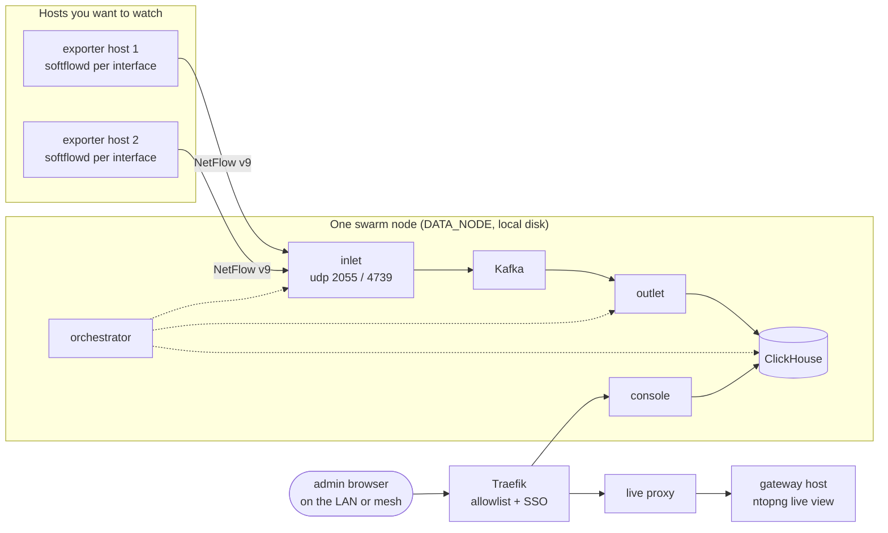

# sknet overview

sknet is network flow visibility for a self-hosted estate. It answers "who is talking to whom, over which link, how much, and since when" for the LAN, the mesh, the links to other estates and the internet edge, in a web console with history, plus a live per-host view on the gateway.

It is a deployment of two existing open source tools, used unchanged:

- **Akvorado** (AGPL-3.0, [github.com/akvorado/akvorado](https://github.com/akvorado/akvorado)): the flow collector and console. It receives NetFlow v9 and IPFIX, stores flows in ClickHouse and draws them.
- **ntopng Community** (GPLv3, [github.com/ntop/ntopng](https://github.com/ntop/ntopng)): the live view. It captures packets on the gateway's own interfaces and shows hosts, flows and alerts as they happen.

"sknet" is only the name of the role, the stack, the routers and the portal tile. The two upstream web UIs keep their own look. Built on Akvorado (AGPL-3.0) and ntopng Community (GPLv3).

## What you get

| You want to know | Where to look |
|---|---|
| Which hosts and ports used the most traffic last week | Akvorado console, grouped by exporter, interface and port |
| How much traffic crossed the link to another site | Akvorado, filter on the exporter and the `estate-link` interface |
| What is eating the internet uplink right now | ntopng live view on the gateway |
| Whether a site on the mesh is sending something unexpected | Akvorado, filter on that site's exporter |
| History after a host was rebooted | Akvorado (ntopng keeps only what the gateway sees live) |

## The three parts



1. **Exporters** (`exporters.yml`, a host play). `softflowd` runs once per interface you name and sends unsampled NetFlow v9 to the collector. Nothing else is installed on those hosts.
2. **The collector stack** (`deploy_sknet-<env>.yml`, a swarm deploy). Akvorado plus Kafka and ClickHouse on one pinned node, with a port allowlist on the flow ports and a Traefik router with an address allowlist and single sign-on in front of the console.
3. **The live view** (`live.yml`, a host play, optional). ntopng in a container with host networking on the gateway, capped in memory, fronted by the same allowlist and sign-in through a small proxy service in the stack.

All three are opt-in. An estate that never runs these plays gets nothing from sknet.

## Design in one paragraph

Flow data is sensitive: it records every conversation. So sknet is private by construction. The flow ports accept only listed exporter addresses. The web UIs are reachable only from the address ranges you list and, by default, only after SSO. The data lives on local disk on one node, never on shared storage, with a retention you set and a disk budget the deploy checks. Every image is pinned.

## What it does not do

- No packet capture on the collector and no deep packet inspection. Akvorado sees flow records (addresses, ports, byte and packet counts, interfaces), not payload.
- No intrusion detection. That is a different tool and not part of this role.
- No NetFlow in ntopng Community. ntopng reads packets on the gateway only; Akvorado is the cross-site history.
- No GeoIP or ASN enrichment unless you switch on `GEOIP_ENABLED` and supply the database files.
- No SNMP. Interface names and speeds come from static metadata built from your exporter inventory.

## Sizing at a glance

Defaults hold the whole stack to about 3.4 GB of memory (3424M: ClickHouse 1536M, Kafka 704M, outlet 512M, console 256M, orchestrator 192M, inlet 160M, proxy 64M). ClickHouse needs a CPU with AVX2 (`grep -w avx2 /proc/cpuinfo`).

Raw flow rows are about 100 to 150 bytes compressed. A rule of thumb:

```
GB per day = flows per second x 86400 x ~125 bytes / 1e9   (about flows/s x 0.011)
```

So 100 flows/s (8.6 million a day) is roughly 1 to 1.5 GB a day, and the default 20 GB budget holds about 15 to 20 days of raw flows at that rate. The default `FLOW_TTL_DAYS` of 30 therefore fits 20 GB only up to about 50 flows/s; measure after a week and set `FLOW_TTL_DAYS` or `DISK_BUDGET_GB` to match. The 5 minute and hourly tables are small next to the raw table. See [operations](operations.md) for the measuring query and the disk gate.

## Where to go next

- [Architecture](architecture.md): the pieces, the ports, the traffic path and the trust boundaries.
- [Multi-hop pattern](multi-hop-pattern.md): seeing flows across a gateway, a mesh and one-way sites, and the one telemetry exception.
- [Operations](operations.md): deploy order, verification, adding an exporter or a site, retention, upgrade, removal, troubleshooting.
- Source, SOP and the full knob table: [the role directory](https://github.com/smilinTux/skstacks/tree/main/v1/ansible/optional/sknet) in [smilinTux/skstacks](https://github.com/smilinTux/skstacks).
