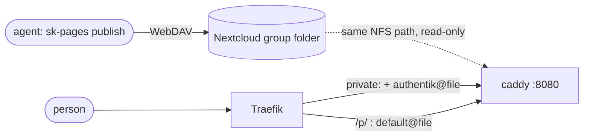

# SKPages: agent-published HTML pages

`optional/skpages` serves static HTML pages that agents publish, from a read-only
docroot, at `https://pages.<cluster>.<domain>/`. Private pages sit behind Authentik;
pages under `/p/<token>/` are public by link only.

The CLI and skill agents use to publish (`sk-pages publish report.html`) live in
[smilinTux/skpages](https://github.com/smilinTux/skpages), together with the standalone
and Tailscale deploys. This role is the Swarm deploy with Traefik labels.

| | |
|---|---|
| URL | `https://pages.<cluster>.<domain>/`; `pages-<env>.` for staging and dev; `pages.<domain>` with `CLOUDFLARED: true` |
| Pages live in | a Nextcloud **group folder** (no single account owns it), mounted **read-only**; any `/var/data` directory works for a Nextcloud-free docroot |
| Server | one `caddy` container (`caddy:2.11.9-alpine@sha256:003a97808e781aa9f7e75cc2f43d34d461099031faf5e20faefb9f61126836f0`), plain HTTP on `:8080` inside the overlay; TLS, SSO and CrowdSec stay at Traefik |
| Private area | everything except `/p/`, router middlewares `default@file,authentik@file` |
| Public area | `/p/<token>/...`, a second router (priority 1000) with `default@file` only; `/p/` itself is never listable |



## Why a separate origin

Pages are agent-written HTML with scripts. Serving them from the Nextcloud host would
let a page read that host's cookies and call its API as the viewer. `pages.` is its own
origin, so it cannot. The rendered Caddyfile also sets a Content-Security-Policy that
lets a page run its own scripts and load common CDNs, but blocks `connect-src` and
`form-action` to anywhere else, so a page cannot send data out. Dotfiles and `*.part`
(half-finished WebDAV uploads) are never served.

## Deploy

1. **DNS and cert:** `pages.<cluster>.<domain>` must reach the cluster's Traefik. A
   wildcard record and wildcard certificate already cover it on most clusters; otherwise
   add the record, and the router's `certresolver` (`main` by default) issues a cert.
2. **Docroot (group folder):** on the Nextcloud container:

   ```bash
   occ app:enable groupfolders
   occ group:add sk-pages-publishers
   occ group:adduser sk-pages-publishers <agent-account>      # one per publishing agent
   occ groupfolders:create skpages                            # prints the folder id
   occ groupfolders:group <id> sk-pages-publishers write share delete
   ```

   The docroot is then `/var/data/skhub-<env>/data/__groupfolders/<id>/files`. Create
   `p/` inside it through Nextcloud (`sk-pages init` does both), not on disk: a folder
   made behind Nextcloud's back stays invisible in Files until `occ files:scan`.
3. **Authentik** (see `optional/sksso/README.md`):
   - A group for the people who may read private pages (e.g. `sk-pages`).
   - A Proxy Provider, mode **forward_single**, external host
     `https://pages.<cluster>.<domain>`, an Application bound to that group, and the
     provider added to the embedded outpost.
   - Without its own provider the domain-wide catch-all answers for `pages.`, and the
     login callback lands on the wrong host. A provider created through `ak shell`
     instead of the UI also needs `provider.set_oauth_defaults(); provider.save()` and
     `outpost_send_update.send(outpost.pk)`, or its redirect URIs stay empty.
4. **Vault:** copy the example below to
   `optional/group_vars/<env>/skpages-<env>-<domain-dashed>-<cluster>_vault.yml` and
   set `DOCROOT`. SKPages holds no secrets; encrypt it if the instance tracks vaults
   encrypted-only.
5. **Run:**

   ```bash
   ansible-playbook -i shared/hosts optional/skpages/deploy_skpages-prod.yml \
     -l <cluster-managers> --vault-password-file <vault-pass-file>
   curl -sI https://pages.<cluster>.<domain>/ | head -3     # 302 to Authentik
   curl -sI https://pages.<cluster>.<domain>/p/ | head -1  # 404, no login (public router)
   ```

## Vault keys

```yaml
skpages:
  DOCROOT: /var/data/skhub-prod/data/__groupfolders/<id>/files   # REQUIRED, must exist
  # everything below is optional, shown with its default
  CLUSTERNAME: <cluster_name>        # from shared/hosts
  DOMAIN: <domain>                   # from shared/hosts
  CLOUDFLARED: false                 # true: hostname is pages.<domain> (no cluster)
  AUTH: true                         # false: no authentik@file on the private router
  DOCROOT_CREATE: false              # true only for a docroot outside Nextcloud
  UID: 33                            # www-data, owner of the Nextcloud data tree
  GID: 33
  IMAGE: caddy:2.11.9-alpine@sha256:003a97808e781aa9f7e75cc2f43d34d461099031faf5e20faefb9f61126836f0
  CERTRESOLVER: main                 # "" = no certresolver label (edge wildcard cert)
  TRAEFIK_MIDDLEWARES: ""            # whole private-router chain; unset = see AUTH
  TRAEFIK_MIDDLEWARES_PUBLIC: ""     # whole /p/ router chain; unset = default@file
  CSP: ""                            # override the Content-Security-Policy (rarely)
```

| Key | Default | Notes |
|---|---|---|
| `DOCROOT` | none (required) | served directory; the deploy fails if it does not exist |
| `CLUSTERNAME`, `DOMAIN` | `cluster_name`, `domain` | build the hostname |
| `CLOUDFLARED` | `false` | drop the cluster label from the hostname |
| `AUTH` | `true` | Authentik on the private router |
| `DOCROOT_CREATE` | `false` | create `DOCROOT` and `DOCROOT/p` on disk |
| `UID`, `GID` | `33` | user Caddy runs as; must be able to read the docroot |
| `IMAGE` | `caddy:2.11.9-alpine@sha256:003a97808e781aa9f7e75cc2f43d34d461099031faf5e20faefb9f61126836f0` | pinned |
| `CERTRESOLVER` | `main` | empty string drops the label |
| `TRAEFIK_MIDDLEWARES` | `default@file,authentik@file` | e.g. prepend `crowdsec-bouncer@file` |
| `TRAEFIK_MIDDLEWARES_PUBLIC` | `default@file` | public router chain |
| `CSP` | see `deploy_skpages-prod.yml` | allows inline scripts and common CDNs, no outbound data |

Networks: `skpages-<env>` overlay (prod `172.16.102.0/24`, staging `172.16.103.0/24`,
dev `172.16.108.0/24`), plus `cloud-public-<env>`. Override with
`skpages_<env>_networks`.

## Operate

- Control script on the manager: `/var/data/deploy_skpages-<env>` (redeploys and forces
  a Caddy restart, since Caddy reads its Caddyfile only at start).
- A removed page can keep answering for up to a minute: the NFS attribute cache on the
  node running Caddy. Not a bug.
- Publishing, listing, removing pages and the Talk feedback loop: the
  [skpages](https://github.com/smilinTux/skpages) README and SOP.
