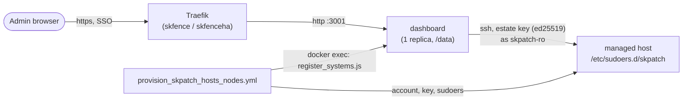

# skpatch-hosts

**Deploys [linux-update-dashboard](https://github.com/TheDuffman85/linux-update-dashboard) (AGPL-3.0) on the swarm: a self-hosted dashboard that checks, and where a host is armed applies, Linux package updates and reboots across a fleet over SSH.** It is the host-patching half of the [skpatch program](../../../../docs/skpatch-program.md); the image-patching half (SBOM scanning, CVE tracking, Renovate) is described there.

- **Status:** Active, opt-in. Nothing renders or changes for an instance that never runs `deploy_skpatch-hosts-<env>.yml`.
- **Maturity-tier:** T0, Classical (see "Honest claims").
- **Version:** framework `v1` tree (this repo's [Versions table](../../../../README.md#versions): "Published, one service at a time"). Release notes are in the repo [CHANGELOG.md](../../../../CHANGELOG.md).
- **Canonical-home:** `v1/ansible/optional/skpatch-hosts/` in [smilinTux/skstacks](https://github.com/smilinTux/skstacks).
- **Docs-verified:** 2026-11-14 (the `docs-evidence` block at the end of [SOP.md](./SOP.md)).
- **Operating procedures:** [SOP.md](./SOP.md) (build, test, deploy, configuration reference, troubleshooting, and runbooks RB-SKPATCH-01 to 11).

> **In-flight work.** Several PRs against `main` change this role. Behaviour described without a marker is merged. Behaviour marked **Pending in PR #N** is described from that PR's branch and is not on `main` yet. The list is in "Pending work" near the end of this file.

## Quickstart

```bash
# 1. Deploy the dashboard (report-only by default: ALLOW_ACTIONS: false)
ansible-playbook -i envs/prod/inventory.ini \
  framework/v1/ansible/optional/skpatch-hosts/deploy_skpatch-hosts-prod.yml \
  -e target_manager_group=swarm_managers \
  --vault-password-file ~/.vault_pass_env/.<instance>_prod_vault_pass

# 2. Give it something to patch: provision one estate's nodes (separate playbook).
#    Run with --check --diff first, then again without.
ansible-playbook -i envs/prod/inventory.ini \
  framework/v1/ansible/optional/skpatch-hosts/provision_skpatch_hosts_nodes.yml \
  -l <estate-inventory-group> -e skpatch_hosts_provision_env=prod \
  --vault-password-file ~/.vault_pass_env/.<instance>_prod_vault_pass
```

Full detail is in **[SOP.md](./SOP.md)**.

## Start here

| Open this | It is |
|---|---|
| [`deploy_skpatch-hosts-<env>.yml`](./) | Deploys the dashboard stack. The vault's fail-closed guards live here (missing encryption key, unpinned image, contradictory sign-in settings). |
| [`provision_skpatch_hosts_nodes.yml`](./provision_skpatch_hosts_nodes.yml) | Idempotent and reversible. Creates the low-privilege account on each target, installs the estate's public key, writes the sudoers allowlist, then registers the hosts in the dashboard. |
| [`src/skpatch-hosts/skpatch-hosts.sudoers.j2`](./src/skpatch-hosts/skpatch-hosts.sudoers.j2) | The exact-command allowlist. "Report-only unless armed" is enforced here, not in the app. |
| [`src/skpatch-hosts/register_systems.js`](./src/skpatch-hosts/register_systems.js) | The registrar. Runs inside the dashboard container and converges systems, schedules and notification channels. |
| [`SOP.md`](./SOP.md) | Build, test, deploy, configuration reference, troubleshooting, runbooks. |

- **What it owns.** `dashboard.db` (SQLite under `/data`): every SSH credential and notification secret this instance holds, AES-256-GCM encrypted at rest.
- **Depends on.** Traefik (skfence or skfenceha) for ingress, Authentik (sksso) for sign-in, SSH reachability to every provisioned node.
- **Does not do.** Patch container images (that is `skbom` plus Renovate), grant itself privilege, or back itself up.

## Architecture



The dashboard polls each host over SSH as a read-mostly account. On a host that is armed it can also run the upgrade and reboot commands the sudoers file names, and nothing else. The detailed diagrams (deploy path, onboarding flow, alert flow) are in [SOP.md §2](./SOP.md#2-architecture).

## Honest claims (read this)

- This role **generates and stores classical key material**: one dedicated SSH **ed25519** keypair per estate (`ssh-keygen`, standard OpenSSH, no custom crypto) and an at-rest **AES-256-GCM** encrypted credential store inside the upstream app, keyed by `LUDASH_ENCRYPTION_KEY`. This role implements neither a cipher nor a key-exchange protocol of its own.
- It makes **no post-quantum or hybrid-KEM claim anywhere**, and should not: everything here is classical (SSH ed25519, TLS for the dashboard's own HTTPS). It is not a "crypto component" under [`SK_REPO_DOC_STANDARD`](https://github.com/smilinTux/sk-standards/blob/main/standards/SK_REPO_DOC_STANDARD.md) in the sense that matters there (it does not implement, negotiate or expose a cryptographic protocol to other systems); it operates one. No separate `CRYPTO_SPEC.md` is carried for that reason; this paragraph is the compliance statement.
- `ALLOW_ACTIONS` in the vault is **metadata only**: flipping it grants nothing by itself. The enforcement is the sudoers allowlist `provision_skpatch_hosts_nodes.yml` writes on each target node, gated by that node's **own** `skpatch_hosts_allow_actions`.
- **"No wildcards" means no `*` pattern.** One sudoers rule has no argument list at all (`/usr/sbin/reboot`), and sudoers lets the caller pass any arguments to a command listed without any. See "Security model".
- **One SSH keypair per estate, never shared, never a reused admin key.** A compromise of this container is a compromise of every host it holds a key for.

## Security model

This app holds a credential that can SSH into every host it is pointed at and, where armed, run privileged commands there. Each choice below shrinks that blast radius.

| Control | What it is | Where it is enforced |
|---|---|---|
| Dedicated account | `PROVISION_USER` (default `skpatch-ro`), fixed uid and gid `PROVISION_UID` (default 5201, never a system uid because containers share the host's uid space), no password set, key-only login. Never an existing admin account. | `provision_skpatch_hosts_nodes.yml` |
| One key per estate | `authorized_key` with `exclusive: true`: the account trusts exactly the estate key, nothing else. | same |
| Read-mostly by default | A report-only host gets two sudo rules: `dpkg --audit` and `apt-get -o DPkg::Lock::Timeout=60 update -qq`. Listing upgradable packages, simulating an upgrade and the reboot-pending test run as the plain user. | `skpatch-hosts.sudoers.j2` |
| Per-host action ceiling | Upgrade, autoremove, snap refresh and reboot lines exist only when the host's own `skpatch_hosts_allow_actions` (else the vault `ALLOW_ACTIONS`) is true. A host-level `false` beats an instance-wide `true`, always. Put `false` on every hypervisor and NAS. | `skp_node_allow_actions` in the provisioning play |
| Exact commands only | Every rule is `<account> ALL=(root) NOPASSWD: <absolute path> <exact argv>`. No `NOPASSWD: ALL`, no `*`. `:` and `=` inside arguments are backslash-escaped, as sudoers requires. | template, plus `visudo -cf` on install |
| Validated before install | The sudoers task runs `visudo -cf %s`; a file that does not parse is never installed. | `validate:` on the template task |
| No wildcard for variable arguments | See below. | design, plus tests |
| Sign-in | `AUTH_MODE: sso` (Authentik forward auth on the whole router) or `oidc` (the dashboard's own OIDC, Authentik group decides role). Bind the application to the admin group. | Traefik label, or `LUDASH_OIDC_*` |
| Encrypted store | Credentials and channel secrets are AES-256-GCM in `dashboard.db`; losing `LUDASH_ENCRYPTION_KEY` makes them unreadable. | upstream app |
| Registrar | Runs inside the dashboard container with a five-minute self-signed session for an existing admin. It grants nothing new: whoever can `docker exec` there can already read the key and the database. | `register_systems.js` |

**Why no wildcards.** The dashboard's "upgrade selected packages" action runs `apt-get -o DPkg::Lock::Timeout=60 install --only-upgrade -y <packages>`, with names that change on every call. The only sudoers rule that matches it is one with a `*`, and `*` also matches extra options. For apt that is `-o APT::Update::Pre-Invoke::=<command>`, which runs `<command>` as root. The same holds for `snap`, `pacman` and `flatpak`. So this role never writes such a rule. The dashboard's own sudoers preview shows the wildcard form as a commented-out suggestion; do not uncomment it. **Pending in PR #403 and PR #406:** root-owned wrappers that validate every argument and run one fixed command, granted by absolute path (see "Selected-package upgrades").

**Residual risk, stated plainly.**

- `/usr/sbin/reboot` is written without arguments. sudoers permits any arguments for a command listed that way (sudoers(5): "If no command line arguments are specified, the user may run the command with any arguments they choose"). The account can therefore also run `reboot -f` or `reboot -p` (force, power off). That is a denial-of-availability on an armed host, not code execution.
- Registered systems have SSH host-key verification off (`hostKeyVerificationEnabled: false`), because the registrar installs fleet nodes it has just provisioned. Turn it on per system in the dashboard if an estate wants pinning.
- The dashboard's repository-source editor needs `sudoedit <path>`. It is deliberately not granted, so that feature does not work on a provisioned host.

## Package managers, dashboard operations and sudo

The image annotates every command it runs through sudo with a `# Sudoers-relevant command:` line. The sudoers template was written from those lines, never from the upstream README (the README-derived guesses it first carried did not match one real command, so every check failed with "sudo: a password is required").

The built-in operations, and what each needs:

| Operation | Does | Needs sudo |
|---|---|---|
| `detect` | finds which package managers the host has | no |
| `check_updates` | refreshes metadata, lists what is upgradable | per manager, below (always granted) |
| `list_installed_packages` | lists installed packages | no |
| `repair_issue` | runs the manager's repair (apt: `dpkg --configure -a`) | per manager |
| `autoremove` | removes unused packages | per manager (armed hosts) |
| `upgrade_all` | installs all updates (apt: `upgrade` or `full-upgrade`, by the system's upgrade mode) | per manager (armed hosts) |
| `full_upgrade_all` | the fuller upgrade where the manager has one | per manager (armed hosts) |
| `upgrade_selected` | upgrades chosen packages, names substituted at run time | per manager; needs a validated wrapper, never a wildcard |
| `system_info` | OS, kernel, uptime, reboot-required flag | no |
| `reboot` | runs the Proxmox backup guard, then `sudo reboot` | `reboot`; plus `pvesh get /cluster/tasks --output-format json` on Proxmox VE |

A custom script (`isDefault`, per package manager and operation) replaces the built-in for every system with that manager. Custom scripts live in the dashboard database; nothing on `main` converges them. **Pending in PR #406:** the registrar converges one default `upgrade_selected` script per wrapper.

Per package manager. "Main" is what the merged template grants; "Pending" names the PR that changes it.

| Manager | check | upgrade all / autoremove | repair | upgrade selected | Main | Pending |
|---|---|---|---|---|---|---|
| **apt** | `dpkg --audit`, `apt-get -o DPkg::Lock::Timeout=60 update -qq` | `... upgrade -y` or `... full-upgrade -y`; `... autoremove -y` | `dpkg --configure -a` | `... install --only-upgrade -y <pkgs>` | check and upgrade/autoremove lines granted; repair and selected are **not** | repair line, `DEBIAN_FRONTEND` env_keep, dpkg conffile policy: #406. Selected wrapper: #403 |
| **snap** | none | `snap refresh` | none | `snap refresh <names>` | `snap refresh` granted on armed hosts | selected wrapper: #403 |
| **pacman** | `pacman -Sy --noconfirm` | `pacman -Syu --noconfirm`; autoremove (`pacman -Rns --noconfirm -`, names on stdin) never granted | none | `pacman -S --noconfirm <pkgs>` | **nothing**: every check fails with "sudo: a password is required" | check, upgrade, selected wrapper: #406 |
| **flatpak** | `flatpak update --appstream` | `flatpak update -y`; `flatpak uninstall --unused -y` | none | `flatpak update -y <ids>` | **nothing** | all of it: #406 |
| **dnf, yum, apk, deb-get** | e.g. `dnf -y check-update --quiet`, `apk update`, `deb-get show <app>` | e.g. `dnf autoremove -y`, `apk upgrade` | dnf/yum only | e.g. `apk upgrade <pkgs>` | not covered | #406 makes provisioning refuse such a host instead of leaving it broken |
| **Proxmox VE (reboot guard)** | n/a | n/a | n/a | n/a | not granted: a reboot from the dashboard is blocked ("could not verify Proxmox backup activity") | `pvesh get /cluster/tasks --output-format json`, only with the reboot line, only where `/usr/bin/pvesh` exists: #406 |

A report-only host gets only the first two apt rules (plus, **pending in #406**, the read-only pacman and flatpak metadata refreshes where those managers exist). Everything else exists only on armed hosts.

## How a host is onboarded

Today (merged) a host is onboarded by one provisioning run plus, when registration is not configured, one manual step in the dashboard:

1. Add the host to the estate's inventory group (name it after its swarm node name where it is a swarm node). Set `skpatch_hosts_allow_actions: false` in its host vars if it must stay report-only.
2. Run `provision_skpatch_hosts_nodes.yml -l <host> --check --diff`, read the diff, then run it without `--check --diff`. This creates the account (fixed uid), installs the key, writes and `visudo`-validates the sudoers file, and, when `REGISTER_AS` and a credential are set, creates the host in the dashboard if it is missing.
3. Without registration configured, add the host in the dashboard by hand with the estate credential.
4. Check: the first dashboard check for the host succeeds (no "sudo: a password is required").

Runbook with verification and rollback: [SOP.md RB-SKPATCH-01](./SOP.md#rb-skpatch-01-onboard-a-host). Offboarding is RB-SKPATCH-02.

> **Pending in PR #406.** Onboarding becomes a single idempotent command with no manual sudo or dashboard step: the run detects the package managers present (apt and dpkg always; pacman, flatpak and Proxmox's `pvesh` where found), refuses a host with a manager the template does not cover, renders sudoers for exactly what it found, installs the wrappers and the dpkg conffile policy, and registers the host together with the default wrapper scripts, app settings, schedules and channels. A host marked `skpatch_hosts_paused: true` (or carrying `/etc/skpatch-hosts.paused`) is left untouched. Details are in the PR's README sections "Onboarding a host (one command)" and "Maintenance pause".

## Schedules and reboot policy

Schedules are declared in code (`SCHEDULES` or `skpatch_hosts_schedules`, see "Schedules and notifications as code" below) and converged by the registrar. The policy this role is built around:

| Rule | Why |
|---|---|
| Refresh on a short cadence, apply updates in a nightly window, reboot in a separate, later, staggered window. | The app's update schedule refreshes in parallel, then upgrades systems one at a time in the order of `systems`. A schedule is a serial chain. |
| Set `UPGRADE_MODE: full-upgrade` if kernels and dependency-changing security fixes should land on the schedule. | `apt-get upgrade` keeps back anything that needs a new package, which on Ubuntu includes every new kernel ABI. |
| Put swarm workers and swarm managers in separate update chains, workers first. Never put two managers, or every worker, in one reboot schedule; give each its own, staggered. | A reboot schedule sends `reboot` and moves on without waiting. Docker engine packages restart `dockerd` when upgraded. At most one `dockerd` should restart at a time and manager quorum must hold. |
| Put the node that runs the dashboard last in its window. | Upgrades run under `nohup setsid` on the host and survive the container restarting; the schedule does not. |
| Use `only_if_required: true` on reboot schedules. | Reboots happen only when the host reports a reboot is pending. |
| Hypervisors and NAS: no upgrade or reboot schedule, `skpatch_hosts_allow_actions: false`. | They are rebooted from their own console, with their guests drained. A Proxmox reboot from the dashboard also needs the backup guard (above). |
| Nothing is held (`apt-mark hold` is not in the sudoers and is not used). | Safety comes from ordering, not holds. |

Estate specifics (host names, times) belong in the estate's own instance repo, never here. A daily digest schedule (`notification_digest`) is the summary channel; see "Alerting".

## Alerting

**Merged.** The registrar converges notification channels (`NOTIFICATIONS`) and a `notification_digest` schedule from the vault, so channels and the digest survive a fresh `dashboard.db`. The pinned image supports these channel types: email, gotify, mqtt, ntfy, telegram, webhook. A channel that needs a name to resolve inside the container (SMTP, OIDC) can fail when the name resolves to the estate's own public address and the router does not hairpin NAT; **pending in PR #406** is `EXTRA_HOSTS` for that case. A Telegram channel takes over the bot it uses (see "Schedules and notifications as code"): give it its own bot or use email.

> **Pending in PR #406.** `tools/skpatch_compliance.py` is a scheduled fleet check (systemd timer, one per estate, daily). It runs the provisioning playbook under `--check`, reads the dashboard through a read-only report, and reports per host: `not-provisioned`, `drift`, `uncovered-manager`, `check-failed`, `unreachable`, `dashboard-only`, `not-in-dashboard`, `sudo-denied:<action>`, and `paused`. It calls an alert hook once when an issue opens and once when it clears, keyed `host|issue`. `tools/skpatch-compliance-alert.example.sh` is an example hook.

> **Pending, no PR open at the time of writing (design, not behaviour).** Routing so that the right thing reaches a person without noise:
>
> | Class | Conditions | Delivery |
> |---|---|---|
> | Immediate | host unreachable; upgrade failed; repair needed; sudo password required; reboot pending for more than 8 days; compliance drift | a dedicated "SK Patching" Talk room per estate, through the dashboard's webhook notifier |
> | Digest | everything else (what is out of date, what ran) | one message per day at 07:00 in that room |
> | Fallback | the Talk room is not configured | email digest only |
>
> The room, its webhook and any token are secrets and live in the estate's vault, never in this repo. This section changes when the PR lands.

## Configuration knobs (vault)

The full reference (every key, every default) is [SOP §6](./SOP.md#6-configuration--usage). The ones that matter most on first read:

| Key | Default | What it controls |
|---|---|---|
| `LUDASH_ENCRYPTION_KEY` | required, no default | AES-256-GCM key for the credential store. Losing it makes every stored credential unreadable. |
| `AUTH_MODE` | `sso` | `sso`: Authentik forward auth in front of the whole router. `local`: the app's own login only. `oidc`: the dashboard's own OIDC login against sksso, no forward auth. See "Sign-in and the admin group". |
| `ALLOW_ACTIONS` | `false` | Instance-wide **metadata**. A node gets upgrade and reboot sudoers lines only when its own `skpatch_hosts_allow_actions` (or, if unset, this) is `true`. |
| `SSH_PUBLIC_KEY` | required by provisioning | Public half of this estate's dedicated keypair. |
| `PROVISION_USER` | `skpatch-ro` | The low-privilege account created on each target node. |
| `REGISTER_AS`, `SSH_PRIVATE_KEY` / `CREDENTIAL_ID` | unset | Turn on automatic host registration (below). |
| `DATA_NODE` | `""` | Required if `DATA_PATH` is local disk, not shared storage; pins the single dashboard replica there. |
| `CLUSTERNAME`, `DOMAIN` | inventory `cluster_name`, `domain` | The dashboard host is `skpatch-hosts.<CLUSTERNAME>.<DOMAIN>`; with `CLOUDFLARED: true` it is `skpatch-hosts.<DOMAIN>`. |

**Per-host actions ceiling:** set `skpatch_hosts_allow_actions: false` in the group_vars of every hypervisor, NAS, or any host that must never be upgraded or rebooted through this app. That per-host `false` always wins over the vault's instance-wide `ALLOW_ACTIONS: true`.

## Sign-in and the admin group

`AUTH_MODE`:

- **`sso` (default): Authentik forward auth on the whole router.**
  `SSO_MIDDLEWARE` (default `authentik@file`). Authentik needs a proxy
  provider in forward-auth mode covering the `skpatch-hosts` host, bound to the
  embedded outpost, with its application restricted to the admin group
  (this app holds the keys to every node it reaches). Users still sign in
  to the dashboard's own account system afterward (a separate first-run
  local account, unless `oidc` below is used instead).
- **`local`: the app's own login only** (password/TOTP/passkey), no
  `SSO_MIDDLEWARE` allowed.
- **`oidc`: the dashboard's own OIDC login against sksso (Authentik), no
  forward auth.** One sign-in, no separate first-run account, Authentik
  group membership decides the role. Verified against the pinned
  `linux-update-dashboard` source (`server/auth/auth-config.ts`,
  `server/auth/oidc.ts`, `server/routes/auth.ts`):
  - Required: `OIDC_ISSUER` (the Authentik application's issuer URL, e.g.
    `https://<sso host>/application/o/<client id>/`; `issuer_mode:
    per_provider` on sksso's blueprint, see below) and `OIDC_CLIENT_SECRET`
    (32+ chars, **the same value** as sksso's `SKPATCH_HOSTS_OIDC_CLIENT_SECRET`).
  - `OIDC_CLIENT_ID` defaults to the router name (e.g. `skpatch-hosts`), the same
    slug `AUTHENTIK_TILE_SLUG` already defaults to above: sksso's blueprint
    (below) and this role's own portal tile then manage the SAME Authentik
    Application (see `shared/src/authentik_portal_tile.py` "keeping its
    existing provider"), not two.
  - `OIDC_SCOPE` (default `openid profile email groups`), `OIDC_GROUPS_CLAIM`
    (default `groups`), `OIDC_ADMIN_GROUPS` (default `skadmin`,
    CSV of Authentik group names), `OIDC_READ_ONLY_GROUPS` (CSV, default
    none), `OIDC_UNMATCHED_ROLE` (`deny` default, or `admin`/`read-only`
    for a group that matched neither list).
  - `OIDC_END_SESSION` (default `true`): also end the Authentik session on
    sign-out.
  - This role also sets `LUDASH_PASSWORD_LOGIN_ENABLED=false`, closing the
    separate first-run local-account path this mode exists to remove.
  - **Verified (`auth-config.ts`): every `LUDASH_OIDC_*` /
    `LUDASH_PASSWORD_LOGIN_ENABLED` value here is *pinned*.** It always
    wins over anything saved in the dashboard's own Settings page and is
    never written back to its database, so a vault change here cannot
    drift the way it can on sksec-web's equivalent (see
    `../sksec-web/README.md` "Sign-in and SSO" for that caveat); removing
    the env var restores whatever was last saved there, if anything.

Guard (the deploy refuses, naming the keys): an `AUTH_MODE` other than
`sso`/`local`/`oidc`; `SSO_MIDDLEWARE` set with `AUTH_MODE: local` or
`oidc`; a forward-auth middleware (`authentik`, or the configured
`SSO_MIDDLEWARE` name) inside `TRAEFIK_MIDDLEWARES` directly (SSO under
another name; use `AUTH_MODE: sso` / `SSO_MIDDLEWARE` instead);
`AUTH_MODE: oidc` without `OIDC_ISSUER` or a 32+ char `OIDC_CLIENT_SECRET`,
or an `OIDC_UNMATCHED_ROLE` other than `deny`/`admin`/`read-only`.

The Authentik side (the OAuth2 provider + application, as code) is
rendered by **sksso**, not this role: see `../sksso/README.md`
"sksec-web / skpatch-hosts (OIDC) login".

## Automatic host registration

`provision_skpatch_hosts_nodes.yml`, on every `present` run, adds one
dashboard system per node in its own target group that the dashboard does
not have yet, so the dashboard is never empty after a deploy. Opt-in:
nothing touches the dashboard unless `REGISTER_AS` and an SSH credential
(`SSH_PRIVATE_KEY` or `CREDENTIAL_ID`) are set; unset, the playbook says it
is skipping registration and nodes are added by hand, as before.

```yaml
skpatch_hosts:
  REGISTER_AS: ""         # username of an existing dashboard ADMIN (local or OIDC); unset skips registration
  SSH_PRIVATE_KEY: ""     # private half of SSH_PUBLIC_KEY; creates the credential "skpatch-hosts <PROVISION_USER>"
  CREDENTIAL_ID: 0        # or: an sshKey credential already in the dashboard (takes precedence)
```

**How it signs in.** The pinned dashboard (2026.10.9) refuses every
API-token request that creates a system or a credential (403 "API tokens
cannot configure SSH connections"), password login is off in `AUTH_MODE:
oidc`, and Authentik forward auth fronts it in `sso` mode. So the
registrar (`src/skpatch-hosts/register_systems.js`) runs **inside the
dashboard's own container**, on whichever node swarm placed it, and talks to
the app on `127.0.0.1` with a five-minute `ludash_session` it signs with the
app's own session key (`LUDASH_SECRET_KEY`, else the `.secret_key` file next
to the database) for the `REGISTER_AS` account. It carries that user's
current `session_version`, so "sign out everywhere" in the dashboard still
revokes it, and it is refused for a read-only or unknown account. This
grants nothing new: whoever can `docker exec` into that container can
already read the key, the database and the encryption key. Every system it
creates shows up in the dashboard as added by that account.

**One-time setup per estate.** Sign in to the dashboard once (first-run
local admin, or OIDC through sksso) so the account exists, then put its
username in `REGISTER_AS` and the estate key's private half in
`SSH_PRIVATE_KEY`. The next `present` run creates the credential and the
systems. Rotating the key: replace the credential in the dashboard (or
delete it and let the next run recreate it); the registrar never rewrites
an existing credential.

**Creates, never edits, never deletes.** The match key is hostname and
port (the app's own uniqueness rule is hostname, port and username, and
every system here shares the one credential). A node already registered is
left exactly as an operator configured it, because `PUT /api/systems/:id`
replaces the whole connection config. Hosts removed from the target
inventory are reported, never deleted.

**Host-key verification is off** for every system this creates
(`hostKeyVerificationEnabled: false`): these are the operator's own
already-provisioned fleet nodes, reached with the keypair
`provision_skpatch_hosts_nodes.yml` just installed. Turn it on by hand per
system if an estate wants it.

**Migrating from `API_TOKEN`.** Token registration never worked against
this dashboard version. A vault that still sets `API_TOKEN` makes the
playbook fail with what to set instead; remove it and set `REGISTER_AS`.
`API_CREDENTIAL_ID` is still read, as `CREDENTIAL_ID`.

## Schedules and notifications as code

The same registrar run (README "Automatic host registration", so
`REGISTER_AS` and a credential must be set) also converges the dashboard's
own configuration, so a redeploy or a fresh `dashboard.db` reproduces it:

| Input | Where | What it does |
|---|---|---|
| `SCHEDULES` | vault, or `skpatch_hosts_schedules` (e.g. `-e @<file>.yml`, which wins) | Refresh / update / autoremove / reboot / notification_digest schedules. `systems` is a list of dashboard system **names**, or absent for all. |
| `NOTIFICATIONS` | vault (channel configs carry SMTP passwords, tokens) | Notification channels; a digest channel is one a `notification_digest` schedule lists in `notifications`. |
| `UPGRADE_MODE` / `skpatch_hosts_upgrade_mode` | vault / host var | APT default upgrade mode of each registered system. |
| `SYNC_CREDENTIAL` | vault | Rewrites the estate credential's key from `SSH_PRIVATE_KEY` (key rotation, SOP §5). |
| `skpatch_hosts_dashboard_address` / `_port` | host var | The address the dashboard container dials, when the controller's (an ssh alias, a tailnet name) does not resolve there. |

Matched by name: missing is created, different is updated, anything the
input does not name is reported and left alone. Nothing is ever deleted.
Notification channels are rewritten on every run (the API only returns their
secrets masked, so they cannot be compared). A system whose package manager
is not detected yet (registered this run, first check pending) gets its
upgrade mode on the next run.

**What the pinned app (2026.10.9) actually does, which the schedule design
has to respect** (read from `server/services/scheduler.ts`):

- An **update** schedule refreshes its systems in parallel, then runs
  upgrade-all on them **one at a time, in the order of `systems`**. One
  schedule is therefore a strict serial chain; two schedules whose windows
  overlap run in parallel.
- Upgrade-all uses each system's APT mode. There is no "full-upgrade"
  schedule type, and plain `apt-get upgrade` keeps back anything that needs
  a new package, which on Ubuntu includes every new kernel ABI. Set
  `UPGRADE_MODE: full-upgrade` if kernels and dependency-changing security
  fixes should land on the schedule rather than by hand.
- A **reboot** schedule sends `reboot` to each system and moves on without
  waiting for it to come back. Never put two swarm managers (or every worker)
  in one reboot schedule: give each its own, staggered.
- Upgrades run under `nohup setsid` on the host and survive the dashboard
  container restarting; the schedule itself does not. Put the node that runs
  the dashboard last in its window.
- A Proxmox reboot is blocked by the app's own backup guard unless sudoers
  grants `pvesh get /cluster/tasks`, which this role does not (sudoers
  template). Hypervisors are rebooted from Proxmox, not from here.
- An enabled **Telegram** channel starts a `getUpdates` long-poll worker and
  rewrites that bot's command menu, whatever `commandsEnabled` says
  (`server/services/telegram-bot.ts` `sync()`). Never point it at a bot
  another service already uses; give it its own bot, or use email.
- Docker engine packages (`docker-ce`, `containerd.io`) upgrade like any
  other package and restart `dockerd`, moving that node's tasks. This role
  holds nothing (`apt-mark hold` is not in the sudoers and is not used);
  the safety comes from ordering: swarm nodes are upgraded in serial chains,
  managers in their own chain after the workers, so at most one `dockerd`
  restarts at a time and manager quorum is never at risk.

Example (estate specifics, host names and times, belong in the estate's own
prod repo):

```yaml
skpatch_hosts_schedules:
  - {name: Default refresh, type: refresh, cron: "15 */6 * * *", cache_hours: 6}
  - {name: Nightly workers, type: update, cron: "0 2 * * *", systems: [wkr-1, wkr-2]}
  - {name: Nightly managers, type: update, cron: "0 3 * * *", systems: [mgr-1, mgr-2, mgr-3]}
  - {name: Reboot mgr-1, type: reboot, cron: "0 4 * * 2", only_if_required: true, systems: [mgr-1]}
  - {name: Reboot mgr-2, type: reboot, cron: "30 4 * * 2", only_if_required: true, systems: [mgr-2]}
  - {name: Daily digest, type: notification_digest, cron: "0 7 * * *", notifications: [Patch digest]}
```


## Pending work

Open PRs against `main` that change this role, and the sections of these docs that describe them. When one merges, remove its marker and fold the text into the surrounding section; the `docs-evidence` block in SOP.md then gets a check for the new behaviour.

| PR | Branch | What it adds | Described under |
|---|---|---|---|
| #403 | `fix/skpatch-hosts-only-upgrade-wrapper` | Validated root-owned wrappers `skpatch-apt-only-upgrade` and `skpatch-snap-refresh` in `/usr/local/sbin`, granted by absolute path, installed only on armed hosts, removed on `absent` or when a host goes report-only. | "Security model", "Package managers" |
| #406 (stacked on #403) | `fix/skpatch-hosts-ideal-setup` | `dpkg --configure -a`; `Defaults env_keep += "DEBIAN_FRONTEND"`; dpkg conffile policy (`DPKG_KEEP_CONFFILES`); Proxmox `pvesh` guard line; pacman and flatpak support with two more wrappers; `EXTRA_HOSTS`; default `upgrade_selected` scripts and app settings (command timeout 600 s) converged by the registrar; a CI test that the template covers every sudo command of the pinned image (`sudo-coverage.yml` plus a fixture); refusal of uncovered package managers; maintenance pause; one-command onboarding; the scheduled compliance check and its alert hook. | "Package managers", "How a host is onboarded", "Alerting"; SOP runbooks RB-SKPATCH-01, 03, 05, 06, 07, 09 |
| #401 | `fix/skpatch-hosts-oidc-healthcheck` | With `AUTH_MODE: oidc` the swarm healthcheck requires `oidcEnabled === true` from `/api/auth/status`, with a 90 s start period, so a task that came up with SSO silently off is replaced. | SOP RB-SKPATCH-08 |
| none yet | n/a | Raised SSH timeout (60 s), the "SK Patching" Talk room routing and 07:00 digest. | "Alerting" (design only), SOP RB-SKPATCH-10 |

These PRs also edit README.md and SOP.md. Whichever lands second has a mechanical conflict in those two files; resolve it by keeping the structure here and moving each PR's prose into the matching section.

## Related projects / See also

- ⬆️ **Depends on:** [skfence / skfenceha](https://github.com/smilinTux/skstacks/blob/main/docs/v1-service-catalog.md#skfence), the Traefik ingress every router here assumes; [sksso](https://github.com/smilinTux/skstacks/blob/main/docs/v1-service-catalog.md#sksso), Authentik, for `AUTH_MODE: sso` and `oidc`.
- ⬇️ **Part of:** [the skpatch program](../../../../docs/skpatch-program.md): this role is the host-patching half; the image-patching half is `skbom` plus `skflow`.
- ↔️ **Sibling:** [skbom](../../../../docs/skpatch-program.md#2-components), Dependency-Track, the image-side CVE register this program's other half feeds.
- ↔️ **Sibling:** [skflow](https://github.com/smilinTux/skstacks/blob/main/docs/v1-service-catalog.md#skflow), Windmill, which runs the program's `f/skpatch`, `f/skrelease` and `f/ops` automation flows.
- ↔️ **Sibling:** [sksec-web](../sksec-web/), another SSO-gated single-purpose ops dashboard with the same read-only-by-default, actions-as-explicit-opt-in shape.
- ↔️ **Sibling:** [skgit](https://github.com/smilinTux/skstacks/blob/main/docs/v1-service-catalog.md#skgit), the repo of record the program's Renovate PRs and release gate target.
- 📐 **Standards:** [sk-standards](https://github.com/smilinTux/sk-standards): [SK_REPO_DOC_STANDARD](https://github.com/smilinTux/sk-standards/blob/main/standards/SK_REPO_DOC_STANDARD.md), [DOCS_FRESHNESS_STANDARD](https://github.com/smilinTux/sk-standards/blob/main/standards/DOCS_FRESHNESS_STANDARD.md), [ITIL_AND_RUNBOOK_OPERATING_MODEL_STANDARD](https://github.com/smilinTux/sk-standards/blob/main/standards/ITIL_AND_RUNBOOK_OPERATING_MODEL_STANDARD.md).

*License: this role is Apache-2.0 (the framework's own license). The upstream application it deploys, `linux-update-dashboard`, is AGPL-3.0 and is referenced by image reference only: nothing from it is vendored.*
