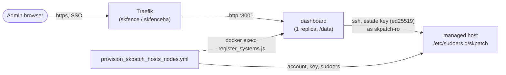

# skpatch-hosts

**Deploys [linux-update-dashboard](https://github.com/TheDuffman85/linux-update-dashboard) (AGPL-3.0) on the swarm: a self-hosted dashboard that checks, and where a host is armed applies, Linux package updates and reboots across a fleet over SSH.** It is the host-patching half of the [skpatch program](../../../../docs/skpatch-program.md); the image-patching half (SBOM scanning, CVE tracking, Renovate) is described there.

- **Status:** Active, opt-in. Nothing renders or changes for an instance that never runs `deploy_skpatch-hosts-<env>.yml`.
- **Maturity-tier:** T0, Classical (see "Honest claims").
- **Version:** framework `v1` tree (this repo's [Versions table](../../../../README.md#versions): "Published, one service at a time"). Release notes are in the repo [CHANGELOG.md](../../../../CHANGELOG.md).
- **Canonical-home:** `v1/ansible/optional/skpatch-hosts/` in [smilinTux/skstacks](https://github.com/smilinTux/skstacks).
- **Docs-verified:** 2026-11-14 (the `docs-evidence` block at the end of [SOP.md](./SOP.md)).
- **Operating procedures:** [SOP.md](./SOP.md) (build, test, deploy, configuration reference, troubleshooting, and runbooks RB-SKPATCH-01 to 11).

> **History markers.** Paragraphs marked **Since PR #N** describe behaviour that PR added (#403 and #406 shipped in v2.26.22, #401 merges with this docs change). All of it is on `main`.

## Quickstart

```bash
# 1. Deploy the dashboard (report-only by default: ALLOW_ACTIONS: false)
ansible-playbook -i envs/prod/inventory.ini \
  framework/v1/ansible/optional/skpatch-hosts/deploy_skpatch-hosts-prod.yml \
  -e target_manager_group=swarm_managers \
  --vault-password-file ~/.vault_pass_env/.<instance>_prod_vault_pass

# 2. Give it something to patch: provision one estate's nodes (separate playbook).
#    Run with --check --diff first, then again without.
ansible-playbook -i envs/prod/inventory.ini \
  framework/v1/ansible/optional/skpatch-hosts/provision_skpatch_hosts_nodes.yml \
  -l <estate-inventory-group> -e skpatch_hosts_provision_env=prod \
  --vault-password-file ~/.vault_pass_env/.<instance>_prod_vault_pass
```

Full detail is in **[SOP.md](./SOP.md)**.

## Start here

| Open this | It is |
|---|---|
| [`deploy_skpatch-hosts-<env>.yml`](./) | Deploys the dashboard stack. The vault's fail-closed guards live here (missing encryption key, unpinned image, contradictory sign-in settings). |
| [`provision_skpatch_hosts_nodes.yml`](./provision_skpatch_hosts_nodes.yml) | Idempotent and reversible. Creates the low-privilege account on each target, installs the estate's public key, writes the sudoers allowlist, then registers the hosts in the dashboard. |
| [`src/skpatch-hosts/skpatch-hosts.sudoers.j2`](./src/skpatch-hosts/skpatch-hosts.sudoers.j2) | The exact-command allowlist. "Report-only unless armed" is enforced here, not in the app. |
| [`src/skpatch-hosts/register_systems.js`](./src/skpatch-hosts/register_systems.js) | The registrar. Runs inside the dashboard container and converges systems, schedules and notification channels. |
| [`SOP.md`](./SOP.md) | Build, test, deploy, configuration reference, troubleshooting, runbooks. |

- **What it owns.** `dashboard.db` (SQLite under `/data`): every SSH credential and notification secret this instance holds, AES-256-GCM encrypted at rest.
- **Depends on.** Traefik (skfence or skfenceha) for ingress, Authentik (sksso) for sign-in, SSH reachability to every provisioned node.
- **Does not do.** Patch container images (that is `skbom` plus Renovate), grant itself privilege, or back itself up.

## Architecture



The dashboard polls each host over SSH as a read-mostly account. On a host that is armed it can also run the upgrade and reboot commands the sudoers file names, and nothing else. The detailed diagrams (deploy path, onboarding flow, alert flow) are in [SOP.md §2](./SOP.md#2-architecture).

## Honest claims (read this)

- This role **generates and stores classical key material**: one dedicated SSH **ed25519** keypair per estate (`ssh-keygen`, standard OpenSSH, no custom crypto) and an at-rest **AES-256-GCM** encrypted credential store inside the upstream app, keyed by `LUDASH_ENCRYPTION_KEY`. This role implements neither a cipher nor a key-exchange protocol of its own.
- It makes **no post-quantum or hybrid-KEM claim anywhere**, and should not: everything here is classical (SSH ed25519, TLS for the dashboard's own HTTPS). It is not a "crypto component" under [`SK_REPO_DOC_STANDARD`](https://github.com/smilinTux/sk-standards/blob/main/standards/SK_REPO_DOC_STANDARD.md) in the sense that matters there (it does not implement, negotiate or expose a cryptographic protocol to other systems); it operates one. No separate `CRYPTO_SPEC.md` is carried for that reason; this paragraph is the compliance statement.
- `ALLOW_ACTIONS` in the vault is **metadata only**: flipping it grants nothing by itself. The enforcement is the sudoers allowlist `provision_skpatch_hosts_nodes.yml` writes on each target node, gated by that node's **own** `skpatch_hosts_allow_actions`.
- **"No wildcards" means no `*` pattern.** One sudoers rule has no argument list at all (`/usr/sbin/reboot`), and sudoers lets the caller pass any arguments to a command listed without any. See "Security model".
- **One SSH keypair per estate, never shared, never a reused admin key.** A compromise of this container is a compromise of every host it holds a key for.

## Security model

This app holds a credential that can SSH into every host it is pointed at and, where armed, run privileged commands there. Each choice below shrinks that blast radius.

| Control | What it is | Where it is enforced |
|---|---|---|
| Dedicated account | `PROVISION_USER` (default `skpatch-ro`), fixed uid and gid `PROVISION_UID` (default 5201, never a system uid because containers share the host's uid space), no password set, key-only login. Never an existing admin account. | `provision_skpatch_hosts_nodes.yml` |
| One key per estate | `authorized_key` with `exclusive: true`: the account trusts exactly the estate key, nothing else. | same |
| Read-mostly by default | A report-only host gets two sudo rules: `dpkg --audit` and `apt-get -o DPkg::Lock::Timeout=60 update -qq`. Listing upgradable packages, simulating an upgrade and the reboot-pending test run as the plain user. | `skpatch-hosts.sudoers.j2` |
| Per-host action ceiling | Upgrade, autoremove, snap refresh and reboot lines exist only when the host's own `skpatch_hosts_allow_actions` (else the vault `ALLOW_ACTIONS`) is true. A host-level `false` beats an instance-wide `true`, always. Put `false` on every hypervisor and NAS. | `skp_node_allow_actions` in the provisioning play |
| Exact commands only | Every rule is `<account> ALL=(root) NOPASSWD: <absolute path> <exact argv>`. No `NOPASSWD: ALL`, no `*`. `:` and `=` inside arguments are backslash-escaped, as sudoers requires. | template, plus `visudo -cf` on install |
| Validated before install | The sudoers task runs `visudo -cf %s`; a file that does not parse is never installed. | `validate:` on the template task |
| No wildcard for variable arguments | See below. | design, plus tests |
| Sign-in | `AUTH_MODE: sso` (Authentik forward auth on the whole router) or `oidc` (the dashboard's own OIDC, Authentik group decides role). Bind the application to the admin group. | Traefik label, or `LUDASH_OIDC_*` |
| Encrypted store | Credentials and channel secrets are AES-256-GCM in `dashboard.db`; losing `LUDASH_ENCRYPTION_KEY` makes them unreadable. | upstream app |
| Registrar | Runs inside the dashboard container with a five-minute self-signed session for an existing admin. It grants nothing new: whoever can `docker exec` there can already read the key and the database. | `register_systems.js` |

**Why no wildcards.** The dashboard's "upgrade selected packages" action runs `apt-get -o DPkg::Lock::Timeout=60 install --only-upgrade -y <packages>`, with names that change on every call. The only sudoers rule that matches it is one with a `*`, and `*` also matches extra options. For apt that is `-o APT::Update::Pre-Invoke::=<command>`, which runs `<command>` as root. The same holds for `snap`, `pacman` and `flatpak`. So this role never writes such a rule. The dashboard's own sudoers preview shows the wildcard form as a commented-out suggestion; do not uncomment it. **Since PR #403 and PR #406:** root-owned wrappers that validate every argument and run one fixed command, granted by absolute path (see "Selected-package upgrades").

**Residual risk, stated plainly.**

- `/usr/sbin/reboot` is written without arguments. sudoers permits any arguments for a command listed that way (sudoers(5): "If no command line arguments are specified, the user may run the command with any arguments they choose"). The account can therefore also run `reboot -f` or `reboot -p` (force, power off). That is a denial-of-availability on an armed host, not code execution.
- Registered systems have SSH host-key verification off (`hostKeyVerificationEnabled: false`), because the registrar installs fleet nodes it has just provisioned. Turn it on per system in the dashboard if an estate wants pinning.
- The dashboard's repository-source editor needs `sudoedit <path>`. It is deliberately not granted, so that feature does not work on a provisioned host.

## Package managers, dashboard operations and sudo

The image annotates every command it runs through sudo with a `# Sudoers-relevant command:` line. The sudoers template was written from those lines, never from the upstream README (the README-derived guesses it first carried did not match one real command, so every check failed with "sudo: a password is required").

The built-in operations, and what each needs:

| Operation | Does | Needs sudo |
|---|---|---|
| `detect` | finds which package managers the host has | no |
| `check_updates` | refreshes metadata, lists what is upgradable | per manager, below (always granted) |
| `list_installed_packages` | lists installed packages | no |
| `repair_issue` | runs the manager's repair (apt: `dpkg --configure -a`) | per manager |
| `autoremove` | removes unused packages | per manager (armed hosts) |
| `upgrade_all` | installs all updates (apt: `upgrade` or `full-upgrade`, by the system's upgrade mode) | per manager (armed hosts) |
| `full_upgrade_all` | the fuller upgrade where the manager has one | per manager (armed hosts) |
| `upgrade_selected` | upgrades chosen packages, names substituted at run time | per manager; needs a validated wrapper, never a wildcard |
| `system_info` | OS, kernel, uptime, reboot-required flag | no |
| `reboot` | runs the Proxmox backup guard, then `sudo reboot` | `reboot`; plus `pvesh get /cluster/tasks --output-format json` on Proxmox VE |

A custom script (`isDefault`, per package manager and operation) replaces the built-in for every system with that manager. Custom scripts live in the dashboard database; nothing on `main` converges them. **Since PR #406:** the registrar converges one default `upgrade_selected` script per wrapper.

Per package manager. "Before v2.26.22" is what the template granted until then; "Added in v2.26.22" names the PR that added the rest (both are on `main`).

| Manager | check | upgrade all / autoremove | repair | upgrade selected | Before v2.26.22 | Added in v2.26.22 |
|---|---|---|---|---|---|---|
| **apt** | `dpkg --audit`, `apt-get -o DPkg::Lock::Timeout=60 update -qq` | `... upgrade -y` or `... full-upgrade -y`; `... autoremove -y` | `dpkg --configure -a` | `... install --only-upgrade -y <pkgs>` | check and upgrade/autoremove lines granted; repair and selected are **not** | repair line, `DEBIAN_FRONTEND` env_keep, dpkg conffile policy: #406. Selected wrapper: #403 |
| **snap** | none | `snap refresh` | none | `snap refresh <names>` | `snap refresh` granted on armed hosts | selected wrapper: #403 |
| **pacman** | `pacman -Sy --noconfirm` | `pacman -Syu --noconfirm`; autoremove (`pacman -Rns --noconfirm -`, names on stdin) never granted | none | `pacman -S --noconfirm <pkgs>` | **nothing**: every check fails with "sudo: a password is required" | check, upgrade, selected wrapper: #406 |
| **flatpak** | `flatpak update --appstream` | `flatpak update -y`; `flatpak uninstall --unused -y` | none | `flatpak update -y <ids>` | **nothing** | all of it: #406 |
| **dnf, yum, apk, deb-get** | e.g. `dnf -y check-update --quiet`, `apk update`, `deb-get show <app>` | e.g. `dnf autoremove -y`, `apk upgrade` | dnf/yum only | e.g. `apk upgrade <pkgs>` | not covered | #406 makes provisioning refuse such a host instead of leaving it broken |
| **Proxmox VE (reboot guard)** | n/a | n/a | n/a | n/a | not granted: a reboot from the dashboard is blocked ("could not verify Proxmox backup activity") | `pvesh get /cluster/tasks --output-format json`, only with the reboot line, only where `/usr/bin/pvesh` exists: #406 |

A report-only host gets only the first two apt rules (plus, **since #406**, the read-only pacman and flatpak metadata refreshes where those managers exist). Everything else exists only on armed hosts.

## How a host is onboarded

Today (merged) a host is onboarded by one provisioning run plus, when registration is not configured, one manual step in the dashboard:

1. Add the host to the estate's inventory group (name it after its swarm node name where it is a swarm node). Set `skpatch_hosts_allow_actions: false` in its host vars if it must stay report-only.
2. Run `provision_skpatch_hosts_nodes.yml -l <host> --check --diff`, read the diff, then run it without `--check --diff`. This creates the account (fixed uid), installs the key, writes and `visudo`-validates the sudoers file, and, when `REGISTER_AS` and a credential are set, creates the host in the dashboard if it is missing.
3. Without registration configured, add the host in the dashboard by hand with the estate credential.
4. Check: the first dashboard check for the host succeeds (no "sudo: a password is required").

Runbook with verification and rollback: [SOP.md RB-SKPATCH-01](./SOP.md#rb-skpatch-01-onboard-a-host). Offboarding is RB-SKPATCH-02.

> **Since PR #406.** Onboarding becomes a single idempotent command with no manual sudo or dashboard step: the run detects the package managers present (apt and dpkg always; pacman, flatpak and Proxmox's `pvesh` where found), refuses a host with a manager the template does not cover, renders sudoers for exactly what it found, installs the wrappers and the dpkg conffile policy, and registers the host together with the default wrapper scripts, app settings, schedules and channels. A host marked `skpatch_hosts_paused: true` (or carrying `/etc/skpatch-hosts.paused`) is left untouched. Details are in the PR's README sections "Onboarding a host (one command)" and "Maintenance pause".

## Schedules and reboot policy

Schedules are declared in code (`SCHEDULES` or `skpatch_hosts_schedules`, see "Schedules and notifications as code" below) and converged by the registrar. The policy this role is built around:

| Rule | Why |
|---|---|
| Refresh on a short cadence, apply updates in a nightly window, reboot in a separate, later, staggered window. | The app's update schedule refreshes in parallel, then upgrades systems one at a time in the order of `systems`. A schedule is a serial chain. |
| Set `UPGRADE_MODE: full-upgrade` if kernels and dependency-changing security fixes should land on the schedule. | `apt-get upgrade` keeps back anything that needs a new package, which on Ubuntu includes every new kernel ABI. |
| Put swarm workers and swarm managers in separate update chains, workers first. Never put two managers, or every worker, in one reboot schedule; give each its own, staggered. | A reboot schedule sends `reboot` and moves on without waiting. Docker engine packages restart `dockerd` when upgraded. At most one `dockerd` should restart at a time and manager quorum must hold. |
| Put the node that runs the dashboard last in its window. | Upgrades run under `nohup setsid` on the host and survive the container restarting; the schedule does not. |
| Use `only_if_required: true` on reboot schedules. | Reboots happen only when the host reports a reboot is pending. |
| Hypervisors and NAS: no upgrade or reboot schedule, `skpatch_hosts_allow_actions: false`. | They are rebooted from their own console, with their guests drained. A Proxmox reboot from the dashboard also needs the backup guard (above). |
| Nothing is held (`apt-mark hold` is not in the sudoers and is not used). | Safety comes from ordering, not holds. |

Estate specifics (host names, times) belong in the estate's own instance repo, never here. A daily digest schedule (`notification_digest`) is the summary channel; see "Alerting".

## Alerting

**Merged.** The registrar converges notification channels (`NOTIFICATIONS`) and a `notification_digest` schedule from the vault, so channels and the digest survive a fresh `dashboard.db`. The pinned image supports these channel types: email, gotify, mqtt, ntfy, telegram, webhook. A channel that needs a name to resolve inside the container (SMTP, OIDC) can fail when the name resolves to the estate's own public address and the router does not hairpin NAT; **pending in PR #406** is `EXTRA_HOSTS` for that case. A Telegram channel takes over the bot it uses (see "Schedules and notifications as code"): give it its own bot or use email.

> **Since PR #406.** `tools/skpatch_compliance.py` is a scheduled fleet check (systemd timer, one per estate, daily). It runs the provisioning playbook under `--check`, reads the dashboard through a read-only report, and reports per host: `not-provisioned`, `drift`, `uncovered-manager`, `check-failed`, `unreachable`, `dashboard-only`, `not-in-dashboard`, `sudo-denied:<action>`, and `paused`. It calls an alert hook once when an issue opens and once when it clears, keyed `host|issue`. `tools/skpatch-compliance-alert.example.sh` is an example hook.

Alert routing (immediate alerts to a Talk room per estate, a 07:00 digest, email as fallback) is implemented: see "Alert routing (Talk room, email as fallback)" below.
The digest also lists each day's vulnerabilities (pending security updates per
host, and the HIGH/CRITICAL fixable CVEs of the images the swarm runs, from a
Trivy scan at 06:15), with the full list as a reply in its Talk thread: see
"Daily vulnerability list" below.

## Configuration knobs (vault)

The full reference (every key, every default) is [SOP §6](./SOP.md#6-configuration--usage). The ones that matter most on first read:

| Key | Default | What it controls |
|---|---|---|
| `LUDASH_ENCRYPTION_KEY` | required, no default | AES-256-GCM key for the credential store. Losing it makes every stored credential unreadable. |
| `AUTH_MODE` | `sso` | `sso`: Authentik forward auth in front of the whole router. `local`: the app's own login only. `oidc`: the dashboard's own OIDC login against sksso, no forward auth. See "Sign-in and the admin group". |
| `ALLOW_ACTIONS` | `false` | Instance-wide **metadata**. A node gets upgrade and reboot sudoers lines only when its own `skpatch_hosts_allow_actions` (or, if unset, this) is `true`. |
| `SSH_PUBLIC_KEY` | required by provisioning | Public half of this estate's dedicated keypair. |
| `PROVISION_USER` | `skpatch-ro` | The low-privilege account created on each target node. |
| `REGISTER_AS`, `SSH_PRIVATE_KEY` / `CREDENTIAL_ID` | unset | Turn on automatic host registration (below). |
| `DATA_NODE` | `""` | Required if `DATA_PATH` is local disk, not shared storage; pins the single dashboard replica there. |
| `CLUSTERNAME`, `DOMAIN` | inventory `cluster_name`, `domain` | The dashboard host is `skpatch-hosts.<CLUSTERNAME>.<DOMAIN>`; with `CLOUDFLARED: true` it is `skpatch-hosts.<DOMAIN>`. |

**Per-host actions ceiling:** set `skpatch_hosts_allow_actions: false` in the group_vars of every hypervisor, NAS, or any host that must never be upgraded or rebooted through this app. That per-host `false` always wins over the vault's instance-wide `ALLOW_ACTIONS: true`.

## Sign-in and the admin group

`AUTH_MODE`:

- **`sso` (default): Authentik forward auth on the whole router.**
  `SSO_MIDDLEWARE` (default `authentik@file`). Authentik needs a proxy
  provider in forward-auth mode covering the `skpatch-hosts` host, bound to the
  embedded outpost, with its application restricted to the admin group
  (this app holds the keys to every node it reaches). Users still sign in
  to the dashboard's own account system afterward (a separate first-run
  local account, unless `oidc` below is used instead).
- **`local`: the app's own login only** (password/TOTP/passkey), no
  `SSO_MIDDLEWARE` allowed.
- **`oidc`: the dashboard's own OIDC login against sksso (Authentik), no
  forward auth.** One sign-in, no separate first-run account, Authentik
  group membership decides the role. Verified against the pinned
  `linux-update-dashboard` source (`server/auth/auth-config.ts`,
  `server/auth/oidc.ts`, `server/routes/auth.ts`):
  - Required: `OIDC_ISSUER` (the Authentik application's issuer URL, e.g.
    `https://<sso host>/application/o/<client id>/`; `issuer_mode:
    per_provider` on sksso's blueprint, see below) and `OIDC_CLIENT_SECRET`
    (32+ chars, **the same value** as sksso's `SKPATCH_HOSTS_OIDC_CLIENT_SECRET`).
  - `OIDC_CLIENT_ID` defaults to the router name (e.g. `skpatch-hosts`), the same
    slug `AUTHENTIK_TILE_SLUG` already defaults to above: sksso's blueprint
    (below) and this role's own portal tile then manage the SAME Authentik
    Application (see `shared/src/authentik_portal_tile.py` "keeping its
    existing provider"), not two.
  - `OIDC_SCOPE` (default `openid profile email groups`), `OIDC_GROUPS_CLAIM`
    (default `groups`), `OIDC_ADMIN_GROUPS` (default `skadmin`,
    CSV of Authentik group names), `OIDC_READ_ONLY_GROUPS` (CSV, default
    none), `OIDC_UNMATCHED_ROLE` (`deny` default, or `admin`/`read-only`
    for a group that matched neither list).
  - `OIDC_END_SESSION` (default `true`): also end the Authentik session on
    sign-out.
  - This role also sets `LUDASH_PASSWORD_LOGIN_ENABLED=false`, closing the
    separate first-run local-account path this mode exists to remove.
  - **Verified (`auth-config.ts`): every `LUDASH_OIDC_*` /
    `LUDASH_PASSWORD_LOGIN_ENABLED` value here is *pinned*.** It always
    wins over anything saved in the dashboard's own Settings page and is
    never written back to its database, so a vault change here cannot
    drift the way it can on sksec-web's equivalent (see
    `../sksec-web/README.md` "Sign-in and SSO" for that caveat); removing
    the env var restores whatever was last saved there, if anything.

Guard (the deploy refuses, naming the keys): an `AUTH_MODE` other than
`sso`/`local`/`oidc`; `SSO_MIDDLEWARE` set with `AUTH_MODE: local` or
`oidc`; a forward-auth middleware (`authentik`, or the configured
`SSO_MIDDLEWARE` name) inside `TRAEFIK_MIDDLEWARES` directly (SSO under
another name; use `AUTH_MODE: sso` / `SSO_MIDDLEWARE` instead);
`AUTH_MODE: oidc` without `OIDC_ISSUER` or a 32+ char `OIDC_CLIENT_SECRET`,
or an `OIDC_UNMATCHED_ROLE` other than `deny`/`admin`/`read-only`.

The Authentik side (the OAuth2 provider + application, as code) is
rendered by **sksso**, not this role: see `../sksso/README.md`
"sksec-web / skpatch-hosts (OIDC) login".

### OIDC healthcheck

With `AUTH_MODE: oidc` the app runs OIDC discovery once, at startup, and
never retries. If sksso is unreachable at that moment the task stays up with
SSO login silently off, and only a forced service update brings it back. So
in oidc mode the swarm healthcheck reads `/api/auth/status` (with `node`,
the image has no curl or wget) and fails unless it reports
`"oidcEnabled":true`. Swarm then replaces the task and discovery runs again;
while sksso stays down the task is replaced every few minutes, which is the
intended signal. The start period defaults to 90s in this mode so a normal
start, discovery included, never counts as a failure. Other modes keep the
plain `/` probe.

## Automatic host registration

`provision_skpatch_hosts_nodes.yml`, on every `present` run, adds one
dashboard system per node in its own target group that the dashboard does
not have yet, so the dashboard is never empty after a deploy. Opt-in:
nothing touches the dashboard unless `REGISTER_AS` and an SSH credential
(`SSH_PRIVATE_KEY` or `CREDENTIAL_ID`) are set; unset, the playbook says it
is skipping registration and nodes are added by hand, as before.

```yaml
skpatch_hosts:
  REGISTER_AS: ""         # username of an existing dashboard ADMIN (local or OIDC); unset skips registration
  SSH_PRIVATE_KEY: ""     # private half of SSH_PUBLIC_KEY; creates the credential "skpatch-hosts <PROVISION_USER>"
  CREDENTIAL_ID: 0        # or: an sshKey credential already in the dashboard (takes precedence)
```

**How it signs in.** The pinned dashboard (2026.10.9) refuses every
API-token request that creates a system or a credential (403 "API tokens
cannot configure SSH connections"), password login is off in `AUTH_MODE:
oidc`, and Authentik forward auth fronts it in `sso` mode. So the
registrar (`src/skpatch-hosts/register_systems.js`) runs **inside the
dashboard's own container**, on whichever node swarm placed it, and talks to
the app on `127.0.0.1` with a five-minute `ludash_session` it signs with the
app's own session key (`LUDASH_SECRET_KEY`, else the `.secret_key` file next
to the database) for the `REGISTER_AS` account. It carries that user's
current `session_version`, so "sign out everywhere" in the dashboard still
revokes it, and it is refused for a read-only or unknown account. This
grants nothing new: whoever can `docker exec` into that container can
already read the key, the database and the encryption key. Every system it
creates shows up in the dashboard as added by that account.

**One-time setup per estate.** Sign in to the dashboard once (first-run
local admin, or OIDC through sksso) so the account exists, then put its
username in `REGISTER_AS` and the estate key's private half in
`SSH_PRIVATE_KEY`. The next `present` run creates the credential and the
systems. Rotating the key: replace the credential in the dashboard (or
delete it and let the next run recreate it); the registrar never rewrites
an existing credential.

**Creates, never edits, never deletes.** The match key is hostname and
port (the app's own uniqueness rule is hostname, port and username, and
every system here shares the one credential). A node already registered is
left exactly as an operator configured it, because `PUT /api/systems/:id`
replaces the whole connection config. Hosts removed from the target
inventory are reported, never deleted.

**Host-key verification is off** for every system this creates
(`hostKeyVerificationEnabled: false`): these are the operator's own
already-provisioned fleet nodes, reached with the keypair
`provision_skpatch_hosts_nodes.yml` just installed. Turn it on by hand per
system if an estate wants it.

**Migrating from `API_TOKEN`.** Token registration never worked against
this dashboard version. A vault that still sets `API_TOKEN` makes the
playbook fail with what to set instead; remove it and set `REGISTER_AS`.
`API_CREDENTIAL_ID` is still read, as `CREDENTIAL_ID`.

## Schedules and notifications as code

The same registrar run (README "Automatic host registration", so
`REGISTER_AS` and a credential must be set) also converges the dashboard's
own configuration, so a redeploy or a fresh `dashboard.db` reproduces it:

| Input | Where | What it does |
|---|---|---|
| `SCHEDULES` | vault, or `skpatch_hosts_schedules` (e.g. `-e @<file>.yml`, which wins) | Refresh / update / autoremove / reboot / notification_digest schedules. `systems` is a list of dashboard system **names**, or absent for all. |
| `NOTIFICATIONS` | vault (channel configs carry SMTP passwords, tokens) | Notification channels; a digest channel is one a `notification_digest` schedule lists in `notifications`. |
| `TALK` | vault (carries an app password) | One more channel: a webhook that posts the dashboard's immediate events to a Nextcloud Talk room (README "Alert routing"). A `NOTIFICATIONS` entry of the same name wins. |
| `UPGRADE_MODE` / `skpatch_hosts_upgrade_mode` | vault / host var | APT default upgrade mode of each registered system. |
| `SYNC_CREDENTIAL` | vault | Rewrites the estate credential's key from `SSH_PRIVATE_KEY` (key rotation, SOP §5). |
| `skpatch_hosts_dashboard_address` / `_port` | host var | The address the dashboard container dials, when the controller's (an ssh alias, a tailnet name) does not resolve there. |

Matched by name: missing is created, different is updated, anything the
input does not name is reported and left alone. Nothing is ever deleted.
To stop a schedule, set `enabled: false` on it and rerun. Taking it out of
the list does nothing, because an undeclared schedule stays as it was, enabled
included (the run reports it as "not declared here, left as is"). A system is
matched by address (`hostname:port`). A target whose name is already
registered at a different address is not created a second time. The run
prints a `WARN <name>: already registered at ...` line instead. It typically
means the estate's targets inventory (with `ansible_host`) was not passed and
the host was seen under its ssh alias. Fix the input, or set
`skpatch_hosts_dashboard_address`.
Notification channels are rewritten on every run (the API only returns their
secrets masked, so they cannot be compared). A system whose package manager
is not detected yet (registered this run, first check pending) gets its
upgrade mode on the next run.

**What the pinned app (2026.10.9) actually does, which the schedule design
has to respect** (read from `server/services/scheduler.ts`):

- An **update** schedule refreshes its systems in parallel, then runs
  upgrade-all on them **one at a time, in the order of `systems`**. One
  schedule is therefore a strict serial chain; two schedules whose windows
  overlap run in parallel.
- Upgrade-all uses each system's APT mode. There is no "full-upgrade"
  schedule type, and plain `apt-get upgrade` keeps back anything that needs
  a new package, which on Ubuntu includes every new kernel ABI. Set
  `UPGRADE_MODE: full-upgrade` if kernels and dependency-changing security
  fixes should land on the schedule rather than by hand.
- A **reboot** schedule sends `reboot` to each system and moves on without
  waiting for it to come back. Never put two swarm managers (or every worker)
  in one reboot schedule: give each its own, staggered.
- Upgrades run under `nohup setsid` on the host and survive the dashboard
  container restarting; the schedule itself does not. Put the node that runs
  the dashboard last in its window.
- A Proxmox reboot runs the app's own backup guard first
  (`pvesh get /cluster/tasks --output-format json`) and is blocked when that
  guard cannot run. On an armed host where `/usr/bin/pvesh` exists (or
  `skpatch_hosts_proxmox: true`) sudoers grants exactly that read-only argv, so
  a hypervisor can be rebooted from the app by hand. Whether it also gets a
  reboot schedule is the operator's choice; most estates give hypervisors none.
- An enabled **Telegram** channel starts a `getUpdates` long-poll worker and
  rewrites that bot's command menu, whatever `commandsEnabled` says
  (`server/services/telegram-bot.ts` `sync()`). Never point it at a bot
  another service already uses; give it its own bot, or use email.
- Docker engine packages (`docker-ce`, `containerd.io`) upgrade like any
  other package and restart `dockerd`, moving that node's tasks. This role
  holds nothing (`apt-mark hold` is not in the sudoers and is not used);
  the safety comes from ordering plus the swarm upgrade gate below: swarm
  nodes are upgraded in serial chains, managers in their own chain after the
  workers.

### Swarm upgrade gate (every swarm node)

Ordering alone was not enough: a chain moves to the next system as soon as
apt exits, and three managers in one chain restarted `dockerd` within about
90 seconds of each other (2026-11-17). The same day a worker's engine upgrade
left a stale overlay vxlan device behind, and every task the swarm placed on
it was rejected (`error creating vxlan interface: file exists`) for 11 hours.
So `provision_skpatch_hosts_nodes.yml` installs an APT hook on every host
that is a swarm member, manager or worker
(`/usr/local/sbin/sk-swarm-upgrade-gate`, wired in
`/etc/apt/apt.conf.d/50sk-swarm-upgrade-gate`). It acts only when the batch
contains `docker-ce` or `containerd.io`; every other upgrade passes through.

- **The hold.** While it is set, no swarm node upgrades its engine. It is the
  file `SWARM_GATE_SHARED_DIR/hold` (default
  `/var/data/skpatch-swarm-gate/hold`, on the storage every node mounts, so a
  worker can read it) and, on a manager, the node label `sk.skpatch.hold`.
  Clear both once the swarm is healthy: `sudo sk-swarm-upgrade-gate
  clear-hold` on a manager. Without shared storage a worker cannot write the
  file (the gate logs it) and a failed manager still holds by its label.
- **Before** the engine is installed, every node: refuse while the hold is
  set. A manager also waits out `SWARM_GATE_GAP_S` (600) since the previous
  manager's engine upgrade converged, and waits at most
  `SWARM_GATE_PRE_TIMEOUT_S` (900) for no other manager to carry a fresh
  `sk.skpatch.docker-upgrading` label (overlapping schedules, a manual run)
  and for every manager to be Ready and Leader/Reachable, else refuses. A
  refusal aborts that apt run (nothing installed); the dashboard shows it
  failed and the host is retried next window.
- **After**: wait `SWARM_GATE_MIN_SETTLE_S` (60), then at most
  `SWARM_GATE_POST_TIMEOUT_S` (900) until, on two polls in a row:
  - dockerd answers and this node is an active swarm member;
  - dockerd's journal shows no task rejected here with
    `vxlan interface: file exists` since the upgrade;
  - on a manager also: every manager Ready and Leader/Reachable, and every
    replicated/global service at its desired replicas (services already short
    before the upgrade are reported, not blamed).

  On a vxlan rejection the gate deletes each `vx-<vni>-<net>` device (host
  netns and docker's `/run/docker/netns/*`) whose overlay has no running
  container on this node and that is not the ingress overlay; docker
  recreates it with the next task. Then the checks start over. A device of an
  overlay in use is never touched.
- Success on a manager labels it `sk.skpatch.docker-upgraded-at`. A timeout
  sets the hold and fails the apt run, so the dashboard records a failed
  upgrade (the `upgrade-failed` alert of `skpatch_watch`, quoting the gate's
  FAILED line) and **no later node upgrades the engine** until the hold is
  cleared.
- A worker cannot see the swarm's services or other nodes (`docker node ls`
  needs a manager): it checks only itself. Workers are serialised by their
  schedule chain, since post holds apt until the node is back.
- Worst case per node is about 40 minutes, inside the app's 3600 s command
  limit. Space schedules accordingly.
- Check without side effects on any swarm node:
  `echo docker-ce_x_amd64.deb | sudo sk-swarm-upgrade-gate pre --dry-run`
  and `sudo sk-swarm-upgrade-gate post --dry-run` (looks at the last hour of
  the journal and names the vx devices it would delete). Bypass one manual
  run: `sudo SK_SWARM_GATE_SKIP=1 apt-get ...` (logged).
- **Single-manager swarm:** with ONE manager there is nobody to keep the
  swarm up, so restarting dockerd stops every service. The gate therefore
  refuses a `docker-ce`/`containerd.io` upgrade there unless an engine window
  is open on that node: `docker node update --label-add
  sk.skpatch.engine-window=$(( $(date +%s) + 7200 )) <node>` (epoch seconds
  until which it is allowed; it expires by itself, remove it after with
  `--label-rm`). Every other package still upgrades. Opt a host out with
  `skpatch_hosts.SWARM_GATE_SINGLE_MANAGER_ENGINE: allow`; bypass one manual
  run with `SK_SWARM_GATE_SKIP=1`. A single-node estate should also carry no
  unattended update schedule. (Production outage 2026-11-17: an update
  schedule ran right after registration and upgraded the engine on a
  one-node swarm; every service was down 7 to 12 minutes.)
- Opt out per host with `skpatch_hosts_swarm_gate: false`, or estate-wide
  with `skpatch_hosts.SWARM_GATE: false`; the next provision run removes it.

Example (estate specifics, host names and times, belong in the estate's own
prod repo):

```yaml
skpatch_hosts_schedules:
  - {name: Default refresh, type: refresh, cron: "15 */6 * * *", cache_hours: 6}
  - {name: Nightly workers, type: update, cron: "0 2 * * *", systems: [wkr-1, wkr-2]}
  - {name: Nightly managers, type: update, cron: "0 3 * * *", systems: [mgr-1, mgr-2, mgr-3]}
  - {name: Reboot mgr-1, type: reboot, cron: "0 4 * * 2", only_if_required: true, systems: [mgr-1]}
  - {name: Reboot mgr-2, type: reboot, cron: "30 4 * * 2", only_if_required: true, systems: [mgr-2]}
  - {name: Daily digest, type: notification_digest, cron: "0 7 * * *", notifications: [Patch digest]}
```

## What an armed host gets

On a host where actions are allowed (`skpatch_hosts_allow_actions`, else
`ALLOW_ACTIONS`), `provision_skpatch_hosts_nodes.yml` writes everything each
dashboard action needs, all confirmed against the pinned image's own
"Sudoers-relevant command" lines:

| Dashboard action | What the host gets |
|---|---|
| Upgrade all / full upgrade / autoremove | the exact `apt-get -o DPkg::Lock::Timeout=60 ...` lines, plus `snap refresh` |
| Upgrade selected | the two wrappers (below), never an `apt-get` or `snap` wildcard |
| Repair ("package manager needs repair") | `/usr/bin/dpkg --configure -a` |
| Reboot | `/usr/sbin/reboot`; on Proxmox VE also the guard's `pvesh get /cluster/tasks --output-format json` |
| Any apt action | `Defaults:<account> env_keep += "DEBIAN_FRONTEND"`, so the app's own `DEBIAN_FRONTEND=noninteractive` reaches apt instead of being dropped by sudo's `env_reset` (without it debconf falls back to Teletype, reads EOF and fails the package) |
| Any apt or dpkg action | `/etc/dpkg/dpkg.cfg.d/90-skpatch-hosts` with `force-confdef` and `force-confold`: a changed conffile is kept instead of dpkg stopping at its prompt with no terminal. `DPKG_KEEP_CONFFILES: false` leaves dpkg's default behaviour |
| Every Ubuntu host (armed or not) | `/etc/apt/apt.conf.d/99skpatch-phased` with `APT::Get::Always-Include-Phased-Updates "true";`: apt installs phased updates at once instead of deferring them ("deferred due to phasing ... 0 upgraded" while the dashboard keeps listing them). The staged rollout is the nightly schedule order. Config only: `--tags phased` rolls out just this file |

On a host with **pacman** or **flatpak** (detected by `/usr/bin/pacman` and
`/usr/bin/flatpak`; host var `skpatch_hosts_pkg_managers: [pacman, flatpak]`
overrides), the check gets `pacman -Sy --noconfirm` and
`flatpak update --appstream` (also on a report-only host: they only refresh
metadata), and an armed host also gets `pacman -Syu --noconfirm`,
`flatpak update -y`, `flatpak uninstall --unused -y` and two more wrappers,
`/usr/local/sbin/skpatch-pacman-upgrade` (validated names, each must already
be installed, then `pacman -S --noconfirm -- <names>`) and
`/usr/local/sbin/skpatch-flatpak-update` (validated application ids, then
`flatpak update -y --noninteractive -- <ids>`). The app's pacman autoremove
(`pacman -Rns --noconfirm -`, names from stdin) is not granted: it would
remove any package it is fed. The dpkg conffile policy is only written where
dpkg exists.

A report-only host gets none of the action lines, and a rerun with actions off
removes the wrappers and the dpkg policy file.

## Notification delivery

The dashboard resolves names through Docker's DNS, which follows the node's
resolver. When an OIDC (or webhook) host resolves to the estate's own public
address and the router does not hairpin NAT that port, the connection from
inside the container times out, while the same name works from a host on a
split-horizon resolver. `EXTRA_HOSTS` pins such a name for the container only:

```yaml
skpatch_hosts:
  EXTRA_HOSTS: ["sso.example.org:10.0.0.15"]
```

Each entry is `host:address`; the deploy refuses anything else.

**Email is different.** The email channel's mailer (nodemailer) resolves the
SMTP host with DNS queries first and reads `/etc/hosts` only when DNS has no
answer, so an `EXTRA_HOSTS` pin does nothing for a name that has a public
record (a wildcard counts). Check from inside the container:
`node -e 'require("dns").resolve4("<smtp host>",console.log)'`. If that
returns the public address and the router forwards no mail port, the fixes
are: a split-horizon record on the resolver the node uses, a port forward or
hairpin for the submission port, or a relay the container can reach. Do not
set `allowInsecureTls` to talk to an IP: that drops certificate checking for
the SMTP password.

## Alert routing (Talk room, email as fallback)

Recommended layout: one Nextcloud Talk room per estate for patching, posted
to by a dedicated account, and email kept for the daily digest only.

| What | Sent by | When |
|---|---|---|
| Host unreachable | the dashboard's webhook channel from `TALK` | immediately (on the reachable-to-unreachable transition) |
| Upgrade failed, sudo denied (a provisioning gap), package manager issue (Repair), reboot required for more than 8 days on one boot | `tools/skpatch_watch.py` (timer every 15 min) | once when it opens, once when it clears |
| Drift, unprovisioned, uncovered manager, DNS port 53 conflict | `tools/skpatch_compliance.py` (daily timer) | once when it opens, once when it clears |
| Daily summary: pending updates, vulnerabilities (pending security updates per host, image CVEs), the last 24 h of scheduled runs, OS end-of-life and end-of-support warnings, open issues | `skpatch_watch.py --digest` | 07:00, the full vulnerability list as a reply in its thread |
| Image vulnerability scan of the swarm's running images (input for the summary, posts nothing itself) | `tools/skpatch_image_vulns.py` (Trivy on the controller) | 06:15 |
| Reboot required (normal) | nobody | never an alert |
| Email digest | the dashboard's email channel in the `notification_digest` schedule | 07:00 (fallback) |

The dashboard itself has no "upgrade failed" event, and a channel that is in
a digest schedule sends every event to the digest, so only `unreachable` goes
through a dashboard channel; the rest come from the watch, which reads the
dashboard (GET only, `dashboard_report.js`) and never a managed host.

Setup per estate:

1. Create the room as the posting account through the Talk API (not `occ`),
   add the people, and give the account a dedicated app password
   (`occ user:auth-tokens:add --name "skpatch-hosts notifier" <user>`
   creates one without the login password). Keep it in your secret store.
2. Vault: `TALK: {URL, ROOM_TOKEN, USER, APP_PASSWORD, MENTION}` and set
   `enabled: false` on any immediate email channel in `NOTIFICATIONS`. The
   next provisioning run converges the dashboard. `MENTION` is the user id
   to @mention, which is what notifies someone in a room left at the
   default "mentions only" level.
3. On a machine that can ssh to the dashboard node: install
   `tools/systemd/skpatch-watch@.{service,timer}` and
   `skpatch-watch-digest@.{service,timer}`, write
   `~/.config/skpatch-watch/<estate>.env` and
   `~/.config/skpatch-talk/<estate>.env` (the unit headers list the keys;
   the app password lives in a 0600 file named there), enable both timers.
   Point the compliance unit's `SKPC_HOOK` at `tools/skpatch-talk-notify.sh`;
   it reads the same `skpatch-talk` env file. For image CVEs in the summary,
   also set up the image scan below ("Daily vulnerability list").
4. Test: `POST /api/notifications/<id>/test` on the dashboard channel, then
   `systemctl --user start skpatch-watch@<estate>` (posts the real open
   issues once; a second run posts nothing).

**Every alert resolves itself.** The watch re-reads the dashboard every run
and posts one short "resolved" reply in the alert's own Talk thread (the hook
returns the posted message id, the state keeps it) when the condition is gone:

| Issue | Resolves when |
|---|---|
| `upgrade-failed:<action>` | a later success of that action, of any upgrade action, or a later clean check |
| `sudo-denied:<action>` | a later success of that action, or the host's sudoers was rewritten after the denial (the coverage stamp below) |
| `package-manager` | the dashboard no longer shows the repair banner |
| `reboot-pending` | the host rebooted or no longer needs it |

History older than the last good run of the same operation on that host is
never alerted on.

**What an alert says.** The run's last meaningful lines (apt and dpkg
progress, package lists and summaries stripped; a run the app cut off is
quoted raw and labelled so), a link to the system (`--dashboard-url`, so
`<url>/systems/<id>`), and the next action in plain words. A sudo denial
the framework already has a fix for (`src/skpatch-hosts/known-gaps.json`,
e.g. "upgrade selected" before the v2.26.22 wrappers) says "known gap, fix in
<PR>" and what to do until then, instead of "reprovision".

**Coverage stamp.** Every provisioning run that writes a host's sudoers
records it in `skpatch-coverage.json` beside the staged registrar on the
dashboard's node (`{host: {provisioned_at, actions}}`, never under
`--check`). The watch reads it in the same ssh call: a sudo denial older than
the stamp of a host with actions granted is resolved as "sudoers now covers it".

The hook's state survives a failed post: an issue whose raise did not reach
the room is retried on the next run instead of being recorded as sent.

### Daily vulnerability list (host security updates and image CVEs)

The 07:00 summary carries a **Vulnerabilities** section, and the full list
goes out as a reply in the summary's own Talk thread, so the room shows one
compact message a day and the detail is one click away.

Main message (counts and the top 5 of each):

```
Vulnerabilities (pending security updates): 6 on 2 host(s)
- mgr-1: curl, libssl3, openssl (+2 more)
- worker-1: openssl

Image vulnerabilities: 3 critical, 7 high (fix available) in 2 of 66 images, 2 ignored
- alpine:3.18.0 (skweb_app, skweb_worker): 3 critical, 6 high
- traefik:v3.7.19 (skproxy_traefik): 0 critical, 1 high
- scan failed for 1 image(s): skgit.example/private/app:latest
```

Reply ("🔎 ... vulnerabilities, full list"): every host's security updates
as `- <package> <installed> -> <candidate> (<manager>)`, then every image
with its findings as `- <SEVERITY> <CVE id> <package> <installed> -> <fixed>`,
then each image that failed to scan with its error.

What each line means:

| Line | Meaning |
|---|---|
| `Vulnerabilities (pending security updates): N on H host(s)` | N pending updates the dashboard flags as security, on H hosts, sorted by host. The same visible list as the dashboard's security count (hidden updates are left out). |
| `- <host>: <packages>` | The first three package names; the reply has all of them with versions. `names not in this report` means a dashboard report from before this change (count only). |
| `Image vulnerabilities: C critical, H high (fix available) in K of T images` | HIGH and CRITICAL findings that have a fixed version (Trivy `--ignore-unfixed`), in K of the T unique images the swarm runs. `I ignored` counts findings the ignore file silenced. |
| `(stale: last scan <time>)` | The scan summary is more than 36 hours old: the 06:15 scan has not been succeeding. |
| `- <image> (<services>): ...` | The worst images first (critical, then high); the digest is left out of the name. |
| `scan failed for N image(s)` | Trivy could not scan those (a private registry without credentials, an image that exists only on the nodes, a registry error). The rest of the run is unaffected. |
| `Image vulnerabilities: scan failed: ...` | The scan could not list the swarm's services at all (ssh, docker), or there is no summary file yet. |
| `... and N more lines (cut to fit one Talk message)` | Talk refuses a message over 32000 characters; both messages are cut at a whole line under `--max-message-chars` (30000). The full data is the summary JSON on the controller. |

**CVE ids for host packages:** the pinned dashboard (2026.10.9) does not
store any. It marks an update as security when its apt repository is a
`-security` pocket (`server/ssh/parsers/apt.ts`); the other package managers
never set it. So host lines are package names and versions; CVE ids are
only on image lines.

**Where the data comes from.** Host lines: `dashboard_report.js`, which now
also reads `GET /api/systems/<id>` (`updates`, `isSecurity`) for each system
with a security count, still GET only. Image lines:
`tools/skpatch_image_vulns.py`, stdlib only, on the same controller as the
watch:

1. `ssh <SKPW_SWARM_SSH> docker service ls --format '{{.Name}}\t{{.Image}}'`
   (read-only, `sudo -n docker` when the user is not in the docker group).
2. Each unique image is scanned with Trivy run as a container on the
   controller, pinned by digest (`aquasec/trivy:0.76.2@sha256:8f6bb947...`, run as the calling user so its DB stays the user's own files,
   the index digest the registry serves), no docker socket mounted: Trivy
   pulls the image from its registry itself. Its DB lives in the unit's
   cache directory.
3. Results are cached per image digest for 24 hours (and dropped when the
   Trivy pin changes), so a rerun the same day scans only what changed or
   failed. A failed scan is recorded for that image and is never cached.
4. The summary (`$STATE_DIRECTORY/<estate>.json`) lists image, services,
   digest, status/error and each finding: id, severity, package, installed,
   fixed version. Exit 1 when some image failed (not a unit failure), 2 when
   the service list could not be read (the summary then carries the error).

Setup on the controller (per estate, after the watch above is running;
needs local docker for the user running the units):

1. Install `tools/systemd/skpatch-image-vulns@.{service,timer}` next to the
   watch units.
2. Add to `~/.config/skpatch-watch/<estate>.env`:
   `SKPW_SWARM_SSH=<a swarm manager>` and
   `SKPW_IMAGE_VULNS=~/.local/state/skpatch-hosts/image-vulns/<estate>.json`
   (what the digest reads; without it the digest has no image line).
   Optional: `SKPW_IMAGE_IGNORE=<ignore file>`, and
   `SKPW_IMAGE_ARGS=--registry-auth <docker config.json>` for images on a
   private registry (mounted read-only into the Trivy container).
3. `systemctl --user daemon-reload && systemctl --user enable --now skpatch-image-vulns@<estate>.timer`,
   then `systemctl --user start skpatch-image-vulns@<estate>` once by hand
   (the first run downloads the Trivy DB and every image; give it time).

**Silencing a known false positive.** Put the id in the ignore file named
by `SKPW_IMAGE_IGNORE`, one rule per line, `#` for a comment and always a
reason:

```
# <vulnerability id> [<image glob>]   # why, and until when
CVE-2022-48174 alpine:*               # busybox ash, no shell reachable in this image
CVE-2025-0001                         # every image: vendor disputes it, see ticket 42
```

The glob matches the image reference without its digest. An ignored
finding is counted (`N ignored` in the main line), never listed. It takes
effect on the next scan run, cached results included (the cache stores
findings before the ignore file is applied).

## Selected-package upgrades (wrappers, and a known limitation)

The dashboard's "upgrade selected packages" action runs
`apt-get -o DPkg::Lock::Timeout=60 install --only-upgrade -y <pkg>...` (and
`snap refresh <name>...` for snaps), with names that change on every call. A
sudoers line for that needs a wildcard, and a wildcard on `apt-get` or `snap`
is root: the caller can append `-o APT::Update::Pre-Invoke::=<cmd>` (or a
snap flag) and run anything. This role therefore never writes one. On a host
where actions are armed (`skpatch_hosts_allow_actions`, same gate as the other
upgrade lines), `provision_skpatch_hosts_nodes.yml` instead installs two
root-owned wrappers, `root:root`, mode `0755`, and sudoers grants only those,
by absolute path with no `*`:

| Wrapper | Accepts | Runs exactly |
|---|---|---|
| `/usr/local/sbin/skpatch-apt-only-upgrade` | one or more args, each matching `^[a-z0-9][a-z0-9+.:-]*$` | `apt-get -o DPkg::Lock::Timeout=60 install --only-upgrade -y -- <pkgs>` |
| `/usr/local/sbin/skpatch-snap-refresh` | one or more args, each matching `^[a-z0-9][a-z0-9-]*$` | `snap refresh -- <names>` |

Any bad argument (empty, option-shaped, uppercase, whitespace, a shell
metacharacter, `=`/`/` version or release pins) rejects the whole call with
exit 2 before anything runs. Both run through `env -i` with a fixed `PATH`, so
nothing in the caller's environment (`APT_CONFIG`, `LD_PRELOAD`, ...) reaches
apt or snap. The snap regex is the lowercase, digit and hyphen alphabet snap
names use; it is a guard, not a name validator (snapd still rejects a
malformed name that passes it), and parallel-install instance names
(`name_key`) are refused on purpose. `snap refresh` accepts `--` (checked on
snap 2.78), so it is a second guard there. Rerunning the playbook with
actions off, or with `skpatch_hosts_provision_state=absent`, removes both
wrappers.

**How the dashboard reaches the wrappers.** The pinned image builds the
selected-package command itself (`builtinUpgradeSelectedCommand`), with no
setting to change it. What it does have is custom scripts with `isDefault`
per package manager and operation, which replace the built-in for every
system with that manager. `src/skpatch-hosts/dashboard-scripts.json` holds one
default `upgrade_selected` script per wrapper (apt, snap, pacman, flatpak),
each calling `sudo -S -p '' /usr/local/sbin/<wrapper> {{quotedPackages}}`,
and the registrar converges them by name on every provisioning run (created
when missing, put back when someone edits one, never deleted). There is no
per-system step. `test_skpatch_hosts_sudo_coverage.py` fails if a wrapper has
no default script calling it.

The app's own sudoers preview shows the wildcard form as a commented-out
suggestion ("Selected-package upgrades are disabled by default"); do not
uncomment it.

## Onboarding a host (one command)

Adding a host to the dashboard is one idempotent run of
`provision_skpatch_hosts_nodes.yml`, with no manual sudo or dashboard step:

1. Add the host to the estate's skpatch inventory group (name it after the
   host; set `skpatch_hosts_allow_actions: false` if it must stay report-only).
2. Run the playbook limited to it, `--check --diff` first:

```bash
ansible-playbook -i <inventory> -i <skpatch targets> \
  framework/v1/ansible/optional/skpatch-hosts/provision_skpatch_hosts_nodes.yml \
  -l <new-host> -e skpatch_hosts_provision_env=prod \
  -e skpatch_hosts_register_manager_group=<swarm managers group> \
  -e @<schedules file> -e skstacks_vault_dir=<instance root> \
  --vault-password-file <file> --check --diff
# then the same without --check --diff
```

That one run creates the account (fixed uid) and its key, detects the package
managers (apt and dpkg always; pacman, flatpak and Proxmox's `pvesh` where
present), refuses the host before any change if it has a manager the template
does not cover (see below), renders the sudoers file for exactly what it
found, validates it with `visudo -cf` before install, installs the wrappers
and the dpkg conffile policy, and registers the host in the dashboard (with
the default wrapper scripts, the app settings, schedules and channels).

A build playbook for a new VM or LXC should end by importing this playbook
for the new host (`import_playbook` with `skpatch_hosts_provision_hosts` set
to it), or print the command above as its last step. A host that is in the
dashboard but was never provisioned is found by the compliance check.

## Sudo coverage and drift detection

The commands the dashboard runs with sudo are a contract with one pinned
image. Three checks keep the template and the fleet honest:

1. **Build time (CI).** `tools/extract_sudo_commands.py` runs the pinned
   image's own `buildCommandReference()` (the code behind its sudoers preview)
   in a throwaway container with no network, and writes
   `v1/tests/fixtures/skpatch_hosts_sudo_commands.json`, keyed to the image
   reference. `src/skpatch-hosts/sudo-coverage.yml` decides every command:
   `exact` (granted verbatim), `wrapper` (only the validated wrapper is
   granted) or `denied` (with the reason). `test_skpatch_hosts_sudo_coverage.py`
   fails when the pinned image is not the fixture's (so a Renovate bump fails
   CI), when the image runs a command with no decision, and when the rendered
   template misses an exact rule or grants anything no decision backs. After
   an image bump: rerun the extractor, review the fixture diff, update
   `sudo-coverage.yml` and the template, rerun the tests.
2. **Fleet (runtime).** `tools/skpatch_compliance.py` takes the provisioning
   command's own arguments, runs the provisioning playbook under `--check`
   (same template and tasks, nothing is written), reads the dashboard through
   a read-only report step, and reports per host: `not-provisioned`, `drift`,
   `uncovered-manager`, `check-failed`, `dns-conflict`, `unreachable`, `dashboard-only` (a
   dashboard system no inventory host matches), `not-in-dashboard` and
   `sudo-denied:<action>`. It keeps open issues in a state file and calls an
   alert hook once when an issue opens and once when it clears, keyed
   `host|issue`. `tools/systemd/skpatch-compliance@.{service,timer}` run it
   daily per estate; `tools/skpatch-talk-notify.sh` is the hook (README
   "Alert routing").
3. **Dashboard.** A history entry that failed because sudo asked for a
   password ("a password is required", sudo's lecture text, "not in the
   sudoers file", "not allowed to execute") is its own issue class,
   `sudo-denied:<action>`, from the latest run of that action only, so it
   clears itself once a later run of the action succeeds.

Managers the template does not cover (the image also knows apk, deb-get, dnf
and yum) are refused at provisioning time. To onboard such a host anyway,
disable that manager for the system in the dashboard and set the host var
`skpatch_hosts_unsupported_managers_ok: [dnf]`; the compliance check then
verifies the dashboard really has it disabled.

## DNS server hosts and NetBird

A host that serves DNS (Pi-hole and the like) must not run NetBird's own DNS.
NetBird can bind `<netbird-ip>:53` at boot before the DNS server starts; the
DNS server then fails to bind `0.0.0.0:53`, the estate loses that resolver,
and every package run on the host fails after it. Every provisioning run
(also under `--check`) runs a read-only probe, `src/skpatch-hosts/skpatch-dns-check.sh`:
it lists port 53 listeners and reads NetBird's profiles. On a DNS host
(Pi-hole installed, a DNS server listening on a non-loopback :53, or host var
`skpatch_hosts_dns_server: true`) it flags:

- NetBird bound to port 53;
- NetBird DNS left on in any profile (`"DisableDNS": true` missing);
- any other process on a non-loopback :53;
- no DNS server listening at all.

Provisioning prints a warning ("Warn about a DNS port conflict") and the
compliance check raises `dns-conflict`. The fix on the host is
`netbird up --disable-dns`. Set `skpatch_hosts_dns_server: true` on every
resolver, so a resolver that is down right now is still checked.

## Maintenance pause

Pause a host (for example a hypervisor during a major upgrade) with the host
var `skpatch_hosts_paused: true` in the instance repo, or in an emergency
with the file `/etc/skpatch-hosts.paused` on the host. A paused host is left
exactly as it is: provisioning changes nothing on it and does not register
it, and the compliance check reports it as `paused`, never as drift, and does
not even connect to a host paused by host var. Remove the marker and rerun
the provisioning playbook to resume.

## Related projects / See also

- ⬆️ **Depends on:** [skfence / skfenceha](https://github.com/smilinTux/skstacks/blob/main/docs/v1-service-catalog.md#skfence), the Traefik ingress every router here assumes; [sksso](https://github.com/smilinTux/skstacks/blob/main/docs/v1-service-catalog.md#sksso), Authentik, for `AUTH_MODE: sso` and `oidc`.
- ⬇️ **Part of:** [the skpatch program](../../../../docs/skpatch-program.md): this role is the host-patching half; the image-patching half is `skbom` plus `skflow`.
- ↔️ **Sibling:** [skbom](../../../../docs/skpatch-program.md#2-components), Dependency-Track, the image-side CVE register this program's other half feeds.
- ↔️ **Sibling:** [skflow](https://github.com/smilinTux/skstacks/blob/main/docs/v1-service-catalog.md#skflow), Windmill, which runs the program's `f/skpatch`, `f/skrelease` and `f/ops` automation flows.
- ↔️ **Sibling:** [sksec-web](../sksec-web/), another SSO-gated single-purpose ops dashboard with the same read-only-by-default, actions-as-explicit-opt-in shape.
- ↔️ **Sibling:** [skgit](https://github.com/smilinTux/skstacks/blob/main/docs/v1-service-catalog.md#skgit), the repo of record the program's Renovate PRs and release gate target.
- 📐 **Standards:** [sk-standards](https://github.com/smilinTux/sk-standards): [SK_REPO_DOC_STANDARD](https://github.com/smilinTux/sk-standards/blob/main/standards/SK_REPO_DOC_STANDARD.md), [DOCS_FRESHNESS_STANDARD](https://github.com/smilinTux/sk-standards/blob/main/standards/DOCS_FRESHNESS_STANDARD.md), [ITIL_AND_RUNBOOK_OPERATING_MODEL_STANDARD](https://github.com/smilinTux/sk-standards/blob/main/standards/ITIL_AND_RUNBOOK_OPERATING_MODEL_STANDARD.md).

*License: this role is Apache-2.0 (the framework's own license). The upstream application it deploys, `linux-update-dashboard`, is AGPL-3.0 and is referenced by image reference only: nothing from it is vendored.*
