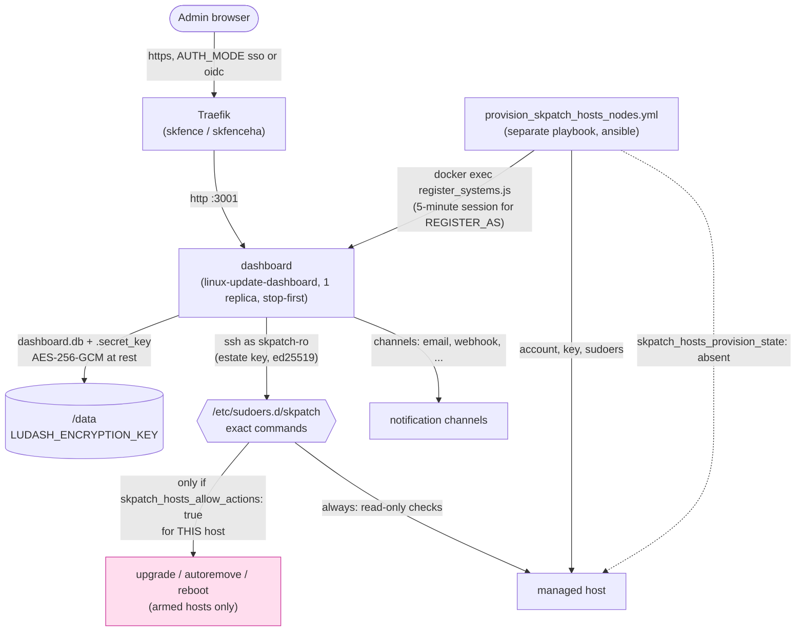
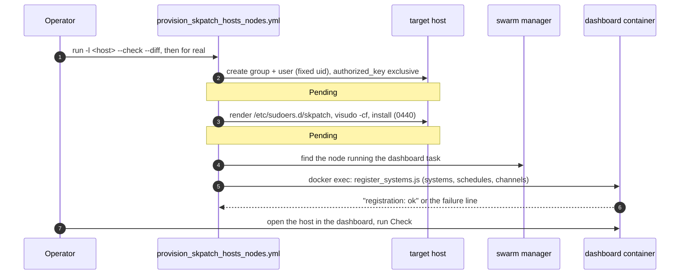
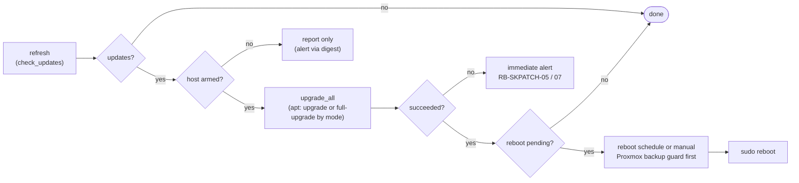

# skpatch-hosts: Standard Operating Procedures

Deploys and operates [linux-update-dashboard](https://github.com/TheDuffman85/linux-update-dashboard) (AGPL-3.0) on the swarm: a self-hosted, SSH-driven dashboard for Linux package updates across a fleet of hosts, report-only by default. Called by: the operator (deploys and provisioning), and, for the image-patching half of the same program, `skflow` `f/skpatch` flows (see [`docs/skpatch-program.md`](../../../../docs/skpatch-program.md)). Companion: [README.md](./README.md) (what it is, the security model, the package-manager matrix).

Conventions in this file: behaviour without a marker is merged on `main`. **Pending in PR #N** marks behaviour described from an open PR's branch. The PR list is in README "Pending work". Placeholders: `<host>`, `<estate>`, `<env>`, `<instance>`, `<skhub-url>`; real names live in the instance repo.

## 1. Overview

**Purpose.** Give an estate one place to see which of its hosts are behind on Linux package updates and, only where explicitly armed per host, apply those updates and reboot, over SSH, under a tight sudoers allowlist rather than a shared admin credential.

**Scope, what it owns.** The `dashboard` service itself (one container, one SQLite file, `/data`), the provisioning playbook that creates the low-privilege SSH account and sudoers rule on each target node, the registrar that keeps the dashboard's systems, schedules and channels equal to what the vault declares, and the per-estate SSH keypair that connects the two.

**What it explicitly does NOT do.**

- It does not patch container images. That is `skbom` plus Renovate, the other half of the [skpatch program](../../../../docs/skpatch-program.md).
- It does not grant itself privilege. `ALLOW_ACTIONS` in the vault is metadata; the grant is the sudoers file `provision_skpatch_hosts_nodes.yml` writes on the node, controlled by that node's own `skpatch_hosts_allow_actions`.
- It does not back itself up. See §5 "Backups" and RB-SKPATCH-11.
- It does not reuse an existing admin account or SSH key. One dedicated keypair and one dedicated low-privilege account per estate, always.
- It does not patch hypervisors or storage appliances from the dashboard. They stay report-only (RB-SKPATCH-06).

**Why this app gets more scrutiny than most.** It holds a credential that can SSH into every host it is pointed at and, if an admin arms it, run privileged commands there. A compromise of this container is a compromise of every host it has a key for. Every design choice here exists to shrink that blast radius (README "Security model").

**Service management (ITIL operating model).** This SOP follows [`ITIL_AND_RUNBOOK_OPERATING_MODEL_STANDARD`](https://github.com/smilinTux/sk-standards/blob/main/standards/ITIL_AND_RUNBOOK_OPERATING_MODEL_STANDARD.md): the runbooks in Appendix A are version-controlled definition, not state. A fleet-affecting step names its change class, its reversibility and its blast radius, and goes through the CAB gate where the class says so. Incidents and follow-ups are recorded in the ITIL and GTD stores, never in this repo (Appendix A, "Recording").

## 2. Architecture

System view (what runs where):



Onboarding flow (one provisioning run; the parts that are **Pending in PR #406** are marked):



Patch and reboot lifecycle (what a scheduled or manual run does, and where the guards are):



**Start here:**

- [`deploy_skpatch-hosts-<env>.yml`](./): deploys the `dashboard` stack; the vault's fail-closed guards live here (missing encryption key, unpinned image, contradictory sign-in settings).
- [`provision_skpatch_hosts_nodes.yml`](./provision_skpatch_hosts_nodes.yml): the separate, idempotent, reversible playbook that grants or revokes SSH access and sudo rights on a node, then registers it.
- [`src/skpatch-hosts/skpatch-hosts.sudoers.j2`](./src/skpatch-hosts/skpatch-hosts.sudoers.j2): the exact-command allowlist, the enforcement point for "report-only unless armed".
- [`src/skpatch-hosts/register_systems.js`](./src/skpatch-hosts/register_systems.js) and [`tasks/register_systems.yml`](./tasks/register_systems.yml): the registrar and the tasks that run it inside the dashboard container.
- [`src/skpatch-hosts/deploy.j2`](./src/skpatch-hosts/deploy.j2): the deploy script the swarm deploy renders.
- [`probe.yml`](./probe.yml): the post-deploy health probe (`GET /` expects `200`).

## 3. Build

Nothing is built; this role deploys an upstream image by digest (no local build step, no Dockerfile). "Build" here means rendering the compose template and env files from the vault:

```bash
ansible-playbook -i envs/<env>/inventory.ini \
  framework/v1/ansible/optional/skpatch-hosts/deploy_skpatch-hosts-<env>.yml \
  -e target_manager_group=swarm_managers \
  --vault-password-file ~/.vault_pass_env/.<instance>_<env>_vault_pass \
  --check --diff
```

`--check --diff` renders every template and shows what would change, without touching the live stack: the fastest way to confirm a vault edit produced the config you expect before deploying it for real. The same flags work on `provision_skpatch_hosts_nodes.yml` and show the sudoers diff for a host before it is written.

## 4. Test

```bash
# Render tests: the compose and env templates render for every documented config shape,
# the default image equals the playbooks' pin, the sign-in guards fire
python -m pytest v1/tests/test_skpatch_hosts_render.py -v

# Provisioning-playbook tests: sudoers content, account creation, the per-host
# actions-ceiling precedence rule, real `visudo -cf` on the rendered file
python -m pytest v1/tests/test_skpatch_hosts_provision.py -v

# Host registration: the real registrar under node against a fake dashboard that
# enforces the session signature and CSRF, plus the include
python -m pytest v1/tests/test_skpatch_hosts_register_systems_js.py v1/tests/test_skpatch_hosts_registration_include.py -v

# Repo-wide gates this role must also keep passing
python -m pytest v1/tests/test_no_latest_images.py -v
python -m pytest v1/tests/test_portal_tile_lint.py -v
```

> **Pending in PR #403 / PR #406.** `test_skpatch_hosts_wrappers.py` and `test_skpatch_hosts_wrappers_pacman_flatpak.py` run each wrapper through `sh`, `dash` and `bash` against a stub binary (rejects option-shaped and malformed arguments, checks the exact argv and that the caller's environment does not leak). `test_skpatch_hosts_sudo_coverage.py` fails when the pinned image is not the fixture's image (so a Renovate bump fails CI), when the image runs a sudo command no decision in `sudo-coverage.yml` covers, and when the rendered template misses an exact rule or grants a rule no decision backs. `test_skpatch_hosts_compliance.py` covers the compliance tool.

The green-bar gate that blocks a release is the framework's own release gate (`framework-tests.yml` plus the end-to-end harness run); nothing in this role bypasses it.

**Docs check.** The `docs-evidence` block at the end of this file is executed by `sk-standards` [`scripts/docs_check.py`](https://github.com/smilinTux/sk-standards/blob/main/scripts/docs_check.py) (DOCS_FRESHNESS_STANDARD tier 3). The checks run from the repository root and are hermetic. Run it locally with the command in §8 "Docs check".

**Lab proof (host registration).** The tests above cover the registrar and the playbook's render-time wiring; what they cannot cover hermetically is the live dashboard. The lab stage's own assertion is: after `provision_skpatch_hosts_nodes.yml` runs with `REGISTER_AS` and `SSH_PRIVATE_KEY` set against the lab's node group, `GET /api/systems` on the deployed dashboard lists every node in that group (by hostname and port), and a second run creates nothing (idempotent: every line prints `unchanged`).


## 5. Release / Deploy

```bash
# Deploy the dashboard
ansible-playbook -i envs/prod/inventory.ini \
  framework/v1/ansible/optional/skpatch-hosts/deploy_skpatch-hosts-prod.yml \
  -e target_manager_group=swarm_managers \
  --vault-password-file ~/.vault_pass_env/.<instance>_prod_vault_pass

# Provision (or de-provision) the nodes it should reach, before or
# after the deploy above, in either order
ansible-playbook -i envs/prod/inventory.ini \
  framework/v1/ansible/optional/skpatch-hosts/provision_skpatch_hosts_nodes.yml \
  -l <estate-inventory-group> \
  -e skpatch_hosts_provision_env=prod \
  --vault-password-file ~/.vault_pass_env/.<instance>_prod_vault_pass

# De-provision (removes the account, its home, its key and the sudoers
# file from every targeted host, cleanly)
ansible-playbook -i envs/prod/inventory.ini \
  framework/v1/ansible/optional/skpatch-hosts/provision_skpatch_hosts_nodes.yml \
  -l <estate-inventory-group> \
  -e skpatch_hosts_provision_env=prod -e skpatch_hosts_provision_state=absent \
  --vault-password-file ~/.vault_pass_env/.<instance>_prod_vault_pass
```

**Rotating the estate key** (suspected exposure, or routine):

1. `ssh-keygen -t ed25519 -N '' -f <scratch>/skpatch-hosts_<estate> -C skpatch-hosts@<estate>`.
2. In the vault, replace `SSH_PUBLIC_KEY` and `SSH_PRIVATE_KEY` with the new
   halves and set `SYNC_CREDENTIAL: true` (plus `CREDENTIAL_ID` if the
   credential was made by hand). Shred the scratch files.
3. Rerun `provision_skpatch_hosts_nodes.yml` against **every** inventory that
   holds this estate's targets. `authorized_key exclusive: true` replaces the
   old key on each host it reaches, and the registrar rewrites the
   dashboard credential in the same run.
4. Verify: on each host `ssh-keygen -lf ~<PROVISION_USER>/.ssh/authorized_keys`
   shows only the new fingerprint; a dashboard refresh reaches every system.
   Any host that was unreachable still trusts the OLD key: list it, and
   rerun against it (`-l <host>`) as soon as it is back.
5. Set `SYNC_CREDENTIAL` back to `false`.

**Rollback.** Redeploy with the previous `skpatch_hosts.IMAGE` digest pinned in
the vault, then rerun the deploy playbook, the same path as any other
image-pinned swarm service in this framework. Credentials in
`dashboard.db` are unaffected by an image rollback (they are data, not
baked into the image).

**Backups.** Not automated by this role. `dashboard.db` is a single
SQLite file; add a plain directory-copy entry to `skbackup` on the
storage host if the instance wants tier-2 copies:

```yaml
skbackup:
  copy:
    apps:
      - name: skpatch-hosts-prod
        newest: [{dir: data, keep: 2}]
```

A copy taken while the app is writing carries the normal SQLite
consistency risk; scale the `dashboard` service to 0 first
(`docker service scale skpatch-hosts-<env>_dashboard=0`) for a guaranteed-clean
copy if that matters for a given instance.

**Migrating an existing `skpatch` instance to `skpatch-hosts`.** This
role was renamed from `skpatch` (role dir, vault namespace, stack,
network, router, default host, tile slug) on 2026-11-06; the program it
is part of keeps the `skpatch` name (`docs/skpatch-program.md`). A rename
in place, zero data loss, old stack removed only once the new one is
confirmed healthy:

1. **Vault.** Rename the top-level key `skpatch:` to `skpatch_hosts:` in
   the vault file, and rename the vault **file itself** to the
   `skpatch-hosts-<env>-...` pattern (`select_vault_file.yml` derives the
   filename from the role directory name, which is now `skpatch-hosts`).
   Keep `DATA_PATH` pointed at the **existing** data directory: if it was
   left at the default, set it explicitly to the OLD path
   (`/var/data/skpatch-<env>/data`) rather than moving the directory --
   this keeps `dashboard.db` (every stored credential, AES-256-GCM at
   rest) exactly where it is. If `AUTH_MODE: oidc` is in use, also rename
   sksso's vault keys `SKPATCH_OIDC_CLIENT_SECRET` / `_HOST` /
   `_CLIENT_ID` / `_APP_NAME` to `SKPATCH_HOSTS_*` (same values) and
   redeploy sksso first.
2. **Deploy the new role name:**
   `deploy_skpatch-hosts-<env>.yml -e target_manager_group=swarm_managers`.
   This creates a **new, separate** stack (`skpatch-hosts-<env>`, its own
   network and router) while the old `skpatch-<env>` stack keeps running
   untouched -- different stack/network/router names, no collision, and
   both can coexist for as long as the migration takes.
3. **Reprovision under the new playbook name** (a no-op on account/key/
   sudoers content; only runs anything new if host auto-registration is
   configured, see README "Automatic host registration"):
   `provision_skpatch_hosts_nodes.yml -l <estate-group> -e skpatch_hosts_provision_env=<env>`.
4. **Verify the new instance**: same stored credentials/history (because
   `DATA_PATH` points at the preserved directory), SSH access to every
   node still works (the account and key never changed), dashboard
   reachable at the new host.
5. **Repoint bookmarks/docs** to the new host
   (`skpatch-hosts[-env].<base domain>`); the new deploy's own portal
   tile (`AUTHENTIK_TILE_SLUG` defaulting to the new router name) handles
   the Authentik side automatically.
6. **Remove the old stack** once the new one is confirmed healthy:
   `docker stack rm skpatch-<env>` on the swarm manager, then delete the
   old config dir (`/var/data/config/skpatch-<env>`) and the old vault
   file. Do **not** remove the `DATA_PATH` directory itself; step 1 kept
   both stacks pointed at it.
7. **Authentik cleanup** (SSO/OIDC instances only): the old `skpatch`
   Application/provider is not auto-removed; delete it by hand once
   confirmed unused, or leave it (stale, harmless).

**Front-end / Exposure** (per `UNIFIED_INGRESS_STANDARD.md`):
- **Tier:** `2 SKStacks/Traefik` (routed by skfence or skfenceha).
- **Public route:** `GET /` (the whole app; there is no separate API
  surface to carve out of forward auth, unlike a role with a mobile
  client).
- **Bind address:** published only through the Traefik ingress network;
  the `dashboard` container has no host-published port.


## 6. Configuration / Usage

Top-level key `skpatch_hosts:` (underscore) in `optional/group_vars/<env>/skpatch-hosts-<env>-<domain dashed>-<cluster>_vault.yml`.

```yaml
skpatch_hosts:
  LUDASH_ENCRYPTION_KEY: "<openssl rand -base64 32>"  # required, secret, >= 32 chars
  CLUSTERNAME: cluster1                     # default: inventory cluster_name
  DOMAIN: example.com                       # default: inventory domain
  CLOUDFLARED: false                        # true: default host is under DOMAIN, not CLUSTERNAME.DOMAIN
  HOSTNAME: ""                              # public host; default skpatch-hosts[-dev|-staging].<base domain>
  TRAEFIK_MIDDLEWARES: ""                   # default default-no-error-pages@file
  AUTH_MODE: sso                            # sso (Authentik forward auth, whole router) | local | oidc
  SSO_MIDDLEWARE: ""                        # sso mode: default authentik@file; must be empty in local/oidc mode
  OIDC_ISSUER: ""                           # oidc mode: required, e.g. https://<sso host>/application/o/<client id>/
  OIDC_CLIENT_ID: ""                        # oidc mode: default the router name (e.g. skpatch-hosts)
  OIDC_CLIENT_SECRET: ""                    # oidc mode: required, >= 32 chars, same value as sksso's SKPATCH_HOSTS_OIDC_CLIENT_SECRET
  OIDC_SCOPE: "openid profile email groups"
  OIDC_GROUPS_CLAIM: groups
  OIDC_ADMIN_GROUPS: "skadmin"     # CSV of Authentik group names
  OIDC_READ_ONLY_GROUPS: ""                 # CSV, default none
  OIDC_UNMATCHED_ROLE: deny                 # deny | admin | read-only
  OIDC_END_SESSION: true
  TLS_OPTIONS: ""                           # default intermediate@file; "none" = no tls.options label
  TZ: UTC
  LUDASH_LOG_LEVEL: info
  extra_env: {}                             # any other upstream app variable, verbatim into skpatch-hosts.env
  IMAGE: ""                                 # default ghcr.io/theduffman85/linux-update-dashboard:2026.10.9@sha256:1fb855a4d4b5eacc0ef3a9816064184492e9d068fb4da353c62871faeeeb1543; must carry @sha256:
  DATA_PATH: ""                             # default /var/data/skpatch-hosts-<env>/data
  DATA_NODE: ""                             # pin dashboard to this node (required with a local path)
  PLACEMENT_CONSTRAINTS: []                 # default ["node.role == worker"]
  HEALTH_CHECK_INTERVAL: 30s
  HEALTH_CHECK_TIMEOUT: 10s
  HEALTH_CHECK_RETRIES: 3
  HEALTH_CHECK_START_PERIOD: 30s
  DASHBOARD_CPUS: "0.50"
  DASHBOARD_MEMORY_LIMIT: 384M
  DASHBOARD_MEMORY_RESERVATION: 64M
  AUTHENTIK_TILE: true                      # false opts out of the portal tile
  AUTHENTIK_TILE_NAME: SKPatch Hosts        # tile title; slug/description/icon/group/open-in-new-tab below
  AUTHENTIK_TILE_SLUG: skpatch-hosts
  AUTHENTIK_TILE_DESCRIPTION: ""                 # default empty
  AUTHENTIK_TILE_ICON: "fa://fa-wrench"
  AUTHENTIK_TILE_GROUP: "skadmin"  # must already exist
  AUTHENTIK_TILE_OPEN_IN_NEW_TAB: true
  # Read by provision_skpatch_hosts_nodes.yml, not the swarm deploy:
  ALLOW_ACTIONS: false                      # instance-wide default; a host's own skpatch_hosts_allow_actions: false always wins
  PROVISION_USER: skpatch-ro                # the low-privilege account's name
  PROVISION_UID: 5201                       # its fixed uid and gid; never a system uid (containers share the host's uid space)
  SSH_PUBLIC_KEY: ""                        # required by provision_skpatch_hosts_nodes.yml; one keypair per estate
  # Host auto-registration (README.md "Automatic host registration"); REGISTER_AS plus a credential, else skipped
  REGISTER_AS: ""                           # an existing dashboard admin's username (local or OIDC)
  SSH_PRIVATE_KEY: ""                       # private half of SSH_PUBLIC_KEY; the registrar creates the credential from it
  CREDENTIAL_ID: 0                          # or an existing sshKey credential's id (takes precedence)
  # Dashboard configuration as code (README "Schedules and notifications as code"); all optional
  SYNC_CREDENTIAL: false                    # true: rewrite the credential's key from SSH_PRIVATE_KEY (key rotation)
  UPGRADE_MODE: ""                          # upgrade | full-upgrade: APT default for registered systems; "" leaves it
  NOTIFICATIONS: []                         # [{name, type, enabled, notify_on, systems, config}], secrets allowed
  SCHEDULES: []                             # [{name, type, cron, enabled, systems, only_if_required, cache_hours, notifications}]
```

**Per-host actions ceiling.** In the group_vars of any host that must stay report-only no matter what (every hypervisor, every NAS):

```yaml
skpatch_hosts_allow_actions: false
```

This beats the vault's instance-wide `ALLOW_ACTIONS: true` unconditionally; nothing in this role overrides a host's own `false` from the vault side.

**Host and play variables** (inventory host vars, or `-e` on the command line):

| Variable | Default | Meaning |
|---|---|---|
| `skpatch_hosts_allow_actions` | the vault `ALLOW_ACTIONS` (false) | Host-level ceiling; `false` always wins. |
| `skpatch_hosts_provision_hosts` | `all` | The play's host pattern (usually set by `-l`). |
| `skpatch_hosts_provision_env` | `prod` | Which stack and vault the registrar talks to. |
| `skpatch_hosts_provision_state` | `present` | `present` or `absent` (offboard). |
| `skpatch_hosts_register_manager_group` | `swarm_managers` | Inventory group the registrar picks a reachable manager from. |
| `skpatch_hosts_schedules` | the vault `SCHEDULES` | Schedules as code; wins over the vault when set (`-e @<file>.yml`). |
| `skpatch_hosts_upgrade_mode` | the vault `UPGRADE_MODE` | `upgrade` or `full-upgrade` for that one system. |
| `skpatch_hosts_dashboard_address`, `skpatch_hosts_dashboard_port` | `ansible_host`, `ansible_port` | What the dashboard container dials, when the controller's address does not resolve there. |

> **Pending in PR #406.** Also `skpatch_hosts_paused` (maintenance pause), `skpatch_hosts_proxmox` (force the `pvesh` guard line), `skpatch_hosts_pkg_managers` (override package-manager detection, for example `[pacman, flatpak]`), `skpatch_hosts_unsupported_managers_ok` (allow a manager the template does not cover, for example `[dnf]`), and vault keys `EXTRA_HOSTS`, `DPKG_KEEP_CONFFILES` and `DASHBOARD_SETTINGS` (default `{cmd_timeout_seconds: 600}`).

**Package managers other than apt and snap.** The merged template covers apt and snap only. A pacman, flatpak, dnf, yum, apk or deb-get host is provisioned without sudo lines for its manager, so every dashboard check on it fails with "sudo: a password is required" (RB-SKPATCH-07). Do not add lines by hand: copy the command from the image's own `# Sudoers-relevant command:` annotation, never from the upstream README, and add it to the template. **Pending in PR #406:** pacman and flatpak are covered, and provisioning refuses a host with a manager that is still uncovered.

## 7. API / Reference

This role exposes no API of its own. It configures the upstream app's HTTP UI (`GET /`, health-checked by `probe.yml`), calls the upstream app's **own** API from the registrar (`src/skpatch-hosts/register_systems.js` runs inside the dashboard container; `GET/POST /api/systems`, `/api/credentials`, schedules and notification channels, over a self-signed five-minute session for `REGISTER_AS`), and ships two playbooks.

| Playbook | Purpose | Key `-e` flags |
|---|---|---|
| `deploy_skpatch-hosts-<env>.yml` | Deploy or update the dashboard stack | `target_manager_group` |
| `provision_skpatch_hosts_nodes.yml` | Grant or revoke SSH access and sudo rights on target nodes; on `present`, also add those nodes as dashboard systems when missing and converge schedules, channels and upgrade modes (opt-in) | `-l <estate-group>`, `skpatch_hosts_provision_env`, `skpatch_hosts_provision_state`, `skpatch_hosts_register_manager_group` |

Files a provisioned host carries (merged):

| Path on the host | Mode | Content |
|---|---|---|
| `/etc/sudoers.d/skpatch` | `0440` root:root | The exact-command allowlist, validated by `visudo -cf` before install. |
| `~<PROVISION_USER>/.ssh/authorized_keys` | per `authorized_key` | Exactly the estate public key. |

> **Pending in PR #403 / PR #406.** `/usr/local/sbin/skpatch-apt-only-upgrade`, `skpatch-snap-refresh`, `skpatch-pacman-upgrade`, `skpatch-flatpak-update` (`root:root`, `0755`, armed hosts only); `/etc/dpkg/dpkg.cfg.d/90-skpatch-hosts` (`force-confdef`, `force-confold`, apt hosts, armed only); `/etc/skpatch-hosts.paused` (the emergency pause marker, written by an operator, not by the playbook).

Registrar output (status lines, never secrets): `... : created`, `... : updated`, `... : unchanged`, `... : key synced`, `upgrade mode set`, and a final `registration: ok`. The play fails unless `registration: ok` is present.

## 8. Troubleshooting

Symptom to check. Runbook ids are in Appendix A; known-error ids (KE-SKPATCH-n) are in Appendix B.

| Symptom | Check |
|---|---|
| Deploy fails: "LUDASH_ENCRYPTION_KEY is required" | Vault is missing the key or it is under 32 characters. Set it, redeploy. |
| Deploy fails: image without `@sha256:` | `skpatch_hosts.IMAGE` (if overridden) must carry a digest; the role refuses a floating tag. |
| Deploy fails: contradictory sign-in settings | `AUTH_MODE: local` with `SSO_MIDDLEWARE` set, a forward-auth middleware inside `TRAEFIK_MIDDLEWARES`, or `oidc` without `OIDC_ISSUER` and a 32+ character `OIDC_CLIENT_SECRET`. Pick one path (README "Sign-in and the admin group"). |
| Dashboard reachable but credentials gone after a restore | `LUDASH_ENCRYPTION_KEY` changed or was lost. Every stored credential becomes unreadable; re-enter them (RB-SKPATCH-11). |
| Nobody can sign in, SSO button missing, `AUTH_MODE: oidc` | KE-SKPATCH-3. RB-SKPATCH-08. |
| Health probe (`probe.yml`) sees a non-200 behind SSO | Expected for `AUTH_MODE: sso`: the probe sees Authentik's response, not the app. It still proves the router and TLS path are live. |
| A check or action fails with `sudo: a password is required` | KE-SKPATCH-1. RB-SKPATCH-07. |
| A node still cannot be upgraded or rebooted with `ALLOW_ACTIONS: true` | That node's own `skpatch_hosts_allow_actions` is `false`. The vault flag never overrides a host-level `false`, by design. |
| Upgrade-all ends "warning" on the snap step | The host was provisioned before the `snap refresh` sudoers line existed; rerun provisioning against it. |
| Repair fails with `sudo: a password is required` | On `main` the `dpkg --configure -a` line is not granted. RB-SKPATCH-05 (do it by hand now). Pending in PR #406. |
| "Upgrade selected" fails with `sudo: a password is required` | On `main` no rule exists, on purpose (a wildcard would be root). Pending in PR #403 and PR #406: wrappers plus default scripts. Until then use Upgrade all, or run the command on the host. |
| An upgrade fails with `debconf: unable to initialize frontend` or `end of file on stdin at conffile prompt` | KE-SKPATCH-2. Pending in PR #406. Until then RB-SKPATCH-05 after each occurrence. |
| A reboot of a Proxmox host says "Reboot blocked" | KE-SKPATCH-4. RB-SKPATCH-06. |
| A command shows a timeout in the history | RB-SKPATCH-10. |
| `provision_skpatch_hosts_nodes.yml` leaves an account on a node it should not | Rerun with `-e skpatch_hosts_provision_state=absent` against that node (RB-SKPATCH-02). It is reversible by design. |
| Host registration fails: `no dashboard user named ...` or `is read-only` | `REGISTER_AS` must be an existing ADMIN account. Sign in once (local or OIDC) so the account exists, or fix its role. |
| Host registration fails: `GET /auth/me: HTTP 401` | The signed session was refused: the account's sessions were revoked mid-run, or the container's session key changed. Rerun; if it persists, check `LUDASH_SECRET_KEY` or `/data/.secret_key` in the container. |
| Host registration fails: `no sshKey credential with id N` | `CREDENTIAL_ID` points at a credential that no longer exists. Unset it to let `SSH_PRIVATE_KEY` create one, or fix the id. |
| `API_TOKEN is set, but the pinned dashboard ... refuses` | Expected: token registration never worked on 2026.10.9 (KE-SKPATCH-5). Remove `API_TOKEN`, set `REGISTER_AS`. |
| A node is missing from the dashboard after a `present` run | `REGISTER_AS` or the credential were unset (registration skips by design; read the play's debug output), or the host was out of the play's `-l`. Set them and rerun. |
| A node's dashboard name or settings were not updated by a run | Expected: registration creates missing systems only and never edits one. Change it in the dashboard. |
| A retired node still shows in the dashboard | Expected: registration never deletes. Remove it by hand (RB-SKPATCH-02). |
| A schedule or channel changed in the dashboard reverted | It is declared in `SCHEDULES` or `NOTIFICATIONS` (or `skpatch_hosts_schedules`); every registrar run converges it back. Change it there. |
| `upgrade mode pending (package manager not detected yet ...)` | Expected right after a system is registered; the next run sets it. |
| Every email notification and the digest fail, the SMTP host works from a shell | KE-SKPATCH-8 (the container cannot reach the estate's own public address). Pending in PR #406: `EXTRA_HOSTS`. |
| Provisioning fails: "has package manager(s) ... that the skpatch-hosts sudoers template does not cover" | Pending in PR #406. By design: every dashboard action for that manager would fail on sudo. Add coverage, or disable the manager for that system in the dashboard and set `skpatch_hosts_unsupported_managers_ok`. |
| `test_fixture_is_for_the_pinned_image` fails | Pending in PR #406. The dashboard image was bumped. RB-SKPATCH-09. |
| Compliance reports `drift`, `sudo-denied:<action>`, `dashboard-only` or `not-provisioned` | Pending in PR #406. `drift`: provisioning would change that host; rerun it (`--check --diff` first). `sudo-denied`: rerun provisioning for the host. `dashboard-only`: provision it, fix its name or address, or remove it from the dashboard. |
| A host was skipped with "skpatch-hosts PAUSED" | Pending in PR #406. Expected: the pause marker is set (RB-SKPATCH-03). |

**Docs check.** The evidence block at the end of this file is the DOCS_FRESHNESS_STANDARD tier 3 contract. `sk-standards` [`scripts/docs_check.py`](https://github.com/smilinTux/sk-standards/blob/main/scripts/docs_check.py) reads `SOP.md` at the repository root, and this SOP lives under the role, so run the same block from the repository root with this loop (each check must exit 0):

```bash
sed -n '/^<!-.*docs-evidence/,/^--[>]/p' v1/ansible/optional/skpatch-hosts/SOP.md \
  | sed -n 's/^ *run: //p' \
  | while IFS= read -r c; do bash -c "$c" >/dev/null 2>&1 && echo "ok    $c" || { echo "FAIL  $c"; exit 1; }; done
```

Prove the gate can fail before trusting it: `python3 <sk-standards>/scripts/docs_check.py --self-test`.

## 9. Maturity-tier + Version reference

- **Maturity tier:** `T0, Classical`. This role generates one SSH ed25519 keypair per estate (`ssh-keygen`, standard OpenSSH) and relies on the upstream app's own AES-256-GCM at-rest encryption for its credential store. No hybrid-KEM, no post-quantum signature, no claim of either.
- **Crypto component status:** not a crypto component under `SK_REPO_DOC_STANDARD`'s operative definition: it operates standard SSH and TLS and an upstream app's own storage encryption; it does not implement, negotiate or expose a cryptographic protocol to other systems. No separate `docs/CRYPTO_SPEC.md` is carried for that reason.
- **Version phase:** framework `v1` tree (this repo's [Versions table](../../../../README.md#versions), "Published, one service at a time"). The role has no version of its own; it ships with the framework release (`skstacks-vMAJOR.MINOR.PATCH`, see [CHANGELOG.md](../../../../CHANGELOG.md)). Pinned upstream image: `linux-update-dashboard` 2026.10.9 (digest in §6).
- **CRYPTOGRAPHY_STANDARD compliance:** N/A. No suite registry, no negotiated primitives, no self-report command; this role has nothing to self-report because it does not implement a crypto surface.
- **Repo-level docs.** `SECURITY.md`, `CONTRIBUTING.md`, `CODE_OF_CONDUCT.md` and a `docs-check` workflow are repository-level files of `smilinTux/skstacks`, not of this role. At the time of writing the repository root carries none of them (see "Open gaps" below).

**Open gaps against the standards** (recorded, not hidden):

| Gap | Standard | Why it is not closed here |
|---|---|---|
| No `.github/workflows/docs-check.yml` in the repo | DOCS_FRESHNESS_STANDARD §1 | The gate's tier 1 requires `SECURITY.md`, `CONTRIBUTING.md`, `CODE_OF_CONDUCT.md` at the repository root; the repo has none, so the gate would start red. §2 forbids landing a red gate. Land the compliance files first, then the gate. |
| `docs_check.py` reads `SOP.md` at the repo root | DOCS_FRESHNESS_STANDARD §1.3 | This SOP is per role. Until the gate supports per-role SOPs, the evidence block is run by hand (§8 "Docs check"). |
| No ITIL KEDB entries exist for Appendix B | ITIL standard §4 | Appendix B is the seed text; create entries from a problem record when one recurs. |


## Appendix A: Runbooks (ITIL operating model)

Runbooks are DEFINITION: they live in git and change by PR. State (incidents, changes, the dashboard's history) lives in the operational stores. Each runbook has the same fields so a reader can find them by position:

| Field | Meaning |
|---|---|
| Class | ITIL class: `incident response`, `standard change` (pre-approved, repeatable, low risk), or `normal change` (CAB gate, any `human` rejection blocks). The class is a proposal from the blast radius below; the CAB decides. |
| Reversible | Whether and how the step is undone. |
| Blast radius | What can be affected if the step goes wrong. |
| Known errors | The Appendix B entries it remediates. |

**Rules that apply to every runbook.**

1. **Plan first.** Run `provision_skpatch_hosts_nodes.yml` and `deploy_skpatch-hosts-<env>.yml` with `--check --diff` and read the diff before the real run. A rule you did not expect in a sudoers diff stops the change.
2. **Never widen sudo by hand.** No `*`, no `NOPASSWD: ALL`, no editing `/etc/sudoers.d/skpatch` on a host. The fix for a missing rule is a PR to the template (RB-SKPATCH-07).
3. **One estate at a time, one host at a time for anything armed.** Production estates other than your own need an explicit go-ahead from their owner.
4. **Never print a secret.** Compare hashes; the registrar and the plays are `no_log` where a key passes through.
5. **Recording.** An incident-class runbook (05, 06, 07, 08, 10) is recorded as an ITIL incident when it fires (`itil_incident_create`, source `skpatch-hosts`). Follow-up work that is not itself a fleet change goes to the one GTD sink with a stable `source_ref` such as `skpatch-hosts:<host>:<issue>`, never to a private list. A change-class runbook (01 armed, 02, 03, 04 reboot, 09) is proposed as a change (`itil_change_propose`) with the rollback text from its "Reversible" field.

### RB-SKPATCH-01: Onboard a host

| | |
|---|---|
| Class | `standard change` for a report-only host. `normal change` when the host is armed (it can then install packages as root) or is a swarm manager. |
| Reversible | Yes: RB-SKPATCH-02. |
| Blast radius | The one host. A wrong sudoers file is rejected by `visudo -cf` before install. |
| Known errors | KE-SKPATCH-1 |

Preconditions: the estate keypair exists (`SSH_PUBLIC_KEY` in the vault, private half in the vault only); the dashboard is deployed; the host is reachable by the controller; you know whether it may be armed.

1. Add the host to the estate's inventory group. Name it after its swarm node name where it is one. Hypervisors, NAS and anything that must not be patched from here get `skpatch_hosts_allow_actions: false` in its group_vars **in the same change**.
2. Plan:

   ```bash
   ansible-playbook -i <inventory> framework/v1/ansible/optional/skpatch-hosts/provision_skpatch_hosts_nodes.yml \
     -l <host> -e skpatch_hosts_provision_env=<env> --vault-password-file <file> --check --diff
   ```

   Read the posture line (`actions ALLOWED` or `report-only`) and the sudoers diff.
3. Apply: the same command without `--check --diff`.
4. Verify on the host as root: `sudo -l -U <PROVISION_USER>` lists only the rules in §6 for that posture, `visudo -cf /etc/sudoers.d/skpatch` prints `parsed OK`, `grep -c . ~<PROVISION_USER>/.ssh/authorized_keys` prints `1`.
5. Verify in the dashboard: the host is listed (registration), its first Check succeeds, and the history has no "sudo: a password is required".
6. Verify idempotence: rerun the apply; every line reports `ok` or `unchanged`, nothing `changed`.

If registration is not configured, add the host by hand in the dashboard with the estate credential (user `PROVISION_USER`).

> **Pending in PR #406.** Steps 2 and 3 become the whole procedure: the run also detects the package managers, refuses an uncovered one before changing anything, installs the wrappers and the dpkg policy, and registers the host with default scripts, settings, schedules and channels. A build playbook for a new VM or LXC should end by importing this playbook for the new host. The compliance check finds a host that is in the dashboard but was never provisioned.

### RB-SKPATCH-02: Offboard a host

| | |
|---|---|
| Class | `standard change` |
| Reversible | Yes: RB-SKPATCH-01 recreates the account and rules. Package history in the dashboard is lost only if you delete the system there. |
| Blast radius | The one host; the dashboard loses sight of it. |
| Known errors | none |

1. Remove the host's name from every `systems` list in `SCHEDULES` or `skpatch_hosts_schedules`, so no schedule names a host that is going away.
2. Run provisioning with `-e skpatch_hosts_provision_state=absent -l <host>`. It removes the sudoers file, ends the account's own sessions and processes (`loginctl terminate-user`, `pkill -KILL -u`), then removes the account, its home (the key included) and its group.
3. Verify on the host: `getent passwd <PROVISION_USER>` prints nothing, `test ! -e /etc/sudoers.d/skpatch` succeeds.
4. Remove the system in the dashboard by hand. Registration never deletes, so a retired host stays listed until you do.
5. Remove the host from the inventory group (or leave it out of the next provisioning run).

> **Pending in PR #403.** `absent` also removes the wrappers.

### RB-SKPATCH-03: Pause and resume a host for maintenance

| | |
|---|---|
| Class | `standard change` |
| Reversible | Yes. |
| Blast radius | The one host stops being acted on (and, once paused with the marker, stops being checked by provisioning). |
| Known errors | none |

Use this when a host is about to be worked on by hand (a hypervisor upgrade, a disk replacement) and the dashboard must not upgrade or reboot it meanwhile.

On `main` the available pause is to **disarm** the host:

1. Set `skpatch_hosts_allow_actions: false` in the host's vars and rerun provisioning for it. The upgrade, autoremove, snap and reboot lines are removed; the read-only checks stay.
2. Remove the host from the `systems` of every update and reboot schedule and rerun the registrar (provisioning with registration configured). In the dashboard, a schedule you changed by hand reverts on the next run, so change the input, not the UI.
3. Verify: `sudo -l -U <PROVISION_USER>` shows only the two read-only rules.
4. Resume: undo steps 1 and 2 and rerun. Verify with a manual Check.

> **Pending in PR #406.** A first-class pause: set `skpatch_hosts_paused: true` in the instance repo, or, in an emergency on the host, create `/etc/skpatch-hosts.paused`. A paused host is left exactly as it is: provisioning changes nothing on it and does not register it, and the compliance check reports `paused`, never drift. Remove the marker and rerun provisioning to resume. Do not apply a provisioning run to a host whose sudoers is paused for maintenance.

### RB-SKPATCH-04: Patch and reboot a host by hand from the dashboard

| | |
|---|---|
| Class | `standard change` for a worker with a healthy fleet. `normal change` for a swarm manager, the node running the dashboard, or any host others depend on. Hypervisors and NAS are never done here (RB-SKPATCH-06). |
| Reversible | Upgrades: no automated rollback (reinstall a pinned package version by hand if needed). Reboot: no. |
| Blast radius | The host, plus anything scheduled on it. A manager reboot can drop swarm quorum. |
| Known errors | KE-SKPATCH-1, KE-SKPATCH-2 |

1. Confirm the host is armed (the dashboard action buttons work) and not paused. Confirm no backup or other maintenance is running on or against it.
2. In the dashboard open the host, run **Check**. Note the pending count and whether a reboot is pending.
3. Run **Upgrade all** (apt uses the system's upgrade mode: `upgrade`, or `full-upgrade` if `UPGRADE_MODE` says so; `full-upgrade` is what lands new kernels). Wait for the result. A warning on the snap step means the host predates the snap rule: rerun provisioning for it.
4. If the result is a failure, stop: RB-SKPATCH-05 (dpkg) or RB-SKPATCH-07 (sudo). Do not reboot a host with an interrupted dpkg.
5. If a reboot is pending, check the cluster first, from a manager: `docker node ls` (all `Ready`), `docker service ls` (replicas converged). For a manager, confirm the other managers are `Ready` and reachable so quorum holds. Reboot workers before managers, one node at a time, the dashboard's own node last.
6. Run **Reboot** in the dashboard (the guard from RB-SKPATCH-06 runs first). Wait for the node to return.
7. Verify: `docker node ls` shows it `Ready`, `docker service ls` has converged, a new Check shows no pending updates and no reboot pending.

### RB-SKPATCH-05: Recover a broken dpkg

| | |
|---|---|
| Class | `incident response` |
| Reversible | The repair completes an interrupted configuration; it does not undo it. |
| Blast radius | The one host's package state. |
| Known errors | KE-SKPATCH-2 |

Symptoms: a "package manager needs repair" banner, "dpkg was interrupted, you must manually run 'sudo dpkg --configure -a'", or an upgrade that ended in `debconf: unable to initialize frontend` or a conffile prompt reading end of file.

1. Make sure nothing is running: `pgrep -a 'apt|dpkg'` is empty. Do not delete lock files to get past a running process.
2. Inspect: `dpkg --audit`, and the tail of `/var/log/dpkg.log` and `/var/log/apt/term.log` for the package that failed.
3. Repair. Press **Repair** in the dashboard if the host has the `dpkg --configure -a` rule. **On `main` it does not** (Repair fails with "sudo: a password is required"), so as an operator with root on the host run `dpkg --configure -a`, then `apt-get -f install`.
4. If a conffile prompt is the cause, the package keeps its old config unless you choose otherwise; review the `.dpkg-dist` file it leaves.
5. Verify: `dpkg --audit` prints nothing, then run **Check** in the dashboard and confirm no repair banner.

> **Pending in PR #406.** The Repair button works on an armed host (`dpkg --configure -a` is granted). The root cause of most occurrences is also closed: sudo's `env_reset` used to drop the app's `DEBIAN_FRONTEND=noninteractive` (a `Defaults:<account> env_keep += "DEBIAN_FRONTEND"` line fixes it) and dpkg stopped at conffile prompts with stdin on `/dev/null` (`/etc/dpkg/dpkg.cfg.d/90-skpatch-hosts` sets `force-confdef` and `force-confold`; `DPKG_KEEP_CONFFILES: false` opts out). Rerun provisioning for hosts that predate it, then press Repair.

### RB-SKPATCH-06: Proxmox reboot guard

| | |
|---|---|
| Class | `incident response` when the guard blocks a reboot someone needs; reboots of hypervisors are `normal change` and are done from Proxmox. |
| Reversible | n/a |
| Blast radius | Every guest on the hypervisor, and any backup running against it. |
| Known errors | KE-SKPATCH-4 |

The dashboard's reboot runs a guard first. On a host where `pveversion` or `pvesh` exists it runs `sudo pvesh get /cluster/tasks --output-format json` and refuses to continue if it cannot, or if a `vzdump` (backup) task is running. The three refusals:

| Message | Meaning | Action |
|---|---|---|
| `Reboot blocked: Proxmox detected but pvesh is unavailable.` | Proxmox is present, `pvesh` is not on the PATH. | Fix the host; do not bypass the guard. |
| `Reboot blocked: could not verify Proxmox backup activity.` | `pvesh` ran and failed, almost always `sudo: a password is required` because the rule is not granted. | On `main` this is the normal state: the role does not grant the guard line. Reboot the hypervisor from Proxmox with its guests drained. |
| `Reboot blocked: Proxmox backup task is running.` | The guard works and a backup is in flight. | Wait for the backup, or check `pvesh get /cluster/tasks` on the host. |

Policy: hypervisors are `skpatch_hosts_allow_actions: false`, have no reboot schedule, and are rebooted from Proxmox. Do not replace the guard with a custom script.

> **Pending in PR #406.** On an armed host where `/usr/bin/pvesh` exists (or `skpatch_hosts_proxmox: true`), sudoers grants exactly `pvesh get /cluster/tasks --output-format json`, only together with the reboot line, so a hypervisor can be rebooted from the app by hand with the guard working. Whether it also gets a schedule is the operator's choice; most estates give hypervisors none.

### RB-SKPATCH-07: "sudo: a password is required"

| | |
|---|---|
| Class | `incident response`, then a code change if the rule is missing from the template. |
| Reversible | n/a |
| Blast radius | The one host and action. |
| Known errors | KE-SKPATCH-1 |

The account's sudo rules are exact commands. The error means the dashboard ran a sudo command that no rule matches exactly. Find which:

1. In the dashboard history, note the action (check, upgrade, repair, selected, autoremove, reboot) and the host.
2. On the host as root, `sudo -l -U <PROVISION_USER>` and `ls -l /etc/sudoers.d/skpatch`. If the file or account is missing, the host was never provisioned: RB-SKPATCH-01.
3. Look up the action in README "Package managers, dashboard operations and sudo". If the host's manager is not covered, or the action is one the matrix says is not granted on `main`, the template has a gap, not the host.
4. If the host is armed, the line exists in the template, but the file on the host lacks it: the host predates it. Run provisioning with `--check --diff` for the host, read the added lines, apply.
5. If the host is report-only, that is the design: upgrade, autoremove and reboot are armed-only. Arm it only through a change (RB-SKPATCH-01 class rule).
6. If the template has a gap: open a PR that adds the **exact** command from the image's own `# Sudoers-relevant command:` annotation (never a wildcard, never `NOPASSWD: ALL`). **Pending in PR #406:** a CI test fails the build when the pinned image runs a command the template does not decide.
7. Verify: rerun the action in the dashboard; the history entry succeeds.

### RB-SKPATCH-08: SSO login lockout after an SSO outage

| | |
|---|---|
| Class | `incident response` |
| Reversible | n/a |
| Blast radius | Nobody can sign in to the dashboard. Hosts are not affected; schedules still run. |
| Known errors | KE-SKPATCH-3 |

Cause: in `AUTH_MODE: oidc` the dashboard runs OIDC discovery **once at startup and never retries**. If the identity provider (Authentik, `sksso`) is unreachable at that moment, the task stays up with SSO login silently off. Password login is also off (`LUDASH_PASSWORD_LOGIN_ENABLED=false`), and the app's own lockout fallback does not engage because the OIDC settings are present, so there is no way in. In `AUTH_MODE: sso` the forward auth sits outside the app and this failure does not apply in the same way.

1. Confirm: from the node running the dashboard,

   ```bash
   docker exec $(docker ps -q --filter name=skpatch-hosts-<env>_dashboard. | head -n1) \
     node -e "require('http').get('http://127.0.0.1:3001/api/auth/status',r=>{let b='';r.on('data',d=>b+=d);r.on('end',()=>console.log(r.statusCode,b))})"
   ```

   `"oidcEnabled":false` while `AUTH_MODE` is `oidc` confirms it.
2. Confirm the identity provider is up: its `<OIDC_ISSUER>.well-known/openid-configuration` answers from that node. If it does not, fix the IdP first (its own runbook); restarting the dashboard before it answers just repeats the failure.
3. Restart the dashboard so discovery runs again: `docker service update --force skpatch-hosts-<env>_dashboard` (stop-first, a short outage).
4. Verify: repeat step 1 and see `"oidcEnabled":true`, then sign in through SSO.

Provisioning and registration keep working while locked out: the registrar signs its own five-minute session for `REGISTER_AS` inside the container and does not use the login page.

A break-glass path if the IdP cannot come back (redeploy with `AUTH_MODE: local`) has **not** been exercised against the pinned image and depends on a local account with a password existing; do not rely on it. Restore the IdP.

> **Pending in PR #401.** With `AUTH_MODE: oidc` the swarm healthcheck reads `/api/auth/status` with `node` and exits non-zero unless the response is 2xx or 3xx and `oidcEnabled === true`; bad JSON, a 5xx, a missing field and a refused connection all fail. `start_period` defaults to `90s` in oidc mode (`HEALTH_CHECK_START_PERIOD` still overrides). Swarm then replaces a task that came up with SSO off, so this runbook becomes the exception path. `sso` and `local` keep the plain `/` probe.

### RB-SKPATCH-09: Upgrade the dashboard image and regenerate the sudo-command fixture

| | |
|---|---|
| Class | `normal change` (the image runs privileged commands on the fleet; the schema may not roll back) |
| Reversible | Image: redeploy the previous digest. Database: only from a copy taken before (the probe declares `schema_changing: true`; an older image may not read a newer schema). |
| Blast radius | The dashboard and, indirectly, every sudo command it will issue on every host. |
| Known errors | KE-SKPATCH-1 |

1. Take a copy of `dashboard.db` and `.secret_key` first (RB-SKPATCH-11).
2. Choose the new upstream tag and its **manifest-list digest** (so amd64 and arm64 both resolve). Renovate normally opens this PR. Read the upstream release notes for changes to sudo commands, auth settings and the API.
3. Change the pin in the three deploy playbooks (`skp_default_image`) and in `src/skpatch-hosts/deploy.j2` together; `test_skpatch_hosts_render.py` fails if they differ. An instance that sets `IMAGE` in its vault changes it there instead.
4. Run the render and provisioning tests (§4).
5. Deploy dev, then staging, then prod: `--check --diff` first, then for real. Verify the probe passes and sign-in works.
6. Provision a canary host with `--check --diff` and confirm the sudoers diff is empty or explained.

> **Pending in PR #406.** The image's sudo commands are a contract with the template, kept by a test. After an image bump: (a) run `python3 v1/ansible/optional/skpatch-hosts/tools/extract_sudo_commands.py` (needs docker; it runs the image's own `buildCommandReference()` in a throwaway container with no network) to regenerate `v1/tests/fixtures/skpatch_hosts_sudo_commands.json`; (b) review the fixture diff; every new command needs a decision in `src/skpatch-hosts/sudo-coverage.yml`: `exact` (granted verbatim), `wrapper` (only a validated wrapper is granted) or `denied` (with the reason); (c) update the template; (d) rerun `v1/tests/test_skpatch_hosts_sudo_coverage.py`, which fails if the pinned image is not the fixture's, if a command has no decision, or if the template misses an exact rule or grants one no decision backs; (e) after the release, rerun provisioning for the fleet (the compliance check reports `drift` until you do).

### RB-SKPATCH-10: Command and SSH timeouts

| | |
|---|---|
| Class | `incident response`; the setting change is a `standard change`. |
| Reversible | Yes (change the setting back). |
| Blast radius | The dashboard's behaviour for every host. |
| Known errors | KE-SKPATCH-6 |

The dashboard has two timeouts. Defaults come from `LUDASH_DEFAULT_SSH_TIMEOUT` (30 s) and `LUDASH_DEFAULT_CMD_TIMEOUT` (120 s); the settings page (`ssh_timeout_seconds`, `cmd_timeout_seconds`) overrides them within the limits SSH 5 to 120 s and command 10 to 600 s (`LUDASH_MAX_SSH_TIMEOUT` and `LUDASH_MAX_CMD_TIMEOUT` lower the ceilings).

A long `apt-get upgrade` or `full-upgrade` can outlast 120 s. A timeout in the history does **not** mean the upgrade stopped: upgrades run under `nohup setsid` on the host and survive the dashboard's SSH session. Before retrying:

1. On the host: `pgrep -a 'apt|dpkg'`. If a process is running, wait; do not start a second upgrade.
2. When it finishes, `dpkg --audit` must print nothing; if not, RB-SKPATCH-05.
3. Raise the command timeout in the dashboard settings (up to 600 s), or set `extra_env: {LUDASH_DEFAULT_CMD_TIMEOUT: "600"}` in the vault to change the default. Re-run Check.

> **Pending in PR #406.** The registrar converges app settings from `DASHBOARD_SETTINGS`, default `{cmd_timeout_seconds: 600}`, so a rebuilt database gets the raised command timeout. **No PR yet (design):** an SSH timeout of 60 s for slow links and busy hosts. When it lands it is a setting in the same mechanism and this runbook names it.

### RB-SKPATCH-11: Back up and restore the dashboard database

| | |
|---|---|
| Class | `standard change` (backup); `normal change` (restore over a live database). |
| Reversible | Backup: yes. Restore: keep the replaced copy until verified. |
| Blast radius | Every credential, schedule, channel and history entry the dashboard holds. |
| Known errors | KE-SKPATCH-7 |

State is the `/data` directory: `dashboard.db` and the `.secret_key` session-key file next to it. Credentials inside are AES-256-GCM encrypted with `LUDASH_ENCRYPTION_KEY`; a backup without that key (kept in the vault, never in the backup) is unreadable by design.

1. Back up: scale the dashboard to zero for a guaranteed-clean copy (`docker service scale skpatch-hosts-<env>_dashboard=0`), copy the whole `/data` directory (the `skbackup` entry in §5 does this on a schedule), then `docker service scale skpatch-hosts-<env>_dashboard=1`.
2. Restore: scale to zero, put the directory back, scale to one.
3. Verify: sign in, open a system's credential (it decrypts only with the same `LUDASH_ENCRYPTION_KEY`), run a Check. If credentials are unreadable the key changed or was lost: re-enter them (the registrar recreates the estate credential from `SSH_PRIVATE_KEY` when none exists).
4. Because schedules, channels and the estate credential are declared in the vault, a lost database is rebuilt by redeploying and rerunning provisioning with registration configured; only history is lost.

## Appendix B: Known errors (KEDB seed text)

Seed text for the Known Error Database. The ids are local to this document. Today a KEDB entry is write-once and created from a problem record; create the entry from the problem when one of these recurs, and link the runbook.

| Id | Symptom | Root cause | Workaround | Runbook | State |
|---|---|---|---|---|---|
| KE-SKPATCH-1 | A dashboard action fails with `sudo: a password is required` | The dashboard ran a sudo command no rule matches exactly: host not provisioned or predates a rule, report-only host, uncovered package manager, or a gap in the template. First seen 2026-10-28, when every check failed because the template had been written from the upstream README instead of the image's own annotations. | Rerun provisioning for the host; otherwise fix the template with the exact command. Never a wildcard. | RB-SKPATCH-07 | Open as a class. Pending in PR #406: CI coverage test. |
| KE-SKPATCH-2 | Upgrade fails with `debconf: unable to initialize frontend`, or stops at a dpkg conffile prompt, leaving dpkg interrupted | sudo's `env_reset` drops `DEBIAN_FRONTEND=noninteractive`; debconf falls back to Teletype and reads EOF. dpkg prompts for a changed conffile with stdin on `/dev/null`. | `dpkg --configure -a` as root, then `apt-get -f install`. | RB-SKPATCH-05 | Pending in PR #406 (env_keep and conffile policy). |
| KE-SKPATCH-3 | Dashboard up, no SSO button, nobody can sign in (`AUTH_MODE: oidc`) | OIDC discovery runs once at startup and is not retried; the identity provider was unreachable at that moment. Seen on two estates for about 36 hours. | Restore the IdP, then `docker service update --force` the dashboard. | RB-SKPATCH-08 | Pending in PR #401 (healthcheck replaces the task). |
| KE-SKPATCH-4 | Reboot blocked: "could not verify Proxmox backup activity" | The app's guard needs `pvesh get /cluster/tasks`; the rule is not granted on `main`. | Reboot the hypervisor from Proxmox. | RB-SKPATCH-06 | Pending in PR #406 (exact `pvesh` line, armed Proxmox only). |
| KE-SKPATCH-5 | Registration fails `403 API tokens cannot configure SSH connections` | The pinned dashboard refuses every API-token request that creates or edits a system or credential. | Use `REGISTER_AS` (session-based registrar); remove `API_TOKEN`. | README "Automatic host registration" | Fixed on `main`. |
| KE-SKPATCH-6 | A command times out in the history while the upgrade continues | Default command timeout is 120 s; upgrades are longer but survive the session (`nohup setsid`). | Wait, verify dpkg, raise the timeout. | RB-SKPATCH-10 | Pending in PR #406 (600 s default). |
| KE-SKPATCH-7 | Stored credentials unreadable after a restore or redeploy | `LUDASH_ENCRYPTION_KEY` changed or was lost. | Restore the key from the vault, or re-enter the credentials. | RB-SKPATCH-11 | By design. |
| KE-SKPATCH-8 | Email notifications and the digest time out, the SMTP host works from a shell | The container resolves the SMTP host to the estate's own public address and the router does not hairpin NAT. | Pin the name for the container with `EXTRA_HOSTS`. | README "Alerting" | Pending in PR #406. |
| KE-SKPATCH-9 | `userdel` refuses to remove the account on a swarm node | The account had been created as a system user and got uid 999, which postgres images use, so container processes "ran as" it. | The account now has a fixed uid and gid (`PROVISION_UID`, default 5201). Deprovision ends the account's sessions first. | RB-SKPATCH-02 | Fixed on `main`. |

<!-- docs-evidence
     Executed by the docs-check gate (DOCS_FRESHNESS_STANDARD 1.3), run from the
     repository root. Hermetic: repo-local, no network, no live host.
verified: 2026-11-14
checks:
  - name: all three deploy playbooks exist
    run: for e in dev staging prod; do test -f v1/ansible/optional/skpatch-hosts/deploy_skpatch-hosts-$e.yml || exit 1; done
  - name: provisioning playbook exists
    run: test -f v1/ansible/optional/skpatch-hosts/provision_skpatch_hosts_nodes.yml
  - name: registrar script and its include exist
    run: test -f v1/ansible/optional/skpatch-hosts/src/skpatch-hosts/register_systems.js && test -f v1/ansible/optional/skpatch-hosts/tasks/register_systems.yml
  - name: sudoers template exists (the real actions-gate enforcement point)
    run: test -f v1/ansible/optional/skpatch-hosts/src/skpatch-hosts/skpatch-hosts.sudoers.j2
  - name: documented default image matches the prod playbook pin
    run: grep -q 'ghcr.io/theduffman85/linux-update-dashboard:2026.10.9@sha256:1fb855a4d4b5eacc0ef3a9816064184492e9d068fb4da353c62871faeeeb1543' v1/ansible/optional/skpatch-hosts/deploy_skpatch-hosts-prod.yml v1/ansible/optional/skpatch-hosts/SOP.md
  - name: sudoers template has no wildcard rule and no NOPASSWD ALL (README security model)
    run: ! grep -E '^[^#]*NOPASSWD:.*([*]|ALL$)' v1/ansible/optional/skpatch-hosts/src/skpatch-hosts/skpatch-hosts.sudoers.j2
  - name: report-only rules are exactly dpkg --audit and apt-get update -qq
    run: grep -q 'NOPASSWD: /usr/bin/dpkg --audit$' v1/ansible/optional/skpatch-hosts/src/skpatch-hosts/skpatch-hosts.sudoers.j2 && grep -q 'update -qq$' v1/ansible/optional/skpatch-hosts/src/skpatch-hosts/skpatch-hosts.sudoers.j2
  - name: reboot rule has no argument list (the documented residual risk)
    run: grep -q 'NOPASSWD: /usr/sbin/reboot$' v1/ansible/optional/skpatch-hosts/src/skpatch-hosts/skpatch-hosts.sudoers.j2
  - name: sudoers install is validated by visudo before it is written
    run: grep -q "validate: '/usr/sbin/visudo -cf %s'" v1/ansible/optional/skpatch-hosts/provision_skpatch_hosts_nodes.yml
  - name: documented default uid 5201 and user skpatch-ro match the provisioning playbook
    run: grep -q "default(5201, true)" v1/ansible/optional/skpatch-hosts/provision_skpatch_hosts_nodes.yml && grep -q "default('skpatch-ro', true)" v1/ansible/optional/skpatch-hosts/provision_skpatch_hosts_nodes.yml
  - name: per-host ceiling variable documented here is the one the playbook reads
    run: grep -q 'skpatch_hosts_allow_actions if skpatch_hosts_allow_actions is defined' v1/ansible/optional/skpatch-hosts/provision_skpatch_hosts_nodes.yml
  - name: documented health check start period default matches the compose template
    run: grep -q "HEALTH_CHECK_START_PERIOD | default('30s', true)" v1/ansible/optional/skpatch-hosts/src/config/skpatch-hosts/skpatch-hosts.yml.j2 && grep -q 'HEALTH_CHECK_START_PERIOD: 30s' v1/ansible/optional/skpatch-hosts/SOP.md
  - name: documented OIDC admin group default matches the deploy playbook
    run: grep -q "OIDC_ADMIN_GROUPS | default('skadmin', true)" v1/ansible/optional/skpatch-hosts/deploy_skpatch-hosts-prod.yml
  - name: SOP has the nine required sections, a mermaid diagram and all eleven runbooks
    run: f=v1/ansible/optional/skpatch-hosts/SOP.md; test "$(grep -c '^## [1-9]\. ' $f)" = 9 && grep -q 'mermaid' $f && test "$(grep -c '^### RB-SKPATCH-' $f)" = 11
  - name: README carries the status and maturity lines in its first lines
    run: head -8 v1/ansible/optional/skpatch-hosts/README.md | grep -q 'Maturity-tier:'
  - name: no em or en dashes in these docs (writing standard)
    run: ! grep -q $'\xe2\x80\x94\|\xe2\x80\x93' v1/ansible/optional/skpatch-hosts/README.md v1/ansible/optional/skpatch-hosts/SOP.md
  - name: no real private IP addresses in these docs (public repo)
    run: bash scripts/scrub-check.sh v1/ansible/optional/skpatch-hosts/README.md v1/ansible/optional/skpatch-hosts/SOP.md
-->
