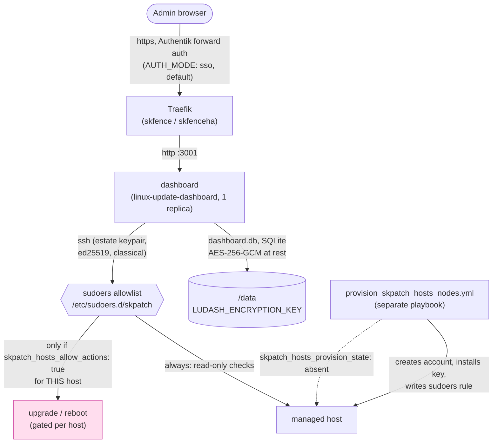

# skpatch-hosts: Standard Operating Procedures

Deploys and operates [linux-update-dashboard](https://github.com/TheDuffman85/linux-update-dashboard)
(AGPL-3.0) on the swarm: a self-hosted, SSH-driven dashboard for Linux
package updates across a fleet of hosts, report-only by default. Called
by: the operator (ad hoc deploys/provisioning today; `skflow` `f/skpatch`
flows, once built, will drive the image-patching half of the same
program; see [`docs/skpatch-program.md`](../../../../docs/skpatch-program.md)).

## 1. Overview

**Purpose.** Give an estate one place to see which of its hosts are
behind on Linux package updates, and, only where explicitly armed per
host, apply those updates and reboot, over SSH, under a tight sudoers
allowlist rather than a shared admin credential.

**Scope, what it owns.** The `dashboard` service itself (one container,
one SQLite file, `/data`), the provisioning playbook that creates the
low-privilege SSH account and sudoers rule on each target node, and the
per-estate SSH keypair that connects the two.

**What it explicitly does NOT do.**
- It does not patch container images. That is `skbom` plus Renovate, the
  other half of the [skpatch program](../../../../docs/skpatch-program.md).
- It does not grant itself privilege. `ALLOW_ACTIONS` in this role's own
  vault block is metadata; the actual grant lives in the sudoers file
  `provision_skpatch_hosts_nodes.yml` writes on the target node, controlled by
  that node's own `skpatch_hosts_allow_actions`.
- It does not back itself up. No dedicated backup CLI ships with it; see
  §5 "Backups" below for the `skbackup` integration pattern instead.
- It does not reuse an existing admin account or SSH key. One dedicated
  keypair and one dedicated low-privilege account per estate, always.

**Why this app gets more scrutiny than most.** It is designed to hold a
credential that can SSH into every host it is pointed at, and, if an
admin arms it, run privileged commands there. A compromise of this
container is a compromise of every host it has a key for. Every design
choice in this document exists to shrink that blast radius.

## 2. Architecture



**Start here:**
- [`deploy_skpatch-hosts-<env>.yml`](./): deploys the `dashboard` stack; this is where the vault's fail-closed guards live (missing encryption key, unpinned image, contradictory sign-in settings).
- [`provision_skpatch_hosts_nodes.yml`](./provision_skpatch_hosts_nodes.yml): the separate, idempotent, reversible playbook that actually grants (or revokes) SSH access and sudo rights on a target node.
- [`src/skpatch-hosts/skpatch-hosts.sudoers.j2`](./src/skpatch-hosts/skpatch-hosts.sudoers.j2): the exact-command allowlist, the actual enforcement point for "report-only unless armed", not application code.
- [`src/skpatch-hosts/deploy.j2`](./src/skpatch-hosts/deploy.j2): the compose template the swarm deploy renders.
- [`probe.yml`](./probe.yml): the post-deploy health probe (`GET /` expects `200`).

## 3. Build

Nothing is built; this role deploys an upstream image by digest (no
local build step, no Dockerfile). "Build" here means rendering the
compose template and env files from the vault:

```bash
ansible-playbook -i envs/<env>/inventory.ini \
  framework/v1/ansible/optional/skpatch-hosts/deploy_skpatch-hosts-<env>.yml \
  -e target_manager_group=swarm_managers \
  --vault-password-file ~/.vault_pass_env/.<instance>_<env>_vault_pass \
  --check --diff
```

`--check --diff` renders every template and shows what would change,
without touching the live stack, the fastest way to confirm a vault
edit produced the config you expect before deploying it for real.

## 4. Test

```bash
# Render tests (template renders correctly for every documented config shape)
python -m pytest v1/tests/test_skpatch_hosts_render.py -v

# Provisioning-playbook tests (sudoers content, account creation, the
# per-host actions-ceiling precedence rule)
python -m pytest v1/tests/test_skpatch_hosts_provision.py -v

# Host auto-registration: the real registrar under node against a fake
# dashboard that enforces the session signature and CSRF, plus the include
python -m pytest v1/tests/test_skpatch_hosts_register_systems_js.py v1/tests/test_skpatch_hosts_registration_include.py -v

# Sudo coverage: the template against the pinned image's own sudo commands
# (fails after an image bump until the fixture is regenerated and reviewed)
python -m pytest v1/tests/test_skpatch_hosts_sudo_coverage.py -v
python3 v1/ansible/optional/skpatch-hosts/tools/extract_sudo_commands.py   # regenerate (docker)

# Fleet compliance tool and its read-only dashboard report
python -m pytest v1/tests/test_skpatch_hosts_compliance.py -v

# Repo-wide gate this role must also keep passing
python -m pytest v1/tests/test_no_latest_images.py -v
python -m pytest v1/tests/test_portal_tile_lint.py -v
```

The green-bar gate that blocks a release is the framework's own release
gate (`framework-tests.yml` plus the end-to-end harness run); nothing in
this role bypasses it.

**Lab proof (host auto-registration).** The above covers the provisioner
script and the playbook's render-time wiring; what it cannot cover
hermetically is the live dashboard API. The lab stage's own assertion
(skstack06, per-estate) is: after `provision_skpatch_hosts_nodes.yml`
runs with `REGISTER_AS` and `SSH_PRIVATE_KEY` set against the lab's node
group, `GET /api/systems` on the deployed dashboard lists every node in
that group (by hostname/port), and a second run of the same playbook
creates nothing (idempotent: every line prints `unchanged`).

## 5. Release / Deploy

```bash
# Deploy the dashboard
ansible-playbook -i envs/prod/inventory.ini \
  framework/v1/ansible/optional/skpatch-hosts/deploy_skpatch-hosts-prod.yml \
  -e target_manager_group=swarm_managers \
  --vault-password-file ~/.vault_pass_env/.<instance>_prod_vault_pass

# Provision (or de-provision) the nodes it should reach, before or
# after the deploy above, in either order
ansible-playbook -i envs/prod/inventory.ini \
  framework/v1/ansible/optional/skpatch-hosts/provision_skpatch_hosts_nodes.yml \
  -l <estate-inventory-group> \
  -e skpatch_hosts_provision_env=prod \
  --vault-password-file ~/.vault_pass_env/.<instance>_prod_vault_pass

# De-provision (removes the account, its home, its key and the sudoers
# file from every targeted host, cleanly)
ansible-playbook -i envs/prod/inventory.ini \
  framework/v1/ansible/optional/skpatch-hosts/provision_skpatch_hosts_nodes.yml \
  -l <estate-inventory-group> \
  -e skpatch_hosts_provision_env=prod -e skpatch_hosts_provision_state=absent \
  --vault-password-file ~/.vault_pass_env/.<instance>_prod_vault_pass
```

**Rotating the estate key** (suspected exposure, or routine):

1. `ssh-keygen -t ed25519 -N '' -f <scratch>/skpatch-hosts_<estate> -C skpatch-hosts@<estate>`.
2. In the vault, replace `SSH_PUBLIC_KEY` and `SSH_PRIVATE_KEY` with the new
   halves and set `SYNC_CREDENTIAL: true` (plus `CREDENTIAL_ID` if the
   credential was made by hand). Shred the scratch files.
3. Rerun `provision_skpatch_hosts_nodes.yml` against **every** inventory that
   holds this estate's targets. `authorized_key exclusive: true` replaces the
   old key on each host it reaches, and the registrar rewrites the
   dashboard credential in the same run.
4. Verify: on each host `ssh-keygen -lf ~<PROVISION_USER>/.ssh/authorized_keys`
   shows only the new fingerprint; a dashboard refresh reaches every system.
   Any host that was unreachable still trusts the OLD key: list it, and
   rerun against it (`-l <host>`) as soon as it is back.
5. Set `SYNC_CREDENTIAL` back to `false`.

**Rollback.** Redeploy with the previous `skpatch_hosts.IMAGE` digest pinned in
the vault, then rerun the deploy playbook, the same path as any other
image-pinned swarm service in this framework. Credentials in
`dashboard.db` are unaffected by an image rollback (they are data, not
baked into the image).

**Backups.** Not automated by this role. `dashboard.db` is a single
SQLite file; add a plain directory-copy entry to `skbackup` on the
storage host if the instance wants tier-2 copies:

```yaml
skbackup:
  copy:
    apps:
      - name: skpatch-hosts-prod
        newest: [{dir: data, keep: 2}]
```

A copy taken while the app is writing carries the normal SQLite
consistency risk; scale the `dashboard` service to 0 first
(`docker service scale skpatch-hosts-<env>_dashboard=0`) for a guaranteed-clean
copy if that matters for a given instance.

**Migrating an existing `skpatch` instance to `skpatch-hosts`.** This
role was renamed from `skpatch` (role dir, vault namespace, stack,
network, router, default host, tile slug) on 2026-11-06; the program it
is part of keeps the `skpatch` name (`docs/skpatch-program.md`). A rename
in place, zero data loss, old stack removed only once the new one is
confirmed healthy:

1. **Vault.** Rename the top-level key `skpatch:` to `skpatch_hosts:` in
   the vault file, and rename the vault **file itself** to the
   `skpatch-hosts-<env>-...` pattern (`select_vault_file.yml` derives the
   filename from the role directory name, which is now `skpatch-hosts`).
   Keep `DATA_PATH` pointed at the **existing** data directory: if it was
   left at the default, set it explicitly to the OLD path
   (`/var/data/skpatch-<env>/data`) rather than moving the directory --
   this keeps `dashboard.db` (every stored credential, AES-256-GCM at
   rest) exactly where it is. If `AUTH_MODE: oidc` is in use, also rename
   sksso's vault keys `SKPATCH_OIDC_CLIENT_SECRET` / `_HOST` /
   `_CLIENT_ID` / `_APP_NAME` to `SKPATCH_HOSTS_*` (same values) and
   redeploy sksso first.
2. **Deploy the new role name:**
   `deploy_skpatch-hosts-<env>.yml -e target_manager_group=swarm_managers`.
   This creates a **new, separate** stack (`skpatch-hosts-<env>`, its own
   network and router) while the old `skpatch-<env>` stack keeps running
   untouched -- different stack/network/router names, no collision, and
   both can coexist for as long as the migration takes.
3. **Reprovision under the new playbook name** (a no-op on account/key/
   sudoers content; only runs anything new if host auto-registration is
   configured, see README "Automatic host registration"):
   `provision_skpatch_hosts_nodes.yml -l <estate-group> -e skpatch_hosts_provision_env=<env>`.
4. **Verify the new instance**: same stored credentials/history (because
   `DATA_PATH` points at the preserved directory), SSH access to every
   node still works (the account and key never changed), dashboard
   reachable at the new host.
5. **Repoint bookmarks/docs** to the new host
   (`skpatch-hosts[-env].<base domain>`); the new deploy's own portal
   tile (`AUTHENTIK_TILE_SLUG` defaulting to the new router name) handles
   the Authentik side automatically.
6. **Remove the old stack** once the new one is confirmed healthy:
   `docker stack rm skpatch-<env>` on the swarm manager, then delete the
   old config dir (`/var/data/config/skpatch-<env>`) and the old vault
   file. Do **not** remove the `DATA_PATH` directory itself; step 1 kept
   both stacks pointed at it.
7. **Authentik cleanup** (SSO/OIDC instances only): the old `skpatch`
   Application/provider is not auto-removed; delete it by hand once
   confirmed unused, or leave it (stale, harmless).

**Front-end / Exposure** (per `UNIFIED_INGRESS_STANDARD.md`):
- **Tier:** `2 SKStacks/Traefik` (routed by skfence or skfenceha).
- **Public route:** `GET /` (the whole app; there is no separate API
  surface to carve out of forward auth, unlike a role with a mobile
  client).
- **Bind address:** published only through the Traefik ingress network;
  the `dashboard` container has no host-published port.

## 6. Configuration / Usage

`skpatch-hosts:` in `optional/group_vars/<env>/skpatch-hosts-<env>-<domain dashed>-<cluster>_vault.yml`.

```yaml
skpatch-hosts:
  LUDASH_ENCRYPTION_KEY: "<openssl rand -base64 32>"  # required, secret, >= 32 chars
  CLUSTERNAME: cluster1                     # default: inventory cluster_name
  DOMAIN: example.com                       # default: inventory domain
  CLOUDFLARED: false                        # true: default host is under DOMAIN, not CLUSTERNAME.DOMAIN
  HOSTNAME: ""                              # public host; default skpatch-hosts[-dev|-staging].<base domain>
  TRAEFIK_MIDDLEWARES: ""                   # default default-no-error-pages@file
  AUTH_MODE: sso                            # sso (Authentik forward auth, whole router) | local | oidc
  SSO_MIDDLEWARE: ""                        # sso mode: default authentik@file; must be empty in local/oidc mode
  OIDC_ISSUER: ""                           # oidc mode: required, e.g. https://<sso host>/application/o/<client id>/
  OIDC_CLIENT_ID: ""                        # oidc mode: default the router name (e.g. skpatch-hosts)
  OIDC_CLIENT_SECRET: ""                    # oidc mode: required, >= 32 chars, same value as sksso's SKPATCH_HOSTS_OIDC_CLIENT_SECRET
  OIDC_SCOPE: "openid profile email groups"
  OIDC_GROUPS_CLAIM: groups
  OIDC_ADMIN_GROUPS: "skadmin"     # CSV of Authentik group names
  OIDC_READ_ONLY_GROUPS: ""                 # CSV, default none
  OIDC_UNMATCHED_ROLE: deny                 # deny | admin | read-only
  OIDC_END_SESSION: true
  TLS_OPTIONS: ""                           # default intermediate@file; "none" = no tls.options label
  TZ: UTC
  LUDASH_LOG_LEVEL: info
  extra_env: {}                             # any other upstream app variable, verbatim into skpatch-hosts.env
  IMAGE: ""                                 # default ghcr.io/theduffman85/linux-update-dashboard:2026.10.9@sha256:1fb855a4d4b5eacc0ef3a9816064184492e9d068fb4da353c62871faeeeb1543; must carry @sha256:
  DATA_PATH: ""                             # default /var/data/skpatch-hosts-<env>/data
  DATA_NODE: ""                             # pin dashboard to this node (required with a local path)
  PLACEMENT_CONSTRAINTS: []                 # default ["node.role == worker"]
  EXTRA_HOSTS: []                           # ["host:address", ...] added to the container's /etc/hosts (README "Notification delivery")
  HEALTH_CHECK_INTERVAL: 30s
  HEALTH_CHECK_TIMEOUT: 10s
  HEALTH_CHECK_RETRIES: 3
  HEALTH_CHECK_START_PERIOD: 60s
  DASHBOARD_CPUS: "0.50"
  DASHBOARD_MEMORY_LIMIT: 384M
  DASHBOARD_MEMORY_RESERVATION: 64M
  AUTHENTIK_TILE: true                      # false opts out of the portal tile
  AUTHENTIK_TILE_NAME: SKPatch Hosts        # tile title; slug/description/icon/group/open-in-new-tab below
  AUTHENTIK_TILE_SLUG: skpatch-hosts
  AUTHENTIK_TILE_DESCRIPTION: "Linux update dashboard"
  AUTHENTIK_TILE_ICON: "fa://fa-wrench"
  AUTHENTIK_TILE_GROUP: "skadmin"  # must already exist
  AUTHENTIK_TILE_OPEN_IN_NEW_TAB: true
  # Read by provision_skpatch_hosts_nodes.yml, not the swarm deploy:
  ALLOW_ACTIONS: false                      # instance-wide default; a host's own skpatch_hosts_allow_actions: false always wins
  PROVISION_USER: skpatch-ro                # the low-privilege account's name
  PROVISION_UID: 5201                       # its fixed uid and gid; never a system uid (containers share the host's uid space)
  SSH_PUBLIC_KEY: ""                        # required by provision_skpatch_hosts_nodes.yml; one keypair per estate
  DPKG_KEEP_CONFFILES: true                 # armed hosts answer dpkg's conffile prompt with its default (README "What an armed host gets")
  # Host auto-registration (README.md "Automatic host registration"); REGISTER_AS plus a credential, else skipped
  REGISTER_AS: ""                           # an existing dashboard admin's username (local or OIDC)
  SSH_PRIVATE_KEY: ""                       # private half of SSH_PUBLIC_KEY; the registrar creates the credential from it
  CREDENTIAL_ID: 0                          # or an existing sshKey credential's id (takes precedence)
  # Dashboard configuration as code (README "Schedules and notifications as code"); all optional
  SYNC_CREDENTIAL: false                    # true: rewrite the credential's key from SSH_PRIVATE_KEY (key rotation)
  UPGRADE_MODE: ""                          # upgrade | full-upgrade: APT default for registered systems; "" leaves it
  NOTIFICATIONS: []                         # [{name, type, enabled, notify_on, systems, config}], secrets allowed
  SCHEDULES: []                             # [{name, type, cron, enabled, systems, only_if_required, cache_hours, notifications}]
```

**Per-host actions ceiling.** In the group_vars of any host that must
stay report-only no matter what (every hypervisor, every NAS):

```yaml
skpatch_hosts_allow_actions: false
```

This beats the vault's instance-wide `ALLOW_ACTIONS: true` unconditionally;
there is no mechanism in this role to override a host's own `false` from
the vault side.

**Non-Debian hosts.** `src/skpatch-hosts/skpatch-hosts.sudoers.j2` covers apt
(Debian/Ubuntu) only. A host on another package manager needs its own
read (and, if armed, action) lines added by hand; see upstream's
sudoers-generator documentation for the dnf/pacman/apk equivalents.

**Selected-package upgrades.** An armed host also gets two root-owned
wrappers, `/usr/local/sbin/skpatch-apt-only-upgrade` and
`/usr/local/sbin/skpatch-snap-refresh`, granted in sudoers by absolute path
(no wildcard, ever: an `apt-get`/`snap` wildcard is root). Each validates
every argument against a strict regex and execs one fixed command. **Known
limitation:** the pinned dashboard's "upgrade selected packages" still calls
`apt-get`/`snap` directly (`server/services/script-service.ts`,
`builtinUpgradeSelectedCommand`, lines 1134 and 1147 of 2026.10.9) and has no
env or config knob for it; point it at the wrappers once per system with a
custom script override. Recipe, regexes and caveats: README "Selected-package
upgrades". Applied with `provision_skpatch_hosts_nodes.yml`; do not apply it
to a host whose skpatch sudoers is paused for maintenance.

## 7. API / Reference

This role exposes no API of its own. It configures the upstream app's
HTTP UI (`GET /`, health-checked by `probe.yml`), calls the upstream
app's **own** API from `provision_skpatch_hosts_nodes.yml` to register
hosts (opt-in, see README.md "Automatic host registration";
`src/skpatch-hosts/register_systems.js` runs inside the dashboard
container, `GET/POST /api/systems` and `/api/credentials` over a
self-signed five-minute session for `REGISTER_AS`), and ships two playbooks:

| Playbook | Purpose | Key `-e` flags |
|---|---|---|
| `deploy_skpatch-hosts-<env>.yml` | Deploy/update the dashboard stack | `target_manager_group` |
| `provision_skpatch_hosts_nodes.yml` | Grant/revoke SSH access and sudo rights on target nodes; on `present`, also adds those nodes as dashboard systems when missing and converges schedules, channels and upgrade modes (opt-in, README "Schedules and notifications as code") | `-l <estate-group>`, `skpatch_hosts_provision_env`, `skpatch_hosts_provision_state` (`present` or `absent`), `skpatch_hosts_register_manager_group` (default `swarm_managers`) |

## 8. Troubleshooting

| Symptom | Check |
|---|---|
| Deploy fails: "LUDASH_ENCRYPTION_KEY is required" | Vault is missing the key or it is under 32 characters. Set it, re-deploy. |
| Deploy fails: image without `@sha256:` | `skpatch_hosts.IMAGE` (if overridden) must carry a digest; the role refuses a floating tag. |
| Deploy fails: contradictory sign-in settings | `AUTH_MODE: local` with `SSO_MIDDLEWARE` set, or a forward-auth middleware inside `TRAEFIK_MIDDLEWARES` in `local` mode. Pick one path (SOP §6). |
| Dashboard reachable but credentials gone after a restore | `LUDASH_ENCRYPTION_KEY` changed or was lost. Every stored credential becomes unreadable; re-enter them. |
| A node still can't be upgraded/rebooted with `ALLOW_ACTIONS: true` | Check that node's own `skpatch_hosts_allow_actions`. The vault's instance-wide flag never overrides a host-level `false`, by design. |
| Health probe (`probe.yml`) sees a non-200 behind SSO | Expected: `AUTH_MODE: sso` means the probe sees Authentik's response, not the app directly. This still proves the router and TLS path are live. |
| `provision_skpatch_hosts_nodes.yml` leaves an account on a node it shouldn't | Rerun with `-e skpatch_hosts_provision_state=absent` against that node's inventory group. It is reversible by design. |
| Host registration fails: `no dashboard user named ...` or `is read-only` | `REGISTER_AS` must be an existing ADMIN account. Sign in to the dashboard once (local or OIDC) so the account exists, or fix its role. |
| Host registration fails: `GET /auth/me: HTTP 401` | The signed session was refused: the account's sessions were revoked mid-run, or the container's session key changed. Rerun; if it persists, check `LUDASH_SECRET_KEY` / `/data/.secret_key` in the container. |
| Host registration fails: `no sshKey credential with id N` | `CREDENTIAL_ID` points at a credential that no longer exists. Unset it to let `SSH_PRIVATE_KEY` create one, or fix the id. |
| `API_TOKEN is set, but the pinned dashboard ... refuses` | Expected: token registration never worked on 2026.10.9. Remove `API_TOKEN`, set `REGISTER_AS` (README "Automatic host registration"). |
| A node is missing from the dashboard after a `present` run | `REGISTER_AS` or the credential were unset at the time (registration skips, by design; check the play's own debug output); set them and rerun. |
| A node's dashboard name or settings were not updated by a run | Expected: registration creates missing systems only and never edits one. Change it in the dashboard. |
| A schedule or channel you changed in the dashboard reverted | It is declared in `SCHEDULES`/`NOTIFICATIONS` (or `skpatch_hosts_schedules`); every registrar run converges it back. Change it there. |
| `upgrade mode pending (package manager not detected yet ...)` | Expected right after a system is registered; the next run sets it. |
| Upgrade-all ends "warning" on the snap step | The host was provisioned before the `snap refresh` sudoers line existed; rerun the provisioning playbook against it. |
| "Upgrade selected" fails with `sudo: a password is required` | The dashboard runs `apt-get ... install --only-upgrade -y <pkgs>` (or `snap refresh <names>`) directly and sudoers deliberately has no wildcard for it. Rerun the provisioning playbook: it installs the wrappers and converges the default "upgrade selected" scripts that call them (README "Selected-package upgrades"). A wrapper exiting 2 with `refusing invalid ... name` means an argument failed its regex, by design. |
| A reboot of a Proxmox host says "Reboot blocked: could not verify Proxmox backup activity" | The host was provisioned before the `pvesh` guard line existed, or actions are off for it. Rerun the provisioning playbook (it detects `/usr/bin/pvesh`; `skpatch_hosts_proxmox: true` forces it). "Reboot blocked: Proxmox backup task is running" is the guard working: wait for the backup. |
| Repair fails with `sudo: a password is required` | The host was provisioned before the `dpkg --configure -a` line existed; rerun the provisioning playbook. |
| An upgrade fails with `debconf: unable to initialize frontend` or `end of file on stdin at conffile prompt` | The host predates the `DEBIAN_FRONTEND` env_keep and the dpkg conffile policy; rerun the provisioning playbook, then press Repair. |
| Every email notification and the digest fail, the SMTP host works from a shell | The container resolves the SMTP host to the estate's public address with no hairpin NAT. Set `EXTRA_HOSTS` (README "Notification delivery"). |
| Provisioning fails: "has package manager(s) ... that the skpatch-hosts sudoers template does not cover" | By design: every dashboard action for that manager would fail on sudo. Add coverage (README "Sudo coverage and drift detection"), or disable the manager for that system in the dashboard and set `skpatch_hosts_unsupported_managers_ok`. |
| `test_fixture_is_for_the_pinned_image` fails | The dashboard image was bumped. Run `tools/extract_sudo_commands.py`, review the fixture diff, update `sudo-coverage.yml` and the sudoers template, rerun the tests. |
| Compliance reports `drift` | Provisioning would change that host (listed tasks). Usually the framework moved on: rerun the provisioning playbook for it (`--check --diff` first). |
| Compliance reports `sudo-denied:<action>` | The dashboard's latest run of that action hit sudo. Rerun provisioning for the host; the issue clears with the next successful run of the action. |
| Compliance reports `dashboard-only` | A dashboard system matches no inventory host: provision it, fix its name/address, or remove it from the dashboard. |
| Provisioning warns "serves DNS and has a port 53 conflict", or compliance reports `dns-conflict` | On a resolver host, NetBird's DNS (or another process) can take port 53 before the DNS server. Run `netbird up --disable-dns` on that host, restart the DNS server, rerun the check (README "DNS server hosts and NetBird"). |
| An upgrade or check fails on a resolver host right after a reboot | Check `ss -lnptu 'sport = :53'` on it: NetBird holding :53 means the DNS server never started. Same fix as the row above. |
| A host was skipped with "skpatch-hosts PAUSED" | Expected: host var `skpatch_hosts_paused` or `/etc/skpatch-hosts.paused`. Remove it and rerun to resume. |
| A retired node still shows in the dashboard | Expected: registration never deletes. Remove it by hand once its history is no longer needed. |

## 9. Maturity-tier + Version reference

- **Maturity tier:** `T0, Classical`. This role generates one SSH
  ed25519 keypair per estate (`ssh-keygen`, standard OpenSSH) and relies
  on the upstream app's own AES-256-GCM at-rest encryption for its
  credential store. No hybrid-KEM, no post-quantum signature, no claim
  of either.
- **Crypto component status:** not a crypto component under
  `SK_REPO_DOC_STANDARD`'s operative definition: it operates standard
  SSH/TLS and an upstream app's own storage encryption; it does not
  implement, negotiate, or expose a cryptographic protocol to other
  systems. No separate `docs/CRYPTO_SPEC.md` is carried for that reason.
- **Version phase:** framework `v1` tree (this repo's own
  [Versions table](../../../../README.md#versions), "Published, one
  service at a time"). Current `CHANGELOG.md` line: `Unreleased
  (v2.26.17)` at the time this SOP was written.
- **CRYPTOGRAPHY_STANDARD compliance:** N/A. No suite registry, no
  negotiated primitives, no self-report command; this role has nothing
  to self-report because it does not implement a crypto surface (see
  above).

<!-- docs-evidence
     Executed by the docs-check gate (DOCS_FRESHNESS_STANDARD §1.3).
     Hermetic: repo-local, no network, no live host.
verified: 2026-11-11
checks:
  - name: deploy playbook exists
    run: test -f v1/ansible/optional/skpatch-hosts/deploy_skpatch-hosts-prod.yml
  - name: provisioning playbook exists
    run: test -f v1/ansible/optional/skpatch-hosts/provision_skpatch_hosts_nodes.yml
  - name: sudoers template exists (the real actions-gate enforcement point)
    run: test -f v1/ansible/optional/skpatch-hosts/src/skpatch-hosts/skpatch-hosts.sudoers.j2
  - name: documented default image matches the playbook's pin
    run: grep -q 'ghcr.io/theduffman85/linux-update-dashboard:2026.10.9@sha256:1fb855a4d4b5eacc0ef3a9816064184492e9d068fb4da353c62871faeeeb1543' v1/ansible/optional/skpatch-hosts/deploy_skpatch-hosts-prod.yml
  - name: ALLOW_ACTIONS default documented here matches the playbook default
    run: grep -q "ALLOW_ACTIONS.*false" v1/ansible/optional/skpatch-hosts/README.md
-->
