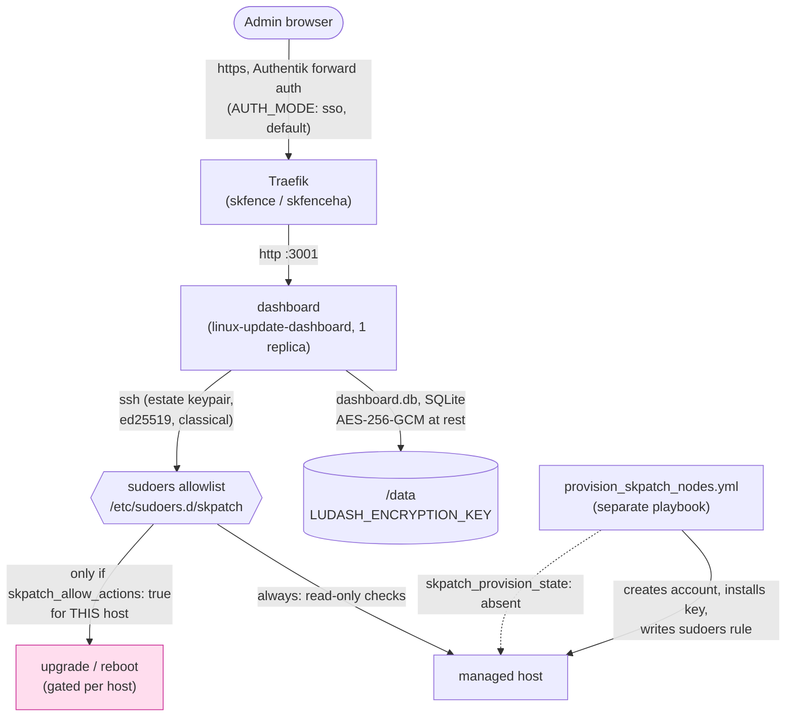

# skpatch: Standard Operating Procedures

Deploys and operates [linux-update-dashboard](https://github.com/TheDuffman85/linux-update-dashboard)
(AGPL-3.0) on the swarm: a self-hosted, SSH-driven dashboard for Linux
package updates across a fleet of hosts, report-only by default. Called
by: the operator (ad hoc deploys/provisioning today; `skflow` `f/skpatch`
flows, once built, will drive the image-patching half of the same
program; see [`docs/skpatch-program.md`](../../../../docs/skpatch-program.md)).

## 1. Overview

**Purpose.** Give an estate one place to see which of its hosts are
behind on Linux package updates, and, only where explicitly armed per
host, apply those updates and reboot, over SSH, under a tight sudoers
allowlist rather than a shared admin credential.

**Scope, what it owns.** The `dashboard` service itself (one container,
one SQLite file, `/data`), the provisioning playbook that creates the
low-privilege SSH account and sudoers rule on each target node, and the
per-estate SSH keypair that connects the two.

**What it explicitly does NOT do.**
- It does not patch container images. That is `skbom` plus Renovate, the
  other half of the [skpatch program](../../../../docs/skpatch-program.md).
- It does not grant itself privilege. `ALLOW_ACTIONS` in this role's own
  vault block is metadata; the actual grant lives in the sudoers file
  `provision_skpatch_nodes.yml` writes on the target node, controlled by
  that node's own `skpatch_allow_actions`.
- It does not back itself up. No dedicated backup CLI ships with it; see
  §5 "Backups" below for the `skbackup` integration pattern instead.
- It does not reuse an existing admin account or SSH key. One dedicated
  keypair and one dedicated low-privilege account per estate, always.

**Why this app gets more scrutiny than most.** It is designed to hold a
credential that can SSH into every host it is pointed at, and, if an
admin arms it, run privileged commands there. A compromise of this
container is a compromise of every host it has a key for. Every design
choice in this document exists to shrink that blast radius.

## 2. Architecture



**Start here:**
- [`deploy_skpatch-<env>.yml`](./): deploys the `dashboard` stack; this is where the vault's fail-closed guards live (missing encryption key, unpinned image, contradictory sign-in settings).
- [`provision_skpatch_nodes.yml`](./provision_skpatch_nodes.yml): the separate, idempotent, reversible playbook that actually grants (or revokes) SSH access and sudo rights on a target node.
- [`src/skpatch/skpatch.sudoers.j2`](./src/skpatch/skpatch.sudoers.j2): the exact-command allowlist, the actual enforcement point for "report-only unless armed", not application code.
- [`src/skpatch/deploy.j2`](./src/skpatch/deploy.j2): the compose template the swarm deploy renders.
- [`probe.yml`](./probe.yml): the post-deploy health probe (`GET /` expects `200`).

## 3. Build

Nothing is built; this role deploys an upstream image by digest (no
local build step, no Dockerfile). "Build" here means rendering the
compose template and env files from the vault:

```bash
ansible-playbook -i envs/<env>/inventory.ini \
  framework/v1/ansible/optional/skpatch/deploy_skpatch-<env>.yml \
  -e target_manager_group=swarm_managers \
  --vault-password-file ~/.vault_pass_env/.<instance>_<env>_vault_pass \
  --check --diff
```

`--check --diff` renders every template and shows what would change,
without touching the live stack, the fastest way to confirm a vault
edit produced the config you expect before deploying it for real.

## 4. Test

```bash
# Render tests (template renders correctly for every documented config shape)
python -m pytest v1/tests/test_skpatch_render.py -v

# Provisioning-playbook tests (sudoers content, account creation, the
# per-host actions-ceiling precedence rule)
python -m pytest v1/tests/test_skpatch_provision.py -v

# Repo-wide gate this role must also keep passing
python -m pytest v1/tests/test_no_latest_images.py -v
python -m pytest v1/tests/test_portal_tile_lint.py -v
```

The green-bar gate that blocks a release is the framework's own release
gate (`framework-tests.yml` plus the end-to-end harness run); nothing in
this role bypasses it.

## 5. Release / Deploy

```bash
# Deploy the dashboard
ansible-playbook -i envs/prod/inventory.ini \
  framework/v1/ansible/optional/skpatch/deploy_skpatch-prod.yml \
  -e target_manager_group=swarm_managers \
  --vault-password-file ~/.vault_pass_env/.<instance>_prod_vault_pass

# Provision (or de-provision) the nodes it should reach, before or
# after the deploy above, in either order
ansible-playbook -i envs/prod/inventory.ini \
  framework/v1/ansible/optional/skpatch/provision_skpatch_nodes.yml \
  -l <estate-inventory-group> \
  -e skpatch_provision_env=prod \
  --vault-password-file ~/.vault_pass_env/.<instance>_prod_vault_pass

# De-provision (removes the account, its home, its key and the sudoers
# file from every targeted host, cleanly)
ansible-playbook -i envs/prod/inventory.ini \
  framework/v1/ansible/optional/skpatch/provision_skpatch_nodes.yml \
  -l <estate-inventory-group> \
  -e skpatch_provision_env=prod -e skpatch_provision_state=absent \
  --vault-password-file ~/.vault_pass_env/.<instance>_prod_vault_pass
```

**Rollback.** Redeploy with the previous `skpatch.IMAGE` digest pinned in
the vault, then rerun the deploy playbook, the same path as any other
image-pinned swarm service in this framework. Credentials in
`dashboard.db` are unaffected by an image rollback (they are data, not
baked into the image).

**Backups.** Not automated by this role. `dashboard.db` is a single
SQLite file; add a plain directory-copy entry to `skbackup` on the
storage host if the instance wants tier-2 copies:

```yaml
skbackup:
  copy:
    apps:
      - name: skpatch-prod
        newest: [{dir: data, keep: 2}]
```

A copy taken while the app is writing carries the normal SQLite
consistency risk; scale the `dashboard` service to 0 first
(`docker service scale skpatch-<env>_dashboard=0`) for a guaranteed-clean
copy if that matters for a given instance.

**Front-end / Exposure** (per `UNIFIED_INGRESS_STANDARD.md`):
- **Tier:** `2 SKStacks/Traefik` (routed by skfence or skfenceha).
- **Public route:** `GET /` (the whole app; there is no separate API
  surface to carve out of forward auth, unlike a role with a mobile
  client).
- **Bind address:** published only through the Traefik ingress network;
  the `dashboard` container has no host-published port.

## 6. Configuration / Usage

`skpatch:` in `optional/group_vars/<env>/skpatch-<env>-<domain dashed>-<cluster>_vault.yml`.

```yaml
skpatch:
  LUDASH_ENCRYPTION_KEY: "<openssl rand -base64 32>"  # required, secret, >= 32 chars
  CLUSTERNAME: cluster1                     # default: inventory cluster_name
  DOMAIN: example.com                       # default: inventory domain
  CLOUDFLARED: false                        # true: default host is under DOMAIN, not CLUSTERNAME.DOMAIN
  HOSTNAME: ""                              # public host; default skpatch[-dev|-staging].<base domain>
  TRAEFIK_MIDDLEWARES: ""                   # default default-no-error-pages@file
  AUTH_MODE: sso                            # sso (Authentik forward auth, whole router) | local | oidc
  SSO_MIDDLEWARE: ""                        # sso mode: default authentik@file; must be empty in local/oidc mode
  OIDC_ISSUER: ""                           # oidc mode: required, e.g. https://<sso host>/application/o/<client id>/
  OIDC_CLIENT_ID: ""                        # oidc mode: default the router name (e.g. skpatch)
  OIDC_CLIENT_SECRET: ""                    # oidc mode: required, >= 32 chars, same value as sksso's SKPATCH_OIDC_CLIENT_SECRET
  OIDC_SCOPE: "openid profile email groups"
  OIDC_GROUPS_CLAIM: groups
  OIDC_ADMIN_GROUPS: "authentik Admins"     # CSV of Authentik group names
  OIDC_READ_ONLY_GROUPS: ""                 # CSV, default none
  OIDC_UNMATCHED_ROLE: deny                 # deny | admin | read-only
  OIDC_END_SESSION: true
  TLS_OPTIONS: ""                           # default intermediate@file; "none" = no tls.options label
  TZ: UTC
  LUDASH_LOG_LEVEL: info
  extra_env: {}                             # any other upstream app variable, verbatim into skpatch.env
  IMAGE: ""                                 # default ghcr.io/theduffman85/linux-update-dashboard:2026.10.9@sha256:1fb855a4d4b5eacc0ef3a9816064184492e9d068fb4da353c62871faeeeb1543; must carry @sha256:
  DATA_PATH: ""                             # default /var/data/skpatch-<env>/data
  DATA_NODE: ""                             # pin dashboard to this node (required with a local path)
  PLACEMENT_CONSTRAINTS: []                 # default ["node.role == worker"]
  HEALTH_CHECK_INTERVAL: 30s
  HEALTH_CHECK_TIMEOUT: 10s
  HEALTH_CHECK_RETRIES: 3
  HEALTH_CHECK_START_PERIOD: 60s
  DASHBOARD_CPUS: "0.50"
  DASHBOARD_MEMORY_LIMIT: 384M
  DASHBOARD_MEMORY_RESERVATION: 64M
  AUTHENTIK_TILE: true                      # false opts out of the portal tile
  AUTHENTIK_TILE_NAME: SKPatch              # tile title; slug/description/icon/group/open-in-new-tab below
  AUTHENTIK_TILE_SLUG: skpatch
  AUTHENTIK_TILE_DESCRIPTION: "Linux update dashboard"
  AUTHENTIK_TILE_ICON: "fa://fa-wrench"
  AUTHENTIK_TILE_GROUP: "authentik Admins"  # must already exist
  AUTHENTIK_TILE_OPEN_IN_NEW_TAB: true
  # Read by provision_skpatch_nodes.yml, not the swarm deploy:
  ALLOW_ACTIONS: false                      # instance-wide default; a host's own skpatch_allow_actions: false always wins
  PROVISION_USER: skpatch-ro                # the low-privilege account's name
  PROVISION_UID: 5201                       # its fixed uid and gid; never a system uid (containers share the host's uid space)
  SSH_PUBLIC_KEY: ""                        # required by provision_skpatch_nodes.yml; one keypair per estate
```

**Per-host actions ceiling.** In the group_vars of any host that must
stay report-only no matter what (every hypervisor, every NAS):

```yaml
skpatch_allow_actions: false
```

This beats the vault's instance-wide `ALLOW_ACTIONS: true` unconditionally;
there is no mechanism in this role to override a host's own `false` from
the vault side.

**Non-Debian hosts.** `src/skpatch/skpatch.sudoers.j2` covers apt
(Debian/Ubuntu) only. A host on another package manager needs its own
read (and, if armed, action) lines added by hand; see upstream's
sudoers-generator documentation for the dnf/pacman/apk equivalents.

## 7. API / Reference

This role exposes no API of its own; it configures the upstream app's
HTTP UI (`GET /`, health-checked by `probe.yml`) and ships two
playbooks:

| Playbook | Purpose | Key `-e` flags |
|---|---|---|
| `deploy_skpatch-<env>.yml` | Deploy/update the dashboard stack | `target_manager_group` |
| `provision_skpatch_nodes.yml` | Grant/revoke SSH access and sudo rights on target nodes | `-l <estate-group>`, `skpatch_provision_env`, `skpatch_provision_state` (`present` or `absent`) |

## 8. Troubleshooting

| Symptom | Check |
|---|---|
| Deploy fails: "LUDASH_ENCRYPTION_KEY is required" | Vault is missing the key or it is under 32 characters. Set it, re-deploy. |
| Deploy fails: image without `@sha256:` | `skpatch.IMAGE` (if overridden) must carry a digest; the role refuses a floating tag. |
| Deploy fails: contradictory sign-in settings | `AUTH_MODE: local` with `SSO_MIDDLEWARE` set, or a forward-auth middleware inside `TRAEFIK_MIDDLEWARES` in `local` mode. Pick one path (SOP §6). |
| Dashboard reachable but credentials gone after a restore | `LUDASH_ENCRYPTION_KEY` changed or was lost. Every stored credential becomes unreadable; re-enter them. |
| A node still can't be upgraded/rebooted with `ALLOW_ACTIONS: true` | Check that node's own `skpatch_allow_actions`. The vault's instance-wide flag never overrides a host-level `false`, by design. |
| Health probe (`probe.yml`) sees a non-200 behind SSO | Expected: `AUTH_MODE: sso` means the probe sees Authentik's response, not the app directly. This still proves the router and TLS path are live. |
| `provision_skpatch_nodes.yml` leaves an account on a node it shouldn't | Rerun with `-e skpatch_provision_state=absent` against that node's inventory group. It is reversible by design. |

## 9. Maturity-tier + Version reference

- **Maturity tier:** `T0, Classical`. This role generates one SSH
  ed25519 keypair per estate (`ssh-keygen`, standard OpenSSH) and relies
  on the upstream app's own AES-256-GCM at-rest encryption for its
  credential store. No hybrid-KEM, no post-quantum signature, no claim
  of either.
- **Crypto component status:** not a crypto component under
  `SK_REPO_DOC_STANDARD`'s operative definition: it operates standard
  SSH/TLS and an upstream app's own storage encryption; it does not
  implement, negotiate, or expose a cryptographic protocol to other
  systems. No separate `docs/CRYPTO_SPEC.md` is carried for that reason.
- **Version phase:** framework `v1` tree (this repo's own
  [Versions table](../../../../README.md#versions), "Published, one
  service at a time"). Current `CHANGELOG.md` line: `Unreleased
  (v2.26.17)` at the time this SOP was written.
- **CRYPTOGRAPHY_STANDARD compliance:** N/A. No suite registry, no
  negotiated primitives, no self-report command; this role has nothing
  to self-report because it does not implement a crypto surface (see
  above).

<!-- docs-evidence
     Executed by the docs-check gate (DOCS_FRESHNESS_STANDARD §1.3).
     Hermetic: repo-local, no network, no live host.
verified: 2026-11-06
checks:
  - name: deploy playbook exists
    run: test -f v1/ansible/optional/skpatch/deploy_skpatch-prod.yml
  - name: provisioning playbook exists
    run: test -f v1/ansible/optional/skpatch/provision_skpatch_nodes.yml
  - name: sudoers template exists (the real actions-gate enforcement point)
    run: test -f v1/ansible/optional/skpatch/src/skpatch/skpatch.sudoers.j2
  - name: documented default image matches the playbook's pin
    run: grep -q 'ghcr.io/theduffman85/linux-update-dashboard:2026.10.9@sha256:1fb855a4d4b5eacc0ef3a9816064184492e9d068fb4da353c62871faeeeb1543' v1/ansible/optional/skpatch/deploy_skpatch-prod.yml
  - name: ALLOW_ACTIONS default documented here matches the playbook default
    run: grep -q "ALLOW_ACTIONS.*false" v1/ansible/optional/skpatch/README.md
-->
