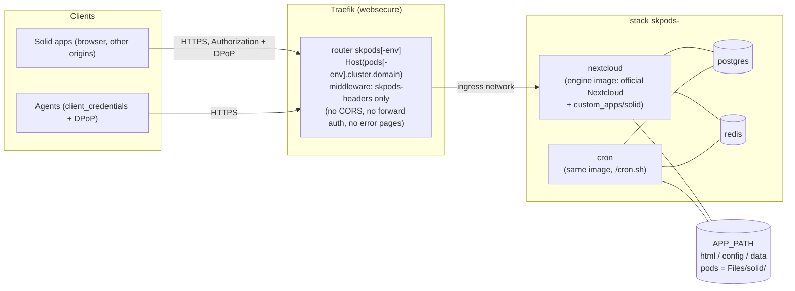
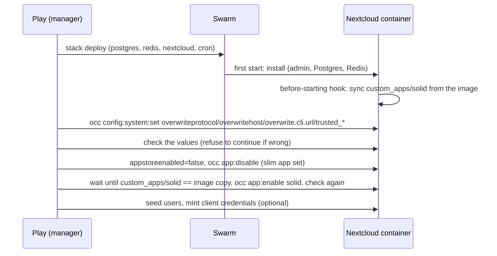

# skpods: Standard Operating Procedures

What and why: [README.md](./README.md). This file is the how, in full.

## 1. Overview

skpods hosts Solid pods. With the `nextcloud` engine each Nextcloud user is a
pod owner: WebID `https://<host>/apps/solid/~<user>/profile/card#me`, storage
`https://<host>/apps/solid/~<user>/storage/`, backed by the `solid/` folder in
the user's Files. The Nextcloud instance is its own Solid-OIDC identity
provider (`https://<host>/.well-known/openid-configuration`).

The role deploys one swarm stack, `skpods-<env>`, configures Nextcloud's
public host and proxy settings, disables the apps a pod server does not need,
enables Solid, and optionally seeds users and mints agent credentials.

## 2. Architecture



Deploy order inside the play:



## 3. Build

The role has nothing to build. The engine image is built by the instance
(README "Engine image"): official Nextcloud image pinned by digest plus the
chosen Solid app source with its composer `vendor/` tree at
`/usr/src/skpods-apps/solid`, and a `before-starting` hook that syncs it into
`custom_apps/solid`. Push it to a registry the cluster can pull from and pin
`skpods.NEXTCLOUD_IMAGE` to `repo:tag@sha256:digest`.

## 4. Test

Framework gates (from the repo root):

```bash
python -m pytest -q v1/tests
python v1/tests/render/render_playbooks.py --service skpods
```

The render gate renders every env twice: `vars/skpods.example.yml` (minimal)
and `vars/skpods.set.yml` (registry login, ingress override, data node, seed
users with client credentials).

## 5. Release / Deploy

### Hostname is permanent

Each pod's root `.acl` stores the owner's WebID as an absolute IRI the first
time the pod is used. The deploy therefore sets and checks
`overwriteprotocol=https`, `overwritehost` and `overwrite.cli.url` BEFORE it
enables Solid, and the engine env sets them from the very first container
start. Changing `HOSTNAME`/`HOST_PREFIX`, `CLUSTERNAME` or `DOMAIN` after
pods exist locks every owner out of their pod until the root ACLs are
rewritten. Treat the hostname as fixed for the life of the environment (for
a dev environment: reset all users after a change).

### Identity domain

`IDENTITY_DOMAIN` (README "Identity domain") is part of every WebID, so it is
as permanent as the hostname: set it, with `HOSTNAME: pods.<IDENTITY_DOMAIN>`,
before the first user signs in. Before the deploy: a DNS record for
`pods.<domain>` and a wildcard `*.<domain>`, and a TLS certificate for
`*.<domain>` in Traefik (or `IDENTITY_CERTRESOLVER` naming a DNS-01
resolver). Check after the deploy:

```bash
curl -s -H 'Accept: text/turtle' https://<user>.<domain>/profile/card | head
```

To turn it off, removing the setting is not enough: the engine falls back to
the stored value and keeps user hosts on (it logs a warning). Also run
`occ config:app:delete solid identityDomain` and remove the `*.<domain>`
entry from `trusted_domains`, then redeploy.

### First deploy

1. Pick the env (`dev`, `staging`, `prod`) and create the vault
   `optional/group_vars/<env>/skpods-<env>-<domain-with-dashes>-<cluster>_vault.yml`
   with at least the README minimal snippet. Private engine image: add
   `REGISTRY_LOGIN` with a read-only pull token.
2. If the cluster's Traefik is not on `cloud-public-<env>`, set
   `INGRESS_NETWORK` and `skpods_<env>_networks` (README).
3. Check mode first, then deploy:

```bash
ansible-playbook -i <inventory> framework/v1/ansible/optional/skpods/deploy_skpods-<env>.yml \
  -e target_manager_group=<managers> -e skstacks_vault_dir=<instance vault root> \
  --vault-password-file <password file> --check --diff
ansible-playbook -i <inventory> framework/v1/ansible/optional/skpods/deploy_skpods-<env>.yml \
  -e target_manager_group=<managers> -e skstacks_vault_dir=<instance vault root> \
  --vault-password-file <password file>
```

The play ends with "Check Solid discovery on the public URL", which prints
the issuer the public URL reports.

### Image update / rollback

Change `NEXTCLOUD_IMAGE` to the new (or previous) digest and rerun the
deploy. The hook syncs the app from the image on start and runs `occ upgrade`
when an app or schema upgrade is pending. Rolling back across a Nextcloud
major version is not supported by Nextcloud.

### Seed and reset

```bash
# create missing users, keep existing pods
ansible-playbook ... deploy_skpods-<env>.yml --tags seed
# wipe and recreate every resettable user (and its pod)
ansible-playbook ... deploy_skpods-<env>.yml --tags seed -e skpods_reset=true
# also reset a non-resettable user
ansible-playbook ... deploy_skpods-<env>.yml --tags seed -e skpods_reset=true -e '{"skpods_reset_users": ["keeper"]}'
```

Minted client credentials go to `CREDENTIALS_OUT` on the controller (JSON
array, 0600): `user`, `client_id`, `client_secret`, `webid`, `issuer`,
`app_password`. Move them into the instance's secret store and delete the
file.

## 6. Configuration / Usage

All knobs: README "Configuration (vault)". Using a pod:

- WebID: `https://<host>/apps/solid/~<user>/profile/card#me`
- Storage: `https://<host>/apps/solid/~<user>/storage/`
- Issuer: `https://<host>`
- Agents: `POST https://<host>/apps/solid/client-credentials` with Basic auth
  (user + Nextcloud app password) and `OCS-APIRequest: true`, body
  `{"name": "..."}`, returns `client_id` and `client_secret` bound to the
  user's WebID. Then a `client_credentials` grant at the token endpoint with
  a DPoP proof gives a DPoP-bound access token (one hour). Revoke with
  `DELETE /apps/solid/client-credentials/<client_id>`.
- Sharing is WAC: an owner writes `.acl` resources granting another WebID
  read, write or append.

## 7. API / Reference

Endpoints that must reach Nextcloud unchanged (no auth middleware, no CORS
rewrite, `OPTIONS` allowed): `/.well-known/openid-configuration`,
`/.well-known/solid`, `/apps/solid/{authorize,token,register,jwks,userinfo,logout}`,
`/apps/solid/~*/profile/*`, `/apps/solid/~*/storage/*`,
`/apps/solid/client-credentials`.

Useful checks:

```bash
H=pods-<env>.<cluster>.<domain>
curl -s https://$H/.well-known/openid-configuration | python3 -m json.tool | grep issuer
curl -s -H 'Accept: text/turtle' https://$H/apps/solid/~<user>/profile/card | head
curl -si -X OPTIONS -H 'Origin: https://app.example.org' \
  -H 'Access-Control-Request-Method: GET' https://$H/apps/solid/~<user>/storage/ | grep -i access-control
```

## 8. Troubleshooting

| Symptom | Cause / fix |
|---|---|
| Play stops at "Check the public host and protocol before enabling Solid" | config.php disagrees with the vault host. Fix the vault or config.php; do not enable Solid until it matches. |
| "the image has no /usr/src/skpods-apps/solid" | `NEXTCLOUD_IMAGE` is a plain Nextcloud image, not an engine image. |
| "custom_apps/solid differs from the copy in the engine image" | Something else wrote the app (an app-store download, a manual copy). `docker service update --force skpods-<env>_nextcloud` resyncs it from the image; rerun the deploy. |
| Image pull fails (`no basic auth credentials`, `denied`) | Private image: set `REGISTRY_LOGIN`; the deploy passes `--with-registry-auth`. |
| WebID or storage IRIs start with `http://` | `overwriteprotocol` missing; rerun the deploy (it sets it). Pods first used while it was wrong need their root `.acl` fixed. |
| Owner gets `403` on their own pod after a hostname change | See "Hostname is permanent": reset the user (dev) or rewrite the root `.acl`. |
| Solid app login fails with CORS errors | A proxy middleware is adding `Access-Control-*`; keep `MIDDLEWARES` to the role default. |
| `404` from Traefik | Router not on the ingress Traefik watches: check `INGRESS_NETWORK`. |
| Play stops at "Check the identity domain" | `IDENTITY_DOMAIN` is not a lowercase hostname, or `HOSTNAME` is not `pods.<IDENTITY_DOMAIN>`. |
| `https://<user>.<domain>` gives a certificate error | Traefik has no certificate for `*.<domain>`: add one, or set `IDENTITY_CERTRESOLVER` to a DNS-01 resolver. |
| Nextcloud shows "Update needed" | Run the deploy again (or `occ upgrade` in the container); the start hook normally does it. |

Logs: `docker service logs skpods-<env>_nextcloud`, `docker exec -u www-data
<container> php occ log:tail`.

## 9. Maturity-tier + Version reference

- Tier: new (dev first). Engine `nextcloud` on Nextcloud 35, Postgres 17,
  Redis 8.
- The Solid app on Nextcloud is not a spec-complete Solid server (the Solid
  conformance suite does not pass in full); owner read/write, WAC grants and
  public read work. Validate apps against it before relying on edge cases.
- Planned: a `rust` engine behind the same `ENGINE` setting, switched only
  after it passes the same tests.
