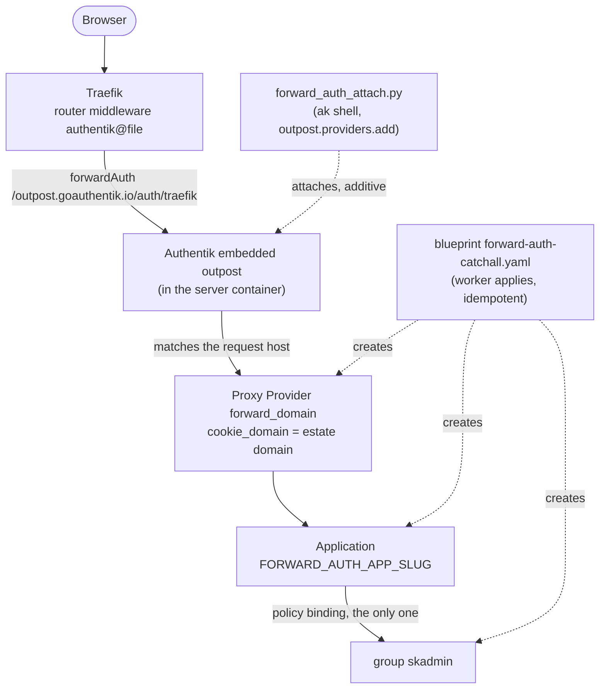

# sksso: Standard Operating Procedures (forward-auth catch-all)

This SOP covers the part of sksso that gates every service routed through the `authentik@file` Traefik
middleware: the domain-wide `forward_domain` Proxy Provider, its Application, the policy binding that closes
it to the admin group, and its attachment to the embedded outpost. The rest of the role (the Authentik stack,
branding, CapAuth, the per-app OIDC blueprints) is in the [README](README.md). Called by: the operator, from
the sksso deploy playbooks (`deploy_sksso-<env>.yml`). Design background:
[`docs/design/sso-app-access-provisioning.md`](../../../../docs/design/sso-app-access-provisioning.md)
(sections 2.3 and 4.7).

## 1. Overview

**Purpose.** Make a fresh estate's SSO gate work and be closed on the first deploy. `authentik@file`
(shipped by `core/skfenceha`) forwards each request to the Authentik embedded outpost, which authorises it
against the Application of the provider that matches the host. Without a catch-all provider the outpost
matches nothing (apps unreachable); with a hand-made one that has no policy binding it admits every
Authentik account.

**Scope, what it owns.** One group (existence only), one `forward_domain` Proxy Provider, one Application,
one policy binding to the admin group, the additive attach of the provider to the embedded outpost, and the
read-only check that the catch-all is in the state described here (`check-access.py`, C7).

**What it explicitly does NOT do.**
- It never binds anyone but the admin group. There is no "any authenticated user" setting.
- It never adds members to the admin group. A new estate's catch-all admits nobody until an admin account
  is added to `skadmin` (fail closed).
- It never removes a binding, a provider, an Application or an outpost attachment. Opting out leaves them.
- It never creates a second catch-all beside an existing one: the preflight refuses the deploy first.
- It does not create per-app providers. An app that is not admin-only gets its own (design, section 4.7).

## 2. Architecture



Two mechanisms on purpose. The blueprint owns the objects (matched by name and slug, so an existing object
is adopted, never duplicated). The attach is a separate ORM step because an outpost's `providers` is a
many-to-many field that the blueprint importer saves as a full replacement set: a blueprint entry for the
outpost would detach every other provider on it.

## 3. Build

Nothing to build. Files: `src/config/sksso/blueprints/forward-auth-catchall.yaml.j2` (the blueprint),
`tasks/forward_auth_blueprint.yml` (settings, refusals, the preflight, render, opt-out cleanup),
`src/sksso/forward_auth_preflight.py` (the read-only preflight),
`tasks/forward_auth_attach.yml` and `src/sksso/forward_auth_attach.py` (the additive attach), and the
`/blueprints/custom` mount in `src/config/sksso/sksso.yml.j2`.

## 4. Test

```bash
python3 -m pytest v1/tests/test_sksso_forward_auth_catchall.py v1/tests/test_sksso_check_access.py -q
python3 v1/tests/render/render_playbooks.py --service sksso      # real Ansible, 3 envs x 2 passes
```

The tests cover: on by default; opt-out renders nothing and removes a stale file; adoption names; the cookie
domain derivation and override; the admin-group-only binding; the refusals; the preflight script against a fake
Authentik ORM (refuses a provider under another name, passes the configured name or none) and its ordering
(before the render, skipped on opt-out); the attach script against a fake
Authentik ORM (additive, idempotent, refuses a widened Application, a twin provider, a wrong outpost); and
the C7 findings of `check-access.py`.

## 5. Release / Deploy

### New estate

1. Deploy sksso as usual. The blueprint is rendered and mounted, the stack comes up, the worker applies the
   blueprint, and the attach step waits for it (up to 5 minutes) and attaches the provider.
2. Add the admin accounts to the group `skadmin` in Authentik. Until you do, nobody passes the catch-all.
3. Run the access check (section 8) and confirm no C7 line.

### Existing estate with a hand-made catch-all (do this BEFORE redeploying sksso)

1. In the Authentik admin UI, note the catch-all provider's **name** and its application's **slug**, and its
   cookie domain.
2. In the sksso vault set `FORWARD_AUTH_PROVIDER_NAME` and `FORWARD_AUTH_APP_SLUG` to them, and
   `FORWARD_AUTH_COOKIE_DOMAIN` and `FORWARD_AUTH_SSO_HOST` if they differ from the derived values (see the
   table in section 6). Or set `FORWARD_AUTH_ENABLED: false` to keep managing it by hand.
3. Redeploy sksso. The blueprint updates the adopted objects to the resolved mode, `external_host`,
   `cookie_domain`, flows and the admin-group binding. It does not change the policy engine mode or remove
   other bindings.
4. Confirm the binding: the attach step refuses (and fails the deploy) if the Application is bound to anything
   but the admin group, and names what. Remove the stray bindings in Authentik, then deploy again. Run
   `check-access.py --who-passes <slug>` to see who passes before and after.

Skipping step 2 on such an estate no longer creates a second catch-all next to the hand-made one: before the
blueprint is rendered, a read-only preflight (`ak shell` in the running server container, nothing edited)
finds a `forward_domain` provider under another name whose cookie domain overlaps the configured one, and
fails the deploy naming it and the settings to change (step 2). Nothing is rendered, so the worker has nothing
to apply, and a blueprint rendered by an earlier run is removed. With no running server (a first install) the
preflight is skipped. The hand-made one keeps serving throughout. The attach step keeps the same refusal as a
second line of defence.

### Rollback

`FORWARD_AUTH_ENABLED: false` and redeploy removes the blueprint file and attaches nothing. Objects already in
Authentik stay. To remove the gate itself, detach the provider from the outpost, then delete the provider,
application and binding in the admin UI. Requests behind `authentik@file` are denied while no provider
matches, so do that only when no route still uses the middleware.

## 6. Configuration / Usage

All knobs live in the sksso vault, all are optional.

| Knob | Default | Meaning |
|---|---|---|
| `FORWARD_AUTH_ENABLED` | `true` | `false` opts out. Only true/false spellings are accepted. |
| `FORWARD_AUTH_PROVIDER_NAME` | `SKStacks forward auth (domain)` | Provider name (identifier). Existing name = adopt. |
| `FORWARD_AUTH_APP_SLUG` | `skstacks-forward-auth` | Application slug (identifier). Existing slug = adopt. |
| `FORWARD_AUTH_APP_NAME` | `SKStacks forward auth (admin-only apps)` | Application display name. |
| `FORWARD_AUTH_SSO_HOST` | `sso[-<env>].<base>`, or `CAPAUTH_SSO_HOST` when set | `external_host` is `https://<it>`. |
| `FORWARD_AUTH_COOKIE_DOMAIN` | `<base>` (`<CLUSTERNAME>.<DOMAIN>`, or `<DOMAIN>` with `CLOUDFLARED`) | Cookie domain; the SSO host must sit under it. |
| `FORWARD_AUTH_ADMIN_GROUP` | `skadmin` | The one bound group. Never `skuser`. |
| `FORWARD_AUTH_OUTPOST` | `authentik Embedded Outpost` | Outpost to attach to. |

Refused before anything is rendered: `FORWARD_AUTH_ENABLED: false` together with any other `FORWARD_AUTH_*`
knob; an unreadable `FORWARD_AUTH_ENABLED`; a cookie domain that is not multi-label or that the SSO host is not
under; `FORWARD_AUTH_ADMIN_GROUP: skuser`; a malformed slug or host; the app slug equal to the skgit OIDC client
id while `SKGIT_OIDC_ENABLED` is on.

## 7. API / Reference

- Rendered file: `/var/data/config/sksso-<env>/blueprints/forward-auth-catchall.yaml` (0644, no secret).
- Authentik objects: `authentik_core.group`, `authentik_providers_proxy.proxyprovider`,
  `authentik_core.application`, `authentik_policies.policybinding` (identifiers: provider by name, application
  by slug, group by name, binding by target plus group plus order 0).
- Preflight status lines (`forward_auth_preflight.py`, run before the render): `preflight: ok`,
  `preflight: skipped` (no server container yet), `preflight: refused ...` (never retried, the deploy fails
  before anything is rendered), `preflight: waiting ...` (no answer from `ak shell`, retried, then fails).
- Attach status lines (`forward_auth_attach.py`, last line): `attach: ok` (attached, or already attached),
  `attach: waiting ...` (blueprint not applied yet, retried), `attach: refused ...` (never retried, the deploy
  fails and nothing is attached).
- Check: `src/sksso/check-access.py`, C7 findings for the catch-all (missing, unbound, bound to more than the
  admin group, on no outpost).

## 8. Troubleshooting

- **Deploy fails at "Fail before rendering when the preflight did not pass".** Read the `preflight:` lines
  above it. `refused (Authentik already has a domain-wide provider ...)`: the line names the existing provider
  and its application slug; set `FORWARD_AUTH_PROVIDER_NAME` and `FORWARD_AUTH_APP_SLUG` to them (adopt), or
  `FORWARD_AUTH_ENABLED: false`. No `preflight:` line, or `waiting`: the running Authentik server did not
  answer `ak shell` (still starting, or unhealthy); deploy again once `docker service ps sksso-<env>_server`
  shows it running. Nothing was rendered or changed in Authentik.
- **Deploy fails at "Fail unless the forward-auth provider is on the embedded outpost".** Read the `attach:`
  lines above it. `refused (... bound to more than the admin group ...)`: remove those bindings in Authentik.
  `refused (another domain-wide provider ...)`: adopt it (set the two names) or opt out. `refused (no outpost
  named ...)`: set `FORWARD_AUTH_OUTPOST`. Still `waiting` after 5 minutes: check the worker logs for blueprint
  errors (`docker service logs sksso-<env>_worker`); the file is under `/blueprints/custom`.
- **Everything behind `authentik@file` returns 401/403 for admins.** The admin group has no members, or the
  user is not in it: add them to `FORWARD_AUTH_ADMIN_GROUP`.
- **A browser loops on sign-in.** The cookie domain does not cover the app's host; widen
  `FORWARD_AUTH_COOKIE_DOMAIN`.
- **Run the check:** token on stdin, no command-line token:
  `... | python3 src/sksso/check-access.py --url https://<sso host>`. A C7 line says what is wrong.

## 9. Maturity-tier + Version reference

Added in v2.26.32. Authentik compatibility: the blueprint works on the framework's default image (2024.4.2)
and on current releases. `invalidation_flow` (Authentik 2024.10 and later, required there) is sent only when the
resolved image tag is 2024.10 or newer, or is not a version (a digest pin); an older tag gets a provider
without it, as that field does not exist there. `meta_hide` and the `authentik_policies.policybinding`
identifier set are the same ones the skaegis blueprint uses. The attach script uses the Django ORM models
`Outpost`, `ProxyProvider`, `Application` and `PolicyBinding` under `ak shell`.
