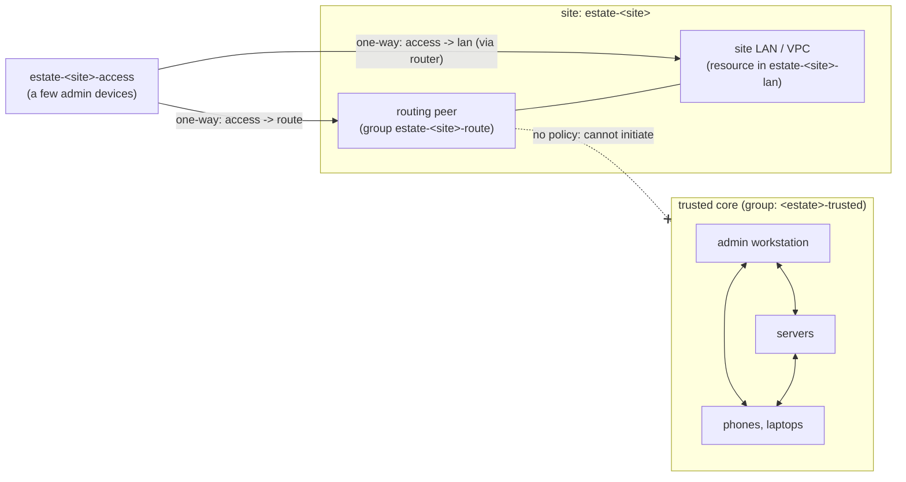

# Pattern: skmesh site isolation (trusted core, one-way sites)

**Layer:** cloud / skmesh (NetBird) · **Status:** in production on a multi-site estate since 2026-11 ·
**Applies to:** any skmesh deployment that joins machines you do not fully trust
(a cloud VM, a relative's house, a client office, a lab).

## Problem

A fresh NetBird account ships a `Default` policy: every peer may reach every peer,
on every port, in both directions. That is fine while the mesh is only your own
laptops and servers. It stops being fine the moment you add:

- an **internet-facing VM** (cloud host, VPS): if it is compromised, the attacker
  is now inside your mesh;
- a **remote site** you administer but do not control (family, client): their
  malware, their guests and their IoT devices should not see your network;
- a **routed LAN** behind one of those peers.

Host firewalls on the untrusted machine help, but anyone with root on that machine
can switch them off. The control has to live in the mesh, where the untrusted side
has no write access.

## Shape



Three rules make it work:

1. **Disable `Default`** (keep it, disabled, as an instant rollback). Replace it with
   a named group for the devices you own and one bidirectional accept policy inside
   that group. Day one behaviour for owned devices does not change.
2. **Every outside machine is a site**, never a member of the trusted group. A site is
   three groups (`-route`, `-access`, `-lan`) and two accept policies whose source is
   the access group and which are **not bidirectional**. NetBird's firewall is
   stateful, so replies flow back, but the site side cannot open a connection.
3. **Isolation comes from the absence of an accept, never from a drop.** A drop
   policy from the site to the core also drops the replies to connections the core
   opened, which breaks admin access to the site. Use no drop rules.

The result: an untrusted peer receives WireGuard keys only for the peers in its
access group (`netbird status` on it lists just those), and even to those it can
only answer.

## Recipe

Names are examples; keep the `estate-<site>-*` convention so policies sort together.

1. **Inventory.** Snapshot `GET /api/{peers,groups,policies,routes,networks,setup-keys,dns/nameservers}`
   to a dated, private directory. This is the rollback.
2. **Trusted group.** Create `<estate>-trusted` with every owned peer. Create policy
   `<estate>-trusted-internal`: accept, all protocols, bidirectional, group to itself.
3. **Baseline probe.** From an admin device, check ssh/ping/DNS to a sample of
   servers, each routed network, and each site. Save the script; you will rerun it.
4. **Disable `Default`** (`PUT /api/policies/<id>` with `enabled: false`). Wait for
   propagation (seconds) and rerun the probe. Any failure: re-enable and look for
   the peer you left out of the trusted group.
5. **Per site:**
   - groups `estate-<site>-route`, `estate-<site>-access`, `estate-<site>-lan`;
   - a one-off setup key, short expiry, auto-group `estate-<site>-route`;
   - policy `estate-<site>-admin`: access -> route, not bidirectional (narrow to the
     ports you use once you know them);
   - a NetBird **Network** `estate-<site>`: resource = the site CIDR in
     `estate-<site>-lan`, router = peer group `estate-<site>-route`, masquerade on;
   - policy `estate-<site>-lan-access`: access -> lan, not bidirectional.
6. **Prove isolation from the site side.** On the site's routing peer, try TCP and
   ICMP to a trusted server and to an access device. All must fail. Check
   `GET /api/peers/<id>/accessible-peers` lists only the access group.
7. **Defence in depth (optional, recommended for internet-facing peers).** A host
   rule that rejects new outbound connections on the mesh interface, including
   from containers:

   ```sh
   for t in iptables ip6tables; do
     for chain in OUTPUT DOCKER-USER; do
       $t -N "$chain" 2>/dev/null || true
       $t -C "$chain" -o wt0 -m conntrack --ctstate NEW -j REJECT 2>/dev/null ||
         $t -I "$chain" 1 -o wt0 -m conntrack --ctstate NEW -j REJECT
     done
   done
   ```

   Run it from a oneshot systemd unit ordered after the firewall, docker and
   netbird. The mesh policy covers a compromised host; the host rule covers a policy
   mistake.

## Site types

| Site | Routing peer | Notes |
|---|---|---|
| Cloud VM / VPC | the VM itself (Linux) | Close public ssh at the provider; mesh-only ssh on a non-default port. Security lists are stateful, so only the WireGuard UDP port needs to be open inbound. |
| Remote home | an always-on desktop (Windows works: masquerade is forced, forwarding is userspace) | Renumber the site LAN first if it overlaps yours. Reaching the routing peer's own LAN IP needs local forwarding enabled on that peer. |
| Partner estate (its own NetBird) | a gateway on each side with a plain WireGuard link | Keep it a separate mesh; route only the CIDRs you need, gated by an access group. |

## Operating it

- **New owned device:** add it to the trusted group (or give its setup key that
  auto-group). Until then it reaches nothing, which is the safe default.
- **New outside device:** never the trusted group. Give it a site.
- **CIDR plan:** keep one table of site CIDRs; no two sites may overlap each other
  or the core LAN.
- **Known NetBird behaviours (0.8x):** a policy holds one rule in the dashboard; a
  routing peer occasionally needs its route or router PUT again unchanged before a
  new policy reaches it.
- **Visibility:** self-hosted NetBird has no traffic-events API; flow monitoring is
  a separate component (export flows from each routing peer to a collector).

## Rollback

Re-enable `Default`. Nothing else needs to be undone: the trusted group and site
policies are additive.
