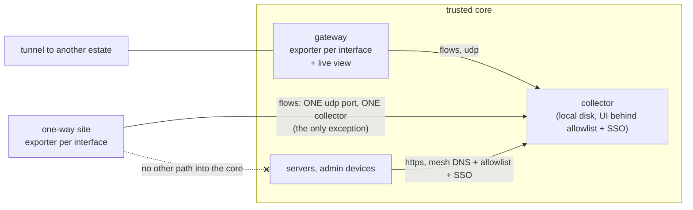

# Pattern: flow visibility across mesh hops (sknet)

**Layer:** cloud / skmesh + compute / sknet · **Status:** implemented as the v1 role `sknet` ·
**Applies to:** any estate with a gateway, an overlay mesh and sites you do not fully trust,
where you want to see who talks to whom across those hops.

See also [skmesh site isolation](skmesh-site-isolation.md), which defines the trusted core and
one-way sites this pattern is designed to fit, and the role itself:
[`v1/ansible/optional/sknet`](../../../v1/ansible/optional/sknet/README.md).

## Problem

Once a mesh is locked down to a trusted core with one-way sites, you lose the easy answer to
"what is that traffic?". The firewall logs show drops, not conversations. Each hop (the LAN, the
mesh, a tunnel to another estate, a cloud VM's public interface) sees a different slice, and
the obvious fix, letting every site reach a monitoring server, undoes the isolation you just built.

You want three things at once:

- a history of flows across all hops, in one place;
- a live view of the hop that matters most (usually the gateway);
- no new path from an untrusted site into the core, beyond the smallest one that works.

## Shape

Four rules make it work:

1. **The collector lives in the trusted core.** It holds a record of every conversation. Put it on a
   node you trust, with data on local disk (never shared storage), a retention you set and a disk
   budget it checks. It receives; it never reaches out.
2. **One exporter per hop that matters, one instance per interface.** Export from the gateway's LAN,
   mesh and tunnel interfaces, and from each site's mesh and public interfaces. Give every
   interface a stable name, a forced index and a class (`lan`, `mesh`, `estate-link`, `internet`) so
   the UI shows names and knows inside from outside. Identify an exporter by its source address
   and allow only listed addresses to send.
3. **The telemetry exception for one-way sites is one UDP port to one collector.** See below.
4. **Web access is mesh-only by two layers plus sign-in.** Mesh DNS publishes the UI names only to
   the trusted group; an address allowlist enforces who may connect; SSO says who they are.

## The telemetry exception

A one-way site cannot open connections into the core. Flow export is a connection from the site to
the collector, so it needs exactly one carve-out:

| What | Value |
|---|---|
| Protocol and port | UDP, the NetFlow port (2055 by default). Not 4739 or anything else unless you use it. |
| Destination | one collector, a mesh group that contains only that host |
| Direction | site to collector only; the policy is not bidirectional |
| Mesh | one accept policy from the site's routing group to the collector group |
| Host | one ACCEPT ahead of the egress REJECT on the site host (`-o <mesh iface> -d <collector mesh address> -p udp --dport 2055`), in `OUTPUT` and, for containers, `DOCKER-USER` |

Both halves are needed: the mesh policy covers a compromised site host, the host rule covers a
policy mistake, and removing either blocks the flows. Nothing else changes. After adding it,
**rerun the isolation proof** from the site side: every connection except UDP 2055 to the
collector must still fail. UDP needs no reply, so the one-way policy does not hurt.

Do not widen it: no second port, no second destination, no return path, no "management" extras.
If someone needs more from the site, that is a different, deliberate decision.

## Mesh-only web access

- **DNS split.** A mesh DNS zone for exactly the UI names (for example `sknet.example.com` and
  `sknet-live.example.com`) pointing at the mesh address of an ingress node, distributed to the
  trusted group only. Devices outside the group fall back to public DNS.
- **Allowlist.** The ingress lists the LAN and mesh ranges and refuses everything else with 403
  before sign-in. It must judge the real client address: host-mode ingress, no NAT, tunnel or proxy
  in front. Otherwise rely on SSO as the gate and do not use an allowlist-only mode.
- **Header trust.** Flow consoles typically trust a login header set by the SSO proxy. Keep the
  network between proxy and console private and publish only the router.

## The double-count caveat

An exporter such as softflowd observes one interface per instance and reports one interface index
as both input and output. A flow forwarded between two monitored interfaces on one host is seen
twice, once per interface. So:

- always group and filter by **exporter and interface**;
- never add interfaces of one exporter together;
- a flow that crosses two exporters appears once per exporter.

Per interface the numbers are right. Summed across interfaces they are not.

## Sizing and retention

Flow rows compress to roughly 100 to 150 bytes. `GB per day = flows per second x 86400 x ~125 / 1e9`:
100 flows/s is about 1 to 1.5 GB a day. Set the raw retention so it fits the disk budget, keep a
free-space floor so the store stops writing before the disk fills, and decide retention before the
first start (partition sizes are derived from it).

## Recipe

1. Place the collector in the core, on local disk; set the disk budget and free-space floor.
2. List every exporter address in the collector's allowlist; build interface metadata (name, index, class) per exporter.
3. Install an exporter on the gateway and on each hop host, one instance per interface.
4. For each one-way site, add the telemetry exception (policy and host rule) and re-prove isolation.
5. Publish the UI names through mesh DNS to the trusted group; set the ingress allowlist and SSO.
6. Optionally add a live packet view on the gateway, memory-capped, bound to one private address.
7. Check: the UI shows each exporter by name with named interfaces; a request from outside the allowed
   ranges gets 403; the site cannot reach anything except UDP 2055 to the collector.

## In this framework

The v1 role [`sknet`](../../../v1/ansible/optional/sknet/README.md) implements it with Akvorado
(collector and console), softflowd (exporters) and ntopng Community (live view). See the
[service page](../services/sknet.md).

## Rollback

Remove the exporters (`sknet_state: absent`), the stack and the mesh policy plus host ACCEPT. The
isolation model is unchanged by the exception, so nothing else needs to be undone.
