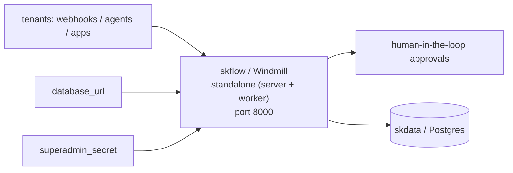

# skflow: Automation / workflow, visual and code-first agent + human-in-loop pipelines

✅ **deploy-ready** · layer: compute · version 1.837.0 · scope `skflow`

## Capability / Provider
- **Capability:** Automation / workflow, visual and code-first agent + human-in-loop pipelines
- **Provider:** Windmill (AGPLv3, OSI-open, code-first; visual + scripts). RATIFIED 2026-06-11.
- **Alternates:** Activepieces (MIT, permissive visual builder); Temporal (durable workflows at scale); n8n (fair-code / non-OSI, optional, license-flagged; large node ecosystem)
- **Platforms:** docker-swarm, kubernetes
- **Production path today:** the v1 role [`v1/ansible/optional/skflow`](../../../v1/ansible/optional/skflow/README.md) (server, workers, own Postgres + dump sidecar or an external database). This v2 descriptor runs Windmill in standalone mode against skdata.

## Topology

## Secrets

| key | rotation_days | required | description |
|-----|---------------|----------|-------------|
| `database_url` | 90 | yes | Postgres URL for Windmill; carries the DB password (sensitive) |
| `superadmin_secret` | 365 | no | Windmill `SUPERADMIN_SECRET` bearer token for bootstrap automation (sensitive) |

The renderer injects each key UPPERCASE (`DATABASE_URL`, `SUPERADMIN_SECRET`), which are the variables Windmill reads.

## Config
`LOG_LEVEL=INFO` · `DOMAIN=${SKSTACKS_DOMAIN}` · `CLUSTER=${SKSTACKS_CLUSTER}` · `MODE=standalone` · `BASE_URL=https://skflow.${SKSTACKS_DOMAIN}` · `DISABLE_NSJAIL=true`

## Deploy
- **Container/image:** `skflow` / `ghcr.io/windmill-labs/windmill:1.837.0@sha256:661aa3e3...6a74`
- **Ports:** `8000:8000`
- **Volumes:** `skflow-cache:/tmp/windmill/cache`, `skflow-logs:/tmp/windmill/logs`
- **HA/replicas:** 1 (scale workers in the v1 role)
- **Healthcheck:** `curl http://127.0.0.1:8000/api/version` (30s/5s/3)

Renders to **both** Swarm compose and K8s manifests via `skrender`.

## Dependencies
- **depends_on:** `skdata`
- **required_by:** none declared
