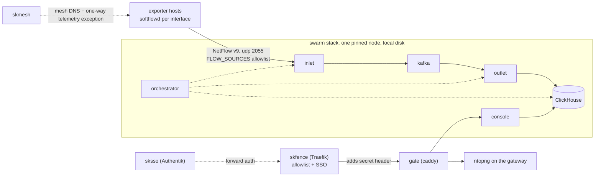

# sknet: network flow visibility

**Status:** v1 role only (`v1/ansible/optional/sknet`), documented here for the 4C capability map. There is no v2 `app.yaml` descriptor and no v2 `deploy:` block yet, so sknet is not counted in the descriptor totals of the [service catalog](README.md). Layer: compute · scope `sknet`.

## Capability / Provider
- **Capability:** Network flow visibility: who talks to whom, over which interface, with history and a live view.
- **Provider:** Akvorado (flow collector and console, AGPL-3.0) with softflowd exporters and an optional ntopng Community live view (GPLv3). Upstream images are used unchanged.
- **Alternates considered:** ntopng alone (live capture only, no NetFlow without a commercial collector), Grafana-based flow dashboards (no purpose-built flow UI).
- **Platforms:** docker-swarm (collector stack), bare-metal hosts (exporters, live view).

## Topology

## Secrets
`GATE_SECRET` (required): a random string of 32 or more characters that Traefik sends as the `X-Sknet-Gate` header and the gate requires. Nothing else: the console takes its login from the SSO proxy headers, and the exporters and collector exchange only flow records.

## Config
`DATA_NODE` (required) · `GATE_SECRET` (required) · `DATA_DIR=/var/lib/sknet-<env>` · `FLOW_SOURCES` (required) · `ALLOW_CIDRS` · `AUTH_MODE=authentik` · `NETFLOW_PORT=2055` · `IPFIX_PORT=4739` · `FLOW_TTL_DAYS=30` · `FLOW_AGG_TTL_DAYS=90` · `DISK_BUDGET_GB=20` · `MIN_FREE_GB=5` · `LIVE_UPSTREAM` (unset: no live view). Full table: [role README](../../../v1/ansible/optional/sknet/README.md#configuration-vault).

## Dependencies
- **depends_on:** skfence (Traefik ingress), sksso (forward auth and portal tile), a swarm node with AVX2 and local disk
- **optional:** skmesh (mesh-only access and one-way sites)
- **required_by:** none declared

## Patterns and docs
- [Flow visibility across mesh hops](../patterns/sknet-flow-visibility.md): collector placement, one exporter per hop, the one-way telemetry exception, the double-count caveat.
- Role docs: [README](../../../v1/ansible/optional/sknet/README.md), [SOP](../../../v1/ansible/optional/sknet/SOP.md), and the [product site](https://sknet.skworld.io).
- Related: [skmesh](skmesh.md), [skmon](skmon.md).
